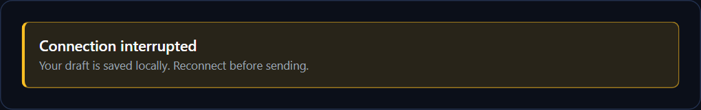
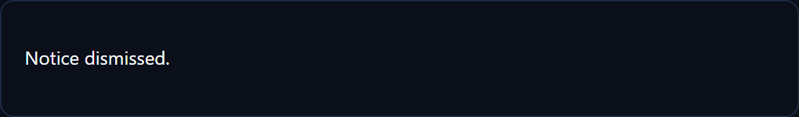
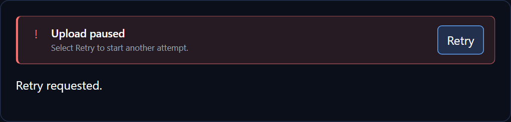

# q-alert

`q-alert` shows an inline contextual message with optional actions and application-controlled dismissal.

**Component tag:** `<q-alert>`

**Working preview:** Run `bun start` at the repository root, open the [playground](http://localhost:3333) and select **Communication → Alert**.

**On this page**

- [Quick start](#quick-start)
- [Examples](#examples)
- [Behavior & accessibility](#behavior--accessibility)
- [Styling](#styling)
- [API reference](#api-reference)

## Quick start

1. Follow the central [installation instructions](../../README.md#1-install-library).
2. In your application entry file, register WebQuark. This assumes a bundler that resolves package imports and CSS imports.

```javascript
import '@webquark/browser/dist/webquark/webquark.css';
import { defineCustomElements } from '@webquark/browser/loader';
defineCustomElements();
```

3. Add this markup to your application page. Any module script runs after that shared setup.

```html
<q-alert heading="Changes saved" variant="success">Your profile is up to date.</q-alert>
```

**Result:** a green success message with a heading and body.

### At a glance

| Capability | Options | Default |
| :--- | :--- | :--- |
| [Appearance](#variants) | info, success, warning, danger | info |
| [Content](#slots) | Heading, message, icon and actions | Empty |
| [Dismissal](#state-and-interaction) | Optional button emitting qDismiss | Off; application removes it |
| [Announcements](#labels-and-announcements) | off, polite, assertive | off |

**With no properties:** An empty informational surface renders, with no heading, icon, action, dismiss button, or live-region announcement. Supply message content.

## Examples

These examples share the [Quick start registration](#quick-start). Screenshots show the real registered component in a temporary preview fixture using the existing playground runtime.

### Explain a recoverable problem

Use a warning message with a heading that explains what needs attention.



```html
<q-alert heading="Connection interrupted" variant="warning">Your draft is saved locally. Reconnect before sending.</q-alert>
```

### Handle a dismissal request

Remove the alert when the user activates its dismiss button.



```html
<q-alert id="notice" dismissible heading="Import complete">All records are available.</q-alert>
<p id="notice-result" role="status"></p>
<script type="module">
const notice = document.querySelector('#notice');
notice.addEventListener('qDismiss', () => {
  notice.remove();
  document.querySelector('#notice-result').textContent = 'Notice dismissed.';
});
</script>
```

The screenshot shows the result after selecting Dismiss alert. Without this listener, qDismiss leaves the alert visible.

### Offer a recovery action

Use the actions slot for an application-owned control.



```html
<q-alert variant="danger" heading="Upload paused" announcement="polite">
  <span slot="icon">!</span>
  Select Retry to start another attempt.
  <button slot="actions" id="retry" type="button">Retry</button>
</q-alert>
<p id="retry-result" role="status"></p>
<script type="module">
document.querySelector('#retry').addEventListener('click', () => {
  document.querySelector('#retry-result').textContent = 'Retry requested.';
});
</script>
```

The screenshot follows Retry. The application owns the actual upload; the icon slot is decorative.

## Behavior & accessibility

### State and interaction

The application supplies content and owns dismissal. Activating the dismiss button emits `qDismiss` but does not hide, remove, or reset the element. Changing `variant` changes colors only. Named-slot visibility updates when assigned content changes.

Boolean `dismissible` can be enabled with a bare attribute; remove the attribute or set the JavaScript property to `false` to disable it. There is no automatic timeout.

### Keyboard and focus

| Key | Action |
| :--- | :--- |
| Tab / Shift+Tab | Move through dismiss and slotted controls in normal document order. |
| Enter / Space | Activate a focused native button. |

### Labels and announcements

| announcement | Role | Live-region attributes |
| :--- | :--- | :--- |
| `off` (default) | None | No aria-live or aria-atomic |
| `polite` | `status` | aria-live="polite", aria-atomic="true" |
| `assertive` | `alert` | aria-live="assertive", aria-atomic="true" |

The heading is visual text, not an HTML heading element. The icon region is always `aria-hidden="true"`; put essential status in text. `dismissLabel` names the native button; blank/whitespace text falls back to “Dismiss alert.” A screenshot cannot demonstrate a screen-reader announcement.

### Limitations and compatibility

Use only supported announcement values: an unknown value has no role/live attribute but still gets `aria-atomic="true"`. Unknown variants retain the info accent. Actions wrap below the message at viewport widths of 480 px or less. The component defines no animation.

## Styling

### Variants

| variant | Appearance / use |
| :--- | :--- |
| `info` (default) | Primary accent for contextual information |
| `success` | Success accent for a completed result |
| `warning` | Warning accent for something needing attention |
| `danger` | Danger accent for an error |

### Custom styling

Scope CSS to the host or supplied content. See the exact [CSS variables](#css-variables) and [Shadow Parts](#shadow-parts).

```html
<q-alert class="notice" heading="Saved">Your draft is available.</q-alert>
<style>
  q-alert.notice { --q-alert-padding: 16px; --q-alert-radius: 12px; }
</style>
```

Shared geometry and theme setup are documented in [Foundation](../foundation.md) and [theme tokens](../theme-tokens.md).

## API reference

Cross-check the [generated API](../../src/browser/components/communication/alert/readme.md) and [implementation](../../src/browser/components/communication/alert/alert.tsx). Source nullability and actual rendering limitations are preserved below.

### Properties

All properties are optional and listed alphabetically.

| Name | Default | Description |
| :--- | :--- | :--- |
| `announcement` | `'off'` | Controls announcement semantics; use off, polite, or assertive.<br>**Type:** `"assertive" \| "off" \| "polite"`. **HTML attribute:** `announcement`. **Required:** No. |
| `dismissible` | `false` | Shows the dismiss button; does not implement removal.<br>**Type:** `boolean`. **HTML attribute:** `dismissible`. **Required:** No. |
| `dismissLabel` | `'Dismiss alert'` | Accessible dismiss-button name; blank text falls back to Dismiss alert.<br>**Type:** `string`. **HTML attribute:** `dismiss-label`. **Required:** No. |
| `heading` | `undefined` | Optional visible heading; an empty value omits it.<br>**Type:** `string`. **HTML attribute:** `heading`. **Required:** No. |
| `variant` | `'info'` | Visual accent: info, success, warning, danger. Unknown values use the info accent.<br>**Type:** `"danger" \| "info" \| "success" \| "warning"`. **HTML attribute:** `variant`. **Required:** No. |

### Slots

| Name | Description |
| :--- | :--- |
| (default) | Message content; no fallback. Supply meaningful text. |
| actions | Application-owned controls; hidden when empty. |
| icon | Decorative leading mark; hidden when empty and always hidden from accessibility. |

### Events

| Name | When it fires | Payload |
| :--- | :--- | :--- |
| `qDismiss` | Dismiss button activated; element stays rendered. | `CustomEvent<void>` |

These events bubble, cross shadow boundaries (composed), and are cancelable. The implementation does not check preventDefault(); cancellation does not stop the documented state changes.

### Methods

This component exposes no public methods.

### Styling hooks

#### CSS variables

Defaults include the shared theme when set there; nested `var()` expressions show CSS fallbacks. Shared palette/typography tokens and fallback aliases are listed in the [shared variable reference](../theme_variables.md). Internal `--_q-*` variables are not public hooks.

| Name | Default | Controls |
| :--- | :--- | :--- |
| `--q-alert-accent-border` | `3px solid variant accent` | accent border. |
| `--q-alert-actions-gap` | `8px` | actions gap. |
| `--q-alert-bg` | `12% variant accent mixed with transparent` | background. |
| `--q-alert-border` | `1px solid 55% variant accent mixed with transparent` | border. |
| `--q-alert-dismiss-fg` | `currentColor` | dismiss foreground color. |
| `--q-alert-dismiss-hover-bg` | `color-mix(in srgb, currentColor 8%, transparent)` | dismiss hover background. |
| `--q-alert-dismiss-radius` | `var(--q-radius-sm, 4px)` | dismiss radius. |
| `--q-alert-dismiss-size` | `28px` | dismiss size. |
| `--q-alert-fg` | `var(--q-fg-base, #f9fafb)` | foreground color. |
| `--q-alert-gap` | `10px` | gap. |
| `--q-alert-heading-fg` | `currentColor` | heading foreground color. |
| `--q-alert-heading-gap` | `2px` | heading gap. |
| `--q-alert-heading-size` | `var(--q-font-size-base, 0.9rem)` | heading size. |
| `--q-alert-heading-weight` | `var(--q-font-weight-bold, 600)` | heading weight. |
| `--q-alert-message-fg` | `var(--q-fg-muted, #d1d5db)` | message foreground color. |
| `--q-alert-message-size` | `var(--q-font-size-sm, 0.8125rem)` | message size. |
| `--q-alert-padding` | `12px 14px` | padding. |
| `--q-alert-radius` | `var(--q-radius-md, 7px)` | radius. |

#### Shadow Parts

| Name | Targets |
| :--- | :--- |
| `actions` | Action region; always exists, hidden without slot content. |
| `container` | Outer alert surface. |
| `content` | Heading and message column. |
| `dismiss-button` | Native button, only when dismissible. |
| `heading` | Heading text, only for a truthy heading. |
| `icon` | Decorative region; hidden without content. |
| `message` | Default-slot wrapper. |
