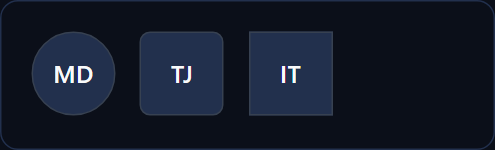
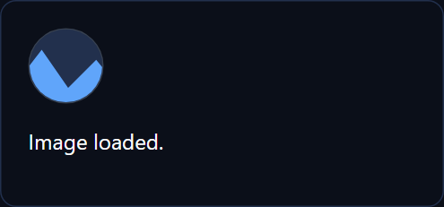
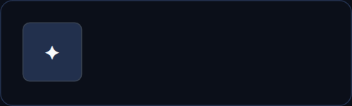

# q-avatar

`q-avatar` shows an identity image with initials or custom fallback content.

**Component tag:** `<q-avatar>`

**Working preview:** Run `bun start` from the repository root, open the [existing playground](http://localhost:3333), then select **Media → Avatar**.

**On this page**

- [Quick start](#quick-start)
- [Examples](#examples)
- [Behavior & accessibility](#behavior--accessibility)
- [Styling](#styling)
- [API reference](#api-reference)

## Quick start

1. Follow the central [installation instructions](../../README.md#1-install-library).
2. In your application entry file, register WebQuark. This assumes a bundler that resolves package imports and CSS imports.

```javascript
import '@webquark/browser/dist/webquark/webquark.css';
import { defineCustomElements } from '@webquark/browser/loader';
defineCustomElements();
```

3. Add this markup to your application page. Any module script runs after that shared setup.

```html
<q-avatar name="Maya Dlamini"></q-avatar>
```

**Result:** a 40 px circular avatar with MD initials and the accessible name Maya Dlamini.

### At a glance

| Capability | Options | Default |
| :--- | :--- | :--- |
| [Image and fallback](#state-and-interaction) | Image, derived initials, explicit initials, fallback slot | ? fallback |
| [Shape](#shapes) | circle, rounded, square | circle |
| [Size](#sizes) | sm, md, lg, numeric property or CSS length | md (40 px) |
| [Accessible identity](#labels-and-announcements) | name, explicit alt, decorative empty alt | Decorative |
| [Image feedback](#events) | qLoad and qError | Lazy loading |

**With no properties:** A 40 px circular surface shows “?” and is hidden from assistive technology because no identity name is supplied.

## Examples

These examples share the [Quick start registration](#quick-start). Screenshots show the real registered component in a temporary preview fixture using the existing playground runtime. They do not imply extra permanent playground presets.

### Show identity without an image

Derive initials from names and choose the appropriate shape.



```html
<q-avatar name="Maya Dlamini" size="lg"></q-avatar>
<q-avatar name="Theo Jacobs" size="lg" shape="rounded"></q-avatar>
<q-avatar name="Support" initials="IT" size="lg" shape="square"></q-avatar>
```

### Handle image loading

Listen for the image result while keeping a named fallback available.



```html
<q-avatar id="profile" name="Maya Dlamini" size="lg" loading="eager"></q-avatar>
<p id="image-status" role="status">Loading image…</p>
<script type="module">
await customElements.whenDefined('q-avatar');
const avatar = document.querySelector('#profile');
avatar.addEventListener('qLoad', () => { document.querySelector('#image-status').textContent = 'Image loaded.'; });
avatar.addEventListener('qError', () => { document.querySelector('#image-status').textContent = 'Using initials instead.'; });
avatar.src = "data:image/svg+xml,%3Csvg xmlns='http://www.w3.org/2000/svg' width='320' height='180' viewBox='0 0 320 180'%3E%3Crect width='320' height='180' fill='%2322304d'/%3E%3Cpath d='M0 180L100 50L190 180M130 180L235 75L320 180' fill='%2360a5fa'/%3E%3C/svg%3E";
</script>
```

The screenshot shows the loaded image. On failure the same element switches to its initials; changing src permits a new attempt.

### Supply a custom identity mark

Replace generated initials while retaining an accessible identity name.



```html
<q-avatar name="Support team" size="lg" shape="rounded"><span slot="fallback">✦</span></q-avatar>
```

Fallback slot content is visual; alt or name still supplies the accessible name.

## Behavior & accessibility

### State and interaction

A nonblank `src` selects a native image. Its load emits `qLoad`; its error switches to fallback and emits `qError`. Changing `src` clears the failure state. There is no built-in loading skeleton or automatic retry.

Nonblank `initials` takes the first two Unicode code points and uppercases them. Otherwise a single-word name supplies its first two code points; a multiword name supplies the first letter of its first and last words. No name produces `?`. A fallback slot replaces that text. Uppercasing can expand some characters.

### Labels and announcements

The container gets `role="img"` and an accessible name from trimmed `alt` when supplied, otherwise trimmed `name`. Explicit `alt=""` makes it decorative even when name exists. Without a name the container is `aria-hidden="true"`. The native image and fallback content are always hidden from accessibility to avoid duplicate names.

The avatar adds no keyboard interaction or live region. Image events let the application present feedback when needed.

### Limitations and compatibility

Images use `object-fit: cover`, `loading="lazy"` by default, and `referrerpolicy="no-referrer"`. A custom fallback is not a place for interactive controls because its region is hidden from assistive technology. There is no animation.

## Styling

### Sizes

| size | Dimensions |
| :--- | :--- |
| `sm` | 28 × 28 px |
| `md` (default) | 40 × 40 px |
| `lg` | 56 × 56 px |
| Number assigned in JavaScript | Positive finite pixel size |
| CSS string, such as `3rem` | CSS width and height |

Use `size="48px"` in HTML or `avatar.size = 48` in JavaScript. A unitless string such as `size="48"` is passed to CSS, not converted to pixels. Nonpositive or nonfinite numbers clear the custom size and use the medium fallback. Invalid CSS strings are not validated.

### Shapes

| shape | Appearance |
| :--- | :--- |
| `circle` (default) | 50% corner radius |
| `rounded` | Theme medium radius, normally 7 px |
| `square` | No rounding |

An unknown shape has no rounding rule.

### Custom styling

Scope CSS to the host or supplied content. See the exact [CSS variables](#css-variables) and [Shadow Parts](#shadow-parts).

```html
<q-avatar class="team" name="Support team" shape="rounded"></q-avatar>
<style>
  q-avatar.team { --q-avatar-bg: #22304d; --q-avatar-fg: #fbbf24; --q-avatar-radius: 12px; }
</style>
```

Shared geometry and theme setup are documented in [Foundation](../foundation.md) and [theme tokens](../theme-tokens.md).

## API reference

Cross-check the [generated API](../../src/browser/components/media/avatar/readme.md) and [implementation](../../src/browser/components/media/avatar/avatar.tsx). Source nullability and actual rendering limitations are preserved below.

### Properties

All properties are optional and listed alphabetically.

| Name | Default | Description |
| :--- | :--- | :--- |
| `alt` | `undefined` | Explicit accessible name; an empty string makes the avatar decorative.<br>**Type:** `string`. **HTML attribute:** `alt`. **Required:** No. |
| `initials` | `undefined` | Nonblank explicit initials, taking the first two Unicode code points before uppercase conversion.<br>**Type:** `string`. **HTML attribute:** `initials`. **Required:** No. |
| `loading` | `'lazy'` | Native image policy: eager or lazy.<br>**Type:** `"eager" \| "lazy"`. **HTML attribute:** `loading`. **Required:** No. |
| `name` | `undefined` | Identity name; derives initials and supplies the accessible name unless alt is provided.<br>**Type:** `string`. **HTML attribute:** `name`. **Required:** No. |
| `shape` | `'circle'` | circle, rounded, or square; unknown shapes have no rounding rule.<br>**Type:** `"circle" \| "rounded" \| "square"`. **HTML attribute:** `shape`. **Required:** No. |
| `size` | `'md'` | sm, md, lg, a positive finite numeric JavaScript pixel size, or a CSS length string. See Sizes for invalid values.<br>**Type:** `"lg" \| "md" \| "sm" \| number \| string & {}`. **HTML attribute:** `size`. **Required:** No. |
| `src` | `undefined` | Image URL; missing or whitespace-only values show fallback.<br>**Type:** `string`. **HTML attribute:** `src`. **Required:** No. |

### Slots

| Name | Description |
| :--- | :--- |
| fallback | Visual fallback when src is blank or fails. Defaults to initials or ?. Keep it noninteractive. |

### Events

| Name | When it fires | Payload |
| :--- | :--- | :--- |
| `qError` | Native image fails; fallback is selected. | `CustomEvent<void>` |
| `qLoad` | Native image finishes loading. | `CustomEvent<void>` |

These events bubble, cross shadow boundaries (composed), and are cancelable. The implementation does not check preventDefault(); cancellation does not stop the documented state changes.

### Methods

This component exposes no public methods.

### Styling hooks

#### CSS variables

Defaults include the shared theme when set there; nested `var()` expressions show CSS fallbacks. Shared palette/typography tokens and fallback aliases are listed in the [shared variable reference](../theme_variables.md). Internal `--_q-*` variables are not public hooks.

| Name | Default | Controls |
| :--- | :--- | :--- |
| `--q-avatar-bg` | `var(--q-bg-surface-3)` | background. |
| `--q-avatar-border` | `var(--q-border)` | border. |
| `--q-avatar-fg` | `var(--q-fg-base)` | foreground color. |
| `--q-avatar-font-size` | `0.8rem` | Medium/custom text size; sm/lg use their specific font hooks. |
| `--q-avatar-font-size-lg` | `1rem` | font size large preset. |
| `--q-avatar-font-size-sm` | `0.65rem` | font size small preset. |
| `--q-avatar-font-weight` | `var(--q-font-weight-bold, 600)` | font weight. |
| `--q-avatar-radius` | `var(--q-radius-md, 7px)` | radius. |
| `--q-avatar-resolved-size` | `Unset; maintained by the size property` | Implementation writes/removes this host variable during rendering. Use size instead of relying on a persistent override. |
| `--q-avatar-size-lg` | `56px` | size large preset. |
| `--q-avatar-size-md` | `40px` | size medium preset. |
| `--q-avatar-size-sm` | `28px` | size small preset. |

#### Shadow Parts

| Name | Targets |
| :--- | :--- |
| `container` | Identity surface and accessible image container. |
| `fallback` | Fallback region, only without a usable image. |
| `image` | Native img, only with a nonblank src and no recorded error. |
