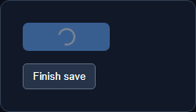
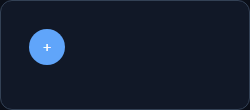
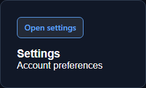

# q-button

`q-button` runs an action or presents a destination as a button.

**Component tag:** `<q-button>`

**Working preview:** Run `bun start` from the repository root, open the [existing playground](http://localhost:3333), then select **Actions → Button**. The examples below use this registered runtime with their own markup and data; playground presets are demonstrations, not component defaults.

**On this page**

- [Quick start](#quick-start)
- [Examples](#examples)
- [Behavior & accessibility](#behavior--accessibility)
- [Styling](#styling)
- [API reference](#api-reference)

## Quick start

1. Follow the central [installation instructions](../../README.md#1-install-library).
2. In your application entry file (for example `src/main.js`), register the elements and load the theme. This requires a bundler that resolves package imports and CSS imports.

```javascript
import "@webquark/core/dist/webquark/webquark.css";
import { defineCustomElements } from "@webquark/core/loader";

defineCustomElements();
```

3. Put the following markup in your application HTML.

```html
<q-button>Save changes</q-button>
```

**Result:** A primary medium button labelled “Save changes”.

### At a glance

| Capability | Options | Default |
| :--- | :--- | :--- |
| [Appearance](#variants) | primary, secondary, success, danger, ghost, text | primary |
| [Size](#sizes) | inherit, sm, md, lg | inherit; effective md without scope |
| [Shape and layout](#shape-and-layout) | default, pill, circle; inline or stacked; expand | default / inline / false |
| [Action](#state-and-interaction) | Button or href link; disabled and loading | button; enabled |
| [Content](#labels-and-announcements) | Text, icon shorthand, two icon slots, icon-only | No content |

**With no properties:** An empty primary inherit-sized (standalone md) button renders, with no accessible name. Supply visible text or `aria-label`.

## Examples

Use the registration above first. Each HTML block belongs in the page body; its module script runs after the element is registered. CSS in a `<style>` block belongs in the page or your application stylesheet.

### Keep an action busy until it finishes

Set loading from an application event handler while work is pending.



```html
<q-button id="save-action" aria-label="Save changes">Save changes</q-button>
<button id="finish-save" type="button">Finish save</button>
<script type="module">
  await customElements.whenDefined("q-button");
  const save = document.querySelector("#save-action");
  save.addEventListener("qClick", () => { save.loading = true; });
  document.querySelector("#finish-save").addEventListener("click", () => {
    save.loading = false;
  });
</script>
```

Click Save changes to reach the shown state; Finish save restores it. This still image captures the spinning loader, not its motion.

### Give an icon action a clear name

Pair icon-only content with an explicit accessible name.



```html
<q-button aria-label="Add item" icon-only shape="pill">
  <span slot="icon-left" aria-hidden="true">＋</span>
</q-button>
```

### Make a destination look like an action

Use href for native link behavior and a ghost appearance for a secondary destination.



```html
<q-button href="#settings" variant="ghost">Open settings</q-button>
<section id="settings"><h3>Settings</h3><p>Account preferences</p></section>
```

## Behavior & accessibility

### State and interaction

A nonempty `href` renders an anchor; omitted, null, or empty `href` renders a native button. The literal HTML text `href="undefined"` is a destination, not an omitted value. The application owns `loading` and `disabled`. Loading hides the content visually but retains its layout space, adds a CSS spinner, sets `aria-busy="true"`, and blocks activation. It does not run or finish asynchronous work automatically.

Disabled/loading native buttons use `disabled`. Disabled/loading anchors retain `href` but receive `tabindex="-1"` and `aria-disabled="true"`; their click handler prevents navigation. Supply an explicit accessible name while loading because hidden label content does not provide a reliable name.

### Keyboard and focus

The inner button uses native Tab, Enter, and Space behavior; anchors use Tab and Enter. Shadow focus delegates to the inner control. Disabled/loading controls are removed from ordinary keyboard activation.

### Labels and announcements

Visible default-slot text names the control. A nonblank `aria-label` is forwarded to the native button or anchor. Icon-only content needs `aria-label`. When `iconOnly` is omitted, the component detects icon content without visible text; explicit `false` disables this detection. `icon-left` content replaces the `icon` shorthand. Loading exposes busy state, without creating a live region.

### Forms

`type="submit"` and `type="reset"` describe the inner button, but `q-button` is not a form-associated custom element. Use it inside [q-form](./q-form.md), which bridges these actions, or call the intended native form explicitly. A shadow button does not automatically submit an unrelated light-DOM form.

### Limitations and compatibility

Unrecognized visual values are not normalized; they produce unmatched CSS classes. Use the documented options. The spinner rotates every 0.6 seconds; this component has no reduced-motion override. Platform-specific behavior must be checked in the target webview.

## Styling

Start with `variant`, `size`, `shape`, and `layout`.

### Variants

| Value | Appearance and use |
| :--- | :--- |
| `primary` (default) | Primary color for the main action |
| `secondary` | Secondary filled action |
| `success` | Success color; does not mark work complete |
| `danger` | Destructive-action color; no confirmation is added |
| `ghost` | Transparent with a border |
| `text` | Transparent, low-emphasis action |

### Sizes

`size="inherit"` is the declared default: it uses the nearest [q-form](./q-form.md) or [q-toolbar](./q-toolbar.md) scope, with `md` geometry when no scope exists. Explicit `sm`, `md`, or `lg` overrides that scope. Changing a scope updates inherited dimensions without changing the child's size property.

| Effective size | Minimum control height | Text / line height | Horizontal padding | Radius |
| :--- | :--- | :--- | :--- | :--- |
| `sm` | 1.75rem (28px) | 0.75 / 1rem | 0.5rem | 0.34375rem |
| `md` | 2.25rem (36px) | 0.875 / 1.25rem | 0.75rem | 0.4375rem |
| `lg` | 2.75rem (44px) | 1 / 1.5rem | 1rem | 0.53125rem |

Pixel equivalents assume a 16px root font. Heights are minimums; content and overrides can grow them. See the shared [sizing foundation](../foundation.md#choose-size-once).

### Shape and layout

`shape="default"` uses size-specific radii; `pill` uses 999px; `circle` uses a 120px square with 50% corners and 12px padding. `layout="inline"` places content in a row; `stacked` places it in a column. `expand` fills the available width, though the circle rule sets its own fixed width.

### Custom styling

Use the [CSS variables](#css-variables) or [Shadow Parts](#shadow-parts) for supported customization. This matching markup and CSS can be used together:

```html
<q-button class="save-button">Save changes</q-button>
<style>
  q-button.save-button { --q-btn-radius: 12px; --q-btn-padding: 12px 20px; }
</style>
```

For explicit sizes, `--q-btn-radius-sm/md/lg` precedes `--q-btn-radius`, then the shared control radius. Inherited sizing uses `--q-btn-radius` then the inherited radius. Pill/circle shapes override those radii. Noncircular buttons use `--q-btn-padding` before the explicit-size padding hook and shared geometry; `--q-btn-font-size` overrides shared text size. Icon-only explicit sizes honor `--q-btn-icon-padding-sm/md/lg`. Circle dimensions/padding and stacked content retain their own rules.

Keep shared setup in [Theme variables](../theme_variables.md), [Theme tokens](../theme-tokens.md), and the [sizing, spacing and surface foundation](../foundation.md).

## API reference

Cross-check the [generated API](../../src/components/actions/button/readme.md), [implementation](../../src/components/actions/button/button.tsx), and imported public types. The entries below preserve source defaults and runtime qualifications.

### Properties

All properties are optional in the TypeScript component contract. Required content/labels and conditional constraints are explained with each workflow. Properties are alphabetical.

| Name | Default | Description |
| :--- | :--- | :--- |
| `ariaLabel` | `null` | Required when an icon-only button has no accessible text.<br>**Type:** `string \| null`. **HTML attribute:** `aria-label`. **Required:** No. |
| `disabled` | `false` | Prevents activation, navigation, and secondary actions such as removal.<br>**Type:** `boolean`. **HTML attribute:** `disabled`. **Required:** No. |
| `download` | `undefined` | Enables native download behavior when the component operates as a link.<br>**Type:** `string`. **HTML attribute:** `download`. **Required:** No. |
| `expand` | `false` | Fills the available width; circle styling also sets an explicit width.<br>**Type:** `boolean`. **HTML attribute:** `expand`. **Required:** No. |
| `href` | `undefined` | Destination used when the component operates as a link.<br>**Type:** `string`. **HTML attribute:** `href`. **Required:** No. |
| `icon` | `undefined` | QIconName is a string icon identifier; see [q-icon](./q-icon.md). Whitespace-only names are ignored.<br>**Type:** `string`. **HTML attribute:** `icon`. **Required:** No. |
| `iconOnly` | `undefined` | Auto-detected from slotted icon content when omitted.<br>**Type:** `boolean`. **HTML attribute:** `icon-only`. **Required:** No. |
| `layout` | `'inline'` | Content direction; see [Shape and layout](#shape-and-layout).<br>**Type:** `'inline' \| 'stacked'`. **HTML attribute:** `layout`. **Required:** No. |
| `loading` | `false` | Shows a spinner and prevents interaction while loading.<br>**Type:** `boolean`. **HTML attribute:** `loading`. **Required:** No. |
| `rel` | `undefined` | Explicit relationship string; otherwise _blank receives noopener noreferrer.<br>**Type:** `string`. **HTML attribute:** `rel`. **Required:** No. |
| `shape` | `'default'` | Supported shapes; see [Shape and layout](#shape-and-layout).<br>**Type:** `'default' \| 'pill' \| 'circle'`. **HTML attribute:** `shape`. **Required:** No. |
| `size` | `'inherit'` | Supported visual sizes; see [Sizes](#sizes).<br>**Type:** `'inherit' \| 'sm' \| 'md' \| 'lg'`. **HTML attribute:** `size`. **Required:** No. |
| `target` | `undefined` | Native anchor target, such as _self, _blank, or a browsing-context name.<br>**Type:** `string`. **HTML attribute:** `target`. **Required:** No. |
| `type` | `'button'` | Applied to the native `<button>` when `href` is unset.<br>**Type:** `'button' \| 'submit' \| 'reset'`. **HTML attribute:** `type`. **Required:** No. |
| `variant` | `'primary'` | Visual appearance only; see [Variants](#variants).<br>**Type:** `'primary' \| 'secondary' \| 'success' \| 'danger' \| 'ghost' \| 'text'`. **HTML attribute:** `variant`. **Required:** No. |

Boolean attributes use Stencil coercion: presence/empty string is true, the literal string `"false"` is false, and removing the attribute supplies false rather than restoring a true or undefined initializer. Prefer explicit JavaScript `true`/`false` for updates; an optional Boolean can be reset to `undefined` through its property to recover inheritance/detection. String attributes remain strings; numeric attributes are parsed as numbers, so invalid text can become `NaN`. Setting a property to `undefined` or removing a string/number attribute does not rerun its initializer. Keep values within the documented types.

### Slots

| Name | Description |
| :--- | :--- |
| `default` | Label content; no fallback. Needed for an accessible text button unless aria-label is supplied. |
| `icon-left` | Leading decorative content; falls back to the icon shorthand when provided. |
| `icon-right` | Trailing decorative content; no fallback. |

### Events

| Name | When it fires | Payload |
| :--- | :--- | :--- |
| `qBlur` | The interactive field/control loses focus. | `CustomEvent<FocusEvent>` |
| `qClick` | Activation of the enabled interactive control; detail is the original MouseEvent. | `CustomEvent<MouseEvent>` |
| `qFocus` | The interactive field/control receives focus. | `CustomEvent<FocusEvent>` |

All listed Stencil events bubble, cross shadow boundaries (`composed: true`), and are cancelable. The component handlers do not use the emitted event's canceled result to roll back state or automatically cancel the underlying native event. For forwarded MouseEvent details, the original event is available as `event.detail`.

### Methods

This component exposes no public methods.

### Styling hooks

#### CSS variables

Defaults below show the local fallback chains; references to shared tokens depend on the active theme. Private `--_q-*` variables are implementation details and are not supported overrides. Component and functional shared hooks are listed; global palette/spacing/typography values are catalogued in [Theme tokens](../theme-tokens.md). See [Custom styling](#custom-styling) for effective precedence and exceptions.

| Name | Default | Controls |
| :--- | :--- | :--- |
| `--q-btn-active-transform` | `scale(0.97)` | Transform. |
| `--q-btn-circle-padding` | `12px` | Padding. |
| `--q-btn-circle-size` | `120px` | Width, height. |
| `--q-btn-content-gap` | `var(--q-space-sm, .5rem)` | Gap. |
| `--q-btn-content-gap-sm` | `var(--q-btn-content-gap, 4px)` | Gap. |
| `--q-btn-font-size` | `var(--_q-control-font)` | Font-size. |
| `--q-btn-font-weight` | `var(--q-font-weight-bold)` | Font-weight. |
| `--q-btn-height` | `var(--_q-control-height)` | Min-height, min-width. |
| `--q-btn-hover-overlay` | `color-mix(in srgb, var(--q-fg-base) 8%, transparent)` | Background. |
| `--q-btn-icon-padding-lg` | `9px` | Padding. |
| `--q-btn-icon-padding-md` | `6px` | Padding. |
| `--q-btn-icon-padding-sm` | `4px` | Padding. |
| `--q-btn-padding` | `var(--_q-btn-padding, 0 var(--_q-control-padding))` | Padding. |
| `--q-btn-padding-lg` | `0 var(--_q-control-padding)` | Padding. |
| `--q-btn-padding-md` | `0 var(--_q-control-padding)` | Padding. |
| `--q-btn-padding-sm` | `0 var(--_q-control-padding)` | Padding. |
| `--q-btn-radius` | `var(--_q-control-radius)` | Border-radius. |
| `--q-btn-radius-lg` | `var(--q-btn-radius, var(--_q-control-radius))` | Border-radius. |
| `--q-btn-radius-md` | `var(--q-btn-radius, var(--_q-control-radius))` | Border-radius. |
| `--q-btn-radius-sm` | `var(--q-btn-radius, var(--_q-control-radius))` | Border-radius. |
| `--q-btn-stacked-gap` | `8px` | Gap. |
| `--q-btn-transition` | `all 150ms cubic-bezier(0.4, 0, 0.2, 1)` | Transition. |
| `--q-context-control-font` | `var(--q-control-font-md, 0.875rem)` | Context control font. Inherited context; explicit component size/state may override it. |
| `--q-context-control-height` | `var(--q-control-height-md, 2.25rem)` | Context control height. Inherited context; explicit component size/state may override it. |
| `--q-context-control-icon` | `var(--q-control-icon-md, 1rem)` | Context control icon. Inherited context; explicit component size/state may override it. |
| `--q-context-control-line` | `var(--q-control-line-md, 1.25rem)` | Context control line. Inherited context; explicit component size/state may override it. |
| `--q-context-control-padding` | `var(--q-control-padding-md, 0.75rem)` | Context control padding. Inherited context; explicit component size/state may override it. |
| `--q-context-control-radius` | `var(--q-control-radius-md, 0.4375rem)` | Context control radius. Inherited context; explicit component size/state may override it. |
| `--q-control-font-lg` | `1rem` | Control font lg. Shared geometry for the named size. |
| `--q-control-font-md` | `0.875rem` | Control font md. Shared geometry for the named size. |
| `--q-control-font-sm` | `0.75rem` | Control font sm. Shared geometry for the named size. |
| `--q-control-height-lg` | `2.75rem` | Control height lg. Shared geometry for the named size. |
| `--q-control-height-md` | `2.25rem` | Control height md. Shared geometry for the named size. |
| `--q-control-height-sm` | `1.75rem` | Control height sm. Shared geometry for the named size. |
| `--q-control-icon-lg` | `1.25rem` | Control icon lg. Shared geometry for the named size. |
| `--q-control-icon-md` | `1rem` | Control icon md. Shared geometry for the named size. |
| `--q-control-icon-sm` | `0.875rem` | Control icon sm. Shared geometry for the named size. |
| `--q-control-line-lg` | `1.5rem` | Control line lg. Shared geometry for the named size. |
| `--q-control-line-md` | `1.25rem` | Control line md. Shared geometry for the named size. |
| `--q-control-line-sm` | `1rem` | Control line sm. Shared geometry for the named size. |
| `--q-control-padding-lg` | `1rem` | Control padding lg. Shared geometry for the named size. |
| `--q-control-padding-md` | `0.75rem` | Control padding md. Shared geometry for the named size. |
| `--q-control-padding-sm` | `0.5rem` | Control padding sm. Shared geometry for the named size. |
| `--q-control-radius-lg` | `0.53125rem` | Control radius lg. Shared geometry for the named size. |
| `--q-control-radius-md` | `0.4375rem` | Control radius md. Shared geometry for the named size. |
| `--q-control-radius-sm` | `0.34375rem` | Control radius sm. Shared geometry for the named size. |

#### Shadow Parts

| Name | Targets |
| :--- | :--- |
| `button` | Native button or anchor; always present. |
| `icon` | Shorthand q-icon fallback when icon is nonblank; assigned icon-left content replaces its visible slot fallback. |
| `spinner` | Loading spinner, present only while loading. |
