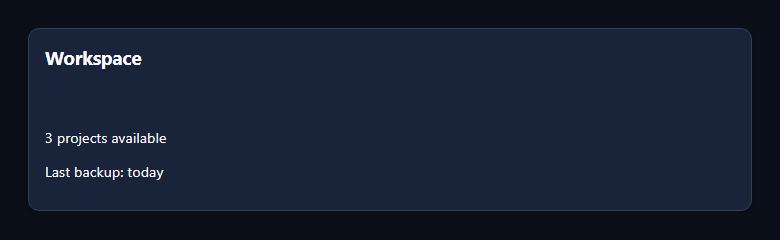
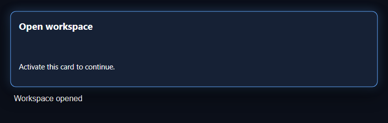
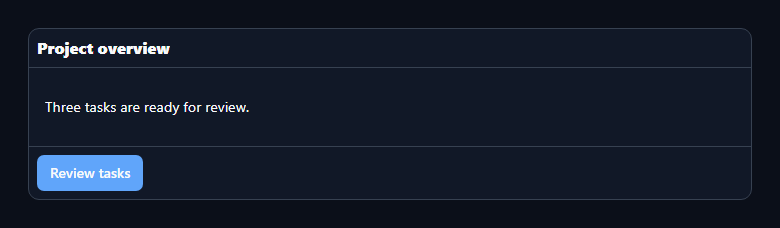

# q-card

`q-card` groups consumer content in a raised surface with an optional header and button interaction.

**Component tag:** `<q-card>`

**Working preview:** Run `bun start` from the repository root, open the [existing playground](http://localhost:3333), then select **Content → Card**. The examples below use temporary fixtures in this same registered runtime.

**On this page**

- [Quick start](#quick-start)
- [Examples](#examples)
- [Behavior & accessibility](#behavior--accessibility)
- [Styling](#styling)
- [API reference](#api-reference)

## Quick start

1. Follow the central [installation instructions](../../README.md#1-install-library).
2. Add registration to your application entry file (`main.js`). This requires a bundler that resolves package imports and CSS imports.

```javascript
import '@webquark/core/dist/webquark/webquark.css';
import { defineCustomElements } from '@webquark/core/loader';

defineCustomElements();
```

3. Add this markup to the application page after setup.

```html
<q-card>
  <h3 slot="header">Workspace</h3>
  <p>Your project is ready.</p>
</q-card>
```

**Result:** a low-elevation card with 16px padding in each visible region.

### At a glance

| Capability | Options | Default |
| :--- | :--- | :--- |
| [Elevation](#variants) | none, low, medium, high; legacy numeric JS aliases | low |
| [Surface](#variants) | Solid or translucent glass | Solid |
| [Interaction](#state-and-interaction) | Static, visual lift, or interactive button | Static |
| [Content](#slots) | Header, body, and footer slots | Empty |
| [Surface role](#surfaces) | canvas, panel, card, field, floating, transparent | card |
| [Region padding](#sizes) | Eight spacing tokens; independent header/footer | lg (16px) |

**With no properties:** `<q-card></q-card>` renders an empty surface with low shadow, 16px body padding, and no minimum-width floor. Header/footer are hidden; the card has no button role or tab stop.

**Playground preset:** The preset supplies a header and body; those are not component defaults.

## Examples

These examples share the registration above. Place each complete snippet in the application page; scripts use module syntax. Screenshots show the real component in the playground runtime with the shared dark theme.

### Group related information

A low-elevation card groups two workspace facts.



```html
<q-card elevation="low">
  <h3 slot="header">Workspace</h3>
  <p>3 projects available</p>
  <p>Last backup: today</p>
</q-card>
```

### Activate a whole card

An interactive card opens a local status message.



```html
<q-card id="workspace-card" interactive glass>
  <h3 slot="header">Open workspace</h3>
  <p>Activate this card to continue.</p>
</q-card>
<p id="workspace-result" role="status">Ready</p>
<script type="module">
  await customElements.whenDefined('q-card');
  document.querySelector('#workspace-card').addEventListener('click', () => {
    document.querySelector('#workspace-result').textContent = 'Workspace opened';
  });
</script>
```

Click the card, or focus its internal button with Tab and press Enter or Space. The screenshot follows activation; the application supplies the status region.

### Separate content and actions

A shadowless card separates content and footer actions with dividers.



```html
<q-card elevation="none" surface="panel" padding="lg" header-padding="sm" footer-padding="sm" dividers>
  <strong slot="header">Project overview</strong>
  <p>Three tasks are ready for review.</p>
  <q-button slot="footer" type="button">Review tasks</q-button>
</q-card>
```

## Behavior & accessibility

### State and interaction

`interactive` adds button semantics; your application handles the ordinary `click` event. The component has no selected or disabled state. `lift` changes hover/focus appearance without making the card interactive. Headers appear when an element is assigned to `header`; empty elements still count as content. Slot changes are observed.

### Keyboard and focus

The interactive internal container receives `tabindex="0"` and `role="button"`. Enter and Space dispatch a click only when that container itself receives the key; keys from nested controls are not reactivated. Avoid nesting interactive controls in a card acting as one button; use a static card with separate controls instead.

### Labels and announcements

Provide clear visible action text for an interactive card. There is no forwarded accessible-name property or built-in live region. The header is a generic wrapper; choose an appropriate heading element yourself.

### Forms

The card has no form value and does not submit forms.

### Limitations and compatibility

Glass uses a translucent background, without backdrop blur. No component-specific reduced-motion rule is implemented. Numeric elevation aliases are actual numbers (`card.elevation = 1`); HTML `elevation="1"` is a string and does not select the low-elevation class. Empty or unknown elevation values receive no matching elevation shadow rule.

Unknown spacing tokens use a 1rem fallback unless an application defines the matching `--q-space-*` token. Invalid surface names have no defined palette fallback; use the accepted roles.

## Styling

Use `elevation`, `glass`, `lift`, and `interactive` for built-in appearance.

### Variants

| Control | Choices and visible effect |
| :--- | :--- |
| elevation | `none` no shadow, `low` (default) subtle shadow, `medium` raised shadow, `high` strongest shadow. JavaScript numbers 1, 2, 3 are corresponding legacy aliases. |
| glass | `false` (default) solid theme card; `true` translucent background. |
| lift | `true` applies hover/focus lift; default false. |
| interactive | `true` also adds primary border/glow, pointer cursor, and pressed scale; default false. |

### Sizes

`padding` is `lg` by default. `header-padding` and `footer-padding` default to the body padding. Region padding stays local; it does not resize descendants.

| Value | Default spacing |
| :--- | :--- |
| `none` | 0 (0px at a 16px root) |
| `xs` | 0.25rem (4px at a 16px root) |
| `sm` | 0.5rem (8px at a 16px root) |
| `md` | 0.75rem (12px at a 16px root) |
| `lg` | 1rem (16px at a 16px root) |
| `xl` | 1.5rem (24px at a 16px root) |
| `2xl` | 2rem (32px at a 16px root) |
| `3xl` | 3rem (48px at a 16px root) |

### Surfaces

| surface | Fallback |
| :--- | :--- |
| `canvas` | --q-bg-base |
| `panel` | --q-bg-surface-1 |
| `card` | --q-bg-surface-2 |
| `field` | --q-bg-surface-3 |
| `floating` | --q-bg-surface-4 |
| `transparent` | transparent |

Surface roles resolve at the component and respect scoped palettes. `--q-card-bg` overrides the role; glass overrides the role unless --q-card-bg is set. Nesting does not change the role automatically. See [Foundation](../foundation.md).

### Custom styling

```html
<q-card class="compact-card"><p>A compact surface</p></q-card>
<style>
  q-card.compact-card { --q-card-min-width: 220px; --q-card-border: 2px solid #60a5fa; }
  q-card.compact-card::part(body) { line-height: 1.7; }
</style>
```

See [CSS variables](#css-variables), [Shadow Parts](#shadow-parts), and central [theme setup](../theme_variables.md).

## API reference

See the [Stencil-generated API](../../src/components/content/card/readme.md) and [component source](../../src/components/content/card/card.tsx). The tables below include source-level types and effective rendering constraints.

### Properties

All properties are optional and are listed alphabetically. Boolean attributes use Stencil boolean parsing: a present empty attribute enables the property, `="false"` disables it; JavaScript properties accept `true`/`false`. Removing a boolean attribute makes it false, including properties initially declared true. For updates, set the desired JavaScript property explicitly instead of relying on attribute removal to restore initializer defaults.

| Name | Default | Description |
| :--- | :--- | :--- |
| `dividers` | `false` | Add header/footer divider borders.<br>**Type:** `boolean`. **HTML attribute:** `dividers`. **Required:** No. |
| `elevation` | `'low'` | Shadow level; accepted named values or numeric JavaScript aliases. No invalid-value fallback.<br>**Type:** `'none' \| 'low' \| 'medium' \| 'high' \| 1 \| 2 \| 3`. **HTML attribute:** `elevation`. **Required:** No. |
| `footerPadding` | `undefined` | Footer spacing token; undefined inherits padding.<br>**Type:** `'none' \| 'xs' \| 'sm' \| 'md' \| 'lg' \| 'xl' \| '2xl' \| '3xl'`. **HTML attribute:** `footer-padding`. **Required:** No. |
| `glass` | `false` | Uses translucent background without blur.<br>**Type:** `boolean`. **HTML attribute:** `glass`. **Required:** No. |
| `headerPadding` | `undefined` | Header spacing token; undefined inherits padding.<br>**Type:** `'none' \| 'xs' \| 'sm' \| 'md' \| 'lg' \| 'xl' \| '2xl' \| '3xl'`. **HTML attribute:** `header-padding`. **Required:** No. |
| `interactive` | `false` | Makes the internal container focusable and keyboard activatable.<br>**Type:** `boolean`. **HTML attribute:** `interactive`. **Required:** No. |
| `lift` | `false` | Visual hover/focus lift without button semantics.<br>**Type:** `boolean`. **HTML attribute:** `lift`. **Required:** No. |
| `padding` | `'lg'` | Spacing token applied to body and, unless overridden, header/footer.<br>**Type:** `'none' \| 'xs' \| 'sm' \| 'md' \| 'lg' \| 'xl' \| '2xl' \| '3xl'`. **HTML attribute:** `padding`. **Required:** No. |
| `surface` | `undefined` | Surface role: canvas, panel, card, field, floating, or transparent. When undefined, use card. Component background overrides win.<br>**Type:** `'canvas' \| 'panel' \| 'card' \| 'field' \| 'floating' \| 'transparent'`. **HTML attribute:** `surface`. **Required:** No. |


### Slots

| Name | Description |
| :--- | :--- |
| `footer` | Optional footer content; hidden unless it has an element or nonblank text. No fallback. |
| `header` | Optional element content; hidden when no assigned elements. No fallback. |
| Default (unnamed) | Body content; no fallback. |

### Events

This component emits no public events.

### Methods

This component exposes no public methods.

### Styling hooks

Defaults below include the imported shared stylesheet; `var(...)` values follow the active theme. Component-specific hooks and the shared tokens they consume are listed. For shared setup, see [Theme variables](../theme_variables.md).

#### CSS variables

| Name | Default | Controls |
| :--- | :--- | :--- |
| `--q-bg-base` | `#0b0f19` | Theme palette fallback for the matching surface role; a --q-bg-{role} override takes precedence. |
| `--q-bg-canvas` | `var(--q-bg-base, #0b0f19)` | Scoped canvas surface-role background; used by surface resolution when that role is selected. |
| `--q-bg-card` | `var(--q-bg-surface-2, #19243b)` | Card surface-role override; active when surface resolves to card. --q-card-bg and glass take precedence. |
| `--q-bg-field` | `var(--q-bg-surface-3, #22304d)` | Scoped field surface-role background; used by surface resolution when that role is selected. |
| `--q-bg-floating` | `var(--q-bg-surface-4, #2c3a58)` | Scoped floating surface-role background; used by surface resolution when that role is selected. |
| `--q-bg-glass` | `rgba(25, 36, 59, 0.85)` | Glass background, used only with glass. |
| `--q-bg-panel` | `var(--q-bg-surface-1, #111827)` | Scoped panel surface-role background; used by surface resolution when that role is selected. |
| `--q-bg-surface-1` | `#111827` | Theme palette fallback for the matching surface role; a --q-bg-{role} override takes precedence. |
| `--q-bg-surface-2` | `#19243b` | Theme palette fallback for the matching surface role; a --q-bg-{role} override takes precedence. |
| `--q-bg-surface-3` | `#22304d` | Theme palette fallback for the matching surface role; a --q-bg-{role} override takes precedence. |
| `--q-bg-surface-4` | `#2c3a58` | Theme palette fallback for the matching surface role; a --q-bg-{role} override takes precedence. |
| `--q-border` | `var(--q-border-width) solid var(--q-border-color)` | border applied to `.card-container`, `.has-dividers .card-header`, `.has-dividers .card-footer`. |
| `--q-border-color` | `#374151` | border color applied to `.card-container`. |
| `--q-card-bg` | `Resolved surface role (card by default)` | Highest-priority background for solid and glass cards. |
| `--q-card-border` | `var(--q-border)` | Container border. |
| `--q-card-divider` | `var(--q-border, 1px solid #374151)` | Header/footer borders when dividers is true. |
| `--q-card-footer-padding` | `Resolved footerPadding or padding (default 1rem)` | Footer padding; overrides footerPadding/padding resolution. |
| `--q-card-header-padding` | `Resolved headerPadding or padding (default 1rem)` | Header padding; overrides headerPadding/padding resolution. |
| `--q-card-hover-transform` | `var(--q-hover-transform)` | Host transform on interactive/lift hover or focus-within. Pressed interactive transform is a fixed scale(0.99). |
| `--q-card-min-width` | `0px` | Host minimum width. |
| `--q-card-padding` | `Resolved padding (default 1rem)` | Body padding; overrides padding property resolution. |
| `--q-card-transition-duration` | `var(--q-transition-normal)` | Host transform and container border/shadow/opacity transition. |
| `--q-color-primary` | `#60a5fa` | color primary applied to `:host([interactive]:hover) .card-container, :host([interactive]:focus-within) .card-container`. |
| `--q-font-family` | `-apple-system, BlinkMacSystemFont, 'Segoe UI', Roboto, Helvetica, Arial, sans-serif` | font family applied to `.card-header`, `.card-body`. |
| `--q-font-size-base` | `0.9rem` | font size base applied to `.card-body`. |
| `--q-font-size-lg` | `1rem` | font size lg applied to `.card-header`. |
| `--q-font-weight-bold` | `600` | font weight bold applied to `.card-header`. |
| `--q-font-weight-normal` | `400` | font weight normal applied to `.card-body`. |
| `--q-glow-interactive` | `0 0 20px rgba(96, 165, 250, 0.3)` | glow interactive applied to `:host([interactive]:hover) .card-container, :host([interactive]:focus-within) .card-container`. |
| `--q-hover-transform` | `translateY(-4px) scale(1.02)` | Shared theme alias used by the default --q-card-hover-transform on an interactive card hover. An explicit card hover transform takes precedence. |
| `--q-padding-lg` | `var(--q-space-lg, 1rem)` | Legacy container padding declaration is overridden by padding: 0; ineffective for current region padding. |
| `--q-padding-sm` | `var(--q-space-sm, .5rem)` | Legacy header margin is overridden by margin: 0; ineffective for current region padding. |
| `--q-radius-lg` | `11px` | radius lg applied to `.card-container`. |
| `--q-shadow-high` | `0 16px 32px rgba(0, 0, 0, 0.45)` | shadow high applied to `.elevation-high`, `:host([interactive]:hover) .card-container, :host([interactive]:focus-within) .card-container`. |
| `--q-shadow-low` | `0 2px 4px rgba(0, 0, 0, 0.2)` | shadow low applied to `.elevation-low`. |
| `--q-shadow-medium` | `0 8px 16px rgba(0, 0, 0, 0.3)` | shadow medium applied to `.elevation-medium`. |
| `--q-space-2xl` | `2rem` | Shared spacing token selected by the corresponding padding/gap property; inherits to descendants. |
| `--q-space-3xl` | `3rem` | Shared spacing token selected by the corresponding padding/gap property; inherits to descendants. |
| `--q-space-lg` | `1rem` | Shared spacing token selected by the corresponding padding/gap property; inherits to descendants. |
| `--q-space-md` | `0.75rem` | Shared spacing token selected by the corresponding padding/gap property; inherits to descendants. |
| `--q-space-none` | `0rem` | Shared spacing token selected by the corresponding padding/gap property; inherits to descendants. |
| `--q-space-sm` | `0.5rem` | Shared spacing token selected by the corresponding padding/gap property; inherits to descendants. |
| `--q-space-xl` | `1.5rem` | Shared spacing token selected by the corresponding padding/gap property; inherits to descendants. |
| `--q-space-xs` | `0.25rem` | Shared spacing token selected by the corresponding padding/gap property; inherits to descendants. |

#### Shadow Parts

| Name | Targets |
| :--- | :--- |
| `body` | Always-rendered body wrapper. |
| `container` | Always-rendered outer card surface and optional button. |
| `footer` | Always-rendered footer wrapper; hidden when unassigned. |
| `header` | Always-rendered header wrapper, hidden when unassigned. |
