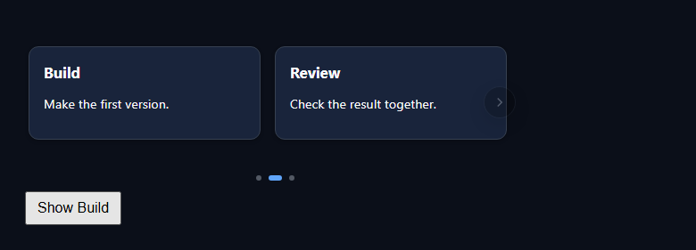

# q-carousel

`q-carousel` lays out slotted slides in a horizontal scroll viewport with optional arrows and indicator buttons.

**Component tag:** `<q-carousel>`

**Working preview:** Run `bun start` from the repository root, open the [existing playground](http://localhost:3333), then select **Content → Carousel**. The examples below use temporary fixtures in this same registered runtime.

**On this page**

- [Quick start](#quick-start)
- [Examples](#examples)
- [Behavior & accessibility](#behavior--accessibility)
- [Styling](#styling)
- [API reference](#api-reference)

## Quick start

1. Follow the central [installation instructions](../../README.md#1-install-library).
2. Add registration to your application entry file (`main.js`). This requires a bundler that resolves package imports and CSS imports.

```javascript
import '@webquark/browser/dist/webquark/webquark.css';
import { defineCustomElements } from '@webquark/browser/loader';

defineCustomElements();
```

3. Add this markup to the application page after setup.

```html
<q-carousel item-width="280px" show-arrows>
  <q-card>First project</q-card>
  <q-card>Second project</q-card>
  <q-card>Third project</q-card>
</q-carousel>
```

**Result:** a horizontal row of cards; arrows navigate when the available width is smaller than the content.

### At a glance

| Capability | Options | Default |
| :--- | :--- | :--- |
| [Snapping](#variants) | start, center, end, none | start |
| [Slide width](#sizes) | auto or CSS width | auto |
| [Controls](#state-and-interaction) | Arrows, dots, and programmatic navigation | Off |
| [Boundaries](#state-and-interaction) | Stop or wrap | Stop |

**With no properties:** `<q-carousel></q-carousel>` creates an empty focusable viewport with padding, no slides, no arrows, and no indicators.

**Playground preset:** The playground supplies slides, 280px item widths, and enabled arrows/indicators. None of these are bare-tag defaults.

## Examples

These examples share the registration above. Place each complete snippet in the application page; scripts use module syntax. Screenshots show the real component in the playground runtime with the shared dark theme.

### Browse a row of project cards

A carousel shows project cards with arrows and slide indicators.


```html
<q-carousel id="project-carousel" item-width="260px" show-arrows show-indicators>
  <q-card><h3>Plan</h3><p>Choose your next project.</p></q-card>
  <q-card><h3>Build</h3><p>Make the first version.</p></q-card>
  <q-card><h3>Review</h3><p>Check the result together.</p></q-card>
</q-carousel>
<style>
  #project-carousel { max-width: 680px; }
  #project-carousel > q-card { --q-card-min-width: 0; }
</style>
```

Hover or focus the carousel to reveal enabled arrows; the first arrow is visibly disabled at the start.

### Navigate from an application control

An external button advances the carousel to its second slide.



```html
<q-carousel id="project-carousel" item-width="260px" show-arrows show-indicators>
  <q-card><h3>Plan</h3><p>Choose your next project.</p></q-card>
  <q-card><h3>Build</h3><p>Make the first version.</p></q-card>
  <q-card><h3>Review</h3><p>Check the result together.</p></q-card>
</q-carousel>
<button id="show-build" type="button">Show Build</button>
<style>
  #project-carousel { max-width: 560px; }
  #project-carousel > q-card { --q-card-min-width: 0; }
</style>
<script type="module">
  await customElements.whenDefined('q-carousel');
  const carousel = document.querySelector('#project-carousel');
  await carousel.componentOnReady();
  document.querySelector('#show-build').addEventListener('click', () => carousel.slideTo(1));
</script>
```

Click Show Build for the screenshot. The method starts scrolling; awaiting it does not await animation completion.

## Behavior & accessibility

### State and interaction

There is no autoplay. Native horizontal scrolling updates the nearest slide index. Optional arrow buttons stop at scroll boundaries; `repeat` wraps arrow/method indices to the opposite endpoint and does not create an endless drag track. A 5px edge tolerance is used. Indicators appear only for overflowing content with more than one slide.

`slideTo` immediately emits its requested slide for a valid navigation request with more than one slide, even when the index is unchanged. An empty or single-slide carousel returns without this emission. After scrolling settles, the nearest rendered position can emit a correction. Browser scroll limits may prevent a last slide from aligning exactly at the start. `updateLimits` recalculates cached measurements; slot changes and viewport resize also trigger measurement. Slides should be direct slotted elements; text nodes do not count.

### Keyboard and focus

The viewport is a native focusable scroll area. Arrow buttons remain focusable when `aria-disabled="true"`; their click handler is removed. Indicator buttons use a single active tab stop; Left/Right wrap focus and initiate slide navigation. `slideTo` changes the scroll position, not keyboard focus.

### Labels and announcements

The viewport has `role="group"`, `aria-roledescription="carousel"`, and the fixed internal name “Carousel content”. Buttons are labelled “Previous slide”, “Next slide”, and “Go to slide N”; the active dot has `aria-current="true"`. There is no live announcement or per-slide role added. Supply meaningful slide content and image alt text. A host `aria-label` does not replace the fixed internal label.

### Limitations and compatibility

Set valid CSS widths. Empty/invalid widths or unknown snapping strings are not normalized. Fractional/NaN indices do not match an item offset; out-of-range indices do nothing without repeat. With repeat, values below zero go to the last index and values above the maximum go to zero (not modulo arithmetic); infinities follow those comparisons.

Changing `itemWidth` or `snapAlignment` after mount changes the property/reflected attribute but does not rerun the slot-style synchronization until the slot changes; `updateLimits` only measures. Supply these when creating the carousel. No component-specific reduced-motion override disables smooth scrolling or transitions.

## Styling

Use snapping, item width, arrows, and indicators as independent controls.

### Variants

`snap-alignment` supports `start` (default), `center`, `end`, and `none`. The first three use mandatory horizontal CSS snap; `none` allows free scrolling. Programmatic navigation requests the item’s start offset even for center/end; browser snapping and edge limits determine the final position.

### Sizes

`item-width="auto"` (default) preserves natural slide widths. CSS widths such as `260px` and `100%` set flex basis and width on slotted elements. Child minimum widths can still constrain them.

### Custom styling

```html
<q-carousel class="compact-deck" item-width="200px">
  <div>First item</div><div>Second item</div>
</q-carousel>
<style>
  q-carousel.compact-deck { --q-carousel-gap: 12px; --q-carousel-padding: 16px; }
</style>
```

The component sets item width/flex and snap variables inline during slot synchronization. Those values win over inherited host CSS; auto/none remove them. See [CSS variables](#css-variables), [Shadow Parts](#shadow-parts), and [theme setup](../theme_variables.md).

## API reference

See the [Stencil-generated API](../../src/browser/components/content/carousel/readme.md) and [component source](../../src/browser/components/content/carousel/carousel.tsx). The tables below include source-level types and effective rendering constraints.

### Properties

All properties are optional and are listed alphabetically. Boolean attributes use Stencil boolean parsing: a present empty attribute enables the property, `="false"` disables it; JavaScript properties accept `true`/`false`. Removing a boolean attribute makes it false, including properties initially declared true. For updates, set the desired JavaScript property explicitly instead of relying on attribute removal to restore initializer defaults.

| Name | Default | Description |
| :--- | :--- | :--- |
| `itemWidth` | `'auto'` | CSS slide width. auto preserves natural width; applied during slot synchronization.<br>**Type:** `string`. **HTML attribute:** `item-width`. **Required:** No. |
| `repeat` | `false` | Wrap arrow and method navigation at endpoints; no autoplay or seamless loop.<br>**Type:** `boolean`. **HTML attribute:** `repeat`. **Required:** No. |
| `showArrows` | `false` | Render previous/next controls; enabled controls reveal on hover/focus.<br>**Type:** `boolean`. **HTML attribute:** `show-arrows`. **Required:** No. |
| `showIndicators` | `false` | Render dots only with overflow and multiple slides.<br>**Type:** `boolean`. **HTML attribute:** `show-indicators`. **Required:** No. |
| `snapAlignment` | `'start'` | Native scroll-snap alignment; none disables the mandatory snap class.<br>**Type:** `'start' \| 'center' \| 'end' \| 'none'`. **HTML attribute:** `snap-alignment`. **Required:** No. |


### Slots

| Name | Description |
| :--- | :--- |
| Default (unnamed) | One element per slide; no fallback. Nested content stays within its slide. |

### Events

All events below are `CustomEvent`s with `bubbles: true`, `composed: true`, and `cancelable: true`. The implementation does not inspect `defaultPrevented`; canceling them does not veto component state changes.

| Name | When it fires | Payload |
| :--- | :--- | :--- |
| `qSlideChange` | Valid programmatic navigation with more than one slide, or scrolling that changes the nearest slide index. | `CustomEvent<QCarouselSlideChangeDetail>`; detail `{ index: number; element: HTMLElement }`: zero-based requested/nearest index and its slotted element. |

### Methods

| Signature | Purpose | Returns |
| :--- | :--- | :--- |
| `slideTo(index: number)` | Request a zero-based slide with smooth scrolling. Out-of-range behavior follows repeat; an empty or single-slide carousel returns without navigation. Does not focus the slide. | `Promise<void>`; does not await scrolling completion. |
| `updateLimits()` | Recalculate offsets, widths, overflow, and controls from current slotted elements. Does not reapply item-width styles. | `Promise<void>`; resolves after measurement is requested. |

Wait for `customElements.whenDefined('q-carousel')` and `await element.componentOnReady()` before calling methods on a newly inserted lazy-loaded element.

### Styling hooks

Defaults below include the imported shared stylesheet; `var(...)` values follow the active theme. Component-specific hooks and the shared tokens they consume are listed. For shared setup, see [Theme variables](../theme_variables.md).

#### CSS variables

| Name | Default | Controls |
| :--- | :--- | :--- |
| `--q-bg-base` | `#0b0f19` | bg base applied to `.arrow-btn:focus-visible`, `.arrow-btn:hover`, `.indicator-dot:focus-visible`. |
| `--q-bg-overlay` | `rgba(0, 0, 0, 0.85)` | Shared theme alias used by the default --q-carousel-arrow-bg; an explicit arrow background takes precedence. |
| `--q-bg-surface-3` | `#22304d` | bg surface 3 applied to `.arrow-btn`. |
| `--q-border` | `var(--q-border-width) solid var(--q-border-color)` | border applied to `.arrow-btn`. |
| `--q-border-color` | `#374151` | border color applied to `.arrow-btn`. |
| `--q-carousel-arrow-bg` | `var(--q-bg-overlay)` | Arrow background; shared stylesheet uses --q-bg-overlay, while isolated fallback uses surface 3. |
| `--q-carousel-arrow-border` | `var(--q-border)` | carousel arrow border applied to `.arrow-btn`. |
| `--q-carousel-arrow-color` | `#ffffff` | carousel arrow color applied to `.arrow-btn`. |
| `--q-carousel-arrow-size` | `40px` | carousel arrow size applied to `.arrow-btn`. |
| `--q-carousel-gap` | `16px` | carousel gap applied to `.carousel-viewport`. |
| `--q-carousel-indicator-gap` | `8px` | carousel indicator gap applied to `.carousel-indicators`. |
| `--q-carousel-indicator-size` | `6px` | Dot diameter; active dot width is 2.5 times this value. |
| `--q-carousel-item-flex` | `0 0 auto` | Slotted slide flex; non-auto itemWidth sets this inline on the host. |
| `--q-carousel-item-width` | `auto` | Slotted slide width; non-auto itemWidth sets this inline on the host. |
| `--q-carousel-padding` | `24px 20px` | Viewport padding. Shared stylesheet supplies 24px 20px; isolated component fallback is 48px 40px. |
| `--q-carousel-snap-align` | `none` | Slotted snap alignment; initial non-none snapAlignment sets this inline. |
| `--q-color-primary` | `#60a5fa` | color primary applied to `.carousel-viewport:focus-visible`, `.arrow-btn:focus-visible`, `.arrow-btn:hover`. |
| `--q-fg-base` | `#f9fafb` | fg base applied to `.arrow-btn`. |
| `--q-fg-muted` | `#9ca3af` | fg muted applied to `.indicator-dot`. |
| `--q-radius-md` | `7px` | radius md applied to `.carousel-viewport:focus-visible`. |
| `--q-shadow-medium` | `0 8px 16px rgba(0, 0, 0, 0.3)` | shadow medium applied to `.arrow-btn`. |
| `--q-transition-normal` | `250ms cubic-bezier(0.4, 0, 0.2, 1)` | transition normal applied to `.arrow-btn`, `.indicator-dot`. |

#### Shadow Parts

This component exposes no Shadow Parts.
