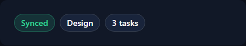
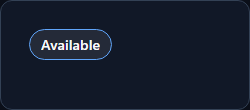
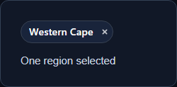

# q-chip

`q-chip` presents a status, category, or short summary in a compact label. It also supports selectable filters, links, and removable tokens.

**Component tag:** `<q-chip>`

**Working preview:** Run `bun start` from the repository root, open the [existing playground](http://localhost:3333), then select **Data display → Chip**. The examples below use this registered runtime with their own markup and data; playground presets are demonstrations, not component defaults.

**On this page**

- [Quick start](#quick-start)
- [Examples](#examples)
- [Behavior & accessibility](#behavior--accessibility)
- [Styling](#styling)
- [API reference](#api-reference)

## Quick start

1. Follow the central [installation instructions](../../README.md#1-install-library).
2. In your application entry file (for example `src/main.js`), register the elements and load the theme. This requires a bundler that resolves package imports and CSS imports.

```javascript
import "@webquark/browser/dist/webquark/webquark.css";
import { defineCustomElements } from "@webquark/browser/loader";

defineCustomElements();
```

3. Put the following markup in your application HTML.

```html
<q-chip variant="success">Synced</q-chip>
```

**Result:** A green status chip labelled “Synced”.

### At a glance

| Capability | Options | Default |
| :--- | :--- | :--- |
| [Appearance](#variants) | neutral, filter, primary, success, warning, danger | neutral |
| [Size](#sizes) | sm, md, lg | md |
| [Interaction](#state-and-interaction) | label, href link, clickable button, removable token | noninteractive |
| [Selection](#state-and-interaction) | selected, disabled | both false |
| [Content](#slots) | label plus leading/trailing icons | empty |

**With no properties:** An empty neutral medium noninteractive span renders. Supply default-slot text or `label`.

## Examples

Use the registration above first. Each HTML block belongs in the page body; its module script runs after the element is registered. CSS in a `<style>` block belongs in the page or your application stylesheet.

### Show a status and a short summary

Use noninteractive chips to make a status, category, or count easy to scan.



```html
<q-inline gap="sm">
  <q-chip variant="success">Synced</q-chip>
  <q-chip>Design</q-chip>
  <q-chip>3 tasks</q-chip>
</q-inline>
```

These chips render as text spans and add no tab stops. Their text carries the meaning; the success color is an additional cue. Add interaction only when the chip represents an available action.

### Toggle a filter from application state

Handle qClick and update selected to turn a filter on or off.



```html
<q-chip id="available-filter" variant="filter" clickable>Available</q-chip>
<script type="module">
  await customElements.whenDefined("q-chip");
  const filter = document.querySelector("#available-filter");
  filter.addEventListener("qClick", () => { filter.selected = !filter.selected; });
</script>
```

Click Available once to reach the selected state shown.

### Remove a named token

Use label for both the visible text and the remove button's accessible name.



```html
<q-chip id="region-token" removable label="Western Cape" value="western-cape"></q-chip>
<output id="token-state">One region selected</output>
<script type="module">
  await customElements.whenDefined("q-chip");
  document.querySelector("#region-token").addEventListener("qRemove", event => {
    document.querySelector("#token-state").textContent = "Removed " + event.detail.label;
    event.currentTarget.remove();
  });
</script>
```

The image shows the token before removal. Click its remove button to remove it and update the message.

## Behavior & accessibility

### State and interaction

`removable` takes priority: the chip becomes a span with a separate remove button, even when `href` or `clickable` is set. Otherwise a nonblank trimmed `href` chooses an anchor; otherwise `clickable` chooses a button; otherwise it is a span. The application owns `selected` and removes the element after `qRemove`. Neither action happens automatically.

Disabled chips block interaction. Disabled anchors lose `href`, `target`, `rel`, and `download`, and receive `tabindex="-1"`. Native chip/remove buttons use `disabled`.

### Keyboard and focus

Native buttons activate with Enter or Space, and anchors with Enter. The removable chip's remove button is its only built-in focus target. Noninteractive chips are not tab stops.

### Labels and announcements

Default-slot content takes precedence over `label` for visible text. The remove button uses “Remove ” plus trimmed `label`, or “Remove chip” when label is absent—even if slotted text is visible. Selected anchors expose `aria-current="page"`; selected/unselected buttons expose `aria-pressed="true/false"`. Selected static/removable spans carry visual selection only. No live region is created.

### Forms

The chip is not a form control. Its native buttons are `type="button"`. Application code must store selected values or create form inputs.

### Limitations and compatibility

Use supported finite visual values; invalid values produce unmatched classes. There is no component-specific reduced-motion rule. Do not put interactive controls inside the whole-chip anchor/button.

## Styling

Use variant and size for the built-in appearance; selection adds a separate visual state.

### Variants

| Value | Appearance |
| :--- | :--- |
| `neutral` (default) | Surface background and normal foreground |
| `filter` | Subtle filter surface |
| `primary` | Primary tinted surface; solid when selected |
| `success` | Green tinted surface |
| `warning` | Warning tinted surface |
| `danger` | Danger tinted surface |

Colors do not perform application actions or announce status.

### Sizes

| Value | Minimum height | Padding | Font size |
| :--- | :--- | :--- | :--- |
| `sm` | 24px | 4px 9px | 0.7rem |
| `md` (default) | 30px | 6px 11px | 0.9rem |
| `lg` | 36px | 8px 14px | 1rem |

Content and padding can make the actual height larger.

### Custom styling

Use the [CSS variables](#css-variables) or [Shadow Parts](#shadow-parts) for supported customization. This matching markup and CSS can be used together:

```html
<q-chip class="project-chip">Project Alpha</q-chip>
<style>
  q-chip.project-chip { --q-chip-radius: 7px; }
  q-chip.project-chip::part(chip) { background: #164e63; color: white; }
</style>
```

Variant classes assign `--q-chip-bg` and `--q-chip-fg` on the inner chip, overriding values inherited from the host. Set those variables on `::part(chip)` or style its background/color directly. Selected and hover rules also override the base colors. Small/large remove buttons declare their own `--q-chip-remove-size` (16/20px); medium uses the host/default 18px. The later size padding shorthand supersedes the earlier removable-end padding rule for supported sizes.

Keep shared setup in [Theme variables](../theme_variables.md), [Theme tokens](../theme-tokens.md), and the [sizing, spacing and surface foundation](../foundation.md).

## API reference

Cross-check the [generated API](../../src/browser/components/data-display/chip/readme.md), [implementation](../../src/browser/components/data-display/chip/chip.tsx), and imported public types. The entries below preserve source defaults and runtime qualifications.

### Properties

All properties are optional in the TypeScript component contract. Required content/labels and conditional constraints are explained with each workflow. Properties are alphabetical.

| Name | Default | Description |
| :--- | :--- | :--- |
| `clickable` | `false` | Renders a native button when `href` is empty and `removable` is false.<br>**Type:** `boolean`. **HTML attribute:** `clickable`. **Required:** No. |
| `disabled` | `false` | Prevents activation, navigation, and secondary actions such as removal.<br>**Type:** `boolean`. **HTML attribute:** `disabled`. **Required:** No. |
| `download` | `undefined` | Enables native download behavior when the component operates as a link.<br>**Type:** `string`. **HTML attribute:** `download`. **Required:** No. |
| `href` | `undefined` | Destination used when the component operates as a link.<br>**Type:** `string`. **HTML attribute:** `href`. **Required:** No. |
| `label` | `undefined` | Visible fallback text and source of the remove-button name.<br>**Type:** `string`. **HTML attribute:** `label`. **Required:** No. |
| `rel` | `undefined` | Defaults to `noopener noreferrer` when `target="_blank"`.<br>**Type:** `string`. **HTML attribute:** `rel`. **Required:** No. |
| `removable` | `false` | Adds a remove button and prevents the rest of the chip from being interactive.<br>**Type:** `boolean`. **HTML attribute:** `removable`. **Required:** No. |
| `selected` | `false` | Application-owned visual selection; does not toggle on activation.<br>**Type:** `boolean`. **HTML attribute:** `selected`. **Required:** No. |
| `size` | `'md'` | Minimum size and padding; see [Sizes](#sizes).<br>**Type:** `'sm' \| 'md' \| 'lg'`. **HTML attribute:** `size`. **Required:** No. |
| `target` | `undefined` | Native anchor target; ignored when removable or disabled.<br>**Type:** `'_self' \| '_blank' \| '_parent' \| '_top'`. **HTML attribute:** `target`. **Required:** No. |
| `value` | `undefined` | Included in `qRemove` detail.<br>**Type:** `string`. **HTML attribute:** `value`. **Required:** No. |
| `variant` | `'neutral'` | Visual palette; see [Variants](#variants).<br>**Type:** `'neutral' \| 'filter' \| 'primary' \| 'success' \| 'warning' \| 'danger'`. **HTML attribute:** `variant`. **Required:** No. |

Boolean attributes use Stencil coercion: presence/empty string is true, the literal string `"false"` is false, and removing the attribute supplies false rather than restoring a true or undefined initializer. Prefer explicit JavaScript `true`/`false` for updates; an optional Boolean can be reset to `undefined` through its property to recover inheritance/detection. String attributes remain strings; numeric attributes are parsed as numbers, so invalid text can become `NaN`. Setting a property to `undefined` or removing a string/number attribute does not rerun its initializer. Keep values within the documented types.

### Slots

| Name | Description |
| :--- | :--- |
| `default` | Visible chip label, falling back to label. Set label too for a specific remove-button name. |
| `icon-left` | Leading decorative content; no fallback. |
| `icon-right` | Trailing decorative content; no fallback. |

### Events

| Name | When it fires | Payload |
| :--- | :--- | :--- |
| `qBlur` | The interactive field/control loses focus. | `CustomEvent<FocusEvent>` |
| `qClick` | Activation of the enabled interactive control; detail is the original MouseEvent. | `CustomEvent<MouseEvent>` |
| `qFocus` | The interactive field/control receives focus. | `CustomEvent<FocusEvent>` |
| `qRemove` | The enabled remove button is activated; the application removes the token. | `CustomEvent<QChipRemoveDetail>` |

All listed Stencil events bubble, cross shadow boundaries (`composed: true`), and are cancelable. The component handlers do not use the emitted event's canceled result to roll back state or automatically cancel the underlying native event. For forwarded MouseEvent details, the original event is available as `event.detail`.

#### Removal detail

`QChipRemoveDetail` contains optional `value?: string` and `label?: string`, copied from the corresponding properties. Slot text is not included.

### Methods

This component exposes no public methods.

### Styling hooks

#### CSS variables

Defaults below show the local fallback chains; references to shared tokens depend on the active theme. Private `--_q-*` variables are implementation details and are not supported overrides. Component and functional shared hooks are listed; global palette/spacing/typography values are catalogued in [Theme tokens](../theme-tokens.md). See [Custom styling](#custom-styling) for effective precedence and exceptions.

| Name | Default | Controls |
| :--- | :--- | :--- |
| `--q-chip-active-transform` | `scale(0.97)` | Transform. |
| `--q-chip-bg` | `color-mix(in srgb, var(--q-color-danger, #f87171) 14%, transparent)` | Background. |
| `--q-chip-border` | `var(--q-border)` | Border. |
| `--q-chip-danger-selected-bg` | `color-mix(in srgb, var(--q-color-danger, #f87171) 16%, transparent)` | Background. |
| `--q-chip-danger-selected-border-color` | `var(--q-color-danger, #f87171)` | Border-color. |
| `--q-chip-danger-selected-fg` | `var(--q-color-danger, #f87171)` | Color. |
| `--q-chip-disabled-opacity` | `0.55` | Opacity. |
| `--q-chip-fg` | `var(--q-color-danger, #f87171)` | Color. |
| `--q-chip-focus-offset` | `2px` | Outline-offset. |
| `--q-chip-font-size-lg` | `var(--q-font-size-lg, 1rem)` | Font-size. |
| `--q-chip-font-size-md` | `var(--q-font-size-base, 0.9rem)` | Font-size. |
| `--q-chip-font-size-sm` | `var(--q-font-size-sm, 0.7rem)` | Font-size. |
| `--q-chip-font-weight` | `var(--q-font-weight-bold)` | Font-weight. |
| `--q-chip-gap-lg` | `9px` | Gap. |
| `--q-chip-gap-md` | `7px` | Gap. |
| `--q-chip-gap-sm` | `5px` | Gap. |
| `--q-chip-height-lg` | `36px` | Min-height. |
| `--q-chip-height-md` | `30px` | Min-height. |
| `--q-chip-height-sm` | `24px` | Min-height. |
| `--q-chip-hover-bg` | `color-mix(in srgb, var(--q-fg-base, #f9fafb) 8%, var(--q-chip-bg, transparent))` | Background. |
| `--q-chip-hover-border-color` | `var(--q-color-primary, #60a5fa)` | Border-color. |
| `--q-chip-hover-fg` | `var(--q-fg-base, #f9fafb)` | Color. |
| `--q-chip-padding-lg` | `8px 14px` | Padding. |
| `--q-chip-padding-md` | `6px 11px` | Padding. |
| `--q-chip-padding-sm` | `4px 9px` | Padding. |
| `--q-chip-primary-selected-fg` | `var(--q-bg-base, #111827)` | Color. |
| `--q-chip-radius` | `999px` | Border-radius. |
| `--q-chip-removable-padding-end` | `4px` | Padding-inline-end. |
| `--q-chip-remove-hover-bg` | `color-mix(in srgb, currentColor 12%, transparent)` | Background. |
| `--q-chip-remove-offset` | `-2px` | Margin-inline-end. |
| `--q-chip-remove-opacity` | `0.75` | Opacity. |
| `--q-chip-remove-size` | `20px` | Width, height. |
| `--q-chip-selected-bg` | `color-mix(in srgb, var(--q-color-primary, #60a5fa) 16%, transparent)` | Background. |
| `--q-chip-selected-border-color` | `var(--q-color-primary, #60a5fa)` | Border-color. |
| `--q-chip-selected-fg` | `var(--q-color-primary, #60a5fa)` | Color. |
| `--q-chip-success-selected-bg` | `color-mix(in srgb, var(--q-color-success, #34d399) 16%, transparent)` | Background. |
| `--q-chip-success-selected-border-color` | `var(--q-color-success, #34d399)` | Border-color. |
| `--q-chip-success-selected-fg` | `var(--q-color-success, #34d399)` | Color. |
| `--q-chip-warning-selected-bg` | `color-mix(in srgb, var(--q-color-warning, #fbbf24) 18%, transparent)` | Background. |
| `--q-chip-warning-selected-border-color` | `var(--q-color-warning, #fbbf24)` | Border-color. |
| `--q-chip-warning-selected-fg` | `var(--q-color-warning, #fbbf24)` | Color. |

#### Shadow Parts

| Name | Targets |
| :--- | :--- |
| `chip` | Root span, anchor, or button; always present. |
| `label` | Visible label wrapper; always present. |
| `remove-button` | Native remove button, only when removable. |
| `remove-icon` | Decorative SVG in the remove button, only when removable. |
