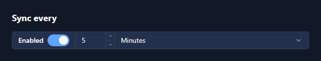
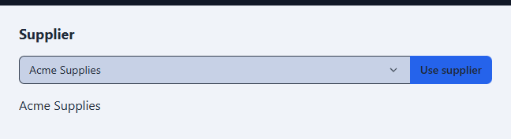

# q-control-group

`q-control-group` visually joins existing controls without combining their values or behavior.

**Component tag:** `<q-control-group>`

**Working preview:** Run `bun start` and select **Layout → Control Group** in the
[existing playground](http://localhost:3333). This component is local source work;
it is not part of the previously published dev-12 package.

**On this page**

- [Quick start](#quick-start)
- [Examples](#examples)
- [Behavior & accessibility](#behavior--accessibility)
- [Styling](#styling)
- [API reference](#api-reference)

## Quick start

Register the library and its theme in your bundled application entry:

```js
import '@webquark/browser/dist/webquark/webquark.css';
import { defineCustomElements } from '@webquark/browser/loader';
defineCustomElements();
```

Then add named, direct child controls:

```html
<p>Sync every</p>
<q-control-group aria-label="Sync interval">
  <q-toggle label="Enabled" checked></q-toggle>
  <q-input label="Amount" label-hidden type="number" min="1" value="5" width="xs"></q-input>
  <q-dropdown label="Unit" label-hidden options='["Seconds","Minutes","Hours"]' value="Minutes"></q-dropdown>
</q-control-group>
```

**Result:** a joined toggle, number and unit picker. Switching the toggle does
not disable the other fields automatically; your application owns that rule.
A bare tag is an empty layout group with no interactive content.

### At a glance

| Capability | Options | Default |
|---|---|---|
| Children | Input, dropdown, toggle, quantity selector, button; any order | Empty |
| Direction | Horizontal or vertical | Horizontal |
| Geometry | inherit, sm, md, lg | Inherited; standalone md |
| Values and events | Owned by each child | No group value/event |

## Examples

### Set a sync interval

Use the complete Quick start example for the interval picker shown here.



The screenshot shows a local fixture with the menu closed. No scheduler is started.

### Choose a supplier and confirm

Pair a searchable dropdown with a separate action button. The screenshot follows
typing Acme, selecting Acme Supplies with Arrow Down and Enter, then choosing
Use supplier.



```html
<q-control-group aria-label="Supplier selection">
  <q-dropdown id="supplier" label="Supplier" label-hidden searchable
    placeholder="Find a supplier" options='["Acme Supplies","Example Trading"]'></q-dropdown>
  <q-button id="confirm" type="button">Use supplier</q-button>
</q-control-group>
<p id="selection" role="status"></p>
<script type="module">
  await customElements.whenDefined('q-dropdown');
  document.querySelector('#confirm').addEventListener('qClick', () => {
    document.querySelector('#selection').textContent =
      document.querySelector('#supplier').value || 'Choose a supplier first.';
  });
</script>
```

For remote results, use the dropdown's existing external-search contract. The
group does not fetch data or confirm the selected value itself.

### Stack repeated controls

Use vertical orientation when the controls need to fit a narrow panel.


```html
<q-control-group aria-label="Name" orientation="vertical" style="width:240px">
  <q-input label="First name" label-hidden placeholder="First name"></q-input>
  <q-input label="Last name" label-hidden placeholder="Last name"></q-input>
  <q-button type="button">Save</q-button>
</q-control-group>
```

The repeated inputs retain separate values. Reorder the child tags to change the
display and keyboard order. The interval and vertical screenshots use the dark
theme; the supplier screenshot uses `data-theme="light"` on its container.

## Behavior & accessibility

### State and interaction

Supported direct children can repeat and appear in any DOM order. Insertion,
removal, reordering and direct-child `hidden` changes update the joined edges.
Leaving the group restores standalone styling. The wrapper does not clone or
reparent children and does not assign their values or public props.

### Keyboard and focus

Tab order and keyboard behavior belong to the child controls. The group has no
tab stop, combined focus target or arrow-navigation model. Child focus indicators
and dropdown popups remain unclipped.

### Labels and announcements

Use `aria-label` to name the group. Every child still needs its own accessible
name. For the joined row, use a visible caption outside the group and explicitly
hide input/dropdown labels with `label-hidden`. Toggle labels may remain inline.
The group never hides labels or feedback. Keep helper/error text with its field;
these remain outside that child's control border. ARIA checks are not a claim of
screen-reader certification.

### Forms

The wrapper is not a field or form. Named children retain their native form and
`q-form` ownership, validation, submit/reset and disabled behavior where supported.
The quantity selector retains its existing limitations; use `q-input type="number"`
when you need its form/validation/disabled contract.

### Limitations and compatibility

Only direct, unslotted supported controls receive joined styling. Arbitrary
wrappers, nested groups and unsupported elements render normally but are not
guaranteed to join. Use the native `hidden` attribute for dynamic visibility;
CSS-only hiding does not update edge tracking.

Horizontal groups do not wrap. Select vertical orientation for narrow layouts.
Mixed visible field-label heights, multiline feedback between vertically stacked
fields and conflicting explicit child sizes may interrupt the visual join; their
content is preserved rather than hidden or resized. Compact joined examples use
hidden field labels and no reserved feedback space. Child controls retain their
own support limitations, including quantity-selector naming.

## Styling

### Sizes

`size` uses the same scope helper as `q-form` and `q-toolbar`. It carries size intent
through compact/comfortable preset boundaries rather than freezing pixel values.
Explicit child sizes win. See [foundation composition](../foundation.md) and
[shared theme tokens](../theme-tokens.md).

### Direction and widths

`orientation="vertical"` stacks the controls. Logical corners and margins support
RTL without changing DOM order. Existing input/dropdown `width` props and inline
host widths remain available; other controls keep their intrinsic width in a row.
A dropdown with `width="fit-options"` uses its longest option's width when space
allows and shrinks to the remaining space when the group is narrower.

### Custom styling

The common outline is composed from the children's control borders, overlapping
adjacent borders by one pixel. This keeps labels and feedback outside the outline.
It does not clip the group or draw an outline around labels. Button variant colors
and toggle/quantity internals remain their own; only joined edges are reshaped.

```css
q-control-group {
  --q-control-group-radius: var(--q-radius-md);
}
```

Existing child border, validation, focus and popup tokens retain their behavior.
Standalone controls do not consume this grouped presentation. Private markers
and `--_q-*` variables are not consumer API.

## API reference

### Properties

All properties are optional.

| Name | Default | Description |
|---|---|---|
| `ariaLabel` | `null` | `string \| null`; HTML `aria-label`; names the group |
| `orientation` | `horizontal` | `horizontal \| vertical`; HTML `orientation` |
| `size` | `inherit` | `QControlSize`: inherit, sm, md, lg; HTML `size` |

### Slots

| Name | Description |
|---|---|
| Default | Direct supported controls, in reading/display order |

### Events

None. Child events retain their existing behavior.

### Methods

None.

### Styling hooks

**CSS variables**

| Name | Default | Controls |
|---|---|---|
| `--q-control-group-radius` | Effective control radius | Outer logical corners |

**Shadow Parts**

| Name | Targets |
|---|---|
| `group` | Layout container; control surfaces belong to the children |
