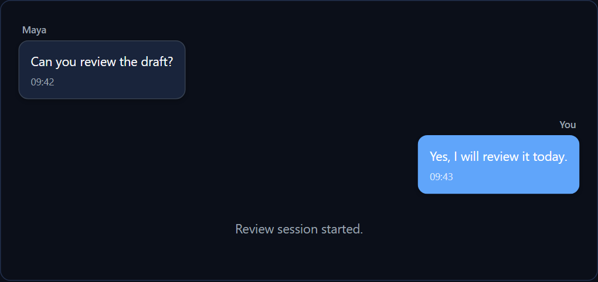
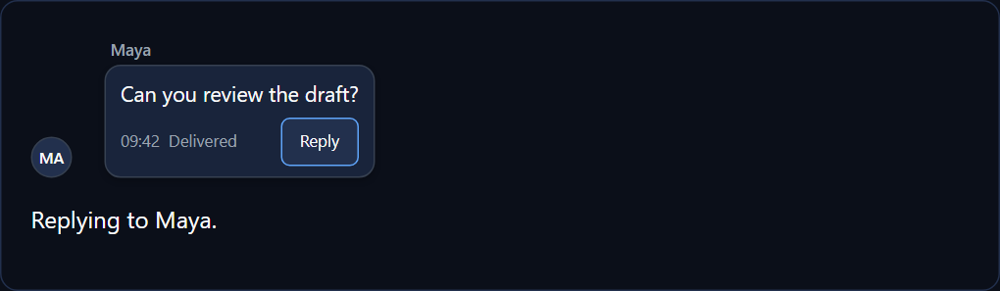

# q-conversation-bubble

`q-conversation-bubble` presents a conversation message with optional sender, timestamp, identity, metadata, and actions.

**Component tag:** `<q-conversation-bubble>`

**Working preview:** Run `bun start` from the repository root, open the [existing playground](http://localhost:3333), then select **Communication → Conversation Bubble**.

**On this page**

- [Quick start](#quick-start)
- [Examples](#examples)
- [Behavior & accessibility](#behavior--accessibility)
- [Styling](#styling)
- [API reference](#api-reference)

## Quick start

1. Follow the central [installation instructions](../../README.md#1-install-library).
2. In your application entry file, register WebQuark. This assumes a bundler that resolves package imports and CSS imports.

```javascript
import '@webquark/core/dist/webquark/webquark.css';
import { defineCustomElements } from '@webquark/core/loader';
defineCustomElements();
```

3. Add this markup to your application page. Any module script runs after that shared setup.

```html
<q-conversation-bubble sender="Maya" timestamp="09:42">The design is ready for review.</q-conversation-bubble>
```

**Result:** an incoming message with Maya above it and 09:42 in its footer.

### At a glance

| Capability | Options | Default |
| :--- | :--- | :--- |
| [Message direction](#variants) | incoming, outgoing, system | incoming |
| [Content](#slots) | Body, avatar, metadata and action slots | Empty |
| [Identity](#labels-and-announcements) | sender, timestamp, aria-label | Message |
| [Density](#density) | Normal or compact | Normal |

**With no properties:** An empty incoming message surface renders with the accessible group name “Message”; there is no sender, timestamp, avatar, or body text.

## Examples

These examples share the [Quick start registration](#quick-start). Screenshots show the real registered component in a temporary preview fixture using the existing playground runtime. They do not imply extra permanent playground presets.

### Distinguish incoming and outgoing messages

Choose message alignment without changing application conversation state.



```html
<q-conversation-bubble sender="Maya" timestamp="09:42">Can you review the draft?</q-conversation-bubble>
<q-conversation-bubble variant="outgoing" sender="You" timestamp="09:43">Yes, I will review it today.</q-conversation-bubble>
<q-conversation-bubble variant="system">Review session started.</q-conversation-bubble>
```

### Add identity and a message action

Compose an avatar, delivery metadata, and an application-owned reply control.



```html
<q-conversation-bubble sender="Maya" timestamp="09:42" compact><q-avatar slot="avatar" name="Maya" size="sm" alt=""></q-avatar>Can you review the draft?<span slot="meta">Delivered</span><button slot="actions" id="reply" type="button">Reply</button></q-conversation-bubble>
<p id="reply-result" role="status"></p>
<script type="module">
document.querySelector('#reply').addEventListener('click', () => {
  document.querySelector('#reply-result').textContent = 'Replying to Maya.';
});
</script>
```

The screenshot follows Reply. The bubble does not emit a custom event or manage replies.

## Behavior & accessibility

### State and interaction

The application owns message history, delivery, streaming, editing, and actions. Updating properties or slotted content changes presentation; the component does not append or send messages. Named slot presence updates on slotchange. Footer content is shown for a timestamp, metadata, or actions.

Message text preserves line breaks and wraps long words. Compact mode changes spacing only. Remove its attribute or assign `compact = false` to turn it off.

### Labels and announcements

Each message is an `article` with `role="group"`. A nonblank `aria-label` wins. Otherwise the name is “Message from {sender}, {timestamp}”, “Message from {sender}”, “Message, {timestamp}”, or “Message”; a system message without sender/time is “System message”.

Sender and timestamp are trimmed before rendering. The timestamp is a `time` element without a generated machine-readable datetime. The avatar is hidden for system messages. No live region or keyboard behavior is added; ordinary slotted controls retain their own behavior.

### Limitations and compatibility

System styling hides the sender header and avatar, but supplied sender/timestamp can still contribute to the generated accessible name. Prefer omitting sender for system messages or set an explicit aria-label. The component is not a conversation log or live announcer.

## Styling

### Variants

| variant | Appearance / use |
| :--- | :--- |
| `incoming` (default) | Left-aligned neutral bubble |
| `outgoing` | Right-aligned primary-colored bubble |
| `system` | Centered, transparent status text; avatar/header hidden |

Unknown variants retain base incoming styling.

### Density

`compact` changes bubble padding from 11px 13px to 7px 10px and reduces the header gap. The content maximum is `min(76ch, 82%)`; system messages use `min(80ch, 94%)`. At 600 px and below, normal content uses 88%, or `calc(100% - 42px)` with an avatar. CSS specificity can retain the system maximum.

### Custom styling

Scope CSS to the host or supplied content. See the exact [CSS variables](#css-variables) and [Shadow Parts](#shadow-parts).

```html
<q-conversation-bubble class="review" sender="Maya">Ready for review.</q-conversation-bubble>
<style>
  q-conversation-bubble.review { --q-conversation-max-width: 60ch; --q-conversation-radius: 16px; }
</style>
```

Shared geometry and theme setup are documented in [Foundation](../foundation.md) and [theme tokens](../theme-tokens.md).

## API reference

Cross-check the [generated API](../../src/components/communication/conversation-bubble/readme.md) and [implementation](../../src/components/communication/conversation-bubble/conversation-bubble.tsx). Source nullability and actual rendering limitations are preserved below.

### Properties

All properties are optional and listed alphabetically.

| Name | Default | Description |
| :--- | :--- | :--- |
| `ariaLabel` | `null` | Nonblank override for the generated accessible group name.<br>**Type:** `string \| null`. **HTML attribute:** `aria-label`. **Required:** No. |
| `compact` | `false` | Reduces spacing without changing semantics.<br>**Type:** `boolean`. **HTML attribute:** `compact`. **Required:** No. |
| `sender` | `undefined` | Trimmed visible sender; empty text omits the header.<br>**Type:** `string`. **HTML attribute:** `sender`. **Required:** No. |
| `timestamp` | `undefined` | Trimmed visible timestamp; no datetime parsing or formatting.<br>**Type:** `string`. **HTML attribute:** `timestamp`. **Required:** No. |
| `variant` | `'incoming'` | incoming, outgoing, or system; controls alignment and appearance.<br>**Type:** `"incoming" \| "outgoing" \| "system"`. **HTML attribute:** `variant`. **Required:** No. |

### Slots

| Name | Description |
| :--- | :--- |
| (default) | Message body; no fallback. Whitespace and line breaks are preserved. |
| actions | Application-owned accessible controls; hidden when empty. |
| avatar | Identity mark; hidden when empty or variant is system. |
| meta | Additional metadata beside timestamp; hidden when empty. |

### Events

This component emits no public events.

### Methods

This component exposes no public methods.

### Styling hooks

#### CSS variables

Defaults include the shared theme when set there; nested `var()` expressions show CSS fallbacks. Shared palette/typography tokens and fallback aliases are listed in the [shared variable reference](../theme_variables.md). Internal `--_q-*` variables are not public hooks.

| Name | Default | Controls |
| :--- | :--- | :--- |
| `--q-conversation-border` | `var(--q-border, 1px solid var(--q-border-color, #374151))` | border. |
| `--q-conversation-compact-padding` | `7px 10px` | compact padding. |
| `--q-conversation-fg` | `var(--q-fg-base, #f9fafb)` | foreground color. |
| `--q-conversation-font-size` | `var(--q-font-size-base, 0.9rem)` | font size. |
| `--q-conversation-footer-gap` | `10px` | footer gap. |
| `--q-conversation-footer-margin` | `6px` | footer margin. |
| `--q-conversation-gap` | `10px` | gap. |
| `--q-conversation-header-gap` | `4px` | header gap. |
| `--q-conversation-header-inset` | `4px` | header inset. |
| `--q-conversation-incoming-bg` | `var(--q-bg-surface-2)` | incoming background. |
| `--q-conversation-line-height` | `1.55` | line height. |
| `--q-conversation-max-width` | `min(76ch, 82%)` | max width. |
| `--q-conversation-meta-fg` | `var(--q-fg-muted, #9ca3af)` | meta foreground color. |
| `--q-conversation-meta-gap` | `6px` | meta gap. |
| `--q-conversation-meta-size` | `var(--q-font-size-sm, 0.7rem)` | meta size. |
| `--q-conversation-mobile-avatar-max-width` | `calc(100% - 42px)` | mobile avatar max width. |
| `--q-conversation-mobile-max-width` | `88%` | mobile max width. |
| `--q-conversation-outgoing-bg` | `var(--q-color-primary)` | outgoing background. |
| `--q-conversation-outgoing-border` | `transparent` | outgoing border. |
| `--q-conversation-outgoing-fg` | `#ffffff` | outgoing foreground color. |
| `--q-conversation-outgoing-meta-fg` | `rgba(255, 255, 255, 0.76)` | outgoing meta foreground color. |
| `--q-conversation-padding` | `11px 13px` | padding. |
| `--q-conversation-radius` | `var(--q-radius-lg, 11px)` | radius. |
| `--q-conversation-sender-fg` | `var(--q-fg-muted, #9ca3af)` | sender foreground color. |
| `--q-conversation-shadow` | `var(--q-shadow-low, 0 2px 4px rgba(0, 0, 0, 0.2))` | shadow. |
| `--q-conversation-system-bg` | `transparent` | system background. |
| `--q-conversation-system-border` | `transparent` | system border. |
| `--q-conversation-system-fg` | `var(--q-fg-muted)` | system foreground color. |
| `--q-conversation-system-max-width` | `min(80ch, 94%)` | system max width. |

#### Shadow Parts

| Name | Targets |
| :--- | :--- |
| `actions` | Action wrapper; always exists, hidden when empty. |
| `avatar` | Avatar wrapper; hidden when empty or system. |
| `body` | Default message slot wrapper. |
| `bubble` | Message surface. |
| `container` | Named message group. |
| `content` | Sender and bubble column. |
| `footer` | Footer wrapper; hidden without timestamp/meta/actions. |
| `header` | Sender header, only for nonblank sender; hidden in system mode. |
| `meta` | Metadata wrapper; hidden when empty. |
| `sender` | Sender text, only for nonblank sender. |
| `timestamp` | Time element, only for nonblank timestamp. |
