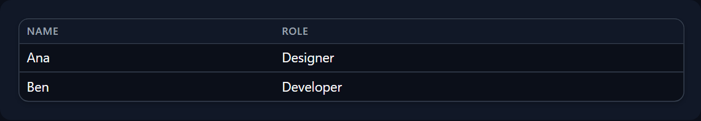
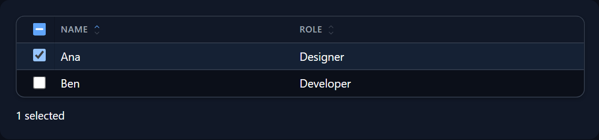
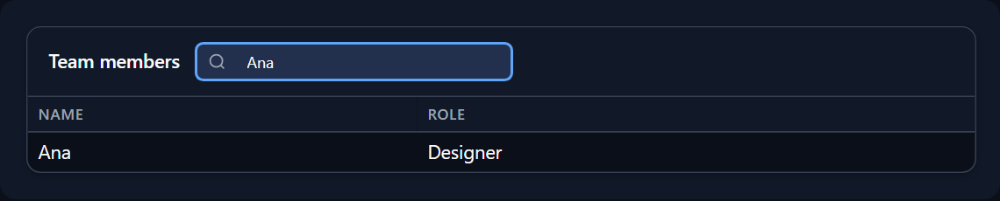
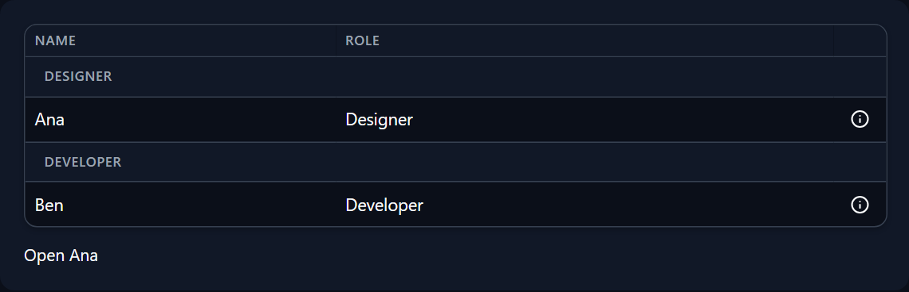
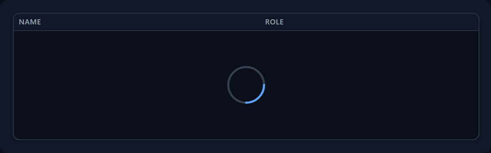

# q-data-table

`q-data-table` displays records with optional sorting, selection, grouping, search, and row actions.

**Component tag:** `<q-data-table>`

**Working preview:** Run `bun start` from the repository root and open the [WebQuark playground](http://localhost:3333). Select **Data display → Data Table**. Examples use their own small datasets; playground presets are not defaults.

**On this page**

- [Quick start](#quick-start)
- [Examples](#examples)
- [Behavior & accessibility](#behavior--accessibility)
- [Styling](#styling)
- [API reference](#api-reference)

## Quick start

Follow the central [installation instructions](../../README.md#1-install-library). In a bundled application that resolves package imports and CSS imports, add this to the JavaScript entry file:

```javascript
import '@webquark/browser/dist/webquark/webquark.css';
import { defineCustomElements } from '@webquark/browser/loader';
defineCustomElements();
```

Place the following markup in the application HTML. Scripts shown below are module scripts and assume the registration above.

```html
<q-data-table id="people" aria-label="Team members"></q-data-table>
<script type="module">
await customElements.whenDefined('q-data-table');
const table = document.querySelector('#people');
table.columns = [{ key: 'name', header: 'Name' }, { key: 'role', header: 'Role' }];
table.items = [{ id: 'ana', name: 'Ana', role: 'Designer' }, { id: 'ben', name: 'Ben', role: 'Developer' }];
</script>
```

**Result:** two named columns and two team-member rows. The table renders the supplied collection; it does not fetch data.

### At a glance

| Capability | Options | Default |
| :--- | :--- | :--- |
| [Data and cells](#public-data-types) | Column definitions, rows, custom render callbacks and rich-cell slots | Empty arrays |
| [Row interaction](#state-and-interaction) | Row activation, checkboxes, actions, group dividers | Activation on; selection off |
| [Sorting](#select-and-sort-records) | Local or external; per-column opt-in/out | Off; local mode |
| [Search and toolbar](#filter-rows-from-the-search-event) | Search events, custom filters/actions | Hidden |
| [Loading and empty states](#labels-and-announcements) | In-table loading row or empty slot | “No data available” |
| [Appearance](#custom-styling) | Sticky headers/start columns, density and cell parts | Theme surface and typography |

**Bare tag:** renders an empty table with “No data available,” no data columns, and no toolbar. Supply `columns` and `items` for useful output.

## Examples

### Uniform two-line rows

```html
<q-data-table two-line-rows aria-label="Team members"></q-data-table>
```

Each data cell reserves two text lines plus its existing padding. Plain text
wraps to two lines with ellipsis. Set `overflowTooltip: true` on selected columns
to expose truncated values in a tooltip on hover and keyboard focus. Fitting
text has no tooltip or extra keyboard stop. Full text remains in the accessible DOM.
Column widths use fixed table layout in this mode.

```javascript
table.columns = [
  { key: 'member', header: 'Member', overflowTooltip: true },
  { key: 'store', header: 'Store', overflowTooltip: true },
  { key: 'status', header: 'Status' },
];
```

Rich-cell slots retain their own controls and tooltips. Their content must fit
the shared height; use `--q-table-cell-content-height` for consistently taller
rich cells or leave `two-line-rows` off for forms, expanded rows, and bespoke
layouts. Default tables continue to size rows automatically.

`--q-table-cell-line-height` defaults to `1.5` and the reserved content height
defaults to `2lh`; padding still uses the existing cell padding variables.

### Row gutter

Every table defaults to a blank 36px leading gutter, separate from selection and
data columns. Set `row-gutter="none"` to omit it, `row-gutter="numbers"` to show
rendered row numbers, or `row-gutter="custom"` for row-specific named slots.
`row-number-offset` defaults to zero and accepts only finite, nonnegative safe
integers. Invalid modes fall back to blank; invalid offsets fall back to zero.
Numbers follow the current rendered order (including local sorting), exclude
group headers, and restart for each supplied collection unless you set an offset.
External sorting leaves the supplied order unchanged.

```javascript
import { getDataTableRowGutterSlotName } from '@webquark/browser';
table.rowGutter = 'custom';
const control = document.createElement('button');
control.textContent = 'Open';
control.slot = getDataTableRowGutterSlotName('ana');
table.append(control);
```

Use unique, stable string or number values in `keyField` (default `id`). The helper
uses the same typed identity encoding as data-cell slots. Missing or duplicate
keys use collection fallback identities, which cannot reliably preserve custom
slot attachment through sorting or replacement. Angular and React support these
props and ordinary named-slot children; no additional adapter API is required.

Set `--q-table-row-gutter-width` to override the 36px width. Gutter content is
clipped to this width, so keep custom controls compact and give them accessible
names. The gutter scrolls horizontally with the table; sticky start data columns
remain at `left: 0`. Blank and numeric areas activate the row, while interactive
slotted controls preserve their own click and keyboard behavior.

Registration from [Quick start](#quick-start) is required. Screenshots show the actual registered components in the existing playground runtime.

### Show a collection of records

Define columns and assign an array of rows with stable IDs.



```html
<q-data-table id="people" aria-label="Team members"></q-data-table>
```

```html
<script type="module">
await customElements.whenDefined('q-data-table');
const table = document.querySelector('#people');
table.columns = [{ key: 'name', header: 'Name' }, { key: 'role', header: 'Role' }];
table.items = [{ id: 'ana', name: 'Ana', role: 'Designer' }, { id: 'ben', name: 'Ben', role: 'Developer' }];
</script>
```

Assign arrays as properties. JSON strings are also accepted for columns and rows, but cannot include render callbacks.

### Select and sort records

Enable selection and sortable headers and observe the selected record count.



```html
<q-data-table id="people" selectable sortable aria-label="Team members"></q-data-table>
<p id="selection" role="status">0 selected</p>
```

```html
<script type="module">
await customElements.whenDefined('q-data-table');
const table = document.querySelector('#people');
table.columns = [{ key: 'name', header: 'Name' }, { key: 'role', header: 'Role' }];
table.items = [{ id: 'ana', name: 'Ana', role: 'Designer' }, { id: 'ben', name: 'Ben', role: 'Developer' }];
table.addEventListener('qSelectionChange', event => {
  document.querySelector('#selection').textContent = event.detail.selectedKeys.length + ' selected';
});
</script>
```

Click the Name header once, then the first row checkbox to reach the screenshot. Selection and sort properties update internally; keep application state in sync through their events.

### Filter rows from the search event

Use the toolbar search text to filter the application-owned dataset.



```html
<q-data-table id="people" show-toolbar show-search toolbar-title="Team members" aria-label="Team members"></q-data-table>
```

```html
<script type="module">
await customElements.whenDefined('q-data-table');
const table = document.querySelector('#people');
table.columns = [{ key: 'name', header: 'Name' }, { key: 'role', header: 'Role' }];
table.items = [{ id: 'ana', name: 'Ana', role: 'Designer' }, { id: 'ben', name: 'Ben', role: 'Developer' }];
const allPeople = [...table.items];
table.addEventListener('qSearch', event => {
  table.items = allPeople.filter(person => person.name.toLowerCase().includes(event.detail.toLowerCase()));
});
</script>
```

Type **Ana** to reach the screenshot. Search emits text and updates searchValue; filtering happens in this listener, not inside the table. The built-in search field currently relies on its placeholder rather than an explicit label; supply an accessible custom search control in toolbar-left when needed.

### Group rows and handle actions

Add group dividers and named row actions without making cell text interactive.



```html
<q-data-table id="people" aria-label="Team members"></q-data-table>
<p id="row-result" role="status">Choose a row action</p>
```

```html
<script type="module">
await customElements.whenDefined('q-data-table');
const table = document.querySelector('#people');
table.columns = [{ key: 'name', header: 'Name' }, { key: 'role', header: 'Role' }];
table.items = [{ id: 'ana', name: 'Ana', role: 'Designer' }, { id: 'ben', name: 'Ben', role: 'Developer' }];
table.rowGroup = person => ({ key: person.role, label: person.role });
table.rowActions = [{ key: 'open', icon: 'info', tooltip: 'Open member' }];
table.addEventListener('qRowAction', event => {
  document.querySelector('#row-result').textContent = 'Open ' + event.detail.item.name;
});
</script>
```

Activate the first Open member action to reach the screenshot. Grouping inserts a divider when the returned key changes; it does not reorder records.

### Show loading inside the table

Replace data rows with an indeterminate progress row while fetching results.



```html
<q-data-table id="people" loading aria-label="Team members"></q-data-table>
```

```html
<script type="module">
await customElements.whenDefined('q-data-table');
const table = document.querySelector('#people');
table.columns = [{ key: 'name', header: 'Name' }, { key: 'role', header: 'Role' }];
table.items = [{ id: 'ana', name: 'Ana', role: 'Designer' }, { id: 'ben', name: 'Ben', role: 'Developer' }];
</script>
```

This is a still frame of an animated indicator. Loading suppresses body rows; it is not an overlay. Set loading to false when application data is ready.

## Behavior & accessibility

### State and interaction

Assign arrays and callback-bearing definitions in JavaScript after registration. `columns`, `items`, and `rowActions` also accept JSON arrays. Invalid JSON falls back to an empty array; valid JSON of the wrong shape is not a supported input and may fail during rendering.

Use unique string/number row IDs in `keyField`, unique column keys, and unique action keys. Missing row IDs fall back to indexes for selection; stable rendering requires valid identities. See [Collection Identity](../architecture/collection-identity.md). String and numeric IDs are distinct.

| Feature | Component responsibility | Application responsibility |
| :--- | :--- | :--- |
| Selection | Updates `selectedKeys` and emits keys/items | Persist selection as needed |
| Local sorting | Cycles ascending → descending → unset and sorts a copy | Supply stable row identities |
| External sorting | Updates sort state and emits an event | Return rows in the desired order |
| Search | Updates `searchValue` and emits text | Filter or fetch `items` |
| Row actions/activation | Emits the item, visible index and original event | Navigate or perform the action |
| Loading | Replaces body rows with progress | Set/clear `loading` around work |

Row clicks do not toggle selection. Enter/Space on a focused row also toggles selection when selectable. Clicks originating in inputs, buttons, links, selects, textareas, summary elements, button roles, or editable content are excluded from row activation.

Select-all targets the currently supplied items, not records on an unloaded server page. Sorting uses `sortKey` or the column key, supports dot paths, leaves missing values last in either direction, and preserves order on ties. Column `sortable` overrides table-level `sortable`.

Group callbacks run over displayed rows. Blank labels suppress a divider; thrown callbacks are logged and skipped. Render callback errors fall back to ordinary cell lookup; missing/null cell values show a dash.

### Keyboard and focus

| Key | Action |
| :--- | :--- |
| Tab / Shift+Tab | Move through focusable rows and enabled nested controls |
| Enter / Space on a row | Emit `qRowClick`; also toggle selection if enabled |
| Enter / Space on a sort button | Cycle the column sort state |
| Space on a checkbox | Toggle selection |

The grid does not implement roving cell focus or arrow-key spreadsheet navigation. Set `rowClickable=false` when row activation is not needed.

### Labels and announcements

The wrapper has `role="grid"` with a name from trimmed `ariaLabel`, then `toolbarTitle`, then “Data table.” Rows/cells/headers expose corresponding roles. Sortable headers expose `aria-sort`; rows expose `aria-selected`.

Checkboxes are named “Select all rows” and “Select row N.” Action `tooltip` supplies the action button name. Name custom controls placed in slots.

Loading uses a circular, indeterminate [q-progress](./q-progress.md) named “Loading table data.” The grid itself does not set `aria-busy` or create a live region for loading, search, sorting, or empty results. Add an application status announcement when required.

### Limitations and compatibility

There is no built-in pagination, virtualization, fetch, filtering, or responsive column collapse. Compose [q-pagination](./q-pagination.md) in the footer and supply only the desired page. Many rows still create many DOM nodes.

Sticky start columns each use `left: 0`; multiple pinned columns need additional styling to avoid overlap. The component has no reduced-motion override for its own hover/sort transitions; the loading indicator has its own reduced-motion behavior.

## Styling

Use CSS hooks for density and surfaces. There are no built-in `variant`, `size`, or `tone` properties.

### Columns and cells

Set a column's `width` to a CSS length, `sticky: 'start'` to pin it, and `className`/`cellClassName` to expose custom style targets. Both header and cell class tokens become Shadow Parts. `cellClassName` may be a callback; `className` applies to the header and body.

### Custom styling

Use [CSS variables](#css-variables) for spacing and [Shadow Parts](#shadow-parts) for cell styling.

```html
<q-data-table class="roomy-table" aria-label="Results"></q-data-table>
```

```css
q-data-table.roomy-table {
  --q-table-cell-padding-block: 10px;
  --q-table-outer-radius: 12px;
}
```

Add `columns` and `items` as in Quick start. Shared palette and layout rules are in [Foundation](../foundation.md) and [Theme tokens](../theme-tokens.md). The table has its own density hooks; it does not inherit the form control height as a row-height contract.

Directly slotted dropdowns can receive the table's dropdown forwarding hooks. Those rules do not reach dropdowns nested inside a slotted wrapper.

## API reference

See the [generated API](../../src/browser/components/data-display/data-table/readme.md). The callback types below follow the source, including `rowGroup` where generated output may abbreviate the type.

### Properties

All properties are optional. Use JavaScript properties for structured values and callbacks; numeric HTML attributes are parsed by the component runtime. For booleans, use the bare attribute for true and remove it or assign the property `false` for false.

| Name | Default | Description |
| :--- | :--- | :--- |
| `ariaLabel` | `null` | Accessible name for the grid; falls back to `toolbarTitle`, then "Data table".<br>**Type:** `string \| null`. **HTML attribute:** `aria-label`. **Required:** No. |
| `columns` | `[]` | Column definitions or a JSON-encoded array.<br>**Type:** `TableColumn[] \| string`. **HTML attribute:** `columns`. **Required:** No. |
| `items` | `[]` | Row data or a JSON-encoded array.<br>**Type:** `DataTableItem[] \| string`. **HTML attribute:** `items`. **Required:** No. |
| `keyField` | `'id'` | Row field used as the stable selection and render key. Falls back to the row index.<br>**Type:** `string`. **HTML attribute:** `key-field`. **Required:** No. |
| `loading` | `false` | Shows a loading state and suppresses row rendering while true.<br>**Type:** `boolean`. **HTML attribute:** `loading`. **Required:** No. |
| `rowActions` | `[]` | Row actions rendered as trailing icon buttons.<br>**Type:** `DataTableRowAction[] \| string`. **HTML attribute:** `row-actions`. **Required:** No. |
| `rowClickable` | `true` | Enables full-row click and keyboard activation.<br>**Type:** `boolean`. **HTML attribute:** `row-clickable`. **Required:** No. |
| `twoLineRows` | `false` | Reserves two lines per data cell with ellipsis for plain text. Rich cells must fit the reserved height.<br>**Type:** `boolean`. **HTML attribute:** `two-line-rows`. **Required:** No. |
| `rowGutter` | `blank` | Leading structural gutter: `none`, `blank`, `numbers`, or `custom`. **HTML attribute:** `row-gutter`. |
| `rowNumberOffset` | `0` | Nonnegative safe integer offset for rendered row numbers. **HTML attribute:** `row-number-offset`. |
| `rowGroup` | `undefined` | JavaScript callback returning a group key and label; see DataTableRowGrouper.<br>**Type:** `DataTableRowGrouper`. **HTML attribute:** --. **Required:** No. |
| `searchPlaceholder` | `'Search...'` | Placeholder of the built-in search field.<br>**Type:** `string`. **HTML attribute:** `search-placeholder`. **Required:** No. |
| `searchValue` | `''` | Current search text, updated internally on input; does not filter rows itself.<br>**Type:** `string`. **HTML attribute:** `search-value`. **Required:** No. |
| `selectable` | `false` | Enables row selection checkboxes and selection state.<br>**Type:** `boolean`. **HTML attribute:** `selectable`. **Required:** No. |
| `selectedKeys` | `[]` | Selected identities; assign an array as a property. Updated by selection interactions.<br>**Type:** `DataTableKey[]`. **HTML attribute:** --. **Required:** No. |
| `showSearch` | `false` | Show search inside the toolbar; also requires showToolbar.<br>**Type:** `boolean`. **HTML attribute:** `show-search`. **Required:** No. |
| `showToolbar` | `false` | Render the toolbar and its three slots.<br>**Type:** `boolean`. **HTML attribute:** `show-toolbar`. **Required:** No. |
| `sortable` | `false` | Enables sortable column headers. Columns can override this with their own sortable setting.<br>**Type:** `boolean`. **HTML attribute:** `sortable`. **Required:** No. |
| `sortColumn` | `undefined` | Column key used for sorting; unset clears active column.<br>**Type:** `string`. **HTML attribute:** `sort-column`. **Required:** No. |
| `sortDirection` | `undefined` | Accepted values asc or desc; undefined clears sorting.<br>**Type:** `DataTableSortDirection`. **HTML attribute:** `sort-direction`. **Required:** No. |
| `sortMode` | `'table'` | Accepted values table (local sorting) or external (application sorts).<br>**Type:** `DataTableSortMode`. **HTML attribute:** `sort-mode`. **Required:** No. |
| `toolbarTitle` | `undefined` | Visible toolbar title and secondary grid-name fallback.<br>**Type:** `string`. **HTML attribute:** `toolbar-title`. **Required:** No. |

#### Public data types

These types describe property values and event payloads. Optional fields are marked with `?`; callbacks must be assigned in JavaScript.

**DataTableItem**: `unknown`.

**DataTableKey**: `unknown`.

**DataTableSortDirection**: `'asc' | 'desc'`.

**DataTableSortMode**: `'table' | 'external'`.

**DataTableColumnSticky**: `'start'`.

**DataTableCellClassName** (generic type): `| string   | ((item: T, rowIndex: number, column: TableColumn<T>) => string | null | undefined)`.

##### DataTableRowGroup

| Field | Type | Required |
| :--- | :--- | :--- |
| `key` | `string \| number` | Yes |
| `label` | `string` | Yes |

**DataTableRowGrouper** (generic type): `(item: T, index: number) => DataTableRowGroup | null | undefined`.

##### TableColumn

| Field | Type | Required |
| :--- | :--- | :--- |
| `key` | `string` | Yes |
| `header` | `string` | No |
| `width` | `string` | No |
| `className` | `string` | No |
| `cellClassName` | `DataTableCellClassName<T>` | No |
| `overflowTooltip` | `boolean` (default `false`; truncated plain text in two-line mode) | No |
| `sticky` | `DataTableColumnSticky` | No |
| `sortable` | `boolean` | No |
| `sortKey` | `string` | No |
| `render` | `(item: T, column: TableColumn<T>) => unknown` | No |

##### DataTableCellContext

| Field | Type | Required |
| :--- | :--- | :--- |
| `row` | `T` | Yes |
| `value` | `unknown` | Yes |
| `rowIndex` | `number` | Yes |
| `column` | `TableColumn<T>` | Yes |

##### DataTableRowAction

| Field | Type | Required |
| :--- | :--- | :--- |
| `key` | `string` | Yes |
| `icon` | `string` | Yes |
| `tooltip` | `string` | Yes |
| `disabled` | `boolean \| ((item: T, index: number, action: DataTableRowAction<T>) => boolean)` | No |

##### QDataTableRowClickDetail

| Field | Type | Required |
| :--- | :--- | :--- |
| `item` | `T` | Yes |
| `index` | `number` | Yes |
| `originalEvent` | `MouseEvent \| KeyboardEvent` | Yes |

##### QDataTableRowActionDetail

| Field | Type | Required |
| :--- | :--- | :--- |
| `action` | `DataTableRowAction` | Yes |
| `item` | `T` | Yes |
| `index` | `number` | Yes |
| `originalEvent` | `MouseEvent` | Yes |

##### QDataTableSortChangeDetail

| Field | Type | Required |
| :--- | :--- | :--- |
| `columnKey` | `string` | No |
| `direction` | `DataTableSortDirection` | No |

##### QDataTableSelectionChangeDetail

| Field | Type | Required |
| :--- | :--- | :--- |
| `selectedKeys` | `unknown[]` | Yes |
| `selectedItems` | `T[]` | Yes |

#### Column and action semantics

`TableColumn.key` is required and resolves nested values using dots. An omitted header is derived from the key; explicit empty text stays empty. `width` is a CSS width; `sticky` accepts only `start`. `render(item, column)` returns renderable content; it is not an HTML-string sanitizer or a React/Angular renderer.

`DataTableRowAction` requires a key, icon name, and tooltip/name. Its disabled callback receives the row, visible index, and action; a thrown callback is logged and leaves the action enabled.

For framework-rendered cells, use the adapters exported by `@webquark/react` and `@webquark/angular`. For direct custom elements, import `getDataTableCellSlotName(columnKey, rowKey)` from `@webquark/browser` in the bundled entry file and use its returned slot name. Use stable string/number keys; do not construct encoded slot names manually.

Public helpers also include `getDataTableCellValue(item, path): unknown` for dot-path lookup and `getDataTableItemKey(item, index, keyField)` for string/number identities; the latter returns undefined for an unsupported/missing identity. `DataTableItem` and `DataTableKey` are declared as unknown, but stable identity requires the supported scalar values.

### Slots

| Name | Description |
| :--- | :--- |
| `actions` | Right toolbar controls; only with showToolbar |
| `empty` | Empty-state cell content; defaults to “No data available”; hidden during loading |
| `filters` | Left toolbar filters; only with showToolbar |
| `footer` | Content below the scrollable table, such as pagination |
| `q-data-table-cell-*` | Generated per-column/per-row rich content; default is rendered cell value |
| `q-data-table-row-gutter-*` | Row-specific content in custom gutter mode; names from `getDataTableRowGutterSlotName` |
| `toolbar-left` | Content after the optional title and before built-in search; only with showToolbar |

There is no public default slot.

### Events

| Name | When it fires | Payload |
| :--- | :--- | :--- |
| `qRowAction` | Enabled row action activation | `QDataTableRowActionDetail` |
| `qRowClick` | Noninteractive row area click or Enter/Space | `QDataTableRowClickDetail` |
| `qSearch` | Built-in search input | `string` |
| `qSelectionChange` | Row checkbox, select-all, or selectable row keyboard activation | `QDataTableSelectionChangeDetail` |
| `qSortChange` | Sort header activation | `QDataTableSortChangeDetail` |

All are `CustomEvent<Payload>`, bubble, are composed and cancelable. No handler checks cancellation; preventDefault does not undo internal state. Payload shapes are listed under [Public data types](#public-data-types). Programmatic property assignments do not emit these events.

### Methods

This component exposes no public methods.

### Styling hooks

#### CSS variables

Defaults show local declarations, shared defaults where declared, or the component fallback expression. Shared tokens are defined in the [theme-token reference](../theme-tokens.md). Set overrides directly on the host. Scrollbar hooks affect the rows viewport; their appearance depends on browser and operating-system scrollbar support. Where supported, standard `scrollbar-width` and `scrollbar-color` values can take precedence over the WebKit-specific rules.

| Name | Default | Controls |
| :--- | :--- | :--- |
| `--q-scrollbar-radius` | `var(--q-radius-sm, 4px)` | Thumb corner radius in the WebKit-specific scrollbar rules. |
| `--q-scrollbar-thumb-color` | `var(--q-border-color, #374151)` | Scrollbar thumb color in both standard and WebKit-specific rules. |
| `--q-scrollbar-thumb-color-hover` | `var(--q-color-primary, #60a5fa)` | Hovered thumb color in the WebKit-specific scrollbar rules. |
| `--q-scrollbar-track-color` | `transparent` | Scrollbar track background in both standard and WebKit-specific rules. |
| `--q-scrollbar-width` | `6px` | Vertical scrollbar width and horizontal scrollbar height in the WebKit-specific rules. |
| `--q-scrollbar-width-thin` | `thin` | Standard scrollbar thickness: `auto`, `thin`, or `none`; does not accept a CSS length. |
| `--q-table-cell-font-size` | `var(--q-font-size-base, 0.9rem)` | Body cell text size. |
| `--q-table-cell-padding-block` | `4.5px` | Top and bottom padding of header and body cells. |
| `--q-table-cell-padding-inline` | `8px` | Left and right padding of header and body cells. |
| `--q-table-dropdown-bg` | `var(--q-dropdown-bg)` | Background override passed to directly slotted dropdowns. |
| `--q-table-dropdown-border` | `var(--q-dropdown-border)` | Border override passed to directly slotted dropdowns. |
| `--q-table-dropdown-fg` | `var(--q-fg-base)` | Foreground override passed to directly slotted dropdowns. |
| `--q-table-dropdown-menu-bg` | `var(--q-dropdown-menu-bg)` | Menu background override passed to directly slotted dropdowns. |
| `--q-table-dropdown-primary` | `var(--q-color-primary)` | Primary color override passed to directly slotted dropdowns. |
| `--q-table-group-bg` | `var(--q-bg-surface-1, #1f2937)` | Group divider background. |
| `--q-table-group-border` | `var(--q-border-color, #374151)` | Group divider top and bottom border color. |
| `--q-table-group-fg` | `var(--q-fg-muted, #9ca3af)` | Group label color. |
| `--q-table-group-padding` | `8px var(--q-padding-lg, 16px)` | Group divider cell padding. |
| `--q-table-max-height` | `100%` | Maximum height of the scrollable rows region. |
| `--q-table-outer-border` | `var(--q-border, 1px solid var(--q-border-color, #374151))` | Table container border. |
| `--q-table-outer-radius` | `var(--q-radius-lg, 11px)` | Table container corner radius. |
| `--q-table-search-width` | `240px` | Built-in search field width. |
| `--q-table-row-gutter-width` | `36px` | Leading gutter width, including padding; oversized content is clipped. |
| `--q-table-sticky-column-bg` | `var(--q-bg-base, #111827)` | Sticky body cell background. |
| `--q-table-sticky-column-hover-bg` | `var(--q-bg-surface-1, #1f2937)` | Sticky body cell background on row hover. |
| `--q-table-sticky-column-selected-bg` | `color-mix(in srgb, var(--q-color-primary, #60a5fa) 8%, var(--q-bg-base, #111827))` | Sticky body cell background in a selected row. |
| `--q-table-sticky-column-selected-hover-bg` | `color-mix(in srgb, var(--q-color-primary, #60a5fa) 12%, var(--q-bg-base, #111827))` | Sticky body cell background when a selected row is hovered. |
| `--q-table-toolbar-min-height` | `auto` | Minimum toolbar height. |
| `--q-table-toolbar-padding-block` | `12px` | Toolbar top and bottom padding. |
| `--q-table-toolbar-padding-inline` | `16px` | Toolbar inline padding. |
| `--q-table-toolbar-padding-inline-end` | `var(--q-table-toolbar-padding-inline, 16px)` | Toolbar end padding; overrides the general inline padding on that side. |

#### Shadow Parts

| Name | Targets |
| :--- | :--- |
| `row-gutter-header` | Structural gutter header. |
| `row-gutter-cell` | Structural gutter body cells. |
| `cell` | Each data cell; absent for loading/empty/group cells |
| `column-header` | Each configured column header |
| Consumer class tokens | Header/body targets produced by className and cellClassName |
| `is-sortable` | Sortable configured column header |
| `is-sorted` | Header with an active direction |
| `is-sticky-start` | Header/body cells for a sticky start column |
