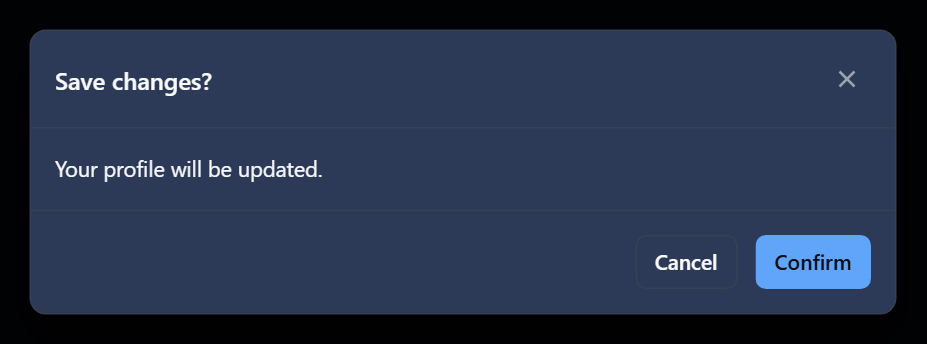
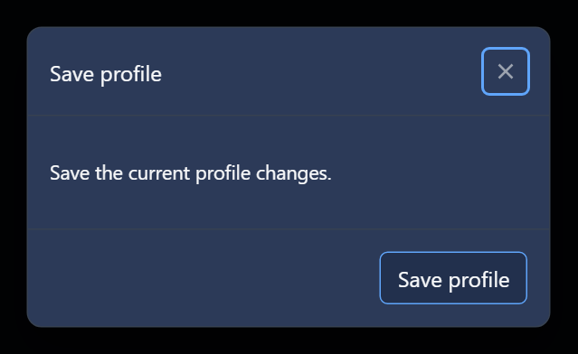

# q-dialog

`q-dialog` shows a modal message or confirmation surface with default actions and replaceable content regions.

**Component tag:** `<q-dialog>`

**Working preview:** Run `bun start` from the repository root, open the [existing playground](http://localhost:3333), then select **Overlays → Dialog**.

**On this page**

- [Quick start](#quick-start)
- [Examples](#examples)
- [Behavior & accessibility](#behavior--accessibility)
- [Styling](#styling)
- [API reference](#api-reference)

## Quick start

1. Follow the central [installation instructions](../../README.md#1-install-library).
2. In your application entry file, register WebQuark. This assumes a bundler that resolves package imports and CSS imports.

```javascript
import '@webquark/core/dist/webquark/webquark.css';
import { defineCustomElements } from '@webquark/core/loader';
defineCustomElements();
```

3. Add this markup to your application page. Any module script runs after that shared setup.

```html
<q-dialog open dialog-title="Save changes?" message="Your profile will be updated."></q-dialog>
```

**Result:** an open medium-width dialog with Cancel, Confirm, and Close controls.

### At a glance

| Capability | Options | Default |
| :--- | :--- | :--- |
| [Visibility](#state-and-interaction) | open property, show()/close() | Closed |
| [Actions](#events) | Confirm, cancel, close and loading | Default actions shown |
| [Width](#sizes) | sm, md, lg, full | md (36rem) |
| [Backdrop](#backdrops) | solid or none | solid |
| [Content](#slots) | Title/message or header/body/footer slots | Empty title/body |

**With no properties:** A closed, inert dialog wrapper renders with no visible UI. Supply a title or aria-label before opening. Playground open/title/message values are demo presets.

## Examples

These examples share the [Quick start registration](#quick-start). Screenshots show the real registered component in a temporary preview fixture using the existing playground runtime. They do not imply extra permanent playground presets.

### Open and handle a confirmation

Open from a real trigger and handle the confirmation event.



```html
<button id="open-confirm" type="button">Review changes</button>
<q-dialog id="confirm-dialog" dialog-title="Save changes?" message="Your profile will be updated."></q-dialog>
<p id="confirm-result" role="status"></p>
<script type="module">
await customElements.whenDefined('q-dialog');
const dialog = document.querySelector('#confirm-dialog');
document.querySelector('#open-confirm').addEventListener('click', () => dialog.show());
dialog.addEventListener('qConfirm', () => { document.querySelector('#confirm-result').textContent = 'Changes confirmed.'; });
</script>
```

The screenshot follows Review changes, before confirmation, and is cropped to the dialog surface; the opening button and result message are outside the crop. Confirm emits qConfirm then closes and emits qClose; it does not wait for an asynchronous listener.

### Control an asynchronous action

Use a custom footer when the application needs to keep the dialog open during work.



```html
<q-dialog id="saving-dialog" open aria-label="Save profile" size="sm">
  <span slot="header">Save profile</span>
  <p>Save the current profile changes.</p>
  <button slot="footer" id="save-profile" type="button">Save profile</button>
</q-dialog>
<script type="module">
await customElements.whenDefined('q-dialog');
const dialog = document.querySelector('#saving-dialog');
const save = document.querySelector('#save-profile');
save.addEventListener('click', async () => {
  dialog.loading = true;
  save.disabled = true;
  save.textContent = 'Saving…';
  await new Promise(resolve => setTimeout(resolve, 1500));
  dialog.loading = false;
  await dialog.close();
  save.disabled = false;
  save.textContent = 'Save profile';
});
</script>
```

The screenshot shows the initial open state. The timer simulates work; replace it with application work and handle errors. loading does not disable slotted controls, so this handler disables its own button.

## Behavior & accessibility

### State and interaction

`open` is mutable. show() sets it true; close() sets it false and emits qClose even if already closed. Setting open=false directly closes without qClose. Confirm/cancel emit their respective event, set open=false, then emit qClose. The header close button emits only qClose. Event cancellation is not checked.

Loading disables default buttons and blocks confirm/cancel, Escape, and backdrop actions. Public close() still works. Custom footer controls remain application-owned. Remove a boolean attribute or assign false for false-default properties; for true-default controls such as showCancel use the JavaScript property false (or Stencil’s explicit attribute value "false").

Closing makes the wrapper inert immediately; visibility ends after transition or its timeout fallback. Methods resolve after requesting the state change, not after the visual transition.

### Keyboard and focus

| Key | Action |
| :--- | :--- |
| Tab / Shift+Tab | Trap focus among visible focusable dialog descendants. |
| Escape | Cancel when open, closeOnEsc=true, and not loading. |
| Enter / Space | Activate a focused native action button. |

Opening after load records the previous focused element, then focuses the first focusable control after the transition. Closing attempts to restore it. Initially-open dialogs focus content but do not record a previous trigger. Keep only one modal open: the Escape listener is window-wide.

### Labels and announcements

The surface has role="dialog", aria-modal="true", tabindex="-1", and aria-hidden reflecting open. A nonblank aria-label wins; otherwise dialogTitle provides aria-labelledby. message supplies aria-describedby.

When replacing the header slot, supply aria-label: the default title target is replaced. When supplying a custom body, omit message to avoid a description reference to replaced fallback content. The confirm button exposes aria-busy while loading. Custom content and action labels remain your responsibility.

### Limitations and compatibility

The dialog does not make the rest of the document inert or lock page scrolling. Default confirm/cancel cannot be held open by preventDefault or an async event listener. Transitions and the loading spinner have no reduced-motion override. No browser/CEF conformance is inferred from these DOM features.

## Styling

### Sizes

| size | Maximum width |
| :--- | :--- |
| `sm` | 24rem |
| `md` (default) | 36rem |
| `lg` | 48rem |
| `full` | Available viewport width inside gutters |

The wrapper uses 16px gutters at a 16px root font and 100dvh height. The body scrolls while header/footer remain fixed within the surface. --q-dialog-width overrides sm/md/lg; full removes max-width and ignores that hook. Unknown sizes use the medium rule.

### Backdrops

`solid` (default) draws the theme overlay; `none` leaves a transparent click layer. Unknown values normalize to solid. `closeOnOverlayClick` controls cancellation separately.

### Custom styling

Scope CSS to the host or supplied content. See the exact [CSS variables](#css-variables) and [Shadow Parts](#shadow-parts).

```html
<q-dialog class="review-dialog" open dialog-title="Review" message="Check the details."></q-dialog>
<style>
  q-dialog.review-dialog { --q-dialog-width: 40rem; --q-dialog-body-padding: 24px; }
</style>
```

Shared geometry and theme setup are documented in [Foundation](../foundation.md) and [theme tokens](../theme-tokens.md).

## API reference

Cross-check the [generated API](../../src/components/overlays/dialog/readme.md) and [implementation](../../src/components/overlays/dialog/dialog.tsx). Source nullability and actual rendering limitations are preserved below.

### Properties

All properties are optional and listed alphabetically.

| Name | Default | Description |
| :--- | :--- | :--- |
| `ariaLabel` | `null` | Nonblank explicit dialog name; overrides dialogTitle association.<br>**Type:** `string \| null`. **HTML attribute:** `aria-label`. **Required:** No. |
| `backdropEffect` | `'solid'` | solid or none; unknown values render solid.<br>**Type:** `"none" \| "solid"`. **HTML attribute:** `backdrop-effect`. **Required:** No. |
| `cancelLabel` | `'Cancel'` | Default cancel-button text.<br>**Type:** `string`. **HTML attribute:** `cancel-label`. **Required:** No. |
| `closeLabel` | `'Close dialog'` | Header close-button accessible name; no blank fallback.<br>**Type:** `string`. **HTML attribute:** `close-label`. **Required:** No. |
| `closeOnEsc` | `true` | Allows Escape to cancel unless loading.<br>**Type:** `boolean`. **HTML attribute:** `close-on-esc`. **Required:** No. |
| `closeOnOverlayClick` | `true` | Allows backdrop clicks to cancel unless loading.<br>**Type:** `boolean`. **HTML attribute:** `close-on-overlay-click`. **Required:** No. |
| `confirmLabel` | `'Confirm'` | Default confirm-button text.<br>**Type:** `string`. **HTML attribute:** `confirm-label`. **Required:** No. |
| `dialogTitle` | `undefined` | Default header title and accessible-name source.<br>**Type:** `string`. **HTML attribute:** `dialog-title`. **Required:** No. |
| `loading` | `false` | Disables built-in actions and marks confirm busy; does not disable slotted controls.<br>**Type:** `boolean`. **HTML attribute:** `loading`. **Required:** No. |
| `message` | `undefined` | Default body text and accessible-description source.<br>**Type:** `string`. **HTML attribute:** `message`. **Required:** No. |
| `open` | `false` | Mutable visibility state; direct assignment does not emit qClose.<br>**Type:** `boolean`. **HTML attribute:** `open`. **Required:** No. |
| `showCancel` | `true` | Renders the default Cancel button.<br>**Type:** `boolean`. **HTML attribute:** `show-cancel`. **Required:** No. |
| `showConfirm` | `true` | Renders the default Confirm button.<br>**Type:** `boolean`. **HTML attribute:** `show-confirm`. **Required:** No. |
| `size` | `'md'` | sm, md, lg, or full; controls maximum surface width.<br>**Type:** `"full" \| "lg" \| "md" \| "sm"`. **HTML attribute:** `size`. **Required:** No. |

### Slots

| Name | Description |
| :--- | :--- |
| (default) | Custom body; replaces message fallback. Omit message with custom body to avoid a dangling description target. |
| footer | Custom actions replace defaults. Application owns disabled/loading behavior. Footer is hidden when empty and both default actions are disabled. |
| header | Custom heading replaces dialogTitle fallback. Supply aria-label when using it. |

### Events

| Name | When it fires | Payload |
| :--- | :--- | :--- |
| `qCancel` | Cancel action, enabled Escape, or enabled backdrop click; followed by qClose. | `CustomEvent<void>` |
| `qClose` | close(), confirm/cancel, or header close action; not direct open assignment. | `CustomEvent<void>` |
| `qConfirm` | Confirm action when not loading; followed by qClose. | `CustomEvent<void>` |

These events bubble, cross shadow boundaries (composed), and are cancelable. The implementation does not check preventDefault(); cancellation does not stop the documented state changes.

### Methods

Wait for `customElements.whenDefined('q-dialog')` before calling element methods.

| Signature | Purpose | Returns |
| :--- | :--- | :--- |
| `cancel(): Promise<void>` | Emit cancel then close unless loading. | `Promise<void>` |
| `close(): Promise<void>` | Close and emit qClose, including while loading. | `Promise<void>` |
| `confirm(): Promise<void>` | Emit confirm then close unless loading. | `Promise<void>` |
| `show(): Promise<void>` | Set open=true. | `Promise<void>` |

### Styling hooks

#### CSS variables

Defaults include the shared theme when set there; nested `var()` expressions show CSS fallbacks. Shared palette/typography tokens and fallback aliases are listed in the [shared variable reference](../theme_variables.md). Internal `--_q-*` variables are not public hooks.

| Name | Default | Controls |
| :--- | :--- | :--- |
| `--q-dialog-backdrop-bg` | `var(--q-bg-overlay, rgba(0, 0, 0, 0.85))` | Base declaration is overridden by solid/none rules; use --q-dialog-backdrop-solid-bg for solid mode. |
| `--q-dialog-backdrop-solid-bg` | `var(--q-bg-overlay, rgba(0, 0, 0, 0.85))` | backdrop solid background. |
| `--q-dialog-bg` | `var(--q-bg-floating, var(--q-bg-surface-4, #2c3a58))` | background. |
| `--q-dialog-body-bg` | `transparent` | body background. |
| `--q-dialog-body-padding` | `var(--q-space-lg, 1rem)` | body padding. |
| `--q-dialog-footer-bg` | `transparent` | footer background. |
| `--q-dialog-footer-padding` | `var(--q-space-lg, 1rem)` | footer padding. |
| `--q-dialog-gutter` | `var(--q-space-lg, 1rem)` | gutter. |
| `--q-dialog-header-bg` | `transparent` | header background. |
| `--q-dialog-header-padding` | `var(--q-space-lg, 1rem)` | header padding. |
| `--q-dialog-width` | `36rem (md); 24rem sm; 48rem lg` | Maximum width for sm/md/lg only; full overrides max-width with none. |

#### Shadow Parts

| Name | Targets |
| :--- | :--- |
| `backdrop` | Backdrop click layer. |
| `body` | Body region. |
| `cancel-btn` | Default cancel button when showCancel; fallback hidden if footer is slotted. |
| `close-btn` | Default header close button. |
| `confirm-btn` | Default confirm button when showConfirm; fallback hidden if footer is slotted. |
| `footer` | Footer region, hidden when no default actions or slotted content. |
| `header` | Header region. |
| `modal` | Dialog surface. |
