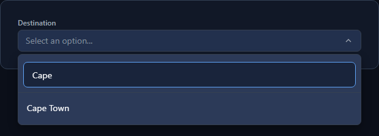
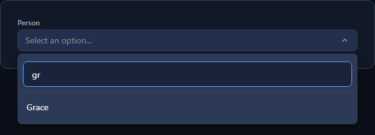
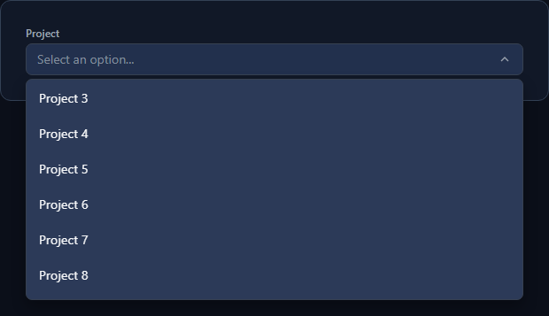

# q-dropdown

`q-dropdown` chooses a string value from a floating option menu with optional local or external search.

**Component tag:** `<q-dropdown>`

**Working preview:** Run `bun start` from the repository root, open the [existing playground](http://localhost:3333), then select **Forms & inputs → Dropdown**. The examples below use this registered runtime with their own markup and data; playground presets are demonstrations, not component defaults.

**On this page**

- [Quick start](#quick-start)
- [Examples](#examples)
- [Behavior & accessibility](#behavior--accessibility)
- [Styling](#styling)
- [API reference](#api-reference)

## Quick start

1. Follow the central [installation instructions](../../README.md#1-install-library).
2. In your application entry file (for example `src/main.js`), register the elements and load the theme. This requires a bundler that resolves package imports and CSS imports.

```javascript
import "@webquark/core/dist/webquark/webquark.css";
import { defineCustomElements } from "@webquark/core/loader";

defineCustomElements();
```

3. Put the following markup in your application HTML.

```html
<q-dropdown label="Status" name="status" value="Draft"
  options='["Draft","Published","Archived"]'></q-dropdown>
```

**Result:** A labelled Status trigger showing Draft; activating it opens the option menu.

### At a glance

| Capability | Options | Default |
| :--- | :--- | :--- |
| [Options](#option-data) | Strings or label/value objects; array or JSON | [] |
| [Search and pages](#state-and-interaction) | Local search, externalSearch, hasMore/loading | off |
| [Placement](#placement) | auto, top, bottom; collision padding | auto; 8px |
| [Size](#sizes) | inherit, sm, md, lg | inherit; standalone md |
| [Field help](#labels-and-announcements) | label, aria-label, description, labelHidden, reserveFeedback | no label/help |
| [Forms](#forms) | name, required, error; validity and focus methods | optional; enabled |

**With no properties:** A medium effective-size trigger shows “Select an option...”; opening it shows “No matches found”. Add options and a label/aria-label.

## Examples

Use the registration above first. Each HTML block belongs in the page body; its module script runs after the element is registered. CSS in a `<style>` block belongs in the page or your application stylesheet.

### Search a known set of options

Enable searchable to filter supplied option labels in the menu.



```html
<q-dropdown label="Destination" searchable
  options='[{"label":"Cape Town","value":"CPT"},{"label":"Durban","value":"DUR"},{"label":"Johannesburg","value":"JNB"}]'></q-dropdown>
```

Open Destination and type Cape to reach the screenshot; the crop includes the floating menu.

### Let the application provide search results

Handle qSearch and replace the external results array.



```html
<q-dropdown id="person-search" label="Person" searchable external-search></q-dropdown>
<script type="module">
  await customElements.whenDefined("q-dropdown");
  const people = [
    { label: "Ada", value: "ada" }, { label: "Grace", value: "grace" },
    { label: "Linus", value: "linus" }
  ];
  const picker = document.querySelector("#person-search");
  picker.options = people;
  picker.addEventListener("qSearch", event => {
    picker.options = people.filter(person =>
      person.label.toLowerCase().includes(event.detail.toLowerCase()));
  });
</script>
```

Open Person and type gr. This complete example uses local data in the application handler; an async handler must also manage loading and stale responses.

### Append another application-owned page

Use hasMore and qLoadMore to extend an externally managed option list.



```html
<q-dropdown id="paged-options" label="Project" external-search has-more></q-dropdown>
<script type="module">
  await customElements.whenDefined("q-dropdown");
  const picker = document.querySelector("#paged-options");
  picker.options = Array.from({ length: 8 }, (_, i) => ({
    label: "Project " + (i + 1), value: String(i + 1)
  }));
  picker.addEventListener("qLoadMore", () => {
    picker.options = [...picker.options, { label: "Project 9", value: "9" }];
    picker.hasMore = false;
  });
</script>
```

Open Project and scroll to the bottom to append Project 9. A real network request should set loading while pending and clear it when finished.

## Behavior & accessibility

### State and interaction

Selecting an option writes mutable value, closes the menu, emits qChange then qSelect, and returns focus to the trigger. Selecting the already-selected option still emits both. JavaScript value assignment emits neither. A value missing from the current options page displays the placeholder while retaining its stored/form value.

Local search filters labels case-insensitively using the trimmed query. It initially renders at most 20 matches; scrolling to within 5px of the bottom adds 20 after an 800ms loading interval. This is incremental rendering of already-supplied data, not a network request.

With externalSearch, the component renders all supplied options without local filtering. Search input emits qSearch when searchable; scrolling to the bottom emits qLoadMore if hasMore and not loading. The application must replace/append options and manage loading/hasMore. An outstanding load latch clears when options changes or loading becomes false. Opening/closing resets search state; opening does not automatically emit a blank qSearch.

Effective disabling blocks opening, searching and selection. Setting disabled or disabling an ancestor fieldset closes an open menu, stops its floating updates and disables the trigger/search controls. Re-enabling preserves the consumer's explicit disabled property.

### Keyboard and focus

ArrowDown/ArrowUp open the menu. Nonsearchable trigger navigation moves the active index; Home/End jump within currently rendered options. Enter/Space chooses an active option or toggles the menu. Escape closes and focuses the trigger; Tab closes while allowing normal focus traversal. Searchable opening moves focus to its text input. In that input, Enter chooses the first match; ArrowDown sets the first active index but leaves DOM focus in the input, so repeated ArrowDown there does not advance through the whole list.

### Labels and announcements

Label names the trigger; nonblank ariaLabel is forwarded and names the list too. labelHidden keeps label accessible. The trigger exposes aria-haspopup=listbox, aria-expanded, and conditional aria-controls/aria-activedescendant; the menu/options use listbox/option and aria-selected. The search input has combobox attributes and a Search... placeholder, but no separate durable label property.

Description is replaced by error feedback. The feedback span always exists with aria-live=polite and is described by the trigger when text exists. This is DOM/ARIA behavior, not a screen-reader conformance claim. reserveFeedback inherits a form setting when omitted; true reserves 1rem and false opts out.

### Forms

Native reset and q-form reset actions restore this field's initial value captured at first initialization. Later assignments, movement between forms and reconnecting preserve that default; reset is silent. q-form cancellation prevents restoration. Native form ownership takes precedence over a logical wrapper.

Explicit disabled state combines with disabled fieldsets and their first-legend exception without changing the public disabled property. Re-enabling restores the current controlled value and constraints. Direct property writes and public queries reconcile native state without requiring an animation frame.

q-form omits unavailable local selections instead of collecting an unmatched raw value. externalSearch retains a nonempty unloaded domain value; a known disabled selection is omitted. setValues takes string/null silently and reconciles required validity. Native ownership and inherited disabled fieldsets govern collection, validity and the internal trigger/search controls.


The successful string selection participates through ElementInternals; reset restores the first-load value. Local selections need an enabled matching option. externalSearch preserves a nonempty unloaded domain value, unless a known option is disabled. Empty required selections remain invalid even when an empty-value option exists. Nonblank error sets customError. Disabled is valid and excluded from native submission. checkValidity() checks these rules, reportValidity() also focuses the trigger and reports invalidity.

### Limitations and compatibility

Options cannot individually be disabled and there is no multiple-selection mode. Supply an array; malformed JSON falls back to [], while valid non-array JSON can fail because the normalizer calls flatMap. No configurable search/loading/empty text exists. Use finite nonnegative collisionPadding: negatives clamp to zero, nonfinite values are not repaired. The menu uses the top layer when Popover API is available, otherwise fixed positioning; clipping behavior needs checking in the target browser. Loading spins every 0.6 seconds with no reduced-motion override.

## Styling

Use size and placement. The menu background has a separate hook from the field trigger.

### Sizes

`size="inherit"` is the declared default: it uses the nearest [q-form](./q-form.md) or [q-toolbar](./q-toolbar.md) scope, with `md` geometry when no scope exists. Explicit `sm`, `md`, or `lg` overrides that scope. Changing a scope updates inherited dimensions without changing the child's size property.

| Effective size | Minimum control height | Text / line height | Horizontal padding | Radius |
| :--- | :--- | :--- | :--- | :--- |
| `sm` | 1.75rem (28px) | 0.75 / 1rem | 0.5rem | 0.34375rem |
| `md` | 2.25rem (36px) | 0.875 / 1.25rem | 0.75rem | 0.4375rem |
| `lg` | 2.75rem (44px) | 1 / 1.5rem | 1rem | 0.53125rem |

Pixel equivalents assume a 16px root font. Heights are minimums; content and overrides can grow them. See the shared [sizing foundation](../foundation.md#choose-size-once).

Trigger geometry inherits the scope. Explicit sm/md/lg also has menu-item and search padding/font rules; default inherit retains the base menu styles. The menu list scrolls at 240px maximum height, additionally bounded by viewport space.

### Placement

`auto` (default) chooses below if the menu fits or below has at least as much room; otherwise above. `top` or `bottom` forces that side while limiting menu height. Position follows viewport resize, scrolling and ResizeObserver updates. The menu is offset 4px and clamped to collisionPadding from viewport edges.

### Custom styling

Use the [CSS variables](#css-variables) or [Shadow Parts](#shadow-parts) for supported customization. This matching markup and CSS can be used together:

```html
<q-dropdown class="status-field" label="Status" value="Draft" options='["Draft","Published"]'></q-dropdown>
<style>
  q-dropdown.status-field { --q-dropdown-radius: 12px; --q-dropdown-menu-bg: #172554; }
</style>
```

Trigger background resolves component → shared field → field surface role. Menu background resolves component → floating role → surface-4. Radius resolves component → field radius → control radius. Position/width/max-height are inline calculations, so styling the menu part should not assume those dimensions are free CSS values. Shared scrollbar hooks affect the internal list.

Keep shared setup in [Theme variables](../theme_variables.md), [Theme tokens](../theme-tokens.md), and the [sizing, spacing and surface foundation](../foundation.md).

## API reference

Cross-check the [generated API](../../src/components/inputs/dropdown/readme.md), [implementation](../../src/components/inputs/dropdown/dropdown.tsx), and imported public types. The entries below preserve source defaults and runtime qualifications.

### Properties

All properties are optional in the TypeScript component contract. Required content/labels and conditional constraints are explained with each workflow. Properties are alphabetical.

| Name | Default | Description |
| :--- | :--- | :--- |
| `ariaLabel` | `null` | Accessible trigger/list name; nonblank value takes precedence.<br>**Type:** `string \| null`. **HTML attribute:** `aria-label`. **Required:** No. |
| `collisionPadding` | `8` | Viewport margin in CSS pixels; negative finite values clamp to 0.<br>**Type:** `number`. **HTML attribute:** `collision-padding`. **Required:** No. |
| `description` | `undefined` | Supporting text replaced by error.<br>**Type:** `string`. **HTML attribute:** `description`. **Required:** No. |
| `disabled` | `false` | Disables trigger/search/selection actions and closes an open menu. Combines with inherited fieldset disabling.<br>**Type:** `boolean`. **HTML attribute:** `disabled`. **Required:** No. |
| `error` | `undefined` | Custom validity error when nonblank; truthy text supplies visible feedback.<br>**Type:** `string`. **HTML attribute:** `error`. **Required:** No. |
| `externalSearch` | `false` | Delegates filtering/pagination to the application; all supplied options render.<br>**Type:** `boolean`. **HTML attribute:** `external-search`. **Required:** No. |
| `hasMore` | `false` | Allows qLoadMore in externalSearch mode when not loading.<br>**Type:** `boolean`. **HTML attribute:** `has-more`. **Required:** No. |
| `label` | `undefined` | Visible trigger label.<br>**Type:** `string`. **HTML attribute:** `label`. **Required:** No. |
| `labelHidden` | `false` | Visually hides label while retaining its accessible name.<br>**Type:** `boolean`. **HTML attribute:** `label-hidden`. **Required:** No. |
| `loading` | `false` | Shows a loading row while open; does not disable the trigger or existing options.<br>**Type:** `boolean`. **HTML attribute:** `loading`. **Required:** No. |
| `name` | `undefined` | Name used for native form submission.<br>**Type:** `string`. **HTML attribute:** `name`. **Required:** No. |
| `options` | `[]` | Array or JSON string; see [Option data](#option-data).<br>**Type:** `DropdownOptionInput[] \| string`. **HTML attribute:** `options`. **Required:** No. |
| `placeholder` | `'Select an option...'` | Displayed when no matching labelled option exists.<br>**Type:** `string`. **HTML attribute:** `placeholder`. **Required:** No. |
| `placement` | `'auto'` | Menu side; see [Placement](#placement).<br>**Type:** `'auto' \| 'top' \| 'bottom'`. **HTML attribute:** `placement`. **Required:** No. |
| `required` | `false` | Requires any truthy value, independently of option membership.<br>**Type:** `boolean`. **HTML attribute:** `required`. **Required:** No. |
| `reserveFeedback` | `undefined` | undefined inherits the form; true reserves 1rem; false opts out.<br>**Type:** `boolean`. **HTML attribute:** `reserve-feedback`. **Required:** No. |
| `searchable` | `false` | Adds a text search input; local filtering unless externalSearch.<br>**Type:** `boolean`. **HTML attribute:** `searchable`. **Required:** No. |
| `size` | `'inherit'` | Inherited or explicit geometry; see [Sizes](#sizes).<br>**Type:** `'inherit' \| 'sm' \| 'md' \| 'lg'`. **HTML attribute:** `size`. **Required:** No. |
| `value` | `''` | Mutable stored string; unmatched values show placeholder but remain valid when required.<br>**Type:** `string`. **HTML attribute:** `value`. **Required:** No. |

Boolean attributes use Stencil coercion: presence/empty string is true, the literal string `"false"` is false, and removing the attribute supplies false rather than restoring a true or undefined initializer. Prefer explicit JavaScript `true`/`false` for updates; an optional Boolean can be reset to `undefined` through its property to recover inheritance/detection. String attributes remain strings; numeric attributes are parsed as numbers, so invalid text can become `NaN`. Setting a property to `undefined` or removing a string/number attribute does not rerun its initializer. Keep values within the documented types.

#### Option data

`DropdownOptionInput = string | Option`, where `Option` has required `label: string` and `value: string`. String entries are trimmed; blank strings are omitted. Object values must be strings (including an empty string); missing/nonstring labels normalize to empty labels, not the value. Use unique stable values. qSelect returns the normalized object.

Pass arrays through the JavaScript property after registration, or a JSON array through the HTML options attribute. Reassign the array after edits; in-place mutation alone does not trigger a property update.

### Slots

| Name | Description |
| :--- | :--- |
| `icon-left` | Leading trigger content, normally decorative; no fallback. |

### Events

| Name | When it fires | Payload |
| :--- | :--- | :--- |
| `qBlur` | The interactive field/control loses focus. | `CustomEvent<FocusEvent>` |
| `qChange` | A user interaction updates or commits the value; see State and interaction. | `CustomEvent<string>` |
| `qClick` | Activation of the enabled interactive control; detail is the original MouseEvent. | `CustomEvent<MouseEvent>` |
| `qFocus` | The interactive field/control receives focus. | `CustomEvent<FocusEvent>` |
| `qLoadMore` | External list reaches its bottom with hasMore and not loading. | `CustomEvent<void>` |
| `qSearch` | Search input changes while externalSearch is enabled. | `CustomEvent<string>` |
| `qSelect` | An option is selected, including reselection of the current option. | `CustomEvent<Option>` |

All listed Stencil events bubble, cross shadow boundaries (`composed: true`), and are cancelable. The component handlers do not use the emitted event's canceled result to roll back state or automatically cancel the underlying native event. For forwarded MouseEvent details, the original event is available as `event.detail`.

### Methods

With the loader used above, first `await customElements.whenDefined("q-dropdown");` and `await element.componentOnReady();` before invoking methods. `componentOnReady()` is loader readiness, not an additional component-defined method. All listed methods return promises.

| Signature | Purpose | Returns |
| :--- | :--- | :--- |
| `checkValidity(): Promise<boolean>` | Checks required/custom-error rules and synchronizes ElementInternals. | `boolean` |
| `focusElement(): Promise<void>` | Focuses the native trigger. | `void` |
| `reportValidity(): Promise<boolean>` | Checks validity, focuses an invalid trigger and asks ElementInternals to report it. | `boolean` |

### Styling hooks

#### CSS variables

Defaults below show the local fallback chains; references to shared tokens depend on the active theme. Private `--_q-*` variables are implementation details and are not supported overrides. Component and functional shared hooks are listed; global palette/spacing/typography values are catalogued in [Theme tokens](../theme-tokens.md). See [Custom styling](#custom-styling) for effective precedence and exceptions.

| Name | Default | Controls |
| :--- | :--- | :--- |
| `--q-bg-field` | `var(--q-bg-surface-3, #22304d)` | Background. |
| `--q-bg-floating` | `var(--q-bg-surface-4, #2c3a58)` | Background. |
| `--q-context-control-font` | `var(--q-control-font-md, 0.875rem)` | Context control font. Inherited context; explicit component size/state may override it. |
| `--q-context-control-height` | `var(--q-control-height-md, 2.25rem)` | Context control height. Inherited context; explicit component size/state may override it. |
| `--q-context-control-icon` | `var(--q-control-icon-md, 1rem)` | Context control icon. Inherited context; explicit component size/state may override it. |
| `--q-context-control-line` | `var(--q-control-line-md, 1.25rem)` | Context control line. Inherited context; explicit component size/state may override it. |
| `--q-context-control-padding` | `var(--q-control-padding-md, 0.75rem)` | Context control padding. Inherited context; explicit component size/state may override it. |
| `--q-context-control-radius` | `var(--q-control-radius-md, 0.4375rem)` | Context control radius. Inherited context; explicit component size/state may override it. |
| `--q-context-feedback-min` | `0px` | Min-block-size, margin. Inherited context; explicit component size/state may override it. |
| `--q-control-font-lg` | `1rem` | Control font lg. Shared geometry for the named size. |
| `--q-control-font-md` | `0.875rem` | Control font md. Shared geometry for the named size. |
| `--q-control-font-sm` | `0.75rem` | Control font sm. Shared geometry for the named size. |
| `--q-control-height-lg` | `2.75rem` | Control height lg. Shared geometry for the named size. |
| `--q-control-height-md` | `2.25rem` | Control height md. Shared geometry for the named size. |
| `--q-control-height-sm` | `1.75rem` | Control height sm. Shared geometry for the named size. |
| `--q-control-icon-lg` | `1.25rem` | Control icon lg. Shared geometry for the named size. |
| `--q-control-icon-md` | `1rem` | Control icon md. Shared geometry for the named size. |
| `--q-control-icon-sm` | `0.875rem` | Control icon sm. Shared geometry for the named size. |
| `--q-control-line-lg` | `1.5rem` | Control line lg. Shared geometry for the named size. |
| `--q-control-line-md` | `1.25rem` | Control line md. Shared geometry for the named size. |
| `--q-control-line-sm` | `1rem` | Control line sm. Shared geometry for the named size. |
| `--q-control-padding-lg` | `1rem` | Control padding lg. Shared geometry for the named size. |
| `--q-control-padding-md` | `0.75rem` | Control padding md. Shared geometry for the named size. |
| `--q-control-padding-sm` | `0.5rem` | Control padding sm. Shared geometry for the named size. |
| `--q-control-radius-lg` | `0.53125rem` | Control radius lg. Shared geometry for the named size. |
| `--q-control-radius-md` | `0.4375rem` | Control radius md. Shared geometry for the named size. |
| `--q-control-radius-sm` | `0.34375rem` | Control radius sm. Shared geometry for the named size. |
| `--q-dropdown-bg` | `var(--q-field-bg, var(--q-bg-field, var(--q-bg-surface-3, #22304d)))` | Background. |
| `--q-dropdown-border` | `var(--q-field-border)` | Border, border-bottom. |
| `--q-dropdown-font-size` | `var(--_q-control-font)` | Font-size. |
| `--q-dropdown-height` | `var(--_q-control-height)` | Min-height. |
| `--q-dropdown-icon-gap` | `10px` | Gap. |
| `--q-dropdown-menu-bg` | `var(--q-bg-floating, var(--q-bg-surface-4, #2c3a58))` | Background. |
| `--q-dropdown-padding` | `0 var(--_q-control-padding)` | Padding. |
| `--q-dropdown-radius` | `var(--q-radius-md, 8px)` | Border-radius. |
| `--q-field-bg` | `var(--q-bg-field, var(--q-bg-surface-3, #22304d))` | Background. |
| `--q-field-border` | `var(--q-border)` | Fallback for --q-dropdown-border. |
| `--q-field-feedback-font` | `.75rem` | Font-size. |
| `--q-field-label-font` | `.75rem` | Font-size. |
| `--q-field-padding` | `10px 14px` | Padding. |
| `--q-field-radius` | `var(--_q-control-radius)` | Border-radius. |
| `--q-scrollbar-radius` | `var(--q-radius-sm, 4px)` | Border-radius. |
| `--q-scrollbar-thumb-color` | `var(--q-border-color, #374151)` | Background. |
| `--q-scrollbar-thumb-color-hover` | `var(--q-color-primary, #60a5fa)` | Background. |
| `--q-scrollbar-track-color` | `transparent` | Background. |
| `--q-scrollbar-width` | `6px` | Width, height. |

#### Shadow Parts

| Name | Targets |
| :--- | :--- |
| `description` | Feedback when no truthy error, including empty text. |
| `error-msg` | Additional feedback part while error is truthy. |
| `feedback` | Always-present polite feedback span. |
| `focused-item` | Additional part on the active-index option while open. |
| `item` | Each normalized visible option while open. |
| `label` | Visible label when supplied; can be visually hidden. |
| `menu` | Floating listbox; only while open. |
| `selected-item` | Additional part on visible options matching value. |
| `trigger` | Native opening button; always present. |
