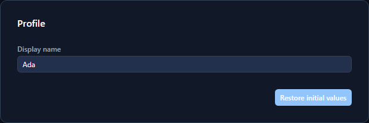

# q-form

`q-form` collects and validates named controls while sharing field size and feedback spacing.

**Component tag:** `<q-form>`

**Working preview:** Run `bun start` from the repository root, open the [existing playground](http://localhost:3333), then select **Forms & inputs → Form**. The examples below use this registered runtime with their own markup and data; playground presets are demonstrations, not component defaults.

**On this page**

- [Quick start](#quick-start)
- [Examples](#examples)
- [Behavior & accessibility](#behavior--accessibility)
- [Styling](#styling)
- [API reference](#api-reference)

## Quick start

1. Follow the central [installation instructions](../../README.md#1-install-library).
2. In your application entry file (for example `src/main.js`), register the elements and load the theme. This requires a bundler that resolves package imports and CSS imports.

```javascript
import "@webquark/core/dist/webquark/webquark.css";
import { defineCustomElements } from "@webquark/core/loader";

defineCustomElements();
```

3. Put the following markup in your application HTML.

```html
<q-form label="Contact details">
  <q-input label="Email" name="email" type="email" required></q-input>
  <q-button slot="actions" type="submit">Save</q-button>
</q-form>
```

**Result:** A labelled form with a required Email field and Save action; valid submission emits qSubmit without navigation by default.

### At a glance

| Capability | Options | Default |
| :--- | :--- | :--- |
| [Collection](#forms) | Native/WebQuark named controls; values and FormData | empty |
| [Submission](#state-and-interaction) | qSubmit; validation; native action/method | preventDefault true; post |
| [Enter policy](#keyboard-and-focus) | submit, focus-next, none | submit |
| [Shared size](#sizes) | inherit, sm, md, lg | inherit; standalone md |
| [Feedback spacing](#labels-and-announcements) | reserveFeedback | inherit/collapsed |
| [Presentation](#slots) | header/default/actions; labelHidden | empty |

**With no properties:** An empty native form shell renders without header, fields, actions, or accessible name. Add a label/aria-label and named controls.

## Examples

Use the registration above first. Each HTML block belongs in the page body; its module script runs after the element is registered. CSS in a `<style>` block belongs in the page or your application stylesheet.

### Handle a valid application submission

Listen to qSubmit and use its collected values.


```html
<q-form id="contact-form" label="Contact details" reserve-feedback>
  <q-input label="Email" name="email" type="email" value="ada@example.com" required></q-input>
  <q-toggle label="Email updates" name="updates" checked></q-toggle>
  <q-button slot="actions" type="submit">Save</q-button>
</q-form>
<output id="contact-result">Ready to save</output>
<script type="module">
  await customElements.whenDefined("q-form");
  document.querySelector("#contact-form").addEventListener("qSubmit", event => {
    document.querySelector("#contact-result").textContent =
      "Saved " + event.detail.values.email + "; updates: " + event.detail.values.updates;
  });
</script>
```

Click Save to reach the shown state; the example displays the payload locally.

### Restore the form's initial values

Call resetForm to run the explicit restoration bridge for slotted fields.



```html
<q-form id="profile-form" label="Profile" size="sm">
  <q-input name="displayName" label="Display name" value="Ada"></q-input>
  <q-button id="restore-profile" slot="actions" type="button">Restore initial values</q-button>
</q-form>
<script type="module">
  await customElements.whenDefined("q-form");
  const form = document.querySelector("#profile-form");
  await form.componentOnReady();
  document.querySelector("#restore-profile").addEventListener("qClick", () => form.resetForm());
</script>
```

Edit Display name, then activate Restore initial values. The screenshot shows the restored value.

### Arrange fields under one size scope

Combine q-grid and q-inline inside a form while preserving field collection.


```html
<q-form label="Delivery address" size="md" reserve-feedback>
  <q-grid columns="2" min-item-width="12rem" gap="lg">
    <q-input data-q-span="full" label="Street" name="street" value="12 Main Road"></q-input>
    <q-input label="City" name="city" value="Cape Town"></q-input>
    <q-input label="Postal code" name="postalCode" value="8001" description="Four digits"></q-input>
  </q-grid>
  <q-inline slot="actions" justify="end">
    <q-button type="submit">Use address</q-button>
  </q-inline>
</q-form>
```

## Behavior & accessibility

### State and interaction

Valid submission emits qSubmit with values, FormData, the inner form and original submit event. preventDefault=true cancels the native event's navigation; false permits native behavior where submission originated natively. q-button submit/reset clicks are explicitly bridged because those controls live outside the native form's shadow boundary. The bridge dispatches a submit event, so it does not itself perform a browser navigation.

submitForm() requests native submission and awaits the pending validation task. setValues() applies values to matching names without emitting synthetic input/change events. resetForm() resets native and known controls, then reapplies the initial values captured after first mount. In contrast, a q-button type=reset click calls the inner native form reset; that path emits qReset but does not call the wrapper's explicit resetValues/applyValues bridge. Use resetForm() when restoring slotted controls is required.

### Keyboard and focus

submit leaves Enter's native behavior alone; it does not add a universal Enter-to-submit bridge for every slotted shadow input. focus-next intercepts Enter on eligible named q-input/native text inputs and focuses the next; Shift+Enter moves backward. Enter on the last eligible field requests submit. none prevents the intercepted Enter action. Multiline, contenteditable, other native interactive controls, non-input q-* controls, modifiers and IME composition are excluded.

### Labels and announcements

label supplies the default visible title and native form name. ariaLabel takes precedence. When a custom header is supplied, label becomes aria-label instead of labelling by the hidden default title. labelHidden visually hides the header container while keeping its content accessible. Supply an explicit name when using a custom header alone.

reserveFeedback publishes an inherited 1rem minimum when true, 0px when false; undefined returns to inherited context. Individual fields can opt out. The form does not add a live region; compatible child fields expose their own polite feedback.

### Forms

The wrapper discovers named controls in its light DOM and assigned content, including descendants through ordinary layout wrappers. It does not traverse consumer-owned nested shadow roots. Disabled controls and noneditable q-syntax-box are skipped. Native FormData is collected first, then values from otherwise unassociated slotted controls are appended.

Repeated submitted names become arrays. The values object additionally represents q-toggle as a Boolean (including false), even though unchecked toggles have no FormData entry. Input numbers generally remain strings after FormData collection. Unselected native checkbox/radio controls may appear as null in values even when absent from FormData. For slotted custom controls, the bridge reads their value property; for example an unmatched q-radio-group value can enter the wrapper's collection even when the control would omit it from native FormData. Required validation still runs first unless noValidate.

setValues takes the first element of an array and assigns it to every matching control. It is not a general inverse for grouped radios, repeated names, multi-selects or files. Do not nest forms. noValidate skips wrapper/native validation; applications must handle their own validation when using it.

### Limitations and compatibility

The wrapper is not itself a form-associated field and has no public checkValidity/reportValidity API. Native navigation with preventDefault=false can happen before asynchronous custom validation completes; use the default event-driven flow for application submission. Custom header content does not automatically name the form. A whitespace-only ariaLabel is truthy for suppressing aria-labelledby yet trims away when rendered, so use nonblank names. There is no component-specific animation.

## Styling

Use size for descendants and layout primitives for field/action arrangements.

### Sizes

`size="inherit"` is the declared default: it uses the nearest [q-form](./q-form.md) or [q-toolbar](./q-toolbar.md) scope, with `md` geometry when no scope exists. Explicit `sm`, `md`, or `lg` overrides that scope. Changing a scope updates inherited dimensions without changing the child's size property.

| Effective size | Minimum control height | Text / line height | Horizontal padding | Radius |
| :--- | :--- | :--- | :--- | :--- |
| `sm` | 1.75rem (28px) | 0.75 / 1rem | 0.5rem | 0.34375rem |
| `md` | 2.25rem (36px) | 0.875 / 1.25rem | 0.75rem | 0.4375rem |
| `lg` | 2.75rem (44px) | 1 / 1.5rem | 1rem | 0.53125rem |

Pixel equivalents assume a 16px root font. Heights are minimums; content and overrides can grow them. See the shared [sizing foundation](../foundation.md#choose-size-once).

q-form publishes geometry through inherited context variables; its own header/body are not fixed-height controls. Explicit child sizes override it. Changing size back to inherit removes the form's inline scope values.

### Layout

The form shell/body use vertical flex layout; actions align to the end and wrap. Use [q-grid](./q-grid.md), [q-stack](./q-stack.md), or [q-inline](./q-inline.md) inside slots for composition. reserveFeedback aligns one-line field-help space, not arbitrary multiline labels or messages.

### Custom styling

Use the [CSS variables](#css-variables) or [Shadow Parts](#shadow-parts) for supported customization. This matching markup and CSS can be used together:

```html
<q-form class="profile-form" label="Profile">
  <q-input label="Display name" name="displayName"></q-input>
</q-form>
<style>
  q-form.profile-form { --q-form-gap: 20px; --q-form-field-gap: 16px; }
</style>
```

The form size prop writes context variables inline on its host when explicit; use the prop for the scope. With inherit it removes its own values so ancestor context resumes. The feedback scope works the same way. Form region tokens do not change child field surface tokens.

Keep shared setup in [Theme variables](../theme_variables.md), [Theme tokens](../theme-tokens.md), and the [sizing, spacing and surface foundation](../foundation.md).

## API reference

Cross-check the [generated API](../../src/components/inputs/form/readme.md), [implementation](../../src/components/inputs/form/form.tsx), and imported public types. The entries below preserve source defaults and runtime qualifications.

### Properties

All properties are optional in the TypeScript component contract. Required content/labels and conditional constraints are explained with each workflow. Properties are alphabetical.

| Name | Default | Description |
| :--- | :--- | :--- |
| `action` | `undefined` | Native form action URL; default navigation is prevented.<br>**Type:** `string`. **HTML attribute:** `action`. **Required:** No. |
| `ariaLabel` | `null` | Nonblank explicit native form name; overrides the default title association.<br>**Type:** `string \| null`. **HTML attribute:** `aria-label`. **Required:** No. |
| `autocomplete` | `'on'` | Native autocomplete preference.<br>**Type:** `'on' \| 'off'`. **HTML attribute:** `autocomplete`. **Required:** No. |
| `enctype` | `'application/x-www-form-urlencoded'` | Native encoding; application FormData handling is independent.<br>**Type:** `'application/x-www-form-urlencoded' \| 'multipart/form-data' \| 'text/plain'`. **HTML attribute:** `enctype`. **Required:** No. |
| `enterBehavior` | `'submit'` | Enter handling policy; see [Keyboard and focus](#keyboard-and-focus).<br>**Type:** `'submit' \| 'focus-next' \| 'none'`. **HTML attribute:** `enter-behavior`. **Required:** No. |
| `label` | `undefined` | Default form heading/name; also names a form with a custom header.<br>**Type:** `string`. **HTML attribute:** `label`. **Required:** No. |
| `labelHidden` | `false` | Visually hides the entire header while preserving its accessible content.<br>**Type:** `boolean`. **HTML attribute:** `label-hidden`. **Required:** No. |
| `method` | `'post'` | Native HTTP submission method; event-driven submission remains default.<br>**Type:** `'get' \| 'post' \| 'dialog'`. **HTML attribute:** `method`. **Required:** No. |
| `noValidate` | `false` | Skips native and wrapper validation.<br>**Type:** `boolean`. **HTML attribute:** `no-validate`. **Required:** No. |
| `preventDefault` | `true` | Prevents native submit-event navigation when true.<br>**Type:** `boolean`. **HTML attribute:** `prevent-default`. **Required:** No. |
| `reserveFeedback` | `undefined` | undefined inherits reservation; true publishes 1rem; false publishes 0px.<br>**Type:** `boolean`. **HTML attribute:** `reserve-feedback`. **Required:** No. |
| `size` | `'inherit'` | Publishes control geometry for descendants; inherit returns to an ancestor or md fallback.<br>**Type:** `'inherit' \| 'sm' \| 'md' \| 'lg'`. **HTML attribute:** `size`. **Required:** No. |
| `target` | `undefined` | Native submission browsing context.<br>**Type:** `'_self' \| '_blank' \| '_parent' \| '_top'`. **HTML attribute:** `target`. **Required:** No. |

Boolean attributes use Stencil coercion: presence/empty string is true, the literal string `"false"` is false, and removing the attribute supplies false rather than restoring a true or undefined initializer. Prefer explicit JavaScript `true`/`false` for updates; an optional Boolean can be reset to `undefined` through its property to recover inheritance/detection. String attributes remain strings; numeric attributes are parsed as numbers, so invalid text can become `NaN`. Setting a property to `undefined` or removing a string/number attribute does not rerun its initializer. Keep values within the documented types.

### Slots

| Name | Description |
| :--- | :--- |
| `default` | Fields/body content; add name to collected controls. No fallback. |
| `actions` | Action controls; wrapper exists but is hidden when empty. Use q-button type=submit or explicit methods. |
| `header` | Custom header; replaces the label-based title. Set label or aria-label for the native form name. |

### Events

| Name | When it fires | Payload |
| :--- | :--- | :--- |
| `qReset` | The inner native form dispatches reset. | `CustomEvent<QFormResetDetail>` |
| `qSubmit` | A submit passes validation, or noValidate is true. | `CustomEvent<QFormSubmitDetail>` |

All listed Stencil events bubble, cross shadow boundaries (`composed: true`), and are cancelable. The component handlers do not use the emitted event's canceled result to roll back state or automatically cancel the underlying native event. For forwarded MouseEvent details, the original event is available as `event.detail`.

#### Event details

`QFormSubmitDetail` contains `values: QFormValues`, `formData: FormData`, `form: HTMLFormElement`, and `originalEvent: Event`. `QFormResetDetail` contains `form` and `originalEvent`. qReset fires during the native reset event, before resetForm's final explicit value restoration; it does not include a values snapshot.

### Methods

With the loader used above, first `await customElements.whenDefined("q-form");` and `await element.componentOnReady();` before invoking methods. `componentOnReady()` is loader readiness, not an additional component-defined method. All listed methods return promises.

| Signature | Purpose | Returns |
| :--- | :--- | :--- |
| `getValues(): Promise<QFormValues>` | Collects current values from named controls. | `QFormValues` |
| `resetForm(): Promise<void>` | Resets native/known controls then reapplies values captured after first mount; qReset occurs during native reset. | `void` |
| `setValues(values: QFormValues): Promise<void>` | Applies values by matching name; arrays use their first member; no input/change events are dispatched. | `void` |
| `submitForm(): Promise<void>` | Requests native submission then awaits the wrapper's validation/submission task; invalid controls suppress qSubmit. | `void` |

#### Value records

`QFormValues = Record<string, QFormValue>`, where `QFormValue` is a field value or an array of field values. `QFormFieldValue = string | File | boolean | number | null`. The broad type permits values supplied by an application; collected FormData usually provides strings/Files, with toggle values replaced by Booleans. See [Forms](#forms) for repeated names and setter limitations.

### Styling hooks

#### CSS variables

Defaults below show the local fallback chains; references to shared tokens depend on the active theme. Private `--_q-*` variables are implementation details and are not supported overrides. Component and functional shared hooks are listed; global palette/spacing/typography values are catalogued in [Theme tokens](../theme-tokens.md). See [Custom styling](#custom-styling) for effective precedence and exceptions.

| Name | Default | Controls |
| :--- | :--- | :--- |
| `--q-context-control-font` | `inherits; size="sm\|md\|lg" publishes the matching --q-control-* token` | Inherited font of descendant controls. Inline context published by an explicit size takes precedence over a stylesheet override on this host. |
| `--q-context-control-height` | `inherits; size="sm\|md\|lg" publishes the matching --q-control-* token` | Inherited height of descendant controls. Inline context published by an explicit size takes precedence over a stylesheet override on this host. |
| `--q-context-control-icon` | `inherits; size="sm\|md\|lg" publishes the matching --q-control-* token` | Inherited icon of descendant controls. Inline context published by an explicit size takes precedence over a stylesheet override on this host. |
| `--q-context-control-line` | `inherits; size="sm\|md\|lg" publishes the matching --q-control-* token` | Inherited line of descendant controls. Inline context published by an explicit size takes precedence over a stylesheet override on this host. |
| `--q-context-control-padding` | `inherits; size="sm\|md\|lg" publishes the matching --q-control-* token` | Inherited padding of descendant controls. Inline context published by an explicit size takes precedence over a stylesheet override on this host. |
| `--q-context-control-radius` | `inherits; size="sm\|md\|lg" publishes the matching --q-control-* token` | Inherited radius of descendant controls. Inline context published by an explicit size takes precedence over a stylesheet override on this host. |
| `--q-context-feedback-min` | `inherits / 0px` | Descendant reserved feedback height. reserveFeedback true/false publishes inline 1rem/0px, which takes precedence over a stylesheet override. |
| `--q-control-font-lg` | `1rem` | Font published when size="lg". Shared geometry for the named size. |
| `--q-control-font-md` | `0.875rem` | Font published when size="md". Shared geometry for the named size. |
| `--q-control-font-sm` | `0.75rem` | Font published when size="sm". Shared geometry for the named size. |
| `--q-control-height-lg` | `2.75rem` | Height published when size="lg". Shared geometry for the named size. |
| `--q-control-height-md` | `2.25rem` | Height published when size="md". Shared geometry for the named size. |
| `--q-control-height-sm` | `1.75rem` | Height published when size="sm". Shared geometry for the named size. |
| `--q-control-icon-lg` | `1.25rem` | Icon published when size="lg". Shared geometry for the named size. |
| `--q-control-icon-md` | `1rem` | Icon published when size="md". Shared geometry for the named size. |
| `--q-control-icon-sm` | `0.875rem` | Icon published when size="sm". Shared geometry for the named size. |
| `--q-control-line-lg` | `1.5rem` | Line published when size="lg". Shared geometry for the named size. |
| `--q-control-line-md` | `1.25rem` | Line published when size="md". Shared geometry for the named size. |
| `--q-control-line-sm` | `1rem` | Line published when size="sm". Shared geometry for the named size. |
| `--q-control-padding-lg` | `1rem` | Padding published when size="lg". Shared geometry for the named size. |
| `--q-control-padding-md` | `0.75rem` | Padding published when size="md". Shared geometry for the named size. |
| `--q-control-padding-sm` | `0.5rem` | Padding published when size="sm". Shared geometry for the named size. |
| `--q-control-radius-lg` | `0.53125rem` | Radius published when size="lg". Shared geometry for the named size. |
| `--q-control-radius-md` | `0.4375rem` | Radius published when size="md". Shared geometry for the named size. |
| `--q-control-radius-sm` | `0.34375rem` | Radius published when size="sm". Shared geometry for the named size. |
| `--q-field-feedback-font` | `.75rem` | Descendant shared feedback font size. The form itself has no feedback span. |
| `--q-field-label-font` | `.75rem` | Descendant shared field label font size. The form header uses --q-form-title-size instead. |
| `--q-form-action-gap` | `var(--q-space-sm, .5rem)` | Spacing between actions in the actions slot. |
| `--q-form-actions-padding-top` | `4px` | Space above the actions row. |
| `--q-form-fg` | `var(--q-fg-base, #172033)` | Base form text color. |
| `--q-form-field-gap` | `12px` | Vertical spacing between direct children in the default body slot. |
| `--q-form-gap` | `var(--q-space-xl, 1.5rem)` | Spacing between the header and form, and between the form body and actions. |
| `--q-form-title-color` | `var(--q-fg-base, #172033)` | Fallback form title text color. |
| `--q-form-title-size` | `var(--q-font-size-lg, 1rem)` | Fallback form title font size. |

#### Shadow Parts

| Name | Targets |
| :--- | :--- |
| `actions` | Action wrapper, hidden while slot is empty. |
| `body` | Default-slot container, always present. |
| `form` | Native form, always present. |
| `header` | Header wrapper, hidden when neither label nor slot content exists; labelHidden visually clips it. |
