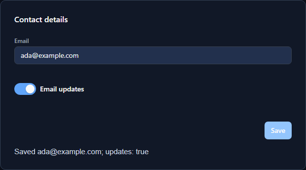
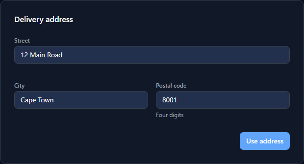
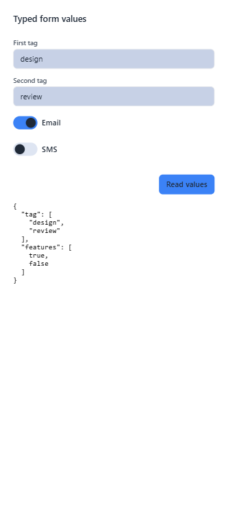

# q-form

`q-form` collects and validates named controls while sharing field size and feedback spacing.

**Component tag:** `<q-form>`

**Working preview:** Run `bun start` from the repository root, open the [existing playground](http://localhost:3333), then select **Forms & inputs → Form**. The examples below use this registered runtime with their own markup and data; playground presets are demonstrations, not component defaults.

**On this page**

- [Quick start](#quick-start)
- [Examples](#examples)
- [Behavior & accessibility](#behavior--accessibility)
- [Styling](#styling)
- [API reference](#api-reference)

## Quick start

1. Follow the central [installation instructions](../../README.md#1-install-library).
2. In your application entry file (for example `src/main.js`), register the elements and load the theme. This requires a bundler that resolves package imports and CSS imports.

```javascript
import "@webquark/browser/dist/webquark/webquark.css";
import { defineCustomElements } from "@webquark/browser/loader";

defineCustomElements();
```

3. Put the following markup in your application HTML.

```html
<q-form label="Contact details">
  <q-input label="Email" name="email" type="email" required></q-input>
  <q-button slot="actions" type="submit">Save</q-button>
</q-form>
```

**Result:** A labelled form with a required Email field and Save action; valid submission emits qSubmit without navigation by default.

### At a glance

| Capability | Options | Default |
| :--- | :--- | :--- |
| [Collection](#forms) | Native/WebQuark named controls; values and FormData | empty |
| [Submission](#state-and-interaction) | qSubmit; validation; native action/method | preventDefault true; post |
| [Enter policy](#keyboard-and-focus) | submit, focus-next, none | submit |
| [Shared size](#sizes) | inherit, sm, md, lg | inherit; standalone md |
| [Feedback spacing](#labels-and-announcements) | reserveFeedback | inherit/collapsed |
| [Presentation](#slots) | header/default/actions; labelHidden | empty |

**With no properties:** An empty native form shell renders without header, fields, actions, or accessible name. Add a label/aria-label and named controls.

## Examples

Use the registration above first. Each HTML block belongs in the page body; its module script runs after the element is registered. CSS in a `<style>` block belongs in the page or your application stylesheet.

### Handle a valid application submission

Listen to qSubmit and use its collected values.



```html
<q-form id="contact-form" label="Contact details" reserve-feedback>
  <q-input label="Email" name="email" type="email" value="ada@example.com" required></q-input>
  <q-toggle label="Email updates" name="updates" checked></q-toggle>
  <q-button slot="actions" type="submit">Save</q-button>
</q-form>
<output id="contact-result">Ready to save</output>
<script type="module">
  await customElements.whenDefined("q-form");
  document.querySelector("#contact-form").addEventListener("qSubmit", event => {
    document.querySelector("#contact-result").textContent =
      "Saved " + event.detail.values.email + "; updates: " + event.detail.values.updates;
  });
</script>
```

Click Save to reach the shown state; the example displays the payload locally.

### Restore the form's initial values

Call resetForm to run the explicit restoration bridge for slotted fields.


```html
<q-form id="profile-form" label="Profile" size="sm">
  <q-input name="displayName" label="Display name" value="Ada"></q-input>
  <q-button id="restore-profile" slot="actions" type="button">Restore initial values</q-button>
</q-form>
<script type="module">
  await customElements.whenDefined("q-form");
  const form = document.querySelector("#profile-form");
  await form.componentOnReady();
  document.querySelector("#restore-profile").addEventListener("qClick", () => form.resetForm());
</script>
```

Edit Display name, then activate Restore initial values. The screenshot shows the restored value.

### Arrange fields under one size scope

Combine q-grid and q-inline inside a form while preserving field collection.



```html
<q-form label="Delivery address" size="md" reserve-feedback>
  <q-grid columns="2" min-item-width="12rem" gap="lg">
    <q-input data-q-span="full" label="Street" name="street" value="12 Main Road"></q-input>
    <q-input label="City" name="city" value="Cape Town"></q-input>
    <q-input label="Postal code" name="postalCode" value="8001" description="Four digits"></q-input>
  </q-grid>
  <q-inline slot="actions" justify="end">
    <q-button type="submit">Use address</q-button>
  </q-inline>
</q-form>
```

### Assign and read repeated fields

Repeated text names use positional arrays; repeated toggles use Boolean arrays. The setter is partial and silent.



```html
<q-form id="typed-form" label="Typed form values">
  <q-input name="tag" label="First tag" value="alpha"></q-input>
  <q-input name="tag" label="Second tag" value="beta"></q-input>
  <q-toggle name="features" label="Email" checked></q-toggle>
  <q-toggle name="features" label="SMS"></q-toggle>
  <q-button slot="actions" type="button">Read values</q-button>
</q-form>
<pre id="typed-result"></pre>
<script type="module">
  await customElements.whenDefined("q-form");
  const form = document.querySelector("#typed-form");
  await form.componentOnReady();
  await form.setValues({ tag: ["design", "review"], features: [true, false] });
  const read = async () => {
    document.querySelector("#typed-result").textContent =
      JSON.stringify(await form.getValues(), null, 2);
  };
  form.querySelector("q-button").addEventListener("qClick", read);
  await read();
</script>
```

The screenshot shows the initial scripted update. Read values collects the current state without submitting or navigating.

### Cancelable reset with dynamic field defaults

This example adds a field after the form initializes, changes all three values, then uses the same reset action as resetForm. Keep edits cancels the reset before any field changes.

```html
<q-form id="reset-profile" label="Reset profile">
  <input name="native" value="Native default">
  <q-input name="custom" label="Custom field" value="Custom default"></q-input>
  <label><input id="keep-edits" type="checkbox"> Keep edits</label>
  <q-button id="change-profile" slot="actions" type="button">Change values</q-button>
  <q-button slot="actions" type="reset">Reset</q-button>
</q-form>
<output id="reset-result"></output>
<script type="module">
  await customElements.whenDefined("q-form");
  const form = document.getElementById("reset-profile");
  await form.componentOnReady();
  const dynamic = document.createElement("q-input");
  dynamic.name = "dynamic";
  dynamic.label = "Added field";
  dynamic.value = "Dynamic default";
  form.append(dynamic);
  document.getElementById("change-profile").addEventListener("qClick", async () => {
    await form.setValues({ native: "Changed", custom: "Changed", dynamic: "Changed" });
    document.getElementById("reset-result").textContent = JSON.stringify(await form.getValues());
  });
  form.addEventListener("qReset", event => {
    if (document.getElementById("keep-edits").checked) event.preventDefault();
    queueMicrotask(async () => {
      document.getElementById("reset-result").textContent = JSON.stringify(await form.getValues());
    });
  });
</script>
```

## Behavior & accessibility

### State and interaction

A submit cancels its original native default synchronously, waits for supported fields to become ready, then validates and takes one current snapshot. A valid submission emits one cancelable qSubmit containing values, FormData, the inner form, the original event and the author submitter (or null). preventDefault=true keeps this event-only flow. With preventDefault=false, an uncanceled qSubmit permits one native delivery of that same FormData. Cancel qSubmit synchronously to stop delivery; the original event is already canceled by the wrapper. Native buttons, submit/image inputs and q-button actions participate through their current owner, including layout wrappers.

Native submit listeners can cancel synchronously with event.preventDefault() or event.returnValue=false, including listeners registered after the wrapper. The wrapper suppresses the original navigation immediately and waits for submit dispatch to finish before validation. It tracks those calls on the individual event and restores its own-property descriptors afterward; it changes no global event prototype. Calling a cached or prototype preventDefault function directly bypasses that tracking: use the cancelable qSubmit event for that pattern. Async application work must cancel qSubmit before awaiting. Native submit/requestSubmit calls reentered from formdata retain the browser's entry-list construction guard and produce no second delivery.

submitForm() starts the same guarded transaction without a submitter and awaits its completion. Busy or reentrant requests join the current transaction. Detaching the form cancels pending readiness and invalidates delivery; moving/removing/disabling its submitter also suppresses delivery. setValues() applies typed values silently. resetForm(), native reset buttons and q-button type=reset use the same native reset event. qReset fires once before restoration; canceling qReset or the native reset event leaves values unchanged, including cancellation from a later native listener. Native defaults remain live. Each custom field restores the initial value captured at its first initialization, including dynamically added fields; assignment, moving to another form and reconnecting do not replace that default. Reset emits no input/change/qInput/qChange. Concurrent or reentrant resetForm calls join the current reset.

### Keyboard and focus

submit handles Enter from an owned eligible single-line q-input/native input, including unnamed fields under layout wrappers. It activates the first owned submit action; a disabled first action blocks implicit submission. Without an action, the wrapper submits once even with multiple text fields. focus-next moves among visible enabled eligible fields, including unnamed and readonly fields; Shift+Enter moves backward and forward Enter at the end submits. none suppresses only eligible Enter. Already-canceled events, modifiers, IME composition/keyCode 229, multiline/editor/contenteditable fields, popup searches, selection/toggle controls, buttons and links retain their own keyboard behavior.

### Labels and announcements

label supplies the default visible title and native form name. ariaLabel takes precedence. When a custom header is supplied, label becomes aria-label instead of labelling by the hidden default title. labelHidden visually hides the header container while keeping its content accessible. Supply an explicit name when using a custom header alone.

reserveFeedback publishes an inherited 1rem minimum when true, 0px when false; undefined returns to inherited context. Individual fields can opt out. The form does not add a live region; compatible child fields expose their own polite feedback.

### Forms

The wrapper discovers supported native input/textarea/select fields and q-input, q-textarea, q-dropdown, q-radio-group, q-toggle and editable q-syntax-box. Unnamed fields validate but do not collect. Arbitrary named wrappers, slots, action controls, display-only editors and consumer shadow internals are excluded. Native ownership wins: controls belonging to another native form or nested q-form are excluded. An explicit unresolved/empty form attribute prevents fallback ownership. A q-form id is not an external native form target. Register q-form and await its own readiness before invoking methods. Its getValues/setValues/submission operations wait for adapters on connected, potentially owned supported fields within one five-second transaction deadline, including tags whose registration is still pending. A supported field that never registers or never initializes rejects with TimeoutError instead of being silently omitted; assignment has not begun when readiness fails. Removal or re-association cancels obsolete waits, and observers/timers are cleaned up. An undefined custom tag outside the host has no native form association yet, so it is not an externally associated field until registration establishes that association.

Values and FormData come from one successful-control snapshot, in field order. Disabled fields, including disabled fieldsets except their first legend, do not contribute. Readonly native fields remain successful. Unchecked native checkbox/radio controls and unavailable local selections have no fallback value. Native options exclude disabled options/optgroups; files preserve every File and the native empty-file placeholder. Native numeric inputs retain strings.

| Group | values shape | FormData |
| --- | --- | --- |
| Repeated text/scalar fields | Array, including when only one succeeds | Every successful entry |
| One q-toggle | Boolean, including false | Checked: string true; unchecked: no entry |
| Repeated unmixed q-toggles | Boolean[] in eligible field order | One true entry per checked field |
| Native radio group | Checked eligible identity or omitted; multiple native owner/tree groups sharing a name use an array | Same successful identities |
| Repeated native checkboxes | Selected identity string[], including [] | Checked identities, including an empty identity |
| Multiple select | string[], including [] | Selected enabled values |
| Multiple/repeated file controls | File[] | Every file or empty placeholder |
| Mixed control kinds sharing a name | Every successful entry; no toggle overwrite | Same successful entries |

Boolean toggle projection intentionally differs from native successful FormData. Local unavailable dropdown/radio values remain in their public props but are omitted; externalSearch dropdowns retain nonempty unloaded domain values. Native radio validity follows the browser even when a disabled checked option satisfies required while submitting nothing.

setValues applies only supplied owned names, including disabled/readonly targets, without input/change/qInput/qChange. Missing names are ignored. Scalars broadcast to repeated text fields; positional arrays must match the full owned field count. Native radio/checkbox values are option identities and are never rewritten: one radio group takes a string/null; multiple native groups sharing a name accept scalar broadcast or an exact positional identity/null array. A lone dropdown/radio-group/single-select rejects arrays; repeated selections accept exact positional arrays. Repeated checkboxes take identity strings/null/[], and a lone checkbox additionally accepts Boolean. Repeated toggles require one Boolean per owned toggle. Multiselect takes identity strings/null; repeated multiselect containers are ambiguous and rejected. File fields support clearing with null, empty string or []; assigning Files/FileLists is unsupported. Mixed identity/Boolean/file/scalar containers and other invalid shapes reject with TypeError before partial mutation. getValues is a successful-value projection rather than a general inverse editing model.

Immediate setValues/getValues/checkValidity/reportValidity/submit chaining uses current values and constraints without a consumer frame wait. Direct value/checked/code, name and existing constraint-property updates synchronize the actual field and native participation. Existing fields combine explicit disabled state with inherited fieldset disabling, preserve the first-legend exception and retain their explicit disabled property when re-enabled. Readonly native text remains successful and programmatically assignable. Public form queries wait for a pending reset to finish. noValidate skips submission validation; explicit checkValidity/reportValidity always check constraints. Submission noValidate or the originating submitter's formnovalidate skips validation while retaining ownership, readiness, collection and cancellation.

Native radios group by their actual native form owner, tree and name. Unassociated radios with the same name in different q-form wrappers still share the browser group: selecting one can uncheck a peer in another wrapper. Wrapper collection and direct assignment stay ownership-scoped; clearing owned options does not clear a checked foreign peer. Use distinct names or actual native owners when independent groups are required.

### Limitations and compatibility

The wrapper is not itself a form-associated field. checkValidity/reportValidity are asynchronous aggregate checks of its owned fields. With preventDefault=false, native GET/POST uses the approved FormData, including repeated entries and Files. Synchronous qSubmit FormData edits change delivery; values remains the original snapshot. Native formdata listeners can make subsequent native edits. Submitter formaction/formmethod/formenctype/formtarget overrides apply to that transaction and the form attributes are restored afterward. No temporary value inputs or field reparenting are used. method="dialog" validates and closes an actual native dialog ancestor with the submitter value without a request; outside one, delivery rejects with NotSupportedError. Event-only dialog mode still emits qSubmit. A q-dialog/role="dialog" overlay is not a native dialog ancestor. Custom header content does not automatically name the form. A whitespace-only ariaLabel is truthy for suppressing aria-labelledby yet trims away when rendered, so use nonblank names. There is no component-specific animation.

## Styling

Use size for descendants and layout primitives for field/action arrangements.

### Sizes

`size="inherit"` is the declared default: it uses the nearest [q-form](./q-form.md) or [q-toolbar](./q-toolbar.md) scope, with `md` geometry when no scope exists. Explicit `sm`, `md`, or `lg` overrides that scope. Changing a scope updates inherited dimensions without changing the child's size property.

| Effective size | Minimum control height | Text / line height | Horizontal padding | Radius |
| :--- | :--- | :--- | :--- | :--- |
| `sm` | 1.75rem (28px) | 0.75 / 1rem | 0.5rem | 0.34375rem |
| `md` | 2.25rem (36px) | 0.875 / 1.25rem | 0.75rem | 0.4375rem |
| `lg` | 2.75rem (44px) | 1 / 1.5rem | 1rem | 0.53125rem |

Pixel equivalents assume a 16px root font. Heights are minimums; content and overrides can grow them. See the shared [sizing foundation](../foundation.md#choose-size-once).

q-form publishes geometry through inherited context variables; its own header/body are not fixed-height controls. Explicit child sizes override it. Changing size back to inherit removes the form's inline scope values.

### Layout

The form shell/body use vertical flex layout; actions align to the end and wrap. Use [q-grid](./q-grid.md), [q-stack](./q-stack.md), or [q-inline](./q-inline.md) inside slots for composition. reserveFeedback aligns one-line field-help space, not arbitrary multiline labels or messages.

### Custom styling

Use the [CSS variables](#css-variables) or [Shadow Parts](#shadow-parts) for supported customization. This matching markup and CSS can be used together:

```html
<q-form class="profile-form" label="Profile">
  <q-input label="Display name" name="displayName"></q-input>
</q-form>
<style>
  q-form.profile-form { --q-form-gap: 20px; --q-form-field-gap: 16px; }
</style>
```

The form size prop writes context variables inline on its host when explicit; use the prop for the scope. With inherit it removes its own values so ancestor context resumes. The feedback scope works the same way. Form region tokens do not change child field surface tokens.

Keep shared setup in [Theme variables](../theme_variables.md), [Theme tokens](../theme-tokens.md), and the [sizing, spacing and surface foundation](../foundation.md).

## API reference

Cross-check the [generated API](../../src/browser/components/inputs/form/readme.md), [implementation](../../src/browser/components/inputs/form/form.tsx), and imported public types. The entries below preserve source defaults and runtime qualifications.

### Properties

All properties are optional in the TypeScript component contract. Required content/labels and conditional constraints are explained with each workflow. Properties are alphabetical.

| Name | Default | Description |
| :--- | :--- | :--- |
| `action` | `undefined` | Native form action URL; default navigation is prevented.<br>**Type:** `string`. **HTML attribute:** `action`. **Required:** No. |
| `ariaLabel` | `null` | Nonblank explicit native form name; overrides the default title association.<br>**Type:** `string \| null`. **HTML attribute:** `aria-label`. **Required:** No. |
| `autocomplete` | `'on'` | Native autocomplete preference.<br>**Type:** `'on' \| 'off'`. **HTML attribute:** `autocomplete`. **Required:** No. |
| `enctype` | `'application/x-www-form-urlencoded'` | Native encoding; application FormData handling is independent.<br>**Type:** `'application/x-www-form-urlencoded' \| 'multipart/form-data' \| 'text/plain'`. **HTML attribute:** `enctype`. **Required:** No. |
| `enterBehavior` | `'submit'` | Enter handling policy; see [Keyboard and focus](#keyboard-and-focus).<br>**Type:** `'submit' \| 'focus-next' \| 'none'`. **HTML attribute:** `enter-behavior`. **Required:** No. |
| `label` | `undefined` | Default form heading/name; also names a form with a custom header.<br>**Type:** `string`. **HTML attribute:** `label`. **Required:** No. |
| `labelHidden` | `false` | Visually hides the entire header while preserving its accessible content.<br>**Type:** `boolean`. **HTML attribute:** `label-hidden`. **Required:** No. |
| `method` | `'post'` | Native GET/POST transport or actual native dialog closure; event-driven submission remains default.<br>**Type:** `'get' \| 'post' \| 'dialog'`. **HTML attribute:** `method`. **Required:** No. |
| `noValidate` | `false` | Skips native and wrapper validation.<br>**Type:** `boolean`. **HTML attribute:** `no-validate`. **Required:** No. |
| `preventDefault` | `true` | Keeps valid qSubmit event-only when true; false permits one uncanceled native delivery after readiness/validation.<br>**Type:** `boolean`. **HTML attribute:** `prevent-default`. **Required:** No. |
| `reserveFeedback` | `undefined` | undefined inherits reservation; true publishes 1rem; false publishes 0px.<br>**Type:** `boolean`. **HTML attribute:** `reserve-feedback`. **Required:** No. |
| `size` | `'inherit'` | Publishes control geometry for descendants; inherit returns to an ancestor or md fallback.<br>**Type:** `'inherit' \| 'sm' \| 'md' \| 'lg'`. **HTML attribute:** `size`. **Required:** No. |
| `target` | `undefined` | Native submission browsing context.<br>**Type:** `'_self' \| '_blank' \| '_parent' \| '_top'`. **HTML attribute:** `target`. **Required:** No. |

Boolean attributes use Stencil coercion: presence/empty string is true, the literal string `"false"` is false, and removing the attribute supplies false rather than restoring a true or undefined initializer. Prefer explicit JavaScript `true`/`false` for updates; an optional Boolean can be reset to `undefined` through its property to recover inheritance/detection. String attributes remain strings; numeric attributes are parsed as numbers, so invalid text can become `NaN`. Setting a property to `undefined` or removing a string/number attribute does not rerun its initializer. Keep values within the documented types.

### Slots

| Name | Description |
| :--- | :--- |
| `default` | Fields/body content; add name to collected controls. No fallback. |
| `actions` | Action controls; wrapper exists but is hidden when empty. Use q-button type=submit or explicit methods. |
| `header` | Custom header; replaces the label-based title. Set label or aria-label for the native form name. |

### Events

| Name | When it fires | Payload |
| :--- | :--- | :--- |
| `qReset` | The inner native form dispatches reset. | `CustomEvent<QFormResetDetail>` |
| `qSubmit` | A submit passes validation, or noValidate is true. | `CustomEvent<QFormSubmitDetail>` |

All listed Stencil events bubble, cross shadow boundaries (`composed: true`), and are cancelable. qReset cancellation cancels the underlying native reset. qSubmit cancellation stops native delivery or dialog closure. For forwarded MouseEvent details, the original event is available as `event.detail`.

#### Event details

`QFormSubmitDetail` contains `values: QFormValues`, `formData: FormData`, `form: HTMLFormElement`, and `originalEvent: Event`, plus optional `submitter: HTMLElement | null`. `QFormResetDetail` contains `form` and `originalEvent`. qReset fires once during native reset dispatch before restoration; cancel it synchronously to retain current values. It does not include a values snapshot.

### Methods

With the loader used above, first `await customElements.whenDefined("q-form");` and `await element.componentOnReady();` before invoking methods. `componentOnReady()` is loader readiness, not an additional component-defined method. All listed methods return promises.

| Signature | Purpose | Returns |
| :--- | :--- | :--- |
| `checkValidity(): Promise<boolean>` | Checks current owned fields without displaying validation messages. | `boolean` |
| `getValues(): Promise<QFormValues>` | Collects current values from named controls. | `QFormValues` |
| `reportValidity(): Promise<boolean>` | Reports current owned constraints and returns aggregate validity. | `boolean` |
| `resetForm(): Promise<void>` | Runs one cancelable reset and awaits restoration of native live defaults and field-owned initial defaults. | `void` |
| `setValues(values: QFormValues): Promise<void>` | Applies typed partial updates to owned named fields, including disabled/readonly targets; repeated-field arrays map positionally with exact arity; no input/change events are dispatched. | `void` |
| `submitForm(): Promise<void>` | Runs and awaits the guarded transaction without a submitter; invalid or canceled submissions never deliver. | `void` |

#### Value records

`QFormValues = Record<string, QFormValue>`, where `QFormValue` is a field value or an array of field values. `QFormFieldValue = string | File | boolean | number | null`. The broad type permits values supplied by an application; collected FormData usually provides strings/Files, with toggle values replaced by Booleans. See [Forms](#forms) for repeated names and setter limitations.

### Styling hooks

#### CSS variables

Defaults below show the local fallback chains; references to shared tokens depend on the active theme. Private `--_q-*` variables are implementation details and are not supported overrides. Component and functional shared hooks are listed; global palette/spacing/typography values are catalogued in [Theme tokens](../theme-tokens.md). See [Custom styling](#custom-styling) for effective precedence and exceptions.

| Name | Default | Controls |
| :--- | :--- | :--- |
| `--q-context-control-font` | `inherits; size="sm\|md\|lg" publishes the matching --q-control-* token` | Inherited font of descendant controls. Inline context published by an explicit size takes precedence over a stylesheet override on this host. |
| `--q-context-control-height` | `inherits; size="sm\|md\|lg" publishes the matching --q-control-* token` | Inherited height of descendant controls. Inline context published by an explicit size takes precedence over a stylesheet override on this host. |
| `--q-context-control-icon` | `inherits; size="sm\|md\|lg" publishes the matching --q-control-* token` | Inherited icon of descendant controls. Inline context published by an explicit size takes precedence over a stylesheet override on this host. |
| `--q-context-control-line` | `inherits; size="sm\|md\|lg" publishes the matching --q-control-* token` | Inherited line of descendant controls. Inline context published by an explicit size takes precedence over a stylesheet override on this host. |
| `--q-context-control-padding` | `inherits; size="sm\|md\|lg" publishes the matching --q-control-* token` | Inherited padding of descendant controls. Inline context published by an explicit size takes precedence over a stylesheet override on this host. |
| `--q-context-control-radius` | `inherits; size="sm\|md\|lg" publishes the matching --q-control-* token` | Inherited radius of descendant controls. Inline context published by an explicit size takes precedence over a stylesheet override on this host. |
| `--q-context-feedback-min` | `inherits / 0px` | Descendant reserved feedback height. reserveFeedback true/false publishes inline 1rem/0px, which takes precedence over a stylesheet override. |
| `--q-control-font-lg` | `1rem` | Font published when size="lg". Shared geometry for the named size. |
| `--q-control-font-md` | `0.875rem` | Font published when size="md". Shared geometry for the named size. |
| `--q-control-font-sm` | `0.75rem` | Font published when size="sm". Shared geometry for the named size. |
| `--q-control-height-lg` | `2.75rem` | Height published when size="lg". Shared geometry for the named size. |
| `--q-control-height-md` | `2.25rem` | Height published when size="md". Shared geometry for the named size. |
| `--q-control-height-sm` | `1.75rem` | Height published when size="sm". Shared geometry for the named size. |
| `--q-control-icon-lg` | `1.25rem` | Icon published when size="lg". Shared geometry for the named size. |
| `--q-control-icon-md` | `1rem` | Icon published when size="md". Shared geometry for the named size. |
| `--q-control-icon-sm` | `0.875rem` | Icon published when size="sm". Shared geometry for the named size. |
| `--q-control-line-lg` | `1.5rem` | Line published when size="lg". Shared geometry for the named size. |
| `--q-control-line-md` | `1.25rem` | Line published when size="md". Shared geometry for the named size. |
| `--q-control-line-sm` | `1rem` | Line published when size="sm". Shared geometry for the named size. |
| `--q-control-padding-lg` | `1rem` | Padding published when size="lg". Shared geometry for the named size. |
| `--q-control-padding-md` | `0.75rem` | Padding published when size="md". Shared geometry for the named size. |
| `--q-control-padding-sm` | `0.5rem` | Padding published when size="sm". Shared geometry for the named size. |
| `--q-control-radius-lg` | `0.53125rem` | Radius published when size="lg". Shared geometry for the named size. |
| `--q-control-radius-md` | `0.4375rem` | Radius published when size="md". Shared geometry for the named size. |
| `--q-control-radius-sm` | `0.34375rem` | Radius published when size="sm". Shared geometry for the named size. |
| `--q-field-feedback-font` | `.75rem` | Descendant shared feedback font size. The form itself has no feedback span. |
| `--q-field-label-font` | `.75rem` | Descendant shared field label font size. The form header uses --q-form-title-size instead. |
| `--q-form-action-gap` | `var(--q-space-sm, .5rem)` | Spacing between actions in the actions slot. |
| `--q-form-actions-padding-top` | `4px` | Space above the actions row. |
| `--q-form-fg` | `var(--q-fg-base, #172033)` | Base form text color. |
| `--q-form-field-gap` | `12px` | Vertical spacing between direct children in the default body slot. |
| `--q-form-gap` | `var(--q-space-xl, 1.5rem)` | Spacing between the header and form, and between the form body and actions. |
| `--q-form-title-color` | `var(--q-fg-base, #172033)` | Fallback form title text color. |
| `--q-form-title-size` | `var(--q-font-size-lg, 1rem)` | Fallback form title font size. |

#### Shadow Parts

| Name | Targets |
| :--- | :--- |
| `actions` | Action wrapper, hidden while slot is empty. |
| `body` | Default-slot container, always present. |
| `form` | Native form, always present. |
| `header` | Header wrapper, hidden when neither label nor slot content exists; labelHidden visually clips it. |
