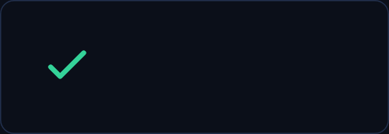
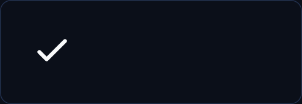
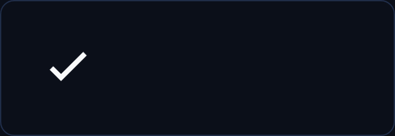

# q-icon

`q-icon` renders registered SVG definitions or loads named remote/local icon assets.

**Component tag:** `<q-icon>`

**Working preview:** Run `bun start` from the repository root, open the [existing playground](http://localhost:3333), then select **Media → Icon**.

**On this page**

- [Quick start](#quick-start)
- [Examples](#examples)
- [Behavior & accessibility](#behavior--accessibility)
- [Styling](#styling)
- [API reference](#api-reference)

## Quick start

1. Follow the central [installation instructions](../../README.md#1-install-library).
2. In your application entry file, register WebQuark. This assumes a bundler that resolves package imports and CSS imports.

```javascript
import '@webquark/core/dist/webquark/webquark.css';
import { defineCustomElements } from '@webquark/core/loader';
defineCustomElements();
```

3. Add this markup to your application page. Any module script runs after that shared setup.

```html
<q-icon id="saved-icon" label="Saved"></q-icon>
<script type="module">
await customElements.whenDefined('q-icon');
document.querySelector('#saved-icon').definition = { node: [['path', { d: 'M5 12l4 4L19 6' }]] };
</script>
```

**Result:** a labeled 24px check icon rendered without network loading.

### At a glance

| Capability | Options | Default |
| :--- | :--- | :--- |
| [Source](#state-and-interaction) | Definition, registry, library/local URL | No icon; lucide lookup when named |
| [Size](#sizes) | sm, md, lg, integer pixels, CSS length | md (24px) |
| [Color](#colors) | CSS color/currentColor | currentColor |
| [Accessible meaning](#labels-and-announcements) | label or decorative omission | Decorative |
| [Configuration](#registry-and-configuration) | Registry and strict no-fetch mode | Strict false |

**With no properties:** An empty 24px icon container renders and is hidden from assistive technology. Supply a definition or name; playground settings is a demo preset.

## Examples

These examples share the [Quick start registration](#quick-start). Screenshots show the real registered component in a temporary preview fixture using the existing playground runtime. They do not imply extra permanent playground presets.

### Render a bundled definition

Assign trusted SVG node data as a JavaScript property.



```html
<q-icon id="check" label="Saved" size="48" color="var(--q-color-success)"></q-icon>
<script type="module">
await customElements.whenDefined('q-icon');
document.querySelector('#check').definition = { node: [['path', { d: 'M5 12l4 4L19 6' }]] };
</script>
```

Objects must be assigned as properties, not serialized into HTML attributes. This definition performs no fetch.

### Register names before use

Register application-owned definitions and prevent network fallback for unknown names.



```html
<div id="registered-icon"></div>
<script type="module">
import { registerQIcons, configureQIcons } from '@webquark/core';
registerQIcons({ 'app-check': { node: [['path', { d: 'M5 12l4 4L19 6' }]] } });
configureQIcons({ strict: true });
await customElements.whenDefined('q-icon');
const icon = document.createElement('q-icon');
icon.name = 'app-check';
icon.label = 'Saved';
icon.size = 48;
document.querySelector('#registered-icon').append(icon);
</script>
```

Register before creating icons that use those names. This runs after Quick start registration; the registry replaces the complete previous mapping and does not automatically reload existing icons.

### Load a supplied local SVG asset

Use a local asset path when registered data is not appropriate.



```html
<q-icon library="local" local-path="/assets/icons/" name="check" label="Saved" size="48"></q-icon>
```

```svg
<svg xmlns="http://www.w3.org/2000/svg" viewBox="0 0 24 24" fill="none" stroke="currentColor"><path d="M5 12l4 4L19 6"/></svg>
```

Place the SVG below at /assets/icons/check.svg in your application public assets. This fetches an SVG in non-strict mode.

### Load an image with a query and fragment

Use a raster asset URL without losing cache parameters or its fragment.


```html
<q-icon library="local" local-path="/assets/icons/"
  name="check-preview.png?v=2#preview" label="Saved" size="64"></q-icon>
```

Copy the supplied [preview PNG](../../src/assets/icons/check-preview.png) to `/assets/icons/check-preview.png` in your application's public assets. The pathname selects the native image renderer; the complete URL is retained. This example uses the same Quick start registration and requires non-strict URL loading. The image keeps its original color.

## Behavior & accessibility

### State and interaction

Source priority is explicit definition, registered name, then URL fallback. Definitions are validated/cloned/frozen; registry definitions render without I/O. Strict mode blocks all URL fallback for an unregistered name and shows an error mark. Missing name/definition renders empty.

Changing name, definition, library, localPath or libraryVersion reloads the icon. A later SVG request wins over an earlier response. SVG loading does not block component hydration; component readiness is not image readiness. Failed loading or definition validation shows a red boxed cross and logs the error; no public load/error events are emitted. Changing fetchTimeout alone does not restart a request.

### Labels and announcements

A nonblank trimmed label sets role="img", aria-label, and aria-hidden="false" on the host. Without label, role/name are removed and aria-hidden="true" is set. Rendered SVG/native images are decorative inside that named host. Use label for meaningful icons and a separate accessible name on icon-only buttons. No keyboard interaction or live region is provided.

### Limitations and compatibility

Remote SVG requests depend on network/CORS and a streaming response. Fetched XML and registered definitions use the same strict SVG policy. Supported nodes are paths, circles, ellipses, lines, rectangles, polygons, polylines, groups, defs, gradients/stops, masks, clip paths, symbols and local use references. Geometry, bounded presentation attributes, and inert data/ARIA attributes are supported. Inline styles, event attributes, navigation, animation, foreign content and external SVG resources are rejected. References must resolve within that icon, without cycles or excessive expansion. Malformed XML, unsupported namespaces/content, or unavailable browser XML parsing produce the existing error fallback; no regex recovery is used. Unqualified SVG XML is normalized to the SVG namespace.

IDs, including a root SVG ID, must be nonempty, valid local-fragment identifiers and unique within the icon. A root ID is retained, but resource references may target only supported child elements; references to the SVG root are rejected to prevent recursive root expansion.

Each icon permits at most 512 SVG child elements, depth 16, 64 attributes per element, 64 KiB per attribute, 128 KiB total attribute values, and 4096 nodes after local-reference expansion (depth 32). Fetched SVG is capped at 128 KiB of UTF-8 response bytes; an oversized declared or streamed body is canceled. Registered icons remain synchronous and perform no I/O or DOM parsing. Non-browser module import remains supported; fetched inline SVG fails closed without DOMParser/XMLSerializer. Installed Chrome coverage does not establish CEF certification.

Icon URLs support HTTP(S), file/blob assets, relative paths and SVG image data URLs, subject to the browser's loading permissions. Other schemes are rejected before loading. Binary assets are classified from the URL pathname, case-insensitively, for png/jpg/jpeg/webp/gif/ico; the original query and fragment remain intact. For example, after placing your PNG at `/assets/icons/logo.PNG`, `<q-icon library="local" name="logo.PNG?v=2#preview" label="Logo"></q-icon>` loads that complete URL as an image. Local names without an extension infer `.svg` before query/fragment, so `name="check?v=2#mark"` loads `/assets/icons/check.svg?v=2#mark`. fetchTimeout applies to fetched SVG when AbortController is available, not binary image loading.

## Styling

### Sizes

| size | Dimensions |
| :--- | :--- |
| `sm` | 16px |
| `md` (default) | 24px |
| `lg` | 32px |
| Integer number or digit-only string | Pixel width and height |
| CSS string, such as `1.5rem` | Passed to width/height |

Numeric 0 and other falsy values resolve to md; string "0" resolves to 0px. Decimal or negative numeric values become unitless strings and may be rejected by CSS; use an explicit CSS unit. Invalid CSS values are not normalized. The component writes width/height inline on every render.

### Colors

`color` accepts a CSS color and defaults to currentColor. It is written inline; SVG strokes/fills that use currentColor inherit it. Binary assets retain their own colors.

### Custom styling

Scope CSS to the host or supplied content. See the exact [CSS variables](#css-variables) and [Shadow Parts](#shadow-parts).

```html
<q-icon class="bold-check" id="bold-check" label="Saved"></q-icon>
<style>
  q-icon.bold-check { --q-icon-stroke-width: 3; }
</style>
<script type="module">
await customElements.whenDefined('q-icon');
document.querySelector('#bold-check').definition = { node: [['path', { d: 'M5 12l4 4L19 6' }]] };
</script>
```

Shared geometry and theme setup are documented in [Foundation](../foundation.md) and [theme tokens](../theme-tokens.md).

## API reference

For new code, use `library`, `libraryVersion`. The deprecated aliases remain supported. Canonical properties take precedence when set; otherwise the legacy property and its default apply. Set a canonical JavaScript property to `undefined` to restore the fallback.

Cross-check the [generated API](../../src/components/media/icon/readme.md) and [implementation](../../src/components/media/icon/icon.tsx). Source nullability and actual rendering limitations are preserved below.

### Properties

All properties are optional and listed alphabetically.

| Name | Default | Description |
| :--- | :--- | :--- |
| `color` | `'currentColor'` | CSS color; written inline to the host. Binary images are not recolored.<br>**Type:** `"currentColor" \| string & {}`. **HTML attribute:** `color`. **Required:** No. |
| `definition` | `undefined` | Trusted QIconDefinition object assigned in JavaScript; takes priority over name. See nested schema.<br>**Type:** `QIconDefinition`. **HTML attribute:** None; JavaScript property only. **Required:** No. |
| `fetchTimeout` | `8000` | SVG fetch timeout in ms; nonfinite/nonpositive values use 8000. Does not affect binary images.<br>**Type:** `number`. **HTML attribute:** `fetch-timeout`. **Required:** No. |
| `label` | `undefined` | Trimmed accessible image name; blank/omitted makes the icon decorative.<br>**Type:** `string`. **HTML attribute:** `label`. **Required:** No. |
| `lib` | `'lucide'` | Deprecated alias for `library`. lucide, font-awesome/fontawesome, local, a {name} URL template, or a base URL/path.<br>**Type:** `"font-awesome" \| "fontawesome" \| "local" \| "lucide" \| string & {}`. **HTML attribute:** `lib`. **Required:** No. |
| `library` | `undefined` | lucide, font-awesome/fontawesome, local, a {name} URL template, or a base URL/path.<br>**Type:** `"font-awesome" \| "fontawesome" \| "local" \| "lucide" \| string & {}`. **HTML attribute:** `library`. **Required:** No. |
| `libraryVersion` | `undefined` | Nonblank override for built-in remote library version; omitted/blank uses pinned version.<br>**Type:** `string`. **HTML attribute:** `library-version`. **Required:** No. |
| `libVersion` | `undefined` | Deprecated alias for `libraryVersion`. Nonblank override for built-in remote library version; omitted/blank uses pinned version.<br>**Type:** `string`. **HTML attribute:** `lib-version`. **Required:** No. |
| `localPath` | `'/assets/icons/'` | Base path for library=local; default /assets/icons/. A slash is appended when needed.<br>**Type:** `string`. **HTML attribute:** `local-path`. **Required:** No. |
| `name` | `undefined` | Registry name or asset name. No name/definition renders empty.<br>**Type:** `string`. **HTML attribute:** `name`. **Required:** No. |
| `size` | `'md'` | sm, md, lg, number, or CSS length string; see Sizes for coercion limitations.<br>**Type:** `"lg" \| "md" \| "sm" \| number \| string & {}`. **HTML attribute:** `size`. **Required:** No. |

#### Definition data

```typescript
interface QIconDefinition {
  node: readonly QIconNode[];
  name?: string;
  size?: number;
  width?: number;
  height?: number;
  attributes?: Readonly<Record<string, string>>;
}
type QIconNode = readonly [
  tagName: string,
  attributes: Readonly<Record<string, string>>,
  children?: readonly QIconNode[]
];
```

node is required. Dimensions must be positive finite numbers; width and height must be supplied together and override size. The default viewBox is 0 0 24 24. SVG attributes can override generated defaults except final width/height/aria-hidden/focusable.

Supported node tags: circle, clipPath, defs, ellipse, g, line, linearGradient, mask, path, polygon, polyline, radialGradient, rect, stop, symbol, use. Maximum depth is 16 and total node count 512. Attribute values must be strings; event attributes, style/src, javascript values, and external resource references are rejected. href/xlink:href must reference a local # fragment.

#### Libraries

Lucide uses lucide-static 0.416.0; Font Awesome uses fontawesome-free 6.7.2 solid icons through jsDelivr. libraryVersion overrides those versions. Local assets append .svg when the name contains no period. Custom templates replace the first {name}; other custom library strings become a base path plus name.

### Slots

This component exposes no public slots.

### Events

This component emits no public events.

### Methods

This component exposes no public methods.

#### Registry and configuration

Registered child-node attributes may include the own enumerable string `key` metadata supplied by `@lucide/icons`. It is discarded before SVG validation/rendering and still counts against attribute and UTF-8 byte budgets. Function/accessor metadata is rejected. This exception does not apply to root SVG attributes or fetched XML: `key` remains unsupported there, and all emitted SVG attributes use the strict allowlist.

These are package utilities, not methods on an element. Import them from `@webquark/core`.

| Signature | Purpose | Returns |
| :--- | :--- | :--- |
| `registerQIcons(registry: QIconRegistry)` | Atomically replace the complete name-to-definition mapping; validates/clones/freezes definitions. | void |
| `configureQIcons(configuration: QIconConfiguration)` | Set strict mode using `{ strict: boolean }`. Default false. | void |

QIconRegistry is Readonly<Record<string, QIconDefinition>>. Registry keys must start with a letter/digit, contain only letters/digits/underscore/period/colon/hyphen, have no leading/trailing whitespace, and be at most 128 characters. Invalid registry/configuration input throws TypeError without partially replacing the registry. Call before registration/rendering; existing instances do not watch registry configuration.

### Styling hooks

#### CSS variables

Defaults include the shared theme when set there; nested `var()` expressions show CSS fallbacks. Shared palette/typography tokens and fallback aliases are listed in the [shared variable reference](../theme_variables.md). Internal `--_q-*` variables are not public hooks.

| Name | Default | Controls |
| :--- | :--- | :--- |
| `--q-icon-stroke-width` | `2.1` | stroke width. |

#### Shadow Parts

| Name | Targets |
| :--- | :--- |
| `fallback` | Error mark container, only after failure. |
| `image` | Native img, only for binary assets without failure. |
| `svg` | Registered/fetched SVG container, also present while empty/loading. |
