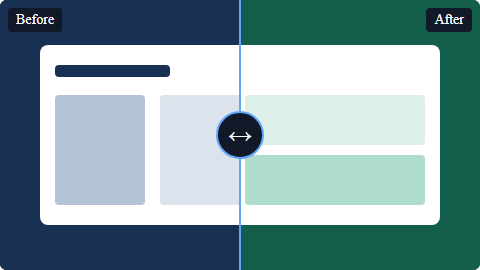

# Image comparison

Reveal two independently framed images with `q-image-comparison`.

Run `bun run start` and choose **Media → Image Comparison** in the existing playground. The permanent example uses workspace illustrations, not release screenshots.

On this page: [Quick start](#quick-start) · [Examples](#examples) · [Behavior & accessibility](#behavior--accessibility) · [Styling](#styling) · [API reference](#api-reference).

## Quick start

Register the component in a bundled application:

```ts
import { defineCustomElement } from '@webquark/core/components/q-image-comparison.js';
defineCustomElement();
```

Provide the two image sources and descriptions in HTML:

```html
<q-image-comparison
  before-src="images/before.png" after-src="images/after.png"
  before-alt="Workspace before the update" after-alt="Workspace after the update"
  aria-label="Compare workspace layouts"
></q-image-comparison>
```

The images fill the same 16:9 frame using containment. Half of Before is initially revealed on the left. A bare tag reserves the frame and reports “Comparison unavailable”; interaction stays disabled until both images load.

**At a glance**

| Capability | Options | Default |
| :--- | :--- | :--- |
| Reveal | 0–100% of Before | 50% |
| Frame | Positive width / height ratio; otherwise partial After, then Before | 16 / 9 for full images |
| Framing | Independent source-percentage `beforeCrop` / `afterCrop` objects | Full image |
| Input | Pointer drag, horizontal touch drag, native range keyboard | Enabled after both loads |
| Captions | Consumer-provided strings | Before / After |

## Examples

### Compare workspace illustrations

Drag the divider or focus it and press arrow keys to reveal the two illustrated layouts.



```html
<q-image-comparison
  before-src="assets/comparison-before.svg" after-src="assets/comparison-after.svg"
  before-alt="Illustrated workspace with a dark blue background"
  after-alt="Illustrated workspace with a green background"
  position="50" aria-label="Compare workspace illustrations"
></q-image-comparison>
```

These sources are included in the playground. The screenshot shows a still state, not a release change.

### Track user changes in Angular

Use the generated standalone Angular component and receive a numeric custom-event detail.

```ts
import { Component } from '@angular/core';
import { QImageComparison } from '@webquark/angular';

@Component({
  selector: 'app-comparison',
  imports: [QImageComparison],
  template: `
    <q-image-comparison
      beforeSrc="images/before.png" afterSrc="images/after.png"
      beforeAlt="Original workspace" afterAlt="Updated workspace"
      [aspectRatio]="4 / 3" [position]="position"
      (qChange)="position = $event.detail" ariaLabel="Compare workspace layouts"
    />
  `,
})
export class Comparison {
  position = 50;
}
```

Each component owns its own position. Assigning `position` from application code updates the view without emitting `qChange`.

### Select independent image regions

Assign crop objects as JavaScript properties or Angular property bindings. Coordinates
are percentages of each complete source file, starting at its left/top origin:

```ts
comparison.beforeCrop = { x: 0, y: 55, width: 45, height: 45 };
comparison.afterCrop = { x: 60, y: 0, width: 40, height: 100 };
```

All four fields must be finite numbers. Origins must be nonnegative, sizes must be
positive, and the rectangle must fit within 100% on each axis. Invalid rectangles
show the unavailable state; the component never clamps them. Omitted crops and
`{ x: 0, y: 0, width: 100, height: 100 }` display the complete image.

An explicit positive `aspectRatio` sets the common frame. When omitted, a partial
After crop determines its natural ratio, otherwise a partial Before crop does;
full images retain 16:9. The component reserves a provisional 16:9 frame while
the selected source loads. Set `aspectRatio` to reserve a final ratio in advance.
Each region is contained with uniform scaling and its own clip, so differing
proportions may leave neutral space. The reveal always follows the full frame.
Original source bytes and URLs stay intact, including animated formats.

For consumer-owned standalone frames, `@webquark/core` exports `ImageCrop`,
`ImageCropBox`, `ImageCropGeometry`, `isImageCropValid`, `hasPartialImageCrop` and
`calculateImageCropGeometry(naturalWidth, naturalHeight, crop?, frameAspectRatio?)`.
The geometry contains percentage `left`, `top`, `width` and `height` boxes: clip
`viewport` relative to the frame and position `image` inside that viewport. Omit
the frame ratio to use the selected region's natural ratio. Invalid input returns
`undefined`. Use positive browser-reported intrinsic dimensions after image load.

## Behavior & accessibility

### State and interaction

Clipping reveals Before from the left over After. `0` shows all After; `100` shows all Before. Full images retain centered containment. Empty or failed sources and crops with unusable intrinsic dimensions show an unavailable state. An explicit aspect ratio remains stable during loading, failure, and replacement. Invalid explicit ratios fall back to 16 / 9.

Source changes reset readiness and intrinsic dimensions. Load/error events from a replaced image cannot change current readiness. Crop-only changes reuse loaded dimensions and recompute both layers in the shared frame. Pointer dragging emits changes continuously, clamps beyond the frame, and ends on release, cancellation, lost capture, or source/framing replacement. Cancellation retains the last position. Touch movement waits for horizontal intent; vertical gestures remain available for page scrolling.

### Keyboard and focus

One native range owns focus and keyboard behavior. Arrow keys adjust by one percent; Home and End use the endpoints. Native browser Page Up/Down behavior is retained. Pointer dragging focuses that same control without scrolling. The frame has a visible theme focus ring.

### Labels and announcements

Supply meaningful `beforeAlt`, `afterAlt`, and `ariaLabel`. Decorative captions and the divider are hidden from accessibility APIs. The native range value text reports the percentage of the Before caption revealed. Loading and failure use a status region. These contracts have browser-level tests; assistive-technology sessions remain separate validation.

### Forms

This media component does not participate in forms and has no value accessor.

### Limitations and compatibility

Only horizontal reveal is supported. Image persistence, release metadata, orientation modes, and image editing belong to consumers. Images with different proportions use the same containment policy and may include letterboxing. URLs use ordinary browser image loading and its origin/security restrictions.

## Styling

### Custom styling

The component inherits [shared theme tokens](../theme-tokens.md) for surfaces, foreground, spacing, radii, and focus. The `aspectRatio` and crop properties own frame geometry. Use the host width to size the comparison.

```css
q-image-comparison { width: 100%; max-width: 60rem; }
q-image-comparison::part(before-label) { font-weight: 600; }
```

## API reference

### Properties

| Name | Default | Description |
| :--- | :--- | :--- |
| `afterSrc` | `''` | String; `after-src`; required for a usable comparison. |
| `beforeSrc` | `''` | String; `before-src`; required for a usable comparison. |
| `afterAlt` | `''` | Optional string; `after-alt`; accessible After image description. |
| `afterLabel` | `'After'` | Optional string; `after-label`; right caption. |
| `ariaLabel` | `'Image comparison'` | Optional string; `aria-label`; native control name. |
| `aspectRatio` | omitted | Optional number; `aspect-ratio`; positive frame width / height ratio; otherwise derives from partial crops or uses 16 / 9. |
| `afterCrop` | omitted | Optional `ImageCrop` object property; rectangle measured in complete After source percentages. |
| `beforeCrop` | omitted | Optional `ImageCrop` object property; rectangle measured in complete Before source percentages. |
| `beforeAlt` | `''` | Optional string; `before-alt`; accessible Before image description. |
| `beforeLabel` | `'Before'` | Optional string; `before-label`; left caption. |
| `position` | `50` | Optional mutable number; `position`; clamped to 0–100; nonfinite values use 50. |

### Slots

None.

### Events

| Name | When it fires | Payload |
| :--- | :--- | :--- |
| `qChange` | User changes the position; bubbles and crosses the shadow boundary | `CustomEvent<number>`; detail is the clamped reveal percentage |

### Methods

None.

### Styling hooks

**CSS variables**

No component-specific variables. Uses shared theme tokens.

**Shadow Parts**

| Name | Targets |
| :--- | :--- |
| `after-image` | Full After image |
| `after-label` | Right decorative caption |
| `before-image` | Complete Before image inside its selected viewport |
| `after-layer` | Full-frame After layer |
| `before-layer` | Full-frame Before reveal plane |
| `after-viewport` | Selected After region clip |
| `before-viewport` | Selected Before region clip |
| `before-label` | Left decorative caption |
| `control` | Native range control |
| `divider` | Reveal boundary |
| `frame` | Stable comparison frame |
| `handle` | Decorative drag handle |
| `status` | Loading or unavailable status |
