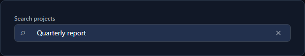
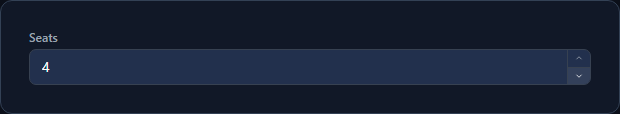
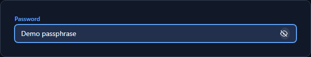
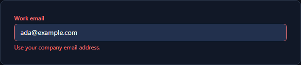

# q-input

`q-input` collects a single value with a visible label, validation messages, and optional inline controls.

**Component tag:** `<q-input>`

**Working preview:** Run `bun start` from the repository root, open the [existing playground](http://localhost:3333), then select **Forms & inputs → Input**. The examples below use this registered runtime with their own markup and data; playground presets are demonstrations, not component defaults.

**On this page**

- [Quick start](#quick-start)
- [Examples](#examples)
- [Behavior & accessibility](#behavior--accessibility)
- [Styling](#styling)
- [API reference](#api-reference)

## Quick start

1. Follow the central [installation instructions](../../README.md#1-install-library).
2. In your application entry file (for example `src/main.js`), register the elements and load the theme. This requires a bundler that resolves package imports and CSS imports.

```javascript
import "@webquark/core/dist/webquark/webquark.css";
import { defineCustomElements } from "@webquark/core/loader";

defineCustomElements();
```

3. Put the following markup in your application HTML.

```html
<q-input label="Email address" name="email" type="email"></q-input>
```

**Result:** An empty labelled email field.

### At a glance

| Capability | Options | Default |
| :--- | :--- | :--- |
| [Input type](#input-types) | Text, password, email, number, URL, search, color and date/time types | text |
| [Size](#sizes) | inherit, sm, md, lg | inherit; effective md without scope |
| [Value and controls](#state-and-interaction) | clearable, password visibility, number stepping | empty; clearable false |
| [Validation](#forms) | required, min/max/step, error/errorMessage, disabled | optional; enabled |
| [Content](#slots) | label, placeholder, prefix and suffix slots | empty |
| [Field help](#labels-and-announcements) | description, labelHidden, reserveFeedback | no description; visible label; inherit reservation |

**With no properties:** An empty inherit-sized (standalone md) text field renders without a label, placeholder, or form name. Add label (or aria-label) and name when submitting data.

## Examples

Use the registration above first. Each HTML block belongs in the page body; its module script runs after the element is registered. CSS in a `<style>` block belongs in the page or your application stylesheet.

### Offer a clearable search field

Use a visible label and clearable to let readers reset entered search text.



```html
<q-input label="Search projects" type="search" value="Quarterly report" clearable>
  <span slot="prefix" aria-hidden="true">⌕</span>
</q-input>
```

The image shows the populated state. Clear input empties the field, emits both value events, and returns focus to it.

### Keep a numeric setting within bounds

Use min, max and step to constrain a number field's step controls.



```html
<q-input label="Seats" name="seats" type="number" value="4" min="1" max="10" step="1"></q-input>
```

The buttons and Arrow keys step the value; manually typed out-of-range values are clamped on blur.

### Let a person inspect a password

Use password mode to get the built-in visibility button.



```html
<q-input label="Password" type="password" value="Demo passphrase"></q-input>
```

Click Show password to reach the screenshot; the button then becomes Hide password.

### Show an application validation message

Supply error text when an application rule rejects a value.



```html
<q-input label="Work email" name="email" type="email" value="ada@example.com"
  error="Use your company email address."></q-input>
```

Clear the error property after the application accepts the value; changing the field does not clear it automatically.

## Behavior & accessibility

### State and interaction

Typing updates mutable `value` and emits `qInput`; committing the native change emits `qChange`. Assigning `value` from JavaScript updates the field without emitting these custom events. Clearing and number stepping emit both. `clearValue()` also clears disabled inputs when called by application code.

The clear button appears only for a nonempty enabled clearable field. It hides slotted suffix content. Password mode adds a visibility button while enabled; it can coexist with the clear button and does not itself hide the suffix slot. The toggle restores input focus/selection where supported.

Number buttons and Arrow keys add/subtract `step` then apply min followed by max. Direct out-of-range numeric text is clamped on blur, with events only if the value changes. Empty text remains empty on blur. A missing/invalid number starts stepping from positive min, negative max, or zero. The component does not clamp initial or programmatically assigned values until an interaction does so.

### Keyboard and focus

Tab reaches the native input and enabled auxiliary buttons. Text editing is native. Number inputs additionally use ArrowUp/ArrowDown to step. `focusElement()` focuses the input. The control wrapper highlights focus; auxiliary buttons have no individual custom focus-visible outline.

### Labels and announcements

`label` renders a label linked to the inner input. A nonblank `aria-label` is forwarded and overrides the visible label's accessible name. Placeholder alone is not a durable label. Nonempty error text sets `aria-invalid="true"`; otherwise it is false.

`labelHidden` visually hides the supplied label while retaining it for accessibility. `description` supplies supporting text; active error text replaces it. The feedback span is always present with `aria-live="polite"`. `aria-describedby` references that span when a description or active error exists, and is absent when both are empty. That is the DOM announcement mechanism; a still image does not verify a screen reader's delivery.

Omitted `reserveFeedback` inherits the enclosing form's setting, falling back to collapsed empty feedback. `true` reserves 1rem; explicit `false` opts out. Longer feedback grows normally.

### Forms

With `name`, the string value participates through ElementInternals. Native form reset restores the initial value captured before first render; later updates do not redefine that initial value. Required/native type/range/step constraints and nonblank custom error text are synchronized to validity. Nonempty `error` wins over the deprecated `errorMessage` alias. Disabled controls are exempt from validity and native submission. Empty error attributes are empty strings, not Boolean error flags; whitespace can render an error style without a trimmed custom validity message.

### Limitations and compatibility

Use finite ordered numeric bounds and a positive finite step. Nonfinite bounds/step are not rejected and can generate unusable values; no snap-to-step rounding is performed by the custom stepper. Keep `value` a string; null is not a supported value and can break clearable rendering. Browser-specific date/time/color widgets follow the embedded browser. There is no component-specific reduced-motion override.

## Styling

Choose an input type and size first; error and disabled states have their own styling.

### Sizes

`size="inherit"` is the declared default: it uses the nearest [q-form](./q-form.md) or [q-toolbar](./q-toolbar.md) scope, with `md` geometry when no scope exists. Explicit `sm`, `md`, or `lg` overrides that scope. Changing a scope updates inherited dimensions without changing the child's size property.

| Effective size | Minimum control height | Text / line height | Horizontal padding | Radius |
| :--- | :--- | :--- | :--- | :--- |
| `sm` | 1.75rem (28px) | 0.75 / 1rem | 0.5rem | 0.34375rem |
| `md` | 2.25rem (36px) | 0.875 / 1.25rem | 0.75rem | 0.4375rem |
| `lg` | 2.75rem (44px) | 1 / 1.5rem | 1rem | 0.53125rem |

Pixel equivalents assume a 16px root font. Heights are minimums; content and overrides can grow them. See the shared [sizing foundation](../foundation.md#choose-size-once).

### Input types

| Values | Behavior |
| :--- | :--- |
| `text` (default), `email`, `url`, `search` | Native single-line text modes |
| `password` | Concealed text plus visibility button |
| `number` | Numeric field with bounded step buttons |
| `color` | Native color widget |
| `date`, `time`, `datetime-local`, `month`, `week` | Native browser date/time modes |

The public type union is finite. Unknown HTML types fall back according to the browser's input behavior.

### Custom styling

Use the [CSS variables](#css-variables) or [Shadow Parts](#shadow-parts) for supported customization. This matching markup and CSS can be used together:

```html
<q-input class="customer-field" label="Customer" value="Ada"></q-input>
<style>
  q-input.customer-field { --q-input-radius: 12px; --q-input-bg: #172554; }
</style>
```

The effective field surface resolves component background → field background → field role → surface-3. Radius resolves `--q-input-radius` → `--q-field-radius` → effective control radius. `--q-input-padding` overrides shared geometry for all supported sizes. Focus/error rules override border colors. There is no public input Shadow Part; use control or the documented hooks.

Keep shared setup in [Theme variables](../theme_variables.md), [Theme tokens](../theme-tokens.md), and the [sizing, spacing and surface foundation](../foundation.md).

## API reference

For new code, use `error`. The deprecated aliases remain supported.

Cross-check the [generated API](../../src/components/inputs/input/readme.md), [implementation](../../src/components/inputs/input/input.tsx), and imported public types. The entries below preserve source defaults and runtime qualifications.

### Properties

All properties are optional in the TypeScript component contract. Required content/labels and conditional constraints are explained with each workflow. Properties are alphabetical.

| Name | Default | Description |
| :--- | :--- | :--- |
| `ariaLabel` | `null` | Accessible name for the native input when a visible label is not used.<br>**Type:** `string \| null`. **HTML attribute:** `aria-label`. **Required:** No. |
| `clearable` | `false` | Shows a clear button when the field has a value.<br>**Type:** `boolean`. **HTML attribute:** `clearable`. **Required:** No. |
| `description` | `undefined` | Supporting text; replaced by active error feedback.<br>**Type:** `string`. **HTML attribute:** `description`. **Required:** No. |
| `disabled` | `false` | Prevents normal interaction.<br>**Type:** `boolean`. **HTML attribute:** `disabled`. **Required:** No. |
| `error` | `undefined` | Custom error text; takes precedence over errorMessage. Empty string does not enable the error state.<br>**Type:** `string`. **HTML attribute:** `error`. **Required:** No. |
| `errorMessage` | `undefined` | Deprecated alias for `error`. Fallback custom error message; nonblank text affects constraint validity.<br>**Type:** `string`. **HTML attribute:** `error-message`. **Required:** No. |
| `label` | `undefined` | Visible native field label.<br>**Type:** `string`. **HTML attribute:** `label`. **Required:** No. |
| `labelHidden` | `false` | Visually hides the supplied label without removing its accessible text.<br>**Type:** `boolean`. **HTML attribute:** `label-hidden`. **Required:** No. |
| `max` | `undefined` | Native upper bound; applied after min by custom number clamping.<br>**Type:** `number`. **HTML attribute:** `max`. **Required:** No. |
| `min` | `undefined` | Native lower bound; custom clamping is numeric and applies in number mode.<br>**Type:** `number`. **HTML attribute:** `min`. **Required:** No. |
| `name` | `undefined` | Name used for form submission.<br>**Type:** `string`. **HTML attribute:** `name`. **Required:** No. |
| `placeholder` | `""` | Hint text, not a replacement for a persistent label.<br>**Type:** `string`. **HTML attribute:** `placeholder`. **Required:** No. |
| `required` | `false` | Native required constraint; does not generate visible error text automatically.<br>**Type:** `boolean`. **HTML attribute:** `required`. **Required:** No. |
| `reserveFeedback` | `undefined` | undefined inherits the form's reservation (otherwise 0px); true reserves 1rem; false explicitly collapses empty feedback.<br>**Type:** `boolean`. **HTML attribute:** `reserve-feedback`. **Required:** No. |
| `size` | `'inherit'` | Visual size; see [Sizes](#sizes).<br>**Type:** `'inherit' \| 'sm' \| 'md' \| 'lg'`. **HTML attribute:** `size`. **Required:** No. |
| `step` | `1` | Number increment/decrement amount and native step constraint. Use a positive finite number.<br>**Type:** `number`. **HTML attribute:** `step`. **Required:** No. |
| `type` | `'text'` | `password` adds a visibility toggle; `number` adds spinner controls.<br>**Type:** `\| 'text' \| 'password' \| 'email' \| 'number' \| 'url' \| 'search' \| 'color' \| 'date' \| 'time' \| 'datetime-local' \| 'month' \| 'week'`. **HTML attribute:** `type`. **Required:** No. |
| `value` | `""` | Mutable string value. Application assignments do not emit qInput/qChange.<br>**Type:** `string`. **HTML attribute:** `value`. **Required:** No. |

Boolean attributes use Stencil coercion: presence/empty string is true, the literal string `"false"` is false, and removing the attribute supplies false rather than restoring a true or undefined initializer. Prefer explicit JavaScript `true`/`false` for updates; an optional Boolean can be reset to `undefined` through its property to recover inheritance/detection. String attributes remain strings; numeric attributes are parsed as numbers, so invalid text can become `NaN`. Setting a property to `undefined` or removing a string/number attribute does not rerun its initializer. Keep values within the documented types.

### Slots

| Name | Description |
| :--- | :--- |
| `prefix` | Leading content; the wrapper is hidden when the slot has no assigned element/nonblank text. |
| `suffix` | Trailing content; hidden while the clear button is visible, but may coexist with the password button. No fallback. |

### Events

| Name | When it fires | Payload |
| :--- | :--- | :--- |
| `qBlur` | The interactive field/control loses focus. | `CustomEvent<FocusEvent>` |
| `qChange` | A user interaction updates or commits the value; see State and interaction. | `CustomEvent<string>` |
| `qClick` | Activation of the enabled interactive control; detail is the original MouseEvent. | `CustomEvent<MouseEvent>` |
| `qFocus` | The interactive field/control receives focus. | `CustomEvent<FocusEvent>` |
| `qInput` | User input updates the value. | `CustomEvent<string>` |

All listed Stencil events bubble, cross shadow boundaries (`composed: true`), and are cancelable. The component handlers do not use the emitted event's canceled result to roll back state or automatically cancel the underlying native event. For forwarded MouseEvent details, the original event is available as `event.detail`.

### Methods

With the loader used above, first `await customElements.whenDefined("q-input");` and `await element.componentOnReady();` before invoking methods. `componentOnReady()` is loader readiness, not an additional component-defined method. All listed methods return promises.

| Signature | Purpose | Returns |
| :--- | :--- | :--- |
| `checkValidity(): Promise<boolean>` | Synchronizes native/custom validity and returns whether valid. | `boolean` |
| `clearValue(): Promise<void>` | Clears value, emits qInput then qChange, and focuses the input; also runs when disabled. | `void` |
| `focusElement(): Promise<void>` | Focuses the native input when mounted. | `void` |
| `reportValidity(): Promise<boolean>` | Synchronizes validity and asks ElementInternals to report a violation. | `boolean` |

### Styling hooks

#### CSS variables

Defaults below show the local fallback chains; references to shared tokens depend on the active theme. Private `--_q-*` variables are implementation details and are not supported overrides. Component and functional shared hooks are listed; global palette/spacing/typography values are catalogued in [Theme tokens](../theme-tokens.md). See [Custom styling](#custom-styling) for effective precedence and exceptions.

| Name | Default | Controls |
| :--- | :--- | :--- |
| `--q-bg-field` | `var(--q-bg-surface-3, #22304d)` | Background. |
| `--q-btn-hover-overlay` | `color-mix(in srgb, var(--q-fg-base) 8%, transparent)` | Background. |
| `--q-context-control-font` | `var(--q-control-font-md, 0.875rem)` | Context control font. Inherited context; explicit component size/state may override it. |
| `--q-context-control-height` | `var(--q-control-height-md, 2.25rem)` | Context control height. Inherited context; explicit component size/state may override it. |
| `--q-context-control-icon` | `var(--q-control-icon-md, 1rem)` | Context control icon. Inherited context; explicit component size/state may override it. |
| `--q-context-control-line` | `var(--q-control-line-md, 1.25rem)` | Context control line. Inherited context; explicit component size/state may override it. |
| `--q-context-control-padding` | `var(--q-control-padding-md, 0.75rem)` | Context control padding. Inherited context; explicit component size/state may override it. |
| `--q-context-control-radius` | `var(--q-control-radius-md, 0.4375rem)` | Context control radius. Inherited context; explicit component size/state may override it. |
| `--q-context-feedback-min` | `0px` | Min-block-size, margin. Inherited context; explicit component size/state may override it. |
| `--q-control-font-lg` | `1rem` | Control font lg. Shared geometry for the named size. |
| `--q-control-font-md` | `0.875rem` | Control font md. Shared geometry for the named size. |
| `--q-control-font-sm` | `0.75rem` | Control font sm. Shared geometry for the named size. |
| `--q-control-height-lg` | `2.75rem` | Control height lg. Shared geometry for the named size. |
| `--q-control-height-md` | `2.25rem` | Control height md. Shared geometry for the named size. |
| `--q-control-height-sm` | `1.75rem` | Control height sm. Shared geometry for the named size. |
| `--q-control-icon-lg` | `1.25rem` | Control icon lg. Shared geometry for the named size. |
| `--q-control-icon-md` | `1rem` | Control icon md. Shared geometry for the named size. |
| `--q-control-icon-sm` | `0.875rem` | Control icon sm. Shared geometry for the named size. |
| `--q-control-line-lg` | `1.5rem` | Control line lg. Shared geometry for the named size. |
| `--q-control-line-md` | `1.25rem` | Control line md. Shared geometry for the named size. |
| `--q-control-line-sm` | `1rem` | Control line sm. Shared geometry for the named size. |
| `--q-control-padding-lg` | `1rem` | Control padding lg. Shared geometry for the named size. |
| `--q-control-padding-md` | `0.75rem` | Control padding md. Shared geometry for the named size. |
| `--q-control-padding-sm` | `0.5rem` | Control padding sm. Shared geometry for the named size. |
| `--q-control-radius-lg` | `0.53125rem` | Control radius lg. Shared geometry for the named size. |
| `--q-control-radius-md` | `0.4375rem` | Control radius md. Shared geometry for the named size. |
| `--q-control-radius-sm` | `0.34375rem` | Control radius sm. Shared geometry for the named size. |
| `--q-field-bg` | `var(--q-bg-field, var(--q-bg-surface-3, #22304d))` | Background. |
| `--q-field-border` | `var(--q-border)` | Fallback for --q-input-border. |
| `--q-field-feedback-font` | `.75rem` | Font-size. |
| `--q-field-label-font` | `.75rem` | Font-size. |
| `--q-field-radius` | `var(--_q-control-radius)` | Border-radius. |
| `--q-input-bg` | `var(--q-field-bg, var(--q-bg-field, var(--q-bg-surface-3, #22304d)))` | Background. |
| `--q-input-border` | `var(--q-field-border)` | Border. |
| `--q-input-height` | `var(--_q-control-height)` | Height, min-height. |
| `--q-input-padding` | `0 var(--_q-control-padding)` | Padding. |
| `--q-input-radius` | `var(--q-field-radius, var(--_q-control-radius))` | Border-radius. |
| `--q-input-text-align` | `start` | Text-align. |

#### Shadow Parts

| Name | Targets |
| :--- | :--- |
| `control` | Input and inline-control wrapper; always present. |
| `description` | Feedback span whenever there is no truthy error, including empty feedback. |
| `error-msg` | Additional name on feedback only while error/errorMessage is truthy. |
| `feedback` | Always-present polite live feedback span; shows error, otherwise description. |
| `label` | Visible label only when label is truthy. |
| `prefix` | Prefix container; always present but hidden without content. |
| `spinners` | Number step buttons, only for enabled number mode. |
| `suffix` | Suffix/control container, hidden unless content, clear button, or password toggle exists. |
