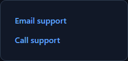
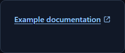

# q-link

`q-link` renders an inline destination with optional icon slots and an external-link cue.

**Component tag:** `<q-link>`

**Working preview:** Run `bun start` from the repository root, open the [existing playground](http://localhost:3333), then select **Actions → Link**. The examples below use this registered runtime with their own markup and data; playground presets are demonstrations, not component defaults.

**On this page**

- [Quick start](#quick-start)
- [Examples](#examples)
- [Behavior & accessibility](#behavior--accessibility)
- [Styling](#styling)
- [API reference](#api-reference)

## Quick start

1. Follow the central [installation instructions](../../README.md#1-install-library).
2. In your application entry file (for example `src/main.js`), register the elements and load the theme. This requires a bundler that resolves package imports and CSS imports.

```javascript
import "@webquark/core/dist/webquark/webquark.css";
import { defineCustomElements } from "@webquark/core/loader";

defineCustomElements();
```

3. Put the following markup in your application HTML.

```html
<q-link href="#details">Read details</q-link>
<section id="details"><h3>Details</h3><p>Account information</p></section>
```

**Result:** A primary-colored Read details link that targets the Details section.

### At a glance

| Capability | Options | Default |
| :--- | :--- | :--- |
| [Appearance](#variants) | default, muted, accent, danger | default |
| [Underline](#underlines) | hover, always, none | hover |
| [Destination](#state-and-interaction) | href, url alias, mailto, tel | none |
| [External cue](#labels-and-announcements) | external or target=_blank | off |
| [Content](#slots) | label/default slot, two icon slots | empty |
| [Availability](#state-and-interaction) | disabled | false |

**With no properties:** An empty anchor without href renders; it has no name or normal link tab stop. Supply visible text and a destination.

## Examples

Use the registration above first. Each HTML block belongs in the page body; its module script runs after the element is registered. CSS in a `<style>` block belongs in the page or your application stylesheet.

### Offer email and telephone contact

Use the convenience properties to build email and telephone destinations.



```html
<p><q-link mailto="support@example.com">Email support</q-link></p>
<p><q-link tel="+27215550123">Call support</q-link></p>
```

Activation is handled by the user's browser and configured mail or phone application.

### Identify a destination that opens in a new tab

Set target to _blank so the visible external icon and hidden new-tab cue agree.



```html
<q-link href="https://example.com" target="_blank" underline="always">Example documentation</q-link>
```

The default rel is noopener noreferrer; the image shows the cue before navigation.

## Behavior & accessibility

### State and interaction

The first truthy destination wins: `href` → deprecated `url` → `mailto` prefixed with `mailto:` → `tel` prefixed with `tel:`. Empty strings fall through; whitespace is not trimmed. With no destination, click is blocked and `qClick` is not emitted. Disabling removes the native destination/target/rel/download and sets `aria-disabled="true"`, `tabindex="-1"`.

`external` supplies a cue and a safe default rel; it does not open a new tab. Use `target="_blank"` for that behavior. Explicit nonempty `rel` overrides the default `noopener noreferrer`.

### Keyboard and focus

The native anchor provides Tab and Enter behavior when it has a destination. Space retains ordinary browser scrolling behavior. Disabled links are omitted from the tab order.

### Labels and announcements

Default-slot text falls back to `label`. External cues add a decorative SVG and visually hidden “external link”, or “opens in new tab” for `_blank`. There is no dedicated ariaLabel property; use meaningful visible link text. No live region is created.

### Limitations and compatibility

The component does not validate or sanitize destination schemes. Supply destinations appropriate to the application. Invalid visual values are not normalized. There is no component-specific reduced-motion override.

## Styling

Choose variant and underline behavior. Font sizing uses CSS rather than a size property.

### Variants

| Value | Effect |
| :--- | :--- |
| `default` (default) | Primary link color |
| `muted` | Muted text, normal foreground on hover/focus |
| `accent` | Secondary color |
| `danger` | Danger color |

Accent/danger rules keep their variant color on hover unless customized; disabled color has final precedence.

### Underlines

`hover` (default) underlines on hover or keyboard focus. `always` keeps the underline visible. `none` removes it; retain another clear indication that the text is a link.

### Custom styling

Use the [CSS variables](#css-variables) or [Shadow Parts](#shadow-parts) for supported customization. This matching markup and CSS can be used together:

```html
<q-link class="help-link" href="#help" underline="always">Open help</q-link>
<p id="help">Help and support</p>
<style>
  q-link.help-link { --q-link-color: #38bdf8; --q-link-font-weight: 700; }
</style>
```

`--q-link-color` controls the default variant. Muted/accent/danger/disabled rules use their own color hooks. Font-size accepts CSS lengths or inheritance, not named component sizes.

Keep shared setup in [Theme variables](../theme_variables.md), [Theme tokens](../theme-tokens.md), and the [sizing, spacing and surface foundation](../foundation.md).

## API reference

For new code, use `href`. The deprecated aliases remain supported.

Cross-check the [generated API](../../src/components/actions/link/readme.md), [implementation](../../src/components/actions/link/link.tsx), and imported public types. The entries below preserve source defaults and runtime qualifications.

### Properties

All properties are optional in the TypeScript component contract. Required content/labels and conditional constraints are explained with each workflow. Properties are alphabetical.

| Name | Default | Description |
| :--- | :--- | :--- |
| `disabled` | `false` | Prevents activation, navigation, and secondary actions such as removal.<br>**Type:** `boolean`. **HTML attribute:** `disabled`. **Required:** No. |
| `download` | `undefined` | Enables native download behavior when the component operates as a link.<br>**Type:** `string`. **HTML attribute:** `download`. **Required:** No. |
| `external` | `false` | Shows an external-link cue and supplies a safe default `rel`.<br>**Type:** `boolean`. **HTML attribute:** `external`. **Required:** No. |
| `href` | `undefined` | Destination used when the component operates as a link.<br>**Type:** `string`. **HTML attribute:** `href`. **Required:** No. |
| `label` | `undefined` | Fallback text when the default slot is empty.<br>**Type:** `string`. **HTML attribute:** `label`. **Required:** No. |
| `mailto` | `undefined` | Generates a `mailto:` URL when `href` and its deprecated `url` alias are unset.<br>**Type:** `string`. **HTML attribute:** `mailto`. **Required:** No. |
| `rel` | `undefined` | Explicit native rel; otherwise external or _blank supplies noopener noreferrer.<br>**Type:** `string`. **HTML attribute:** `rel`. **Required:** No. |
| `target` | `undefined` | Native anchor browsing context. _blank also adds the new-tab cue.<br>**Type:** `'_self' \| '_blank' \| '_parent' \| '_top'`. **HTML attribute:** `target`. **Required:** No. |
| `tel` | `undefined` | Generates a `tel:` URL when higher-priority destinations are unset.<br>**Type:** `string`. **HTML attribute:** `tel`. **Required:** No. |
| `underline` | `'hover'` | When the underline appears; see [Underlines](#underlines).<br>**Type:** `'hover' \| 'always' \| 'none'`. **HTML attribute:** `underline`. **Required:** No. |
| `url` | `undefined` | Deprecated alias for `href`. Compatibility alias used when `href` is unset.<br>**Type:** `string`. **HTML attribute:** `url`. **Required:** No. |
| `variant` | `'default'` | Visual color; see [Variants](#variants).<br>**Type:** `'default' \| 'muted' \| 'accent' \| 'danger'`. **HTML attribute:** `variant`. **Required:** No. |

Boolean attributes use Stencil coercion: presence/empty string is true, the literal string `"false"` is false, and removing the attribute supplies false rather than restoring a true or undefined initializer. Prefer explicit JavaScript `true`/`false` for updates; an optional Boolean can be reset to `undefined` through its property to recover inheritance/detection. String attributes remain strings; numeric attributes are parsed as numbers, so invalid text can become `NaN`. Setting a property to `undefined` or removing a string/number attribute does not rerun its initializer. Keep values within the documented types.

### Slots

| Name | Description |
| :--- | :--- |
| `default` | Link text; falls back to label. Supply a meaningful destination name. |
| `icon-left` | Leading decorative content; no fallback. |
| `icon-right` | Trailing decorative content; no fallback. |

### Events

| Name | When it fires | Payload |
| :--- | :--- | :--- |
| `qBlur` | The interactive field/control loses focus. | `CustomEvent<FocusEvent>` |
| `qClick` | Activation of the enabled interactive control; detail is the original MouseEvent. | `CustomEvent<MouseEvent>` |
| `qFocus` | The interactive field/control receives focus. | `CustomEvent<FocusEvent>` |

All listed Stencil events bubble, cross shadow boundaries (`composed: true`), and are cancelable. The component handlers do not use the emitted event's canceled result to roll back state or automatically cancel the underlying native event. For forwarded MouseEvent details, the original event is available as `event.detail`.

### Methods

This component exposes no public methods.

### Styling hooks

#### CSS variables

Defaults below show the local fallback chains; references to shared tokens depend on the active theme. Private `--_q-*` variables are implementation details and are not supported overrides. Component and functional shared hooks are listed; global palette/spacing/typography values are catalogued in [Theme tokens](../theme-tokens.md). See [Custom styling](#custom-styling) for effective precedence and exceptions.

| Name | Default | Controls |
| :--- | :--- | :--- |
| `--q-link-accent-color` | `var(--q-color-secondary, #7c3aed)` | Color. |
| `--q-link-color` | `var(--q-color-primary, #2563eb)` | Color. |
| `--q-link-color-hover` | `var(--q-color-primary-hover, #1d4ed8)` | Color. |
| `--q-link-danger-color` | `var(--q-color-danger, #dc2626)` | Color. |
| `--q-link-disabled-color` | `var(--q-fg-subtle, #94a3b8)` | Color. |
| `--q-link-external-icon-size` | `0.9em` | Width, height. |
| `--q-link-focus-offset` | `3px` | Outline-offset. |
| `--q-link-font-size` | `inherit` | Font-size. |
| `--q-link-font-weight` | `var(--q-font-weight-medium, 500)` | Font-weight. |
| `--q-link-gap` | `0.35em` | Gap. |
| `--q-link-muted-color` | `var(--q-fg-muted, #64748b)` | Color. |
| `--q-link-muted-color-hover` | `var(--q-fg-base, #172033)` | Color. |
| `--q-link-underline-offset` | `0.18em` | Text-underline-offset. |

#### Shadow Parts

| Name | Targets |
| :--- | :--- |
| `external-icon` | Decorative SVG only when external or target=_blank. |
| `label` | Visible label wrapper; always present. |
| `link` | Native anchor; always present. |
