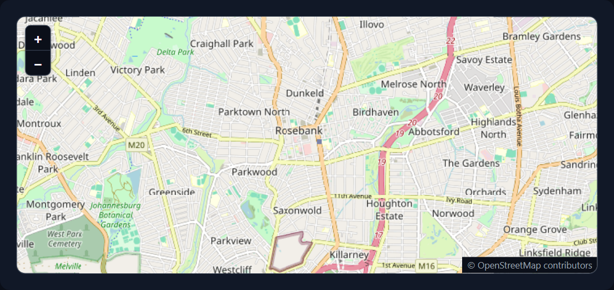
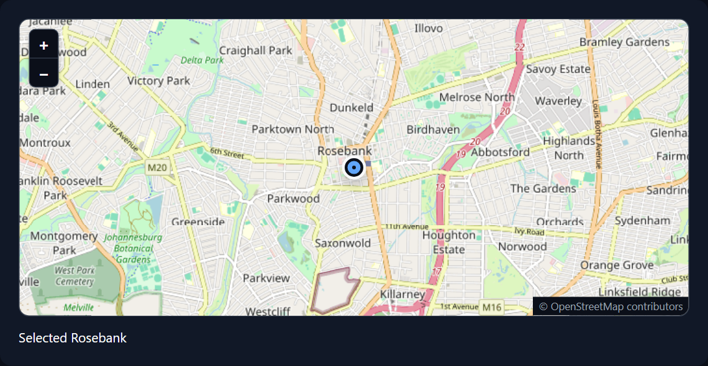
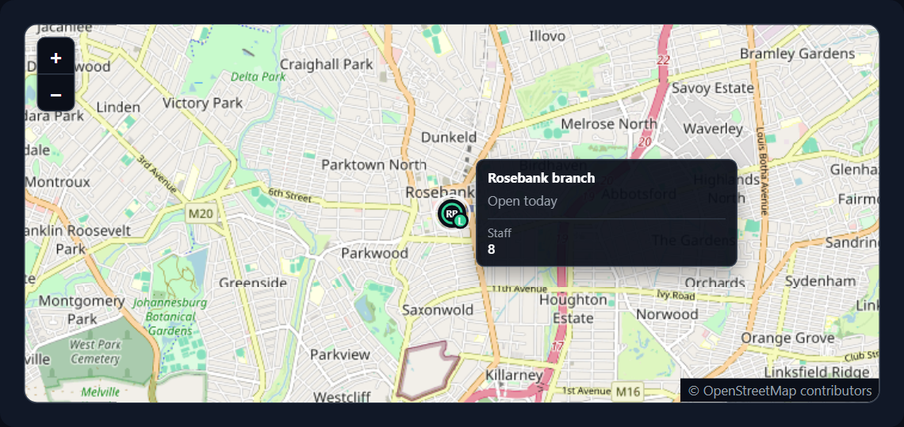
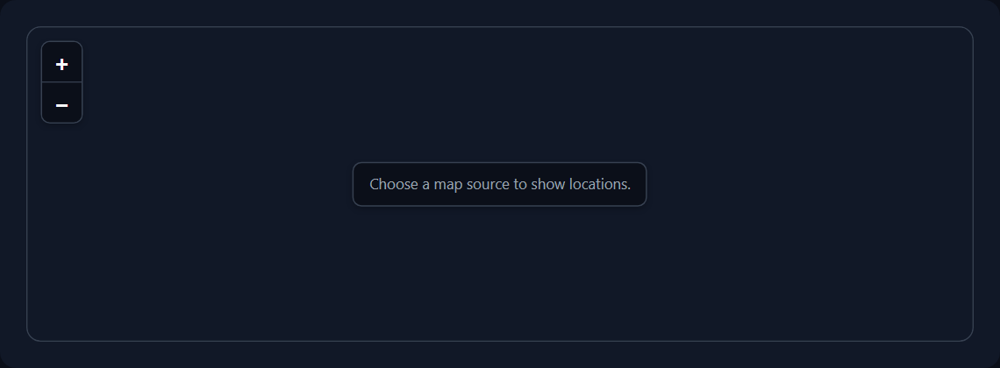

# q-map

`q-map` displays an interactive Leaflet map with configurable imagery, markers, clustering, and selected-location state. Resizing its frame preserves the current geographic center and zoom, subject to configured map bounds.

**Component tag:** `<q-map>`

**Working preview:** Run `bun start` from the repository root and open the [WebQuark playground](http://localhost:3333). Select **Data display → Map**. The menu does not expose every public property; assign additional options in the registered runtime or your application.

**On this page**

- [Quick start](#quick-start)
- [Examples](#examples)
- [Behavior & accessibility](#behavior--accessibility)
- [Styling](#styling)
- [API reference](#api-reference)

## Quick start

Follow the central [installation instructions](../../README.md#1-install-library). In a bundled application that resolves package imports and CSS imports, add this to the JavaScript entry file:

```javascript
import '@webquark/browser/dist/webquark/webquark.css';
import { defineCustomElements } from '@webquark/browser/loader';
defineCustomElements();
```

Place the following markup in the application HTML. Scripts shown below are module scripts and assume the registration above.

```html
<q-map id="locations" aria-label="Johannesburg locations" center-latitude="-26.1459" center-longitude="28.0416" zoom="13"
  tile-url="https://tile.openstreetmap.org/{z}/{x}/{y}.png"
  attribution="© OpenStreetMap contributors" attribution-url="https://www.openstreetmap.org/copyright"
  style="--q-map-height: 320px"></q-map>
```

**Result:** a 320 px map centered on Rosebank, provided the external tile service is reachable.

### At a glance

| Capability | Options | Default |
| :--- | :--- | :--- |
| [Imagery](#providers) | Raster tiles, MapLibre vectors, Google Maps; optional raster fallback | `tiles`, no URL |
| [Viewport](#state-and-interaction) | Center, zoom limits, bounds, zoom controls | 0°/0°, zoom 2, limits 0–19 |
| [Markers](#public-data-types) | Dot/avatar/icon, labels, badges, callouts, selection | Empty list; no selection |
| [Clustering](#group-nearby-locations) | Group-aware clustering, radius and zoom cutoff | Off |
| [Appearance](#custom-styling) | Map dimensions, marker sizes/colors, parts | 240 px minimum height |

**Bare tag:** creates the map surface and shows “Map provider is not configured.” It supplies no imagery or markers. `tileUrl`, `vectorStyleUrl`, or Google configuration is required for the chosen provider. Playground/example locations are presets, not component defaults.

## Examples

Registration from [Quick start](#quick-start) is required. Screenshots show the actual registered components in the existing playground runtime.

### Show a raster map

Provide a tile URL and attribution to display a navigable map.



```html
<q-map id="locations" aria-label="Johannesburg locations" center-latitude="-26.1459" center-longitude="28.0416" zoom="13"
  tile-url="https://tile.openstreetmap.org/{z}/{x}/{y}.png"
  attribution="© OpenStreetMap contributors" attribution-url="https://www.openstreetmap.org/copyright"
  style="--q-map-height: 320px"></q-map>
```

This example requests external OpenStreetMap tiles. Use a tile service appropriate for your application and its usage terms. A configured URL is required; imagery is not bundled.

### Select a location

Update the controlled selection from marker activation.



```html
<q-map id="locations" aria-label="Johannesburg locations" center-latitude="-26.1459" center-longitude="28.0416" zoom="13"
  tile-url="https://tile.openstreetmap.org/{z}/{x}/{y}.png"
  attribution="© OpenStreetMap contributors" attribution-url="https://www.openstreetmap.org/copyright"
  style="--q-map-height: 320px"></q-map>
<p id="location-status" role="status">Choose a location</p>
```

```html
<script type="module">
await customElements.whenDefined('q-map');
const map = document.querySelector('#locations');
map.markers = [{ id: 'rosebank', latitude: -26.1459, longitude: 28.0416, label: 'Rosebank' }];
map.addEventListener('qMarkerSelect', event => {
  map.selectedMarkerId = event.detail.marker.id;
  document.querySelector('#location-status').textContent = 'Selected ' + event.detail.marker.label;
});
</script>
```

Click Rosebank to reach the screenshot. The event does not change selectedMarkerId automatically. Numeric and string IDs are distinct.

### Add a status badge and callout

Attach short, noninteractive context to a location marker.



```html
<q-map id="locations" aria-label="Johannesburg locations" center-latitude="-26.1459" center-longitude="28.0416" zoom="13"
  tile-url="https://tile.openstreetmap.org/{z}/{x}/{y}.png"
  attribution="© OpenStreetMap contributors" attribution-url="https://www.openstreetmap.org/copyright"
  style="--q-map-height: 320px"></q-map>
```

```html
<script type="module">
await customElements.whenDefined('q-map');
const map = document.querySelector('#locations');
map.markers = [{
  id: 'rosebank', latitude: -26.1459, longitude: 28.0416,
  label: 'Rosebank branch', kind: 'avatar', fallbackText: 'RB', size: 'large', variant: 'success', ring: 'solid',
  badge: { text: 'L', ariaLabel: 'Live', variant: 'success' },
  callout: { title: 'Rosebank branch', subtitle: 'Open today', placement: 'right', stats: [{ label: 'Staff', value: 8 }] }
}];
</script>
```

Callouts are visual context and are aria-hidden; put essential accessible context in the marker label. Badge ariaLabel is appended to the marker name. Strings are inserted as text, not HTML.

### Group nearby locations

Enable clustering for markers with matching cluster groups.


```html
<q-map id="locations" cluster-markers aria-label="Johannesburg locations" center-latitude="-26.1459" center-longitude="28.0416" zoom="13"
  tile-url="https://tile.openstreetmap.org/{z}/{x}/{y}.png"
  attribution="© OpenStreetMap contributors" attribution-url="https://www.openstreetmap.org/copyright"
  style="--q-map-height: 320px"></q-map>
```

```html
<script type="module">
await customElements.whenDefined('q-map');
const map = document.querySelector('#locations');
map.markers = [
  { id: 'a', latitude: -26.1459, longitude: 28.0416, label: 'Branch A', clusterGroup: 'branches' },
  { id: 'b', latitude: -26.1460, longitude: 28.0417, label: 'Branch B', clusterGroup: 'branches' }
];
map.addEventListener('qClusterSelect', event => {
  // Call event.preventDefault() here if your app opens a list instead.
  console.log(event.detail.markerIds);
});
</script>
```

The screenshot shows the cluster before activation. Activating it normally centers and zooms toward its members; cancel qClusterSelect to replace that action.

### Explain missing configuration

Supply a useful message while a provider has not been configured.



```html
<q-map aria-label="Locations" style="--q-map-height: 240px">
  <span slot="empty">Choose a map source to show locations.</span>
</q-map>
```

Missing required configuration enters the empty state. This does not mean a network request failed.

## Behavior & accessibility

### State and interaction

Center/zoom properties apply programmatic view updates. User panning/zooming changes Leaflet's view without writing back those properties. `qMapClick` reports background clicks, excluding drags and interactive-layer clicks; there is no public viewport-change event.

`selectedMarkerId` is application-owned. `qMarkerSelect` reports a normalized marker; assign its ID to keep the selected styling and `aria-pressed` state. Replacing markers reconciles stable IDs; duplicate type-identical IDs keep the last definition. Invalid marker entries are omitted; malformed JSON becomes an empty collection.

| Input | Effective behavior |
| :--- | :--- |
| Center latitude/longitude | Finite values clamped to ±90/±180; nonfinite → 0 |
| Zoom | Clamped to normalized limits; nonfinite → minimum |
| Limits | Nonfinite minimum → 0; nonfinite maximum → 19; maximum never below minimum |
| Cluster radius/minimum points | Rounded and clamped to 1–200 / 2–1000; nonfinite → 48 / 2 |
| Cluster maximum zoom | Rounded/clamped to 0–floor(maxZoom); omitted/nonfinite → one below normalized max, at least 0 |
| Tile preload buffer | Rounded/clamped to 0–4; nonfinite → 0 |
| Vector padding | Clamped to 0–0.5; nonfinite → 0.2 |
| Bounds viscosity | Clamped to 0–1; nonfinite → 1 |

Normalization does not rewrite supplied properties. For numeric-or-string marker IDs, use JavaScript properties to preserve the intended type.

Bounds require finite geographic coordinates with south < north and west < east. Antimeridian-crossing bounds are unsupported. Invalid updates emit an error and preserve the previous valid bounds; undefined or a blank bounds string clears them.

Clustering combines only matching normalized groups. Omitted/blank groups become `default`; `clusterable:false` keeps a marker standalone. Displayed markers/clusters use collision adjustment, so overlapping symbols can move visually away from their exact coordinate.

### Keyboard and focus

| Key | Action |
| :--- | :--- |
| Tab / Shift+Tab | Reach map controls, markers, clusters, and attribution link |
| Enter / Space on marker | Request marker selection |
| Enter / Space on cluster | Request expansion; cancelable before default view change |
| Arrow keys on map canvas | Leaflet keyboard panning |
| + / − on map canvas | Leaflet keyboard zooming |

Callouts are noninteractive. The component does not transfer focus to external detail panels.

### Labels and announcements

The canvas is a region named by `ariaLabel`. Its declared default is “Interactive map”; unlike some controls, an explicitly empty/null name has no fallback, so provide a meaningful name.

Markers use button semantics with their label and optional badge description. Selection changes `aria-pressed`. Cluster buttons describe the location count. Callout content is hidden from assistive technology; it does not replace the accessible marker name.

| Provider state | DOM semantics |
| :--- | :--- |
| Initializing | Region has `aria-busy="true"` |
| Ready | Busy attribute removed |
| Empty | Custom/default empty overlay with `role="status"` |
| Error | Custom/default error overlay with `role="alert"` |

`qReady` means Leaflet setup and the initial provider attempt completed, not that imagery succeeded. Inspect `qStatusChange` for the actual provider state.

### Limitations and compatibility

Imagery depends on external provider configuration and network access. Vector rendering additionally needs WebGL; Google needs its API loaded or a valid key. Missing required configuration produces empty state without attempting a raster fallback; an initialization failure for a configured non-tile provider may fall back to a nonempty `tileUrl`.

Raster tile HTTP failures are not a comprehensive provider health signal; do not treat qReady as proof that every tile loaded. Old usable imagery may remain during provider replacement/failure. Raster replacement uses `full-batch` by default or `progressive` after the first successful tile.

Reduced motion removes marker/cluster transitions, stops the decorative pulse, and disables component-requested animated view changes. This is not a claim about every animation in third-party providers.

## Styling

### Variants

These are marker data options, not top-level map properties.

| Marker option | Values | Effect |
| :--- | :--- | :--- |
| `kind` | `dot`, `avatar`, `icon` | Center presentation; omitted supports legacy avatar content or dot |
| `ring` | `none` (default), `solid`, `dashed` | Outer emphasis |
| `pulse` | Boolean, default false | Animated emphasis unless reduced motion is requested |
| Callout placement | `auto` (default), `left`, `right`, `top`, `bottom` | Relative visual placement |
| Callout visibility | `always` (default), `selected` | Show continuously or only when selected |
| Callout stat layout | `compact` (default), `wide` | One column or full callout row |

An icon marker without an icon name falls back to dot. Avatar image failure leaves fallback text when supplied.

### Sizes

| Marker `size` | Default diameter |
| :--- | :--- |
| Omitted | `--q-map-marker-size`, 20 px |
| `small` | 16 px |
| `medium` | `--q-map-marker-size`, 20 px |
| `large` | 24 px |

Marker sizes are independent of inherited form/control sizing. `iconSize` and icon offsets are finite pixel values written inline on the marker, overriding inherited icon hooks. Map height defaults to 100% with a 240 px minimum; give the host a definite height for predictable layouts.

### Tones

Marker, badge, and callout `variant` accepts `default`, `success`, `warning`, `danger`, or `muted`. The default maps to the primary color; other values map to matching semantic colors or muted foreground. Invalid variants normalize to default. Color does not change application status or selection.

### Providers

| `provider` | Required configuration | Additional choices |
| :--- | :--- | :--- |
| `tiles` (default) | `tileUrl` template | Attribution, preload buffer, full-batch/progressive loading |
| `vector` | `vectorStyleUrl` | Viewport padding |
| `google` | Existing Google API or `googleApiKey` | `roadmap` (default), `satellite`, `terrain`, `hybrid` |

Invalid providers fall back to tiles; invalid Google types to roadmap; invalid loading policies to full-batch. Provider configuration is separate from theme styling.

### Custom styling

Use [CSS variables](#css-variables) for dimensions/presentation and [Shadow Parts](#shadow-parts) for visible elements. Shared palette setup is in [Theme tokens](../theme-tokens.md).

```html
<q-map class="location-map" aria-label="Locations"></q-map>
```

```css
q-map.location-map {
  --q-map-height: 320px;
  --q-map-marker-size-large: 32px;
  --q-map-radius: 12px;
}
```

Add imagery and markers as in the examples. The surface uses map-specific background/border hooks and shared palette fallbacks; nested containers do not automatically change its surface role.

## API reference

See the [generated API](../../src/browser/components/data-display/map/readme.md) and [source types](../../src/browser/components/data-display/map/map.types.ts).

### Properties

All properties are optional. Use JavaScript properties for structured values and callbacks; numeric HTML attributes are parsed by the component runtime. For booleans, use the bare attribute for true and remove it or assign the property `false` for false.

| Name | Default | Description |
| :--- | :--- | :--- |
| `ariaLabel` | `'Interactive map'` | Accessible name for the interactive map region.<br>**Type:** `string \| null`. **HTML attribute:** `aria-label`. **Required:** No. |
| `attribution` | `''` | Rendered for raster tiles and styled vectors.<br>**Type:** `string`. **HTML attribute:** `attribution`. **Required:** No. |
| `attributionUrl` | `''` | Links attribution only for HTTP(S) URLs.<br>**Type:** `string`. **HTML attribute:** `attribution-url`. **Required:** No. |
| `centerLatitude` | `0` | Finite values are clamped to the geographic range.<br>**Type:** `number`. **HTML attribute:** `center-latitude`. **Required:** No. |
| `centerLongitude` | `0` | Finite values are clamped to the geographic range.<br>**Type:** `number`. **HTML attribute:** `center-longitude`. **Required:** No. |
| `clusterMarkers` | `false` | Preserves stable source IDs while grouping nearby markers.<br>**Type:** `boolean`. **HTML attribute:** `cluster-markers`. **Required:** No. |
| `clusterMaxZoom` | `undefined` | Last clustering zoom; effective default is one below maxZoom, at least zero.<br>**Type:** `number`. **HTML attribute:** `cluster-max-zoom`. **Required:** No. |
| `clusterMinPoints` | `2` | Minimum markers per cluster; rounded and clamped to 2–1000.<br>**Type:** `number`. **HTML attribute:** `cluster-min-points`. **Required:** No. |
| `clusterRadius` | `48` | Screen-pixel radius clamped from 1 to 200.<br>**Type:** `number`. **HTML attribute:** `cluster-radius`. **Required:** No. |
| `googleApiKey` | `''` | Browser-restricted key used only when WebQuark loads Google Maps.<br>**Type:** `string`. **HTML attribute:** `google-api-key`. **Required:** No. |
| `googleMapType` | `'roadmap'` | Unsupported values normalize to `roadmap`.<br>**Type:** `QMapGoogleMapType`. **HTML attribute:** `google-map-type`. **Required:** No. |
| `markers` | `[]` | Accepts an array or JSON and reconciles markers using type-stable IDs.<br>**Type:** `QMapMarkerInput`. **HTML attribute:** `markers`. **Required:** No. |
| `maxBounds` | `undefined` | Accepts an object or JSON; malformed updates preserve the last valid bounds.<br>**Type:** `QMapBoundsInput`. **HTML attribute:** `max-bounds`. **Required:** No. |
| `maxBoundsViscosity` | `1` | Clamped from zero to one.<br>**Type:** `number`. **HTML attribute:** `max-bounds-viscosity`. **Required:** No. |
| `maxZoom` | `19` | Never resolves below `minZoom`.<br>**Type:** `number`. **HTML attribute:** `max-zoom`. **Required:** No. |
| `minZoom` | `0` | Non-finite values normalize to zero.<br>**Type:** `number`. **HTML attribute:** `min-zoom`. **Required:** No. |
| `provider` | `'tiles'` | Non-tile provider failures may fall back to `tileUrl`.<br>**Type:** `QMapProvider`. **HTML attribute:** `provider`. **Required:** No. |
| `rasterTileLoadingPolicy` | `'full-batch'` | Selects full-batch or progressive raster replacement and zoom loading.<br>**Type:** `QMapRasterTileLoadingPolicy`. **HTML attribute:** `raster-tile-loading-policy`. **Required:** No. |
| `selectedMarkerId` | `undefined` | Controls the selected visual and `aria-pressed` state.<br>**Type:** `QMapMarkerId`. **HTML attribute:** `selected-marker-id`. **Required:** No. |
| `tilePreloadBuffer` | `0` | Offscreen raster rows/columns, default 0; rounded/clamped to 0–4.<br>**Type:** `number`. **HTML attribute:** `tile-preload-buffer`. **Required:** No. |
| `tileUrl` | `''` | Tile template used by the tiles provider and optional provider fallback.<br>**Type:** `string`. **HTML attribute:** `tile-url`. **Required:** No. |
| `vectorPadding` | `0.2` | Vector viewport padding, default 0.2; clamped to 0–0.5.<br>**Type:** `number`. **HTML attribute:** `vector-padding`. **Required:** No. |
| `vectorStyleUrl` | `''` | MapLibre Style Specification URL for the vector provider.<br>**Type:** `string`. **HTML attribute:** `vector-style-url`. **Required:** No. |
| `zoom` | `2` | Clamped between the normalized zoom limits.<br>**Type:** `number`. **HTML attribute:** `zoom`. **Required:** No. |
| `zoomControls` | `true` | Show built-in zoom buttons; keyboard/wheel interactions remain available.<br>**Type:** `boolean`. **HTML attribute:** `zoom-controls`. **Required:** No. |

#### Public data types

These types describe property values and event payloads. Optional fields are marked with `?`; callbacks must be assigned in JavaScript.

**QMapMarkerId**: `string | number`.

##### QMapViewportRect

Each edge is measured in CSS pixels in browser viewport (client) coordinates, such as the values returned by `element.getBoundingClientRect()`.

| Field | Type | Required |
| :--- | :--- | :--- |
| `top` | `number` | Yes |
| `right` | `number` | Yes |
| `bottom` | `number` | Yes |
| `left` | `number` | Yes |

**QMapMarkerVisibilityResult**: `'visible' | 'panned' | 'unavailable' | 'constrained'`.

**QMapProvider**: `'tiles' | 'vector' | 'google'`.

**QMapRasterTileLoadingPolicy**: `'full-batch' | 'progressive'`.

**QMapGoogleMapType**: `'roadmap' | 'satellite' | 'terrain' | 'hybrid'`.

**QMapMarkerVariant**: `'default' | 'success' | 'warning' | 'danger' | 'muted'`.

**QMapMarkerKind**: `'dot' | 'avatar' | 'icon'`.

**QMapMarkerSize**: `'small' | 'medium' | 'large'`.

**QMapMarkerRing**: `'none' | 'solid' | 'dashed'`.

**QMapMarkerCalloutPlacement**: `'auto' | 'left' | 'right' | 'top' | 'bottom'`.

**QMapMarkerCalloutStatLayout**: `'compact' | 'wide'`.

**QMapMarkerCalloutVisibility**: `'always' | 'selected'`.

##### QMapBounds

| Field | Type | Required |
| :--- | :--- | :--- |
| `southLatitude` | `number` | Yes |
| `westLongitude` | `number` | Yes |
| `northLatitude` | `number` | Yes |
| `eastLongitude` | `number` | Yes |

**QMapBoundsInput**: `QMapBounds | string`.

##### QMapMarkerBadge

| Field | Type | Required |
| :--- | :--- | :--- |
| `icon` | `QIconName` | No |
| `text` | `string` | No |
| `variant` | `QMapMarkerVariant` | No |
| `ariaLabel` | `string` | Yes |

##### QMapMarkerCalloutStatus

| Field | Type | Required |
| :--- | :--- | :--- |
| `label` | `string` | Yes |
| `variant` | `QMapMarkerVariant` | No |

##### QMapMarkerCalloutStat

| Field | Type | Required |
| :--- | :--- | :--- |
| `label` | `string` | Yes |
| `value` | `string \| number` | Yes |
| `layout` | `QMapMarkerCalloutStatLayout` | No |

##### QMapMarkerCallout

| Field | Type | Required |
| :--- | :--- | :--- |
| `title` | `string` | Yes |
| `subtitle` | `string` | No |
| `meta` | `string` | No |
| `stats` | `readonly QMapMarkerCalloutStat[]` | No |
| `status` | `QMapMarkerCalloutStatus` | No |
| `variant` | `QMapMarkerVariant` | No |
| `placement` | `QMapMarkerCalloutPlacement` | No |
| `visibility` | `QMapMarkerCalloutVisibility` | No |

##### QMapMarker

| Field | Type | Required |
| :--- | :--- | :--- |
| `id` | `QMapMarkerId` | Yes |
| `latitude` | `number` | Yes |
| `longitude` | `number` | Yes |
| `label` | `string` | Yes |
| `clusterable` | `boolean` | No |
| `clusterGroup` | `string` | No |
| `variant` | `QMapMarkerVariant` | No |
| `imageUrl` | `string` | No |
| `fallbackText` | `string` | No |
| `kind` | `QMapMarkerKind` | No |
| `icon` | `QIconName` | No |
| `iconSize` | `number` | No |
| `iconOffsetX` | `number` | No |
| `iconOffsetY` | `number` | No |
| `size` | `QMapMarkerSize` | No |
| `ring` | `QMapMarkerRing` | No |
| `pulse` | `boolean` | No |
| `badge` | `QMapMarkerBadge` | No |
| `callout` | `QMapMarkerCallout` | No |

**QMapMarkerInput**: `QMapMarker[] | string`.

##### QMapClickDetail

| Field | Type | Required |
| :--- | :--- | :--- |
| `latitude` | `number` | Yes |
| `longitude` | `number` | Yes |
| `originalEvent` | `MouseEvent` | Yes |

##### QMapMarkerSelectDetail

| Field | Type | Required |
| :--- | :--- | :--- |
| `marker` | `QMapMarker` | Yes |
| `originalEvent` | `MouseEvent \| KeyboardEvent` | Yes |

##### QMapClusterSelectDetail

| Field | Type | Required |
| :--- | :--- | :--- |
| `clusterId` | `string` | Yes |
| `clusterGroup` | `string` | Yes |
| `markerIds` | `QMapMarkerId[]` | Yes |
| `latitude` | `number` | Yes |
| `longitude` | `number` | Yes |
| `expansionZoom` | `number` | Yes |
| `originalEvent` | `MouseEvent \| KeyboardEvent` | Yes |

**QMapStatus**: `'initializing' | 'ready' | 'empty' | 'error'`.

##### QMapStatusChangeDetail

| Field | Type | Required |
| :--- | :--- | :--- |
| `status` | `QMapStatus` | Yes |
| `requestedProvider` | `QMapProvider` | Yes |
| `activeProvider` | `QMapProvider` | No |
| `usingFallback` | `boolean` | Yes |

**QMapErrorCode**: `'leaflet-initialization-failed' | 'provider-initialization-failed' | 'fallback-initialization-failed' | 'invalid-max-bounds'`.

##### QMapErrorDetail

| Field | Type | Required |
| :--- | :--- | :--- |
| `code` | `QMapErrorCode` | Yes |
| `message` | `string` | Yes |
| `requestedProvider` | `QMapProvider` | Yes |
| `recoverable` | `boolean` | Yes |

#### Marker content constraints

IDs must be nonblank strings or finite numbers. Coordinates must be finite numbers within geographic bounds; missing/blank labels fall back to the stringified ID at runtime, although the declared marker interface requires a label.

Badges need a nonblank ariaLabel and text or icon. Callouts need a nonblank title; stats need a nonblank label and a finite number/nonblank string value. At most six valid stats are retained. Invalid optional presentation values use their documented defaults.

`QIconName` is a string accepted by [q-icon](./q-icon.md); configure icon assets through that component's public registry. Map marker text is not an icon registry.

### Slots

| Name | Description |
| :--- | :--- |
| `empty` | Missing-configuration content, only in empty state; default “Map provider is not configured.” |
| `error` | Provider-error content, only in error state; fallback is the current error message |

### Events

| Name | When it fires | Payload |
| :--- | :--- | :--- |
| `qClusterSelect` | Cluster activation before default pan/zoom | `QMapClusterSelectDetail` |
| `qError` | Configuration/initialization error | `QMapErrorDetail` |
| `qMapClick` | Background map click | `QMapClickDetail` |
| `qMarkerSelect` | Marker activation | `QMapMarkerSelectDetail` |
| `qReady` | Leaflet setup and initial provider attempt completed | `void` |
| `qStatusChange` | Provider status changes | `QMapStatusChangeDetail` |

Events are `CustomEvent<Payload>` and bubble, are composed and cancelable. Only `qClusterSelect` cancellation is consumed to prevent the default center/zoom action. Other events report changes; cancellation does not roll them back. Full payload fields are listed under [Public data types](#public-data-types).

### Methods

| Signature | Purpose | Returns |
| :--- | :--- | :--- |
| `ensureMarkerVisible(markerId: QMapMarkerId, occlusions: readonly QMapViewportRect[])` | Minimally pan to reveal a marker or its cluster while keeping zoom; account for supplied viewport rectangles and built-in controls | `Promise<QMapMarkerVisibilityResult>` |

Wait for registration and `qReady` before relying on map methods. Pass occlusion rectangles in browser viewport CSS pixels from `getBoundingClientRect()`. Pass `[]` when there are no application overlays. Results: `visible` (already exposed), `panned` (revealed after movement), `unavailable` (missing/unready/interrupted target), or `constrained` (bounds/occlusions prevent visibility). A newer request supersedes the previous one.

#### Package constants

Import these values from `@webquark/browser` in a bundled JavaScript module, for example `import { Q_MAP_MARKER_KINDS } from '@webquark/browser';`. They expose the supported options for application controls; the arrays are declared as readonly tuples in TypeScript.

| Name | Value |
| :--- | :--- |
| `Q_MAP_DEFAULT_CLUSTER_GROUP` | `'default'` |
| `Q_MAP_MARKER_CALLOUT_PLACEMENTS` | `['auto', 'left', 'right', 'top', 'bottom']` |
| `Q_MAP_MARKER_CALLOUT_STAT_LAYOUTS` | `['compact', 'wide']` |
| `Q_MAP_MARKER_CALLOUT_VISIBILITIES` | `['always', 'selected']` |
| `Q_MAP_MARKER_KINDS` | `['dot', 'avatar', 'icon']` |
| `Q_MAP_MARKER_RINGS` | `['none', 'solid', 'dashed']` |
| `Q_MAP_MARKER_SIZES` | `['small', 'medium', 'large']` |
| `Q_MAP_MARKER_VARIANTS` | `['default', 'success', 'warning', 'danger', 'muted']` |
| `Q_MAP_RASTER_TILE_LOADING_POLICIES` | `[ 'full-batch', 'progressive']` |

### Styling hooks

#### CSS variables

Defaults show local declarations, shared defaults where declared, or the component fallback expression. Shared tokens are defined in [Theme variables](../theme_variables.md). Set overrides directly on the host.

| Name | Default | Controls |
| :--- | :--- | :--- |
| `--q-map-attribution-bg` | `var(--q-bg-base)` | Attribution strip background. |
| `--q-map-attribution-color` | `var(--q-fg-muted)` | Attribution text and link color. |
| `--q-map-bg` | `var(--q-bg-surface-1)` | Map surface background before imagery loads. |
| `--q-map-border` | `var(--q-border)` | Outer surface border. |
| `--q-map-height` | `100%` | Host height; percentage values need a sized parent. |
| `--q-map-marker-callout-bg` | `color-mix(in srgb, var(--q-bg-base, #111827) 94%, transparent)` | Callout background. |
| `--q-map-marker-callout-max-width` | `220px` | Fallback callout width when the width hook is unset; despite its name, this is not the viewport maximum. |
| `--q-map-marker-callout-meta-color` | `var(--q-color-primary, #60a5fa)` | Callout metadata text color. |
| `--q-map-marker-callout-status-accent` | `var(--q-color-primary, #60a5fa)` | Status badge foreground, tinted background and border; assigned on the badge by its variant, so host inheritance alone cannot override it. |
| `--q-map-marker-callout-status-max-width` | `45%` | Maximum status badge width within the callout. |
| `--q-map-marker-callout-width` | `var(--q-map-marker-callout-max-width, 220px)` | Callout width, capped by the viewport minus 24px. |
| `--q-map-marker-cluster-size` | `32px` | Cluster width, height and centering offsets. |
| `--q-map-marker-color` | `var(--q-color-primary)` | Default marker and badge background. |
| `--q-map-marker-content-bg` | `var(--q-bg-base, #111827)` | Background behind marker text, image or icon. |
| `--q-map-marker-content-color` | `var(--q-fg-base, #f9fafb)` | Marker text and icon color. |
| `--q-map-marker-content-gap` | `2px` | Padding between marker border and its content. |
| `--q-map-marker-danger` | `var(--q-color-danger)` | Danger marker and badge background. |
| `--q-map-marker-icon-offset-x` | `0` | Horizontal icon translation; marker data can override it inline. |
| `--q-map-marker-icon-offset-y` | `0` | Vertical icon translation; marker data can override it inline. |
| `--q-map-marker-icon-size` | `58%` | Icon width and height; marker data can override it inline. |
| `--q-map-marker-muted` | `var(--q-fg-muted)` | Muted marker and badge background. |
| `--q-map-marker-pulse-color` | `var(--q-color-primary, #60a5fa)` | Animated pulse border color. |
| `--q-map-marker-rendered-size` | `var(--q-map-marker-size, 20px)` | Locally assigned marker dimension; use the semantic size hooks for host overrides. |
| `--q-map-marker-ring-color` | `currentColor` | Solid or dashed outer ring color. |
| `--q-map-marker-selected-color` | `var(--q-fg-base)` | Selection outline on markers and clusters containing the selected marker. |
| `--q-map-marker-selected-shadow` | `var(--q-shadow-medium)` | Selected marker shadow. |
| `--q-map-marker-size` | `20px` | Fallback medium marker dimension. |
| `--q-map-marker-size-large` | `24px` | Large marker width and height. |
| `--q-map-marker-size-medium` | `var(--q-map-marker-size)` | Medium marker width and height; falls back to the general size hook. |
| `--q-map-marker-size-small` | `16px` | Small marker width and height. |
| `--q-map-marker-success` | `var(--q-color-success)` | Success marker and badge background. |
| `--q-map-marker-warning` | `var(--q-color-warning)` | Warning marker and badge background. |
| `--q-map-min-height` | `240px` | Minimum host height. |
| `--q-map-radius` | `var(--q-radius-lg)` | Outer surface corner radius. |
| `--q-map-tile-filter` | `none` | CSS filter applied to the tile pane. |

The declared `--q-map-marker-rendered-size` is assigned locally by marker size classes; setting it only on the host does not override that local assignment. Prefer `--q-map-marker-size` and its semantic size hooks. Data-level icon dimensions/offsets are inline and take precedence over inherited CSS values.

#### Shadow Parts

| Name | Targets |
| :--- | :--- |
| `attribution` | Text/link when raster or vector attribution is nonempty |
| `canvas` | Leaflet canvas region |
| `cluster` | Visible cluster button surface |
| `cluster-group-*` | Visible cluster's normalized group; lowercase with unsupported characters replaced by hyphens |
| `empty` | Empty-state overlay |
| `error` | Error-state overlay |
| `marker` | Visible marker button surface |
| `marker-badge` | Badge node in each marker; hidden unless badge is valid |
| `marker-callout` | Rendered callout when configured and visible |
| `surface` | Outer clipped surface |
