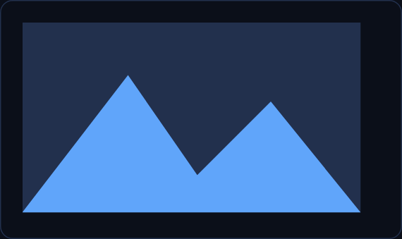
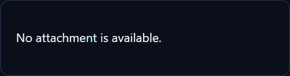

# q-media

`q-media` provides a scaffold that projects application-owned media and fallback content without rendering media itself.

**Component tag:** `<q-media>`

**Working preview:** Run `bun start` from the repository root and open the [existing playground](http://localhost:3333). There is no dedicated q-media preset; the examples below use temporary markup with the same registered runtime, not a new navigation entry.

**On this page**

- [Quick start](#quick-start)
- [Examples](#examples)
- [Behavior & accessibility](#behavior--accessibility)
- [Styling](#styling)
- [API reference](#api-reference)

## Quick start

1. Follow the central [installation instructions](../../README.md#1-install-library).
2. In your application entry file, register WebQuark. This assumes a bundler that resolves package imports and CSS imports.

```javascript
import '@webquark/core/dist/webquark/webquark.css';
import { defineCustomElements } from '@webquark/core/loader';
defineCustomElements();
```

3. Add this markup to your application page. Any module script runs after that shared setup.

```html
<q-media>
  
</q-media>
```

**Result:** the supplied native image, rendered through the default slot.

### At a glance

| Capability | Options | Default |
| :--- | :--- | :--- |
| [Implementation status](#limitations-and-compatibility) | Content projection scaffold | No native media renderer |
| [Content](#slots) | Default and fallback slots | Both always available |
| [Declared media API](#properties) | src, alt, kind, loading | Empty src/alt; image; lazy |

**With no properties:** An empty block renders. src, alt, kind, and loading do not currently create an image, video, file link, or loading/error behavior. Supply your own renderer.

## Examples

These examples share the [Quick start registration](#quick-start). Screenshots show the real registered component in a temporary preview fixture using the existing playground runtime. They do not imply extra permanent playground presets.

### Project a native image

Supply the actual accessible media element through the default slot.



```html
<q-media>
  
</q-media>
```

The native img owns its source, alternate text, dimensions, and loading behavior.

### Show application-owned fallback content

Use the fallback slot only when the application decides it should be displayed.



```html
<q-media><p slot="fallback">No attachment is available.</p></q-media>
```

Both slots render simultaneously when populated; the component does not choose between them.

## Behavior & accessibility

### State and interaction

All four properties are declarations for a future media renderer. Only `kind` reflects to an attribute; none of these properties selects or loads native media. Both slots always render. The application must own conditional fallback, loading, errors, and media events.

### Labels and announcements

The scaffold adds no role, accessible name, keyboard behavior, or live region. Name the actual image, video, or link supplied in a slot. Setting q-media alt does not name a slotted image.

### Limitations and compatibility

Native rendering is deferred in the current implementation. Treat this guide as documentation of the available scaffold, not as evidence of a completed media player. There are no media methods, emitted events, CSS variables, or Shadow Parts.

## Styling

The host is a block with `min-width: 0`. Style the host and your slotted elements with ordinary CSS; there are no built-in appearance variants or sizes.

### Custom styling

Scope CSS to the host or supplied content. See the exact [CSS variables](#css-variables) and [Shadow Parts](#shadow-parts).

```html
<q-media class="attachment"><span slot="fallback">No attachment</span></q-media>
<style>
  q-media.attachment { padding: 12px; border: 1px solid var(--q-border-color); }
</style>
```

Shared geometry and theme setup are documented in [Foundation](../foundation.md) and [theme tokens](../theme-tokens.md).

## API reference

Cross-check the [generated API](../../src/components/media/media/readme.md) and [implementation](../../src/components/media/media/media.tsx). Source nullability and actual rendering limitations are preserved below.

### Properties

All properties are optional and listed alphabetically.

| Name | Default | Description |
| :--- | :--- | :--- |
| `alt` | `''` | Declared alternate-text field; currently unused by rendering.<br>**Type:** `string`. **HTML attribute:** `alt`. **Required:** No. |
| `kind` | `'image'` | image, video, or file. Reflected to the host, with no rendering effect.<br>**Type:** `"file" \| "image" \| "video"`. **HTML attribute:** `kind`. **Required:** No. |
| `loading` | `'lazy'` | eager or lazy. Currently does not configure any native element.<br>**Type:** `"eager" \| "lazy"`. **HTML attribute:** `loading`. **Required:** No. |
| `src` | `''` | Declared media URL; currently unused by rendering.<br>**Type:** `string`. **HTML attribute:** `src`. **Required:** No. |

### Slots

| Name | Description |
| :--- | :--- |
| (default) | Application-owned content; always projected, no fallback. |
| fallback | Application-owned placeholder; always projected alongside default content, not conditional. |

### Events

This component emits no public events.

### Methods

This component exposes no public methods.

### Styling hooks

#### CSS variables

This component declares no component-specific CSS variables. Shared inherited values are documented in the [shared variable reference](../theme_variables.md).

#### Shadow Parts

This component exposes no Shadow Parts.
