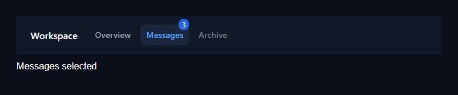
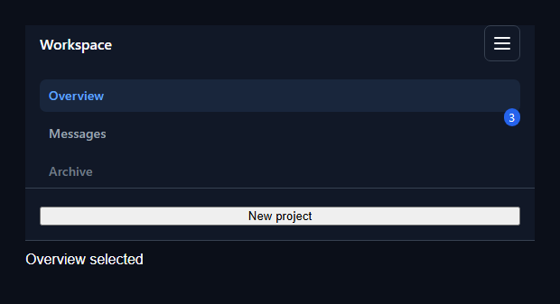

# q-navbar

`q-navbar` displays brand, navigation items, and actions with optional edge placement and a responsive mobile menu.

**Component tag:** `<q-navbar>`

**Working preview:** Run `bun start` from the repository root, open the [existing playground](http://localhost:3333), then select **Layout → Navbar**. The examples below use temporary fixtures in this same registered runtime.

**On this page**

- [Quick start](#quick-start)
- [Examples](#examples)
- [Behavior & accessibility](#behavior--accessibility)
- [Styling](#styling)
- [API reference](#api-reference)

## Quick start

1. Follow the central [installation instructions](../../README.md#1-install-library).
2. Add registration to your application entry file (`main.js`). This requires a bundler that resolves package imports and CSS imports.

```javascript
import '@webquark/core/dist/webquark/webquark.css';
import { defineCustomElements } from '@webquark/core/loader';

defineCustomElements();
```

3. Add this markup to the application page after setup.

```html
<q-navbar brand="Workspace" brand-href="#home" aria-label="Main sections"
  items='["Overview","Projects"]' active-value="Overview"></q-navbar>
```

**Result:** a brand link and two navigation buttons; Overview is marked current. Add a qSelect handler to update selection.

### At a glance

| Capability | Options | Default |
| :--- | :--- | :--- |
| [Content](#navbariteminput-and-navbaritem) | String labels or rich item objects, icons, add-ons | No items/brand |
| [Edges](#edges) | top, right, bottom, left; optional sticky | top, normal flow |
| [Size](#sizes) | Regular or compact | Regular |
| [Surface](#variants) | Opaque/transparent, border toggle | Opaque, bordered |
| [Mobile](#state-and-interaction) | menu or inline | menu at ≤720px |
| [Selection](#state-and-interaction) | activeValue or item.active | No current item |

**With no properties:** `<q-navbar></q-navbar>` renders an empty brand link to `/`, empty navigation/action regions, and a bordered surface. At ≤720px the menu toggle is visible. Supply brand text or brand-slot content so the link has a name, plus navigation content.

**Playground preset:** The playground supplies WebQuark branding, linked items, actions, and an active value; the component does not.

## Examples

These examples share the registration above. Place each complete snippet in the application page; scripts use module syntax. Screenshots show the real component in the playground runtime with the shared dark theme.

### Track application navigation

A navbar shows a selected section and a message-count add-on.



```html
<q-navbar id="project-nav" brand="Workspace" brand-href="#home" active-value="overview" aria-label="Project sections">
  <span slot="messages-count" style="background:#2563eb;color:white;border-radius:12px;padding:2px 6px;font-size:12px">3</span>
</q-navbar>
<p id="nav-status" role="status">Overview selected</p>
<script type="module">
  await customElements.whenDefined('q-navbar');
  const nav = document.querySelector('#project-nav');
  nav.items = [
    { label: 'Overview', value: 'overview' },
    { label: 'Messages', value: 'messages', addonSlot: 'messages-count', addonPlacement: 'top-end' },
    { label: 'Archive', value: 'archive', disabled: true }
  ];
  nav.addEventListener('qSelect', event => {
    nav.activeValue = event.detail.value;
    document.querySelector('#nav-status').textContent = event.detail.label + ' selected';
  });
</script>
```

Click Messages to reach the screenshot. The handler owns activeValue and the status text.

### Expose actions on a narrow screen

A mobile navbar reveals navigation and a separate mobile action slot.



```html
<q-navbar id="project-nav" brand="Workspace" brand-href="#home" active-value="overview" aria-label="Project sections">
  <button slot="mobile-actions" type="button">New project</button>
  <span slot="messages-count" style="background:#2563eb;color:white;border-radius:12px;padding:2px 6px;font-size:12px">3</span>
</q-navbar>
<p id="nav-status" role="status">Overview selected</p>
<script type="module">
  await customElements.whenDefined('q-navbar');
  const nav = document.querySelector('#project-nav');
  nav.items = [
    { label: 'Overview', value: 'overview' },
    { label: 'Messages', value: 'messages', addonSlot: 'messages-count', addonPlacement: 'top-end' },
    { label: 'Archive', value: 'archive', disabled: true }
  ];
  nav.addEventListener('qSelect', event => {
    nav.activeValue = event.detail.value;
    document.querySelector('#nav-status').textContent = event.detail.label + ' selected';
  });
</script>
```

Use a viewport at or below 720px and activate Menu. The screenshot shows the open menu. Desktop actions are hidden at this width; supply mobile-actions when needed.

## Behavior & accessibility

### State and interaction

The application owns `activeValue`; item clicks emit qSelect but do not set it. An item is current when its active flag is true or its value/href matches nonempty activeValue. Multiple active flags may yield multiple current items. Linked items retain native navigation; for client routing preventDefault on `detail.originalEvent` and route in the application.

Menu state is internal. On top/bottom edges at viewport widths ≤720px, menu mode hides desktop items until the toggle opens them and hides the custom `nav` slot even while open; provide `mobile-nav` for that content. It also exposes supplied mobile slots. Clicking a generated item, clicking outside, or pressing Escape closes the menu. Custom slotted links do not automatically close it. Inline mode keeps generated/custom desktop navigation inline and hides the menu button/panel; desktop actions are still hidden at mobile widths. Left/right edges remain vertical without this mobile collapse.

### Keyboard and focus

Links/buttons use normal Tab and activation keys. Disabled buttons use native disabled; disabled links lose href/target and have aria-disabled=true. Menu opening does not move focus or trap it; Escape closes without explicit focus restoration. There is no arrow-key navigation model.

### Labels and announcements

Desktop/mobile nav names fall back to “Primary navigation”/“Mobile navigation” when aria-label is blank after trimming. The menu button uses mobileLabel, aria-expanded, aria-controls and aria-haspopup. Icon-only items use ariaLabel or label as their accessible name and hide the visible label. Logo alt defaults to empty beside brand text or “Brand” without brand text; supply meaningful logoAlt for logo-only branding. Add-on content is not automatically hidden from accessibility. No live region is created.

### Forms

Generated item/toggle buttons use type=button. The component has no form value; slotted buttons need an appropriate type.

### Limitations and compatibility

Items accepts an array property or JSON-array string/attribute. Strings are trimmed and blank strings discarded; objects require a string label. Malformed JSON logs an error and gives an empty array. Valid JSON of a non-array shape is unsupported and can throw because the normalizer calls flatMap. Replace the items array after edits; keep item values unique for stable DOM identity. Unknown edges/mobile modes do not receive a documented fallback. No component-specific reduced-motion rule changes item transitions.

## Styling

Use edge, compact, transparent, and bordered before applying hooks.

### Variants

Opaque background and border are the defaults. `transparent` removes the background. Set `bordered="false"` to remove the inward-facing border. Item active/disabled appearance follows item state.

### Sizes

Top/bottom minimum height is 64px, compact 52px. On left/right edges, the inner row is 240px wide, or 200px compact, filling a definite parent height. The outer host and surface still stretch to the parent width; set the host width explicitly when a narrow vertical bar is required. Logo defaults to 32px square; icon-only items to 40px minimum.

### Edges

`top` (default)/`bottom` are horizontal; `left`/`right` vertical. Sticky sets CSS position:sticky and the matching edge offset; it does not establish a fixed full-screen bar. Safe-area padding depends on edge.

### Custom styling

```html
<q-navbar class="app-nav" brand="Workspace" brand-href="#home" items='["Home","Projects"]'></q-navbar>
<style>
  q-navbar.app-nav { --q-navbar-item-radius: 12px; --q-navbar-item-active-bg: #1e40af; }
</style>
```

See [CSS variables](#css-variables), [Shadow Parts](#shadow-parts), and [theme setup](../theme_variables.md).

## API reference

See the [Stencil-generated API](../../src/components/layout/navbar/readme.md) and [component source](../../src/components/layout/navbar/navbar.tsx). The tables below include source-level types and effective rendering constraints.

### Properties

All properties are optional and are listed alphabetically. Boolean attributes use Stencil boolean parsing: a present empty attribute enables the property, `="false"` disables it; JavaScript properties accept `true`/`false`. Removing a boolean attribute makes it false, including properties initially declared true. For updates, set the desired JavaScript property explicitly instead of relying on attribute removal to restore initializer defaults.

| Name | Default | Description |
| :--- | :--- | :--- |
| `activeValue` | `''` | Current item value or href; application-owned.<br>**Type:** `string`. **HTML attribute:** `active-value`. **Required:** No. |
| `ariaLabel` | `null` | Accessible name for both nav regions; blank uses separate default names.<br>**Type:** `string \| null`. **HTML attribute:** `aria-label`. **Required:** No. |
| `bordered` | `true` | Add inward-facing border.<br>**Type:** `boolean`. **HTML attribute:** `bordered`. **Required:** No. |
| `brand` | `undefined` | Visible fallback brand text; undefined renders none.<br>**Type:** `string`. **HTML attribute:** `brand`. **Required:** No. |
| `brandHref` | `'/'` | Brand anchor destination.<br>**Type:** `string`. **HTML attribute:** `brand-href`. **Required:** No. |
| `compact` | `false` | Use compact height/width/padding.<br>**Type:** `boolean`. **HTML attribute:** `compact`. **Required:** No. |
| `edge` | `'top'` | Layout, border, safe-area, and sticky edge.<br>**Type:** `'top' \| 'right' \| 'bottom' \| 'left'`. **HTML attribute:** `edge`. **Required:** No. |
| `items` | `[]` | Array or JSON-array string; see the complete item shape below.<br>**Type:** `NavbarItemInput[] \| string`. **HTML attribute:** `items`. **Required:** No. |
| `logoAlt` | `''` | Image alt; empty falls back to decorative with brand text or Brand without it.<br>**Type:** `string`. **HTML attribute:** `logo-alt`. **Required:** No. |
| `logoSrc` | `undefined` | Fallback brand image URL; undefined renders no image.<br>**Type:** `string`. **HTML attribute:** `logo-src`. **Required:** No. |
| `mobileLabel` | `'Menu'` | Accessible label for menu toggle.<br>**Type:** `string`. **HTML attribute:** `mobile-label`. **Required:** No. |
| `mobileMode` | `'menu'` | menu collapses horizontal navigation below 721px; inline retains it.<br>**Type:** `'menu' \| 'inline'`. **HTML attribute:** `mobile-mode`. **Required:** No. |
| `sticky` | `false` | Use CSS sticky positioning.<br>**Type:** `boolean`. **HTML attribute:** `sticky`. **Required:** No. |
| `transparent` | `false` | Remove the navbar background.<br>**Type:** `boolean`. **HTML attribute:** `transparent`. **Required:** No. |

#### NavbarItemInput and NavbarItem

A string supplies trimmed label and value. An object supports:

| Field | Type and meaning |
| :--- | :--- |
| label | Required string; visible item text. |
| value | Optional string; stable identity and selection value. Use unique values. |
| href | Optional string; makes an anchor instead of button. |
| target | Optional `_self \| _blank \| _parent \| _top`; _blank adds noopener noreferrer. |
| disabled | Optional boolean, default false. |
| active | Optional boolean, default false; adds aria-current=page independently of activeValue. |
| icon | Optional string; q-icon name. |
| iconLib | Optional string; default lucide. Supports lucide, font-awesome/fontawesome, local, and q-icon custom library handling. |
| iconSize | Optional sm/md/lg, number, or string; default sm. See q-icon for CSS/numeric sizing. |
| iconLocalPath | Optional string for q-icon local-path. |
| iconOnly | Optional boolean; hides label only when an icon is also provided. |
| ariaLabel | Optional string; icon-only accessible name, falling back to label. |
| addonSlot | Optional name for a per-item add-on slot. |
| addonPlacement | Optional top-start, top-center, top-end (default), bottom-start, bottom-center, bottom-end. |

See [q-icon](./q-icon.md) for icon registration and source configuration. Values emitted on selection use `item.value || item.href || item.label`.

### Slots

| Name | Description |
| :--- | :--- |
| `actions` | Desktop actions; hidden at ≤720px on horizontal edges. |
| `brand` | Custom content inside the existing brand anchor; do not nest another anchor. Fallback is logo and brand text. |
| `mobile-actions` | Mobile actions with same condition. |
| `mobile-nav` | Mobile menu navigation; no fallback; available only in opened horizontal mobile menu. |
| `nav` | Additional desktop navigation; no fallback; hidden in mobile menu mode. |
| Item-defined names | Names supplied by addonSlot; projected beside that item, no fallback. |

### Events

Events are `CustomEvent`s with `bubbles: true`, `composed: true`, and `cancelable: true`. The component does not check cancellation; preventDefault on the custom event does not veto its behavior.

| Name | When it fires | Payload |
| :--- | :--- | :--- |
| `qMenuToggle` | Internal menu state changes. | `CustomEvent<boolean>`; new open state. |
| `qSelect` | Enabled generated item activation. | `CustomEvent<NavbarSelectDetail>`; detail `{ value: string; label: string; item: NavbarItem; originalEvent: MouseEvent }`. Item is the normalized object. |

### Methods

This component exposes no public methods.

### Styling hooks

Defaults below include the imported shared stylesheet; `var(...)` values follow the active theme. Component-specific hooks and the shared tokens they consume are listed. For shared setup, see [Theme variables](../theme_variables.md).

#### CSS variables

| Name | Default | Controls |
| :--- | :--- | :--- |
| `--q-bg-surface-1` | `#111827` | bg surface 1 applied to `.navbar`, `:host([edge='top']) .mobile-panel, :host([edge='bottom']) .mobile-panel`. |
| `--q-bg-surface-2` | `#19243b` | bg surface 2 applied to `.nav-item:hover, .nav-item:focus-visible`. |
| `--q-border-color` | `#374151` | border color applied to `:host([edge='top']) .navbar.is-bordered`, `:host([edge='right']) .navbar.is-bordered`, `:host([edge='bottom']) .navbar.is-bordered`. |
| `--q-color-primary` | `#60a5fa` | color primary applied to `.nav-item.is-active`. |
| `--q-fg-base` | `#f9fafb` | fg base applied to `.navbar`, `.nav-item:hover, .nav-item:focus-visible`, `.menu-button`. |
| `--q-fg-muted` | `#9ca3af` | fg muted applied to `.nav-item`, `.nav-item.is-disabled, .nav-item:disabled`. |
| `--q-font-family` | `-apple-system, BlinkMacSystemFont, 'Segoe UI', Roboto, Helvetica, Arial, sans-serif` | font family applied to `.navbar`. |
| `--q-font-weight-bold` | `600` | font weight bold applied to `.brand-text`. |
| `--q-font-weight-medium` | `500` | font weight medium applied to `.nav-item`. |
| `--q-glow-interactive` | `0 0 20px rgba(96, 165, 250, 0.3)` | glow interactive applied to `.nav-item:focus-visible`. |
| `--q-navbar-action-gap` | `8px` | navbar action gap applied to `.desktop-actions`. |
| `--q-navbar-bg` | `var(--q-bg-surface-1, #1f2937)` | navbar bg applied to `.navbar`, `:host([edge='top']) .mobile-panel, :host([edge='bottom']) .mobile-panel`. |
| `--q-navbar-border` | `1px solid var(--q-border-color, #374151)` | navbar border applied to `:host([edge='top']) .navbar.is-bordered`, `:host([edge='right']) .navbar.is-bordered`, `:host([edge='bottom']) .navbar.is-bordered`. |
| `--q-navbar-brand-size` | `1rem` | navbar brand size applied to `.brand-text`. |
| `--q-navbar-compact-height` | `52px` | navbar compact height applied to `.is-compact .navbar-row`. |
| `--q-navbar-compact-padding` | `var(--q-navbar-edge-compact-padding, 0 16px)` | navbar compact padding applied to `.is-compact .navbar-row`. |
| `--q-navbar-compact-width` | `200px` | navbar compact width applied to `:host([edge='left']) .is-compact .navbar-row, :host([edge='right']) .is-compact .navbar-row`. |
| `--q-navbar-edge-compact-padding` | `Depends on edge and safe-area insets; see Edges/Sizes` | Host-defined compact edge/safe-area default; override with --q-navbar-compact-padding. |
| `--q-navbar-edge-mobile-padding` | `Top/bottom safe-area inset plus 16px horizontal` | Horizontal mobile safe-area padding; override with --q-navbar-mobile-padding. |
| `--q-navbar-edge-padding` | `Depends on edge and safe-area insets; see Edges/Sizes` | Host-defined edge/safe-area default; override with --q-navbar-padding. |
| `--q-navbar-fg` | `var(--q-fg-base, #f9fafb)` | navbar fg applied to `.navbar`, `.menu-button`. |
| `--q-navbar-gap` | `20px` | navbar gap applied to `.navbar-row`. |
| `--q-navbar-height` | `64px` | navbar height applied to `.navbar-row`. |
| `--q-navbar-item-active-bg` | `color-mix(in srgb, var(--q-color-primary, #60a5fa) 10%, transparent)` | navbar item active bg applied to `.nav-item.is-active`. |
| `--q-navbar-item-active-fg` | `var(--q-color-primary, #60a5fa)` | navbar item active fg applied to `.nav-item.is-active`. |
| `--q-navbar-item-bg-hover` | `var(--q-bg-surface-2, #374151)` | navbar item bg hover applied to `.nav-item:hover, .nav-item:focus-visible`. |
| `--q-navbar-item-disabled-fg` | `var(--q-fg-muted, #9ca3af)` | navbar item disabled fg applied to `.nav-item.is-disabled, .nav-item:disabled`. |
| `--q-navbar-item-fg` | `var(--q-fg-muted, #9ca3af)` | navbar item fg applied to `.nav-item`, `.nav-item:hover, .nav-item:focus-visible`. |
| `--q-navbar-item-fg-hover` | `var(--q-fg-base, #f9fafb)` | navbar item fg hover applied to `.nav-item:hover, .nav-item:focus-visible`. |
| `--q-navbar-item-gap` | `8px` | navbar item gap applied to `.nav-item`. |
| `--q-navbar-item-icon-only-padding` | `8px` | navbar item icon only padding applied to `.nav-item.is-icon-only`. |
| `--q-navbar-item-icon-only-size` | `40px` | navbar item icon only size applied to `:host([edge='left']) .nav-item-shell.is-icon-only, :host([edge='right']) .nav-item-shell.is-icon-only`, `:host([edge='left']) .nav-item.is-icon-only, :host([edge='right']) .nav-item.is-icon-only`, `.nav-item.is-icon-only`. |
| `--q-navbar-item-padding` | `7px 10px` | navbar item padding applied to `.nav-item`. |
| `--q-navbar-item-radius` | `var(--q-radius-md, 7px)` | navbar item radius applied to `.nav-item`. |
| `--q-navbar-item-size` | `0.9rem` | navbar item size applied to `.nav-item`. |
| `--q-navbar-item-width` | `fit-content` | navbar item width applied to `.nav-item-shell`, `.nav-item`. |
| `--q-navbar-logo-size` | `32px` | navbar logo size applied to `.brand-logo`. |
| `--q-navbar-menu-bg` | `transparent` | navbar menu bg applied to `.menu-button`. |
| `--q-navbar-menu-border` | `1px solid var(--q-border-color, #374151)` | navbar menu border applied to `.menu-button`. |
| `--q-navbar-mobile-bg` | `var(--q-navbar-bg, var(--q-bg-surface-1, #1f2937))` | navbar mobile bg applied to `:host([edge='top']) .mobile-panel, :host([edge='bottom']) .mobile-panel`. |
| `--q-navbar-mobile-padding` | `var(--q-navbar-edge-mobile-padding, 0 16px)` | navbar mobile padding applied to `:host([edge='top']) .navbar-row, :host([edge='bottom']) .navbar-row`. |
| `--q-navbar-mobile-panel-padding` | `8px 16px 16px` | navbar mobile panel padding applied to `:host([edge='top']) .mobile-panel, :host([edge='bottom']) .mobile-panel`. |
| `--q-navbar-nav-gap` | `6px` | navbar nav gap applied to `.desktop-nav`. |
| `--q-navbar-padding` | `var(--q-navbar-edge-padding, 0 24px)` | navbar padding applied to `.navbar-row`. |
| `--q-navbar-width` | `240px` | navbar width applied to `:host([edge='left']) .navbar-row, :host([edge='right']) .navbar-row`. |
| `--q-navbar-z-index` | `100` | navbar z index applied to `:host`. |
| `--q-radius-md` | `7px` | radius md applied to `.nav-item`, `.menu-button`. |
| `--q-transition-fast` | `150ms ease` | transition fast applied to `.nav-item`. |

#### Shadow Parts

| Name | Targets |
| :--- | :--- |
| `actions` | Desktop action wrapper. |
| `brand` | Always-rendered brand anchor. |
| `item-addon` | Only for each item with addonSlot. |
| `menu-button` | Toggle button; CSS hides it outside mobile menu mode. |
| `mobile-panel` | Always-rendered mobile panel; shown only when open and mobile slots exist. |
| `nav` | Desktop navigation (also shows generated mobile items when opened). |
| `navbar` | Always-rendered surface. |
