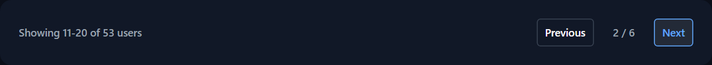
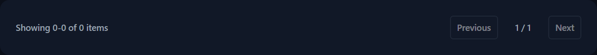

# q-pagination

`q-pagination` requests previous and next pages and displays the current item range.

**Component tag:** `<q-pagination>`

**Working preview:** Run `bun start` from the repository root and open the [WebQuark playground](http://localhost:3333). There is no dedicated pagination menu entry. To try these examples, paste the HTML into the registered runtime using browser DevTools and run the module body in the console. This temporary setup does not add a playground menu entry.

**On this page**

- [Quick start](#quick-start)
- [Examples](#examples)
- [Behavior & accessibility](#behavior--accessibility)
- [Styling](#styling)
- [API reference](#api-reference)

## Quick start

Follow the central [installation instructions](../../README.md#1-install-library). In a bundled application that resolves package imports and CSS imports, add this to the JavaScript entry file:

```javascript
import '@webquark/browser/dist/webquark/webquark.css';
import { defineCustomElements } from '@webquark/browser/loader';
defineCustomElements();
```

Place the following markup in the application HTML. Scripts shown below are module scripts and assume the registration above.

```html
<q-pagination total-items="53" aria-label="User results"></q-pagination>
```

**Result:** “Showing 1-10 of 53 items,” page 1 / 6, and Previous/Next buttons. Add the [page-change listener](#move-through-result-pages) to make Next advance the displayed page.

### At a glance

| Capability | Options | Default |
| :--- | :--- | :--- |
| [Page state](#state-and-interaction) | One-based page, page size, total items | 1 / 10 / 0 |
| [Summary](#labels-and-announcements) | Show/hide range; custom item noun and navigation name | Shown; “items”; “Pagination” |
| [Navigation](#keyboard-and-focus) | Previous and Next; disabled state | Enabled where a page exists |
| [Appearance](#custom-styling) | CSS variables and six parts | Theme typography; 30 px minimum buttons |

**Bare tag:** renders the empty summary, page 1 / 1, and two disabled buttons. No data is required to render, but `totalItems` and a listener are needed for useful paging. Example counts are demo data.

## Examples

Registration from [Quick start](#quick-start) is required. Screenshots show the actual registered components in the existing playground runtime.

### Move through result pages

Update the controlled page when the user requests navigation.



```html
<q-pagination id="users" total-items="53" item-label="users" aria-label="User results"></q-pagination>
```

```html
<script type="module">
await customElements.whenDefined('q-pagination');
const pagination = document.querySelector('#users');
pagination.addEventListener('qPageChange', event => {
  pagination.page = event.detail;
  // Fetch or display this page in your application here.
});
</script>
```

Click **Next** once to reach the screenshot. Without the listener updating `page`, the requested page does not become the displayed page. The component does not fetch or slice data.

### Show an empty result set

Keep navigation visible while showing that no items are available.



```html
<q-pagination total-items="0" aria-label="Search results"></q-pagination>
```

The summary reads “Showing 0-0 of 0 items” and the page counter remains 1 / 1.

## Behavior & accessibility

### State and interaction

`qPageChange.detail` is the requested one-based page. The application owns `page` and the actual data. The component does not mutate `page`, fetch, filter, or slice results. Preventing the custom event does not provide a separate state mechanism; simply decide whether to update `page`.

| Input | Effective behavior |
| :--- | :--- |
| `totalItems` negative, zero, or nonfinite | Treated as zero |
| Positive fractional `totalItems` | Floored |
| `pageSize` nonpositive or nonfinite | Falls back to 1 |
| Positive fractional `pageSize` | Floored; values below 1 become 0, so use positive integers |
| `page` nonpositive or nonfinite | Falls back to 1 |
| Positive fractional `page` | Floored; values below 1 become 0, so use positive integers |
| Page above last page | Clamped to last page for display/navigation |

Normalization does not rewrite supplied properties. Keep `page` and `pageSize` as positive integers: the current implementation checks positivity before flooring and does not repair a resulting zero.

`disabled` disables both buttons. Empty results and first/last-page boundaries also disable unavailable directions; unavailable requests do not emit events.

### Keyboard and focus

| Key | Action |
| :--- | :--- |
| Tab / Shift+Tab | Move among enabled native navigation buttons |
| Enter / Space | Activate the focused button |

No arrow-key page navigation or focus transfer into the result list is implemented.

### Labels and announcements

The navigation landmark uses `ariaLabel`; blank or whitespace-only values fall back to “Pagination.” Buttons are named “Previous page” and “Next page.”

The visible range summary has `aria-live="polite"`. Setting `showSummary = false` removes both that summary and its live region. The page-count text has an accessible label such as “Page 2 of 6.”

`itemLabel` changes the noun; blank text falls back to “items.” There is no automatic singular/plural translation.

### Limitations and compatibility

There is no page-number picker, page-size selector, or built-in data loading. Below 480 px viewport width the summary and controls stack. Button color transitions are 150 ms; this component has no reduced-motion override.

## Styling

There are no built-in variants, sizes, or tones. Use the [CSS variables](#css-variables) for dimensions/colors or [Shadow Parts](#shadow-parts) for individual elements.

### Custom styling

This changes button height while preserving normal paging semantics.

```html
<q-pagination class="roomy-pages" total-items="53" aria-label="User results"></q-pagination>
```

```css
q-pagination.roomy-pages {
  --q-pagination-button-height: 38px;
  --q-pagination-controls-gap: 12px;
}
```

Shared theme setup belongs in [Theme variables](../theme_variables.md).

## API reference

Cross-check the [generated API](../../src/browser/components/data-display/pagination/readme.md) with the behavior described above.

### Properties

All properties are optional. Use JavaScript properties for structured values and callbacks; numeric HTML attributes are parsed by the component runtime. For booleans, use the bare attribute for true and remove it or assign the property `false` for false.

| Name | Default | Description |
| :--- | :--- | :--- |
| `ariaLabel` | `'Pagination'` | Accessible name for the pagination navigation landmark.<br>**Type:** `string \| null`. **HTML attribute:** `aria-label`. **Required:** No. |
| `disabled` | `false` | Disables both navigation buttons.<br>**Type:** `boolean`. **HTML attribute:** `disabled`. **Required:** No. |
| `itemLabel` | `'items'` | Noun used in the visible range summary, for example "users" or "templates".<br>**Type:** `string`. **HTML attribute:** `item-label`. **Required:** No. |
| `page` | `1` | Requested one-based page; supply a positive integer. Does not change itself after navigation.<br>**Type:** `number`. **HTML attribute:** `page`. **Required:** No. |
| `pageSize` | `10` | Items per page; supply a positive integer. See normalization limits.<br>**Type:** `number`. **HTML attribute:** `page-size`. **Required:** No. |
| `showSummary` | `true` | Shows the visible, politely announced item range.<br>**Type:** `boolean`. **HTML attribute:** `show-summary`. **Required:** No. |
| `totalItems` | `0` | Collection count, normalized for display.<br>**Type:** `number`. **HTML attribute:** `total-items`. **Required:** No. |

### Slots

This component exposes no public slots.

### Events

| Name | When it fires | Payload |
| :--- | :--- | :--- |
| `qPageChange` | An enabled button requests a different page | `CustomEvent<number>`; requested one-based page |

The event bubbles, crosses shadow boundaries, and is cancelable. The component does not consume cancellation; the application decides whether to update `page`.

### Methods

This component exposes no public methods.

### Styling hooks

#### CSS variables

Defaults show local declarations, shared defaults where declared, or the component fallback expression. Shared tokens are defined in [Theme variables](../theme_variables.md). Set overrides directly on the host.

| Name | Default | Controls |
| :--- | :--- | :--- |
| `--q-pagination-button-bg` | `transparent` | Navigation button background. |
| `--q-pagination-button-border` | `1px solid var(--q-border-color, #374151)` | Navigation button border. |
| `--q-pagination-button-fg` | `var(--q-fg-base, #f9fafb)` | Navigation button text color. |
| `--q-pagination-button-height` | `30px` | Minimum navigation button height. |
| `--q-pagination-button-hover-bg` | `color-mix(in srgb, var(--q-fg-base, #f9fafb) 8%, transparent)` | Enabled button background on hover. |
| `--q-pagination-button-hover-border` | `var(--q-color-primary, #60a5fa)` | Enabled button border color on hover. |
| `--q-pagination-button-hover-fg` | `var(--q-color-primary, #60a5fa)` | Enabled button text color on hover. |
| `--q-pagination-button-padding` | `5px 8px` | Navigation button padding. |
| `--q-pagination-button-radius` | `var(--q-radius-sm, 4px)` | Navigation button corner radius. |
| `--q-pagination-controls-gap` | `8px` | Gap between the buttons and page count. |
| `--q-pagination-fg` | `var(--q-fg-muted, #9ca3af)` | Summary and page-count text color. |
| `--q-pagination-font-size` | `var(--q-font-size-sm, 0.8125rem)` | Summary, page count and button text size. |
| `--q-pagination-font-weight` | `600` | Summary, page-count and navigation button text weight. |
| `--q-pagination-gap` | `12px` | Gap between the summary and navigation controls. |
| `--q-pagination-page-count-width` | `48px` | Minimum page-count width. |

#### Shadow Parts

| Name | Targets |
| :--- | :--- |
| `container` | Navigation landmark |
| `controls` | Button and page-count group |
| `next-button` | Native Next button |
| `page-count` | Current/total page text |
| `previous-button` | Native Previous button |
| `summary` | Range text; only when `showSummary` is true |
