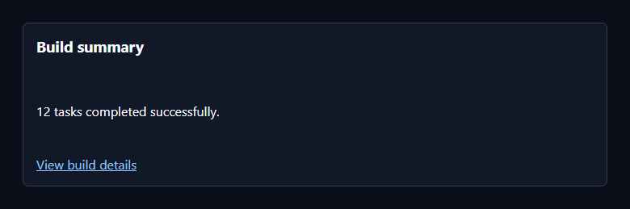
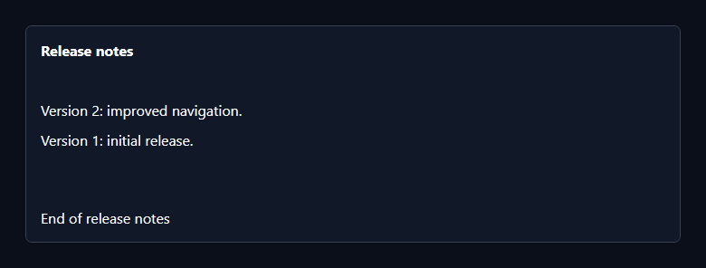

# q-panel

`q-panel` groups header, body, and footer content in a configurable surface with optional scrolling.

**Component tag:** `<q-panel>`

**Working preview:** Run `bun start` from the repository root, open the [existing playground](http://localhost:3333), then select **Layout → Panel**. The examples below use temporary fixtures in this same registered runtime.

**On this page**

- [Quick start](#quick-start)
- [Examples](#examples)
- [Behavior & accessibility](#behavior--accessibility)
- [Styling](#styling)
- [API reference](#api-reference)

## Quick start

1. Follow the central [installation instructions](../../README.md#1-install-library).
2. Add registration to your application entry file (`main.js`). This requires a bundler that resolves package imports and CSS imports.

```javascript
import '@webquark/core/dist/webquark/webquark.css';
import { defineCustomElements } from '@webquark/core/loader';

defineCustomElements();
```

3. Add this markup to the application page after setup.

```html
<q-panel aria-label="Project summary">
  <h3 slot="header">Project summary</h3>
  <p>All checks passed.</p>
</q-panel>
```

**Result:** a bordered surface with 16px region padding and a header.

### At a glance

| Capability | Options | Default |
| :--- | :--- | :--- |
| [Surface](#variants) | plain, surface, bordered; optional border removal | bordered |
| [Padding](#sizes) | none, xs, sm, md, lg, xl, 2xl, 3xl | lg |
| [Scrolling](#state-and-interaction) | Body scroll or sticky whole-panel scroll | Off |
| [Content](#slots) | Header, body, footer | Empty |
| [Surface role](#surfaces) | canvas, panel, card, field, floating, transparent | panel; plain uses transparent |
| [Region padding](#sizes) | Eight spacing tokens; independent header/footer | lg (16px) |

**With no properties:** `<q-panel></q-panel>` renders an empty bordered panel surface with 16px body padding. Header and footer are hidden; no accessible label is supplied.

**Playground preset:** The playground supplies header/body/footer content; the component does not.

## Examples

These examples share the registration above. Place each complete snippet in the application page; scripts use module syntax. Screenshots show the real component in the playground runtime with the shared dark theme.

### Separate summary and actions

A panel places summary text between its header and footer.



```html
<q-panel aria-label="Build summary" padding="lg">
  <h3 slot="header">Build summary</h3>
  <p>12 tasks completed successfully.</p>
  <a slot="footer" href="#build-details">View build details</a>
</q-panel>
```

### Keep long content within a fixed height

A bounded panel scrolls its body between a visible header and footer.



```html
<div style="height:240px">
  <q-panel full-height scrollable aria-label="Release notes">
    <strong slot="header">Release notes</strong>
    <div style="min-height:360px">
      <p>Version 2: improved navigation.</p>
      <p>Version 1: initial release.</p>
    </div>
    <span slot="footer">End of release notes</span>
  </q-panel>
</div>
```

The wrapper supplies the height. `scrollable` alone cannot create overflow without a height constraint.

## Behavior & accessibility

### State and interaction

Header and footer wrappers are hidden until their named slots contain elements. An empty assigned element still counts. The default slot is always rendered.

With `scrollable` and no sticky flags, the body scrolls. With a sticky flag, the outer panel also receives overflow:auto and the flagged region receives position:sticky. A later body rule currently keeps overflow:auto on the body too. In a bounded full-height panel, the body generally remains the scrolling area, so the flags do not reliably switch scrolling to the outer panel. `fullHeight` needs a parent with a definite height.

### Keyboard and focus

A scrollable body receives `tabindex="0"` so native keyboard scrolling is available. Sticky mode also enables outer overflow but keeps the body overflow/tab stop; no separate outer focus target is added.

### Labels and announcements

`aria-label` is forwarded to the section. A scrollable body has `role="region"` and is named “{ariaLabel} content”, or “Panel content” when the label is empty/absent. Non-scrollable bodies have no added role, name, or tab stop. No live region is created.

### Limitations and compatibility

Unknown variants retain the panel surface role but receive no matching variant border/radius styling. `noBorders` removes the outer border, not header/footer dividers. The component adds no motion.

Unknown spacing tokens use a 1rem fallback unless an application defines the matching `--q-space-*` token. Invalid surface names have no defined palette fallback; use the accepted roles.

## Styling

Select a surface, body padding, and optional border removal.

### Variants

| variant | Effect |
| :--- | :--- |
| `plain` | Transparent, borderless layout region. |
| `surface` | Theme surface background without the bordered variant’s radius/border. |
| `bordered` (default) | Theme surface, border, and 7px theme radius. |

`no-borders` removes the outer border while preserving the selected variant’s other styling.

### Sizes

Body `padding` is `lg` by default; header/footer default to it unless header-padding/footer-padding is supplied.

| Value | Default spacing |
| :--- | :--- |
| `none` | 0 (0px at a 16px root) |
| `xs` | 0.25rem (4px at a 16px root) |
| `sm` | 0.5rem (8px at a 16px root) |
| `md` | 0.75rem (12px at a 16px root) |
| `lg` | 1rem (16px at a 16px root) |
| `xl` | 1.5rem (24px at a 16px root) |
| `2xl` | 2rem (32px at a 16px root) |
| `3xl` | 3rem (48px at a 16px root) |

### Surfaces

| surface | Fallback |
| :--- | :--- |
| `canvas` | --q-bg-base |
| `panel` | --q-bg-surface-1 |
| `card` | --q-bg-surface-2 |
| `field` | --q-bg-surface-3 |
| `floating` | --q-bg-surface-4 |
| `transparent` | transparent |

Surface roles resolve at the component and respect scoped palettes. `--q-panel-bg` overrides the role. Nesting does not change the role automatically. See [Foundation](../foundation.md).

### Custom styling

```html
<q-panel class="notes-panel"><p>Notes</p></q-panel>
<style>
  q-panel.notes-panel { --q-panel-radius: 12px; --q-panel-padding: 20px; }
</style>
```

The header background hook also styles the footer; footer padding has its own hook. `--q-panel-padding` overrides per-size aliases. See [CSS variables](#css-variables), [Shadow Parts](#shadow-parts), and [theme setup](../theme_variables.md).

## API reference

See the [Stencil-generated API](../../src/components/layout/panel/readme.md) and [component source](../../src/components/layout/panel/panel.tsx). The tables below include source-level types and effective rendering constraints.

### Properties

All properties are optional and are listed alphabetically. Boolean attributes use Stencil boolean parsing: a present empty attribute enables the property, `="false"` disables it; JavaScript properties accept `true`/`false`. Removing a boolean attribute makes it false, including properties initially declared true. For updates, set the desired JavaScript property explicitly instead of relying on attribute removal to restore initializer defaults.

| Name | Default | Description |
| :--- | :--- | :--- |
| `ariaLabel` | `null` | Accessible section label; also derives the scrollable-body label.<br>**Type:** `string \| null`. **HTML attribute:** `aria-label`. **Required:** No. |
| `dividers` | `false` | Add header/footer divider borders.<br>**Type:** `boolean`. **HTML attribute:** `dividers`. **Required:** No. |
| `footerPadding` | `undefined` | Footer spacing token; undefined inherits padding.<br>**Type:** `'none' \| 'xs' \| 'sm' \| 'md' \| 'lg' \| 'xl' \| '2xl' \| '3xl'`. **HTML attribute:** `footer-padding`. **Required:** No. |
| `fullHeight` | `false` | Fill the parent height; the parent must provide a height.<br>**Type:** `boolean`. **HTML attribute:** `full-height`. **Required:** No. |
| `headerPadding` | `undefined` | Header spacing token; undefined inherits padding.<br>**Type:** `'none' \| 'xs' \| 'sm' \| 'md' \| 'lg' \| 'xl' \| '2xl' \| '3xl'`. **HTML attribute:** `header-padding`. **Required:** No. |
| `noBorders` | `false` | Remove the outer border only.<br>**Type:** `boolean`. **HTML attribute:** `no-borders`. **Required:** No. |
| `padding` | `'lg'` | Spacing token applied to body and, unless overridden, header/footer.<br>**Type:** `'none' \| 'xs' \| 'sm' \| 'md' \| 'lg' \| 'xl' \| '2xl' \| '3xl'`. **HTML attribute:** `padding`. **Required:** No. |
| `scrollable` | `false` | Enable body overflow; sticky flags additionally enable outer overflow, with the current nested-scroll limitation.<br>**Type:** `boolean`. **HTML attribute:** `scrollable`. **Required:** No. |
| `stickyFooter` | `false` | Pin footer while the panel scrolls; requires scrollable and footer content.<br>**Type:** `boolean`. **HTML attribute:** `sticky-footer`. **Required:** No. |
| `stickyHeader` | `false` | Pin header while the panel scrolls; requires scrollable and header content.<br>**Type:** `boolean`. **HTML attribute:** `sticky-header`. **Required:** No. |
| `surface` | `undefined` | Surface role: canvas, panel, card, field, floating, or transparent. When undefined, use transparent for plain and panel otherwise. Component background overrides win.<br>**Type:** `'canvas' \| 'panel' \| 'card' \| 'field' \| 'floating' \| 'transparent'`. **HTML attribute:** `surface`. **Required:** No. |
| `variant` | `'bordered'` | Surface appearance.<br>**Type:** `'plain' \| 'surface' \| 'bordered'`. **HTML attribute:** `variant`. **Required:** No. |


### Slots

| Name | Description |
| :--- | :--- |
| `footer` | Optional footer elements; wrapper hidden when absent. |
| `header` | Optional header elements; wrapper hidden when absent. |
| Default (unnamed) | Body content; no fallback. |

### Events

This component emits no public events.

### Methods

This component exposes no public methods.

### Styling hooks

Defaults below include the imported shared stylesheet; `var(...)` values follow the active theme. Component-specific hooks and the shared tokens they consume are listed. For shared setup, see [Theme variables](../theme_variables.md).

#### CSS variables

| Name | Default | Controls |
| :--- | :--- | :--- |
| `--q-bg-base` | `#0b0f19` | Theme palette fallback for the matching surface role; a --q-bg-{role} override takes precedence. |
| `--q-bg-canvas` | `var(--q-bg-base, #0b0f19)` | Scoped canvas surface-role background; used by surface resolution when that role is selected. |
| `--q-bg-card` | `var(--q-bg-surface-2, #19243b)` | Scoped card surface-role background; used by surface resolution when that role is selected. |
| `--q-bg-field` | `var(--q-bg-surface-3, #22304d)` | Scoped field surface-role background; used by surface resolution when that role is selected. |
| `--q-bg-floating` | `var(--q-bg-surface-4, #2c3a58)` | Scoped floating surface-role background; used by surface resolution when that role is selected. |
| `--q-bg-panel` | `var(--q-bg-surface-1, #111827)` | Scoped panel surface-role background; used by surface resolution when that role is selected. |
| `--q-bg-surface-1` | `#111827` | Theme palette fallback for the matching surface role; a --q-bg-{role} override takes precedence. |
| `--q-bg-surface-2` | `#19243b` | Theme palette fallback for the matching surface role; a --q-bg-{role} override takes precedence. |
| `--q-bg-surface-3` | `#22304d` | Theme palette fallback for the matching surface role; a --q-bg-{role} override takes precedence. |
| `--q-bg-surface-4` | `#2c3a58` | Theme palette fallback for the matching surface role; a --q-bg-{role} override takes precedence. |
| `--q-border` | `var(--q-border-width) solid var(--q-border-color)` | border applied to `.variant-bordered`, `.has-dividers .panel-header`, `.has-dividers .panel-footer`. |
| `--q-border-color` | `#374151` | border color applied to `.variant-bordered`. |
| `--q-fg-base` | `#f9fafb` | fg base applied to `.panel`. |
| `--q-font-family` | `-apple-system, BlinkMacSystemFont, 'Segoe UI', Roboto, Helvetica, Arial, sans-serif` | font family applied to `.panel`. |
| `--q-padding-lg` | `var(--q-space-lg, 1rem)` | Legacy header/footer padding fallback is superseded by the region padding rules; use --q-panel-header-padding and --q-panel-footer-padding. |
| `--q-panel-bg` | `Resolved surface role (transparent for plain, panel otherwise)` | Highest-priority background override for every variant, including plain. |
| `--q-panel-border` | `var(--q-border)` | Bordered variant outer border; noBorders overrides it. |
| `--q-panel-divider` | `1px solid transparent` | Header/footer borders even without dividers when explicitly set. With dividers, default is --q-border. |
| `--q-panel-fg` | `var(--q-fg-base, #f9fafb)` | panel fg applied to `.panel`. |
| `--q-panel-footer-padding` | `Resolved footerPadding or padding (default 1rem)` | Footer padding; overrides footerPadding/padding. |
| `--q-panel-header-bg` | `transparent` | Both header and footer backgrounds; sticky surfaces may need an opaque value. |
| `--q-panel-header-padding` | `Resolved headerPadding or padding (default 1rem)` | Header padding only; overrides headerPadding/padding resolution. |
| `--q-panel-padding` | `Resolved padding (default 1rem)` | Body padding; takes precedence over per-size aliases and padding property. |
| `--q-panel-padding-lg` | `var(--_q-body-padding)` | panel padding lg applied to `.padding-lg .panel-body`. |
| `--q-panel-padding-md` | `var(--_q-body-padding)` | panel padding md applied to `.padding-md .panel-body`. |
| `--q-panel-padding-sm` | `var(--_q-body-padding)` | panel padding sm applied to `.padding-sm .panel-body`. |
| `--q-panel-radius` | `var(--q-radius-md, 7px)` | Bordered variant corner radius only. |
| `--q-radius-md` | `7px` | radius md applied to `.variant-bordered`. |
| `--q-space-2xl` | `2rem` | Shared spacing token selected by the corresponding padding/gap property; inherits to descendants. |
| `--q-space-3xl` | `3rem` | Shared spacing token selected by the corresponding padding/gap property; inherits to descendants. |
| `--q-space-lg` | `1rem` | Shared spacing token selected by the corresponding padding/gap property; inherits to descendants. |
| `--q-space-md` | `0.75rem` | Shared spacing token selected by the corresponding padding/gap property; inherits to descendants. |
| `--q-space-none` | `0rem` | Shared spacing token selected by the corresponding padding/gap property; inherits to descendants. |
| `--q-space-sm` | `0.5rem` | Shared spacing token selected by the corresponding padding/gap property; inherits to descendants. |
| `--q-space-xl` | `1.5rem` | Shared spacing token selected by the corresponding padding/gap property; inherits to descendants. |
| `--q-space-xs` | `0.25rem` | Shared spacing token selected by the corresponding padding/gap property; inherits to descendants. |

#### Shadow Parts

| Name | Targets |
| :--- | :--- |
| `body` | Body wrapper and default scroll region. |
| `footer` | Footer wrapper; hidden without assigned elements. |
| `header` | Header wrapper; hidden without assigned elements. |
| `panel` | Always-rendered section surface. |
