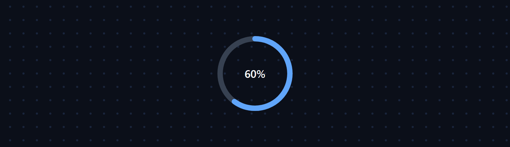
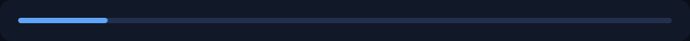
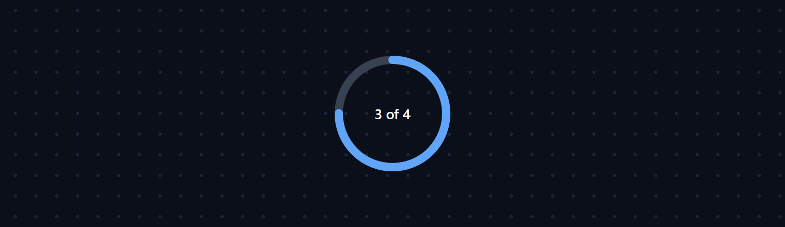
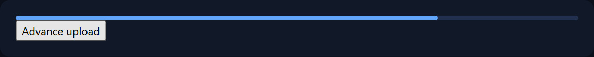

# q-progress

`q-progress` shows how much of a task is complete as a horizontal bar or a circular ring.

**Component tag:** `<q-progress>`

**Working preview:** Run `bun start` from the repository root, open the [WebQuark playground](http://localhost:3333), then select **Indicators → Progress**. The playground supports both variants and their states. This Markdown guide cannot embed a running custom element.

**On this page**

- [Quick start](#quick-start)
- [Examples](#examples)
- [Behavior & accessibility](#behavior--accessibility)
- [Styling](#styling)
- [API reference](#api-reference)

## Quick start

1. Follow the central [installation instructions](../../README.md#1-install-library).
2. Register the components in your application's JavaScript entry file. This setup assumes a bundler that resolves package imports and CSS imports.

```javascript
import '@webquark/browser/dist/webquark/webquark.css';
import { defineCustomElements } from '@webquark/browser/loader';

defineCustomElements();
```

3. Add the component to your application's HTML. Give it an accessible name that identifies the task.

```html
<q-progress value="60" aria-label="Upload progress"></q-progress>
```

**Result:** a primary-colored linear bar filled to 60%.

### At a glance

| Capability | Options | Default |
| :--- | :--- | :--- |
| [Shape](#variants) | Linear bar or circular ring | `linear` |
| [Progress state](#state-and-interaction) | Percentage from 0–100, or an indeterminate animation | Determinate, `0` |
| [Size](#sizes) | `sm`, `md`, `lg`, or a numeric pixel dimension | `md` |
| [Tone](#tones) | `neutral`, `primary`, `success`, `warning`, `danger` | `primary` |
| [Labels](#labels-and-announcements) | Task name, accessible value text, and circular center text | Accessible name “Progress”; value text `0%` |

**With no properties:** `<q-progress></q-progress>` renders a linear track at 0%, with no visible fill. Add a task-specific `aria-label` when using it in an application.

The playground starts at **35%** as a demo preset. The component's default is **0%**.

## Examples

These examples assume the component has been registered as shown in [Quick start](#quick-start). The screenshots run these snippets with the existing playground build; select **Indicators → Progress** there to try the controls.

### Show a circular percentage

Use the circular variant when a compact ring fits the available space.



```html
<q-progress variant="circular" value="60" aria-label="Upload progress"></q-progress>
```

The center text and accessible value text both default to `60%`. Set `label` to change both, or `aria-valuetext` to change only the accessible value text.

### Show progress without a known percentage

Set `indeterminate` while a task is running but its completion percentage is unknown.



```html
<q-progress indeterminate aria-label="Loading search results"></q-progress>
```

The animation supplies no current numeric value. Add `variant="circular"` to show a rotating ring instead; its center text is hidden.

### Replace the circular center text

Use `label` to show short task text inside a determinate ring.



```html
<q-progress
  variant="circular"
  value="75"
  label="3 of 4"
  aria-label="Tasks completed"
></q-progress>
```

The visible label also becomes `aria-valuetext` unless you provide a separate `aria-valuetext` attribute.

Labels longer than five characters automatically shrink, down to 40% of the base font size. Keep labels short for readability; use `--q-progress-font-size` to override the base size.

### Update progress from JavaScript

Set the `value` property when the application receives a new completion percentage.



```html
<q-progress id="upload-progress" value="25" aria-label="Upload progress"></q-progress>
<button id="advance-upload" type="button">Advance upload</button>

<script type="module">
  await customElements.whenDefined('q-progress');
  const progress = document.querySelector('#upload-progress');
  const advanceButton = document.querySelector('#advance-upload');

  advanceButton.addEventListener('click', () => {
    progress.value = Math.min(100, Number(progress.value) + 25);
  });
</script>
```

Click **Advance upload** twice to move from 25% to the 75% shown in the screenshot. The component does not advance itself or emit a change event; the application owns `value`.

## Behavior & accessibility

### State and interaction

| State | Appearance | Value behavior |
| :--- | :--- | :--- |
| Determinate (default) | A filled bar or ring; the ring also shows center text | Uses `value`, clamped to 0–100 |
| Indeterminate | An animated segment or rotating ring; no center text | Ignores `value` for the displayed progress |

**Value limits:** finite values below 0 render as 0%; values above 100 render as 100%. Nonfinite values, including `NaN` and `Infinity`, render as 0%. This normalization does not rewrite the supplied property.

**Variant fallback:** only `variant="circular"` selects the ring. Omitted, empty, or unrecognized values render the linear bar without throwing a variant-validation error. Use the supported values `linear` and `circular` in application code.

**Application updates:** the component is display-only. It has no interactive controls, keyboard actions, disabled state, form value, or emitted events. Your application updates `value` and `indeterminate` as the task changes.

To switch from unknown progress to a known percentage, set `value` and set the JavaScript property `indeterminate` to `false` (or remove the HTML attribute). Reaching 100% does not automatically hide the component or announce completion.

### Labels and announcements

**Name the task:** set `aria-label`, such as “Upload progress.” The internal element has `role="progressbar"`; an omitted, empty, or whitespace-only name falls back to “Progress.”

**Choose the value text:** a nonblank `aria-valuetext` overrides the spoken value. Otherwise, a linear bar uses the percentage; a circular ring uses `label` when supplied, or the percentage when omitted.

`label` affects only the circular variant. An empty `label` hides its center text; provide `aria-valuetext` if an accessible value description is needed.

| Accessibility attribute | Determinate | Indeterminate |
| :--- | :--- | :--- |
| `role` | `progressbar` | `progressbar` |
| `aria-label` | Task name or “Progress” | Task name or “Progress” |
| `aria-valuemin` / `aria-valuemax` | `0` / `100` | `0` / `100` |
| `aria-valuenow` | Clamped percentage | Omitted |
| `aria-valuetext` | Explicit text or label/percentage fallback | Omitted, even when supplied |

**Announcements:** the component does not create a live region. Provide a separate announcement when the workflow needs an explicit completion message. A tone alone does not communicate a task's status in words.

### Limitations and compatibility

The indicator does not track tasks or show error messages. Keep task status and errors in adjacent content; update the indicator from application state.

**Reduced motion:** fill transitions are removed and indeterminate animations slow to 2.8 seconds per cycle. The animations continue to run.

## Styling

Start with `variant`, `size`, and `tone`. Use CSS variables for further adjustments, or Shadow Parts to target a rendered element.

### Variants

| `variant` value | Result | Use when |
| :--- | :--- | :--- |
| `linear` (default) | Horizontal bar that fills the host width | Progress belongs across a content area |
| `circular` | Sized ring with center text in determinate mode | Progress belongs in a compact space |

Both variants support determinate and indeterminate states. Omit `variant` to use the linear bar.

### Sizes

| `size` value | Linear bar height | Circular width and height |
| :--- | :--- | :--- |
| `sm` | 4 px | 64 px |
| `md` (default) | 6 px | 120 px |
| `lg` | 8 px | 180 px |

These are the built-in dimensions before CSS overrides. Size presets also select circular stroke thickness and center-text size; see the [CSS variables](#css-variables).

A numeric size sets the bar height or ring dimensions in pixels. For example, `size="96"` creates a 96 px ring with `variant="circular"`; in JavaScript, use `progress.size = 96`. Numeric sizing retains the medium stroke and text presets.

Negative numeric sizes render as 0 px. Unrecognized nonnumeric sizes fall back to medium dimensions. An empty size attribute converts to 0 px. To use the default size, omit the attribute.

### Tones

| `tone` value | Theme color token |
| :--- | :--- |
| `neutral` | `--q-fg-muted` |
| `primary` (default) | `--q-color-primary` |
| `success` | `--q-color-success` |
| `warning` | `--q-color-warning` |
| `danger` | `--q-color-danger` |

Tone changes the fill color. It does not change the value, label, or task state. For example, `tone="success"` does not set progress to 100%. An unrecognized tone uses the primary color fallback.

### Custom styling

Set a [CSS variable](#css-variables) on the host for a component-specific override. This example makes the linear bar 10 px high with 4 px corners:

```html
<q-progress
  class="upload-progress"
  value="60"
  aria-label="Upload progress"
></q-progress>
```

```css
q-progress.upload-progress {
  --q-progress-linear-height: 10px;
  --q-progress-linear-radius: 4px;
}
```

Use [Shadow Parts](#shadow-parts) when a CSS rule needs to target the container, track, fill, or circular label. The label part exists only for determinate circular progress.

See [Theme variables](../theme_variables.md) for shared color, typography, and theme setup. Explicit dimension hooks override numeric `size` values. See the [CSS-variable table](#css-variables) for the precedence of each hook.

**Circular label size:** use `--q-progress-font-size`. The component sets the font size inline, so `--q-progress-circular-font-size` currently has no effect on the rendered label.

## API reference

The [Stencil-generated API](../../src/browser/components/indicators/progress/readme.md) provides generated property and Shadow-Part tables. The property types below also follow the current [TypeScript source](../../src/browser/components/indicators/progress/progress.tsx), which retains `null` in the accessible-label types.

### Properties

All properties are optional. They are listed alphabetically.

| Name | Default | Description |
| :--- | :--- | :--- |
| `ariaLabel` | `null` | Names the progressbar; an empty or absent name falls back to “Progress.”<br>**Type:** `string \| null`. **HTML attribute:** `aria-label`. **Required:** No. |
| `ariaValueText` | `null` | Overrides the spoken value text in determinate mode when nonblank.<br>**Type:** `string \| null`. **HTML attribute:** `aria-valuetext`. **Required:** No. Ignored in indeterminate mode. |
| `indeterminate` | `false` | Animates progress without a known percentage.<br>**Type:** `boolean`. **HTML attribute:** `indeterminate`. **Required:** No. |
| `label` | `undefined` | Replaces the visible center text of a determinate circular ring.<br>**Type:** `string`. **HTML attribute:** `label`. **Required:** No. It also supplies `aria-valuetext` unless that is set separately. |
| `size` | `'md'` | Selects a built-in size or a custom nonnegative pixel dimension.<br>**Type:** `'sm' \| 'md' \| 'lg' \| number`. **HTML attribute:** `size`. **Required:** No. Numeric inputs below 0 render as 0 px. |
| `tone` | `'primary'` | Selects the fill's semantic color.<br>**Type:** `'neutral' \| 'primary' \| 'success' \| 'warning' \| 'danger'`. **HTML attribute:** `tone`. **Required:** No. |
| `value` | `0` | Sets the determinate percentage; finite values are clamped to 0–100 and nonfinite values render as 0.<br>**Type:** `number`. **HTML attribute:** `value`. **Required:** No. Not exposed as a current value in indeterminate mode. |
| `variant` | `'linear'` | Selects a horizontal bar or circular ring.<br>**Type:** `'linear' \| 'circular'`. **HTML attribute:** `variant`. **Required:** No. An empty or unrecognized value currently renders linear. |

### Slots

This component exposes no public slots.

### Events

This component emits no public events.

### Methods

This component exposes no public methods.

### Styling hooks

The defaults below reflect the component CSS and the shared stylesheet. “Size preset” refers to the [size selection](#sizes), with `md` as the default; “Tone color” refers to the [tone token](#tones), with `primary` as the default; a numeric `size` supplies a pixel dimension unless a more specific CSS variable overrides it. Fallback aliases apply when their preferred hook is unset, except for label font sizing: `--q-progress-font-size` supplies the inline size directly.

#### CSS variables

| Name | Default | Controls |
| :--- | :--- | :--- |
| `--q-progress-bar-fill-color` | Tone color | Fallback alias for linear fill color; `--q-progress-fill-color` takes precedence. |
| `--q-progress-bar-height` | Size preset or numeric `size` | Fallback alias for bar height; `--q-progress-linear-height` takes precedence. |
| `--q-progress-bar-indeterminate-duration` | `1.4s` | Fallback alias for linear indeterminate cycle; `--q-progress-indeterminate-duration` takes precedence. |
| `--q-progress-bar-radius` | `999px` | Fallback alias for bar corners; `--q-progress-linear-radius` takes precedence. |
| `--q-progress-bar-track-color` | `var(--q-bg-surface-3, #22304d)` | Fallback alias for linear track color; `--q-progress-track-color` takes precedence. |
| `--q-progress-bar-transition` | `var(--q-transition-normal, 250ms ease)` | Fallback alias for linear fill transition; `--q-progress-transition` takes precedence. |
| `--q-progress-circular-font-size` | Size preset | Declared in the stylesheet but currently overridden by the inline label font size. Use `--q-progress-font-size` instead. |
| `--q-progress-circular-font-size-lg` | `calc(var(--q-font-size-lg, 1rem) * 1.5)` | Large ring's center-text size preset. |
| `--q-progress-circular-font-size-md` | `var(--q-font-size-lg, 1rem)` | Medium ring's center-text size preset. |
| `--q-progress-circular-font-size-sm` | `var(--q-font-size-sm, 0.7rem)` | Small ring's center-text size preset. |
| `--q-progress-circular-font-weight` | `var(--q-font-weight-bold, 600)` | Circular center-text weight; takes precedence over `--q-progress-font-weight`. |
| `--q-progress-circular-linecap` | `round` | Circular fill stroke end shape. |
| `--q-progress-circular-size` | Size preset or numeric `size` | Ring width and height; takes precedence over `--q-progress-size`. |
| `--q-progress-circular-size-lg` | `180px` | Large ring size preset. |
| `--q-progress-circular-size-md` | `120px` | Medium ring size preset. |
| `--q-progress-circular-size-sm` | `64px` | Small ring size preset. |
| `--q-progress-circular-stroke-width` | Size preset | Ring track and fill thickness; takes precedence over `--q-progress-stroke-width`. |
| `--q-progress-circular-stroke-width-lg` | `10px` | Large ring stroke-width preset. |
| `--q-progress-circular-stroke-width-md` | `8px` | Medium ring stroke-width preset. |
| `--q-progress-circular-stroke-width-sm` | `6px` | Small ring stroke-width preset. |
| `--q-progress-fill-color` | Tone color | Bar or ring fill color. |
| `--q-progress-font-size` | Size preset | Working base size for circular center text. Used by the inline sizing calculation; labels longer than five characters shrink to a minimum of 40% of this size. |
| `--q-progress-font-weight` | `var(--q-font-weight-bold, 600)` | Fallback alias for circular center-text weight. |
| `--q-progress-indeterminate-duration` | `1.4s` | Indeterminate cycle duration for either variant; reduced-motion CSS overrides the animation duration to 2.8s. |
| `--q-progress-linear-height` | Size preset or numeric `size` | Bar height; takes precedence over `--q-progress-bar-height`. |
| `--q-progress-linear-height-lg` | `8px` | Large bar height preset. |
| `--q-progress-linear-height-md` | `6px` | Medium bar height preset. |
| `--q-progress-linear-height-sm` | `4px` | Small bar height preset. |
| `--q-progress-linear-radius` | `999px` | Bar corner radius; takes precedence over `--q-progress-bar-radius`. |
| `--q-progress-size` | Size preset or numeric `size` | Fallback alias for ring width and height. |
| `--q-progress-stroke-width` | Size preset | Fallback alias for ring track and fill thickness. |
| `--q-progress-track-color` | Linear: `var(--q-bg-surface-3, #22304d)`; circular: `var(--q-border-color, #374151)` | Bar or ring track color. |
| `--q-progress-transition` | `var(--q-transition-normal)` | Determinate fill transition for either variant. |

#### Shadow Parts

| Name | Targets |
| :--- | :--- |
| `container` | The element with `role="progressbar"`: bar track or ring wrapper. |
| `fill` | Linear fill segment or circular SVG fill circle. |
| `label` | Circular SVG center text, present only when determinate. |
| `track` | Linear progressbar container or circular SVG track circle. |
