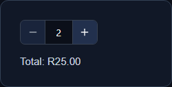
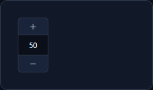

# q-quantity-selector

`q-quantity-selector` edits a number using step buttons and a bounded text field.

**Component tag:** `<q-quantity-selector>`

**Working preview:** Run `bun start` from the repository root, open the [existing playground](http://localhost:3333), then select **Forms & inputs → Quantity Selector**. The examples below use this registered runtime with their own markup and data; playground presets are demonstrations, not component defaults.

**On this page**

- [Quick start](#quick-start)
- [Examples](#examples)
- [Behavior & accessibility](#behavior--accessibility)
- [Styling](#styling)
- [API reference](#api-reference)

## Quick start

1. Follow the central [installation instructions](../../README.md#1-install-library).
2. In your application entry file (for example `src/main.js`), register the elements and load the theme. This requires a bundler that resolves package imports and CSS imports.

```javascript
import "@webquark/core/dist/webquark/webquark.css";
import { defineCustomElements } from "@webquark/core/loader";

defineCustomElements();
```

3. Put the following markup in your application HTML.

```html
<q-quantity-selector min="1" max="10" value="1"></q-quantity-selector>
```

**Result:** A horizontal quantity control showing 1 with its decrement button disabled.

### At a glance

| Capability | Options | Default |
| :--- | :--- | :--- |
| [Layout](#variants) | horizontal or vertical | horizontal |
| [Size](#sizes) | inherit, sm, md, lg | inherit; standalone md |
| [Value](#state-and-interaction) | Editable number, step, min/max | 0; step 1; unbounded |
| [Updates](#events) | qChange number; focus/blur/click | internally updates value |
| [Form support](#forms) | Application bridge required | not form-associated |

**With no properties:** A horizontal enabled quantity control shows 0, with step 1 and no bounds; its internal accessible name is “Quantity”.

## Examples

Use the registration above first. Each HTML block belongs in the page body; its module script runs after the element is registered. CSS in a `<style>` block belongs in the page or your application stylesheet.

### Recalculate a total when quantity changes

Listen to qChange and update application output.



```html
<q-quantity-selector id="order-quantity" min="1" max="10" value="1"></q-quantity-selector>
<output id="order-total">Total: R12.50</output>
<script type="module">
  await customElements.whenDefined("q-quantity-selector");
  document.querySelector("#order-quantity").addEventListener("qChange", event => {
    document.querySelector("#order-total").textContent = "Total: R" + (event.detail * 12.5).toFixed(2);
  });
</script>
```

Click Increment quantity once to reach the screenshot.

### Fit a stepped control into a narrow column

Use the vertical orientation for a compact column of increment and decrement controls.



```html
<q-quantity-selector orientation="vertical" size="sm" min="0" max="100" step="5" value="50"></q-quantity-selector>
```

## Behavior & accessibility

### State and interaction

Button/Arrow-key actions update mutable value and emit qChange, including at a boundary if a keyboard action computes the same result. Disabled boundary buttons prevent pointer stepping. Typing sanitizes to digits, one leading minus and one decimal point, then updates the property only for a parseable value within bounds. Change/blur reconciles incomplete or out-of-range text.

Empty/incomplete input resolves to min if provided, otherwise min(0,max) if max exists, otherwise zero; it is then clamped min followed by max. Initial/application values are not clamped. Nonfinite value shows 0 and omits aria-valuenow without rewriting the property; stepping starts from zero before applying bounds. Changing bounds alone does not rewrite value.

### Keyboard and focus

Tab reaches the decrement/input/increment controls in rendered order. ArrowUp/ArrowDown step in the input. Home jumps to min and End to max when supplied; both emit qChange. Vertical order is increment, input, decrement.

### Labels and announcements

The input has role=spinbutton and fixed aria-label “Quantity”. Buttons are named “Increment quantity” and “Decrement quantity”. aria-valuenow is present only for finite value; min/max ARIA are emitted whenever the corresponding bound is not null/undefined. There is no public per-control label property; adjacent visible context does not replace that internal accessible name. No live region is created.

### Forms

This is not form-associated and exposes no name, required, disabled, or validity method. Bridge value through qChange to an application/native hidden input when submission is needed.

### Limitations and compatibility

Use finite min/max with min ≤ max and a positive finite step. Bounds consider any non-null value present, so NaN/Infinity constraints can propagate invalid results; step is not normalized. There is no snap-to-step rounding. The input removes its default outline without adding a custom focus indicator; a supported part rule can add one. No reduced-motion override exists.

## Styling

Choose a horizontal or vertical layout and inherited/explicit size.

### Variants

`horizontal` (default) places decrement, text, increment in a row. `vertical` places increment above text and decrement below it. Invalid orientations do not get these layout rules.

### Sizes

`size="inherit"` is the declared default: it uses the nearest [q-form](./q-form.md) or [q-toolbar](./q-toolbar.md) scope, with `md` geometry when no scope exists. Explicit `sm`, `md`, or `lg` overrides that scope. Changing a scope updates inherited dimensions without changing the child's size property.

| Effective size | Minimum control height | Text / line height | Horizontal padding | Radius |
| :--- | :--- | :--- | :--- | :--- |
| `sm` | 1.75rem (28px) | 0.75 / 1rem | 0.5rem | 0.34375rem |
| `md` | 2.25rem (36px) | 0.875 / 1.25rem | 0.75rem | 0.4375rem |
| `lg` | 2.75rem (44px) | 1 / 1.5rem | 1rem | 0.53125rem |

Pixel equivalents assume a 16px root font. Heights are minimums; content and overrides can grow them. See the shared [sizing foundation](../foundation.md#choose-size-once).

Horizontal height and button width follow `--q-quantity-selector-height` or shared control height. Vertical width defaults to 50px; each button uses the same height. The horizontal input width uses the longest supplied bound (otherwise current value), at least three characters, plus input padding.

### Custom styling

Use the [CSS variables](#css-variables) or [Shadow Parts](#shadow-parts) for supported customization. This matching markup and CSS can be used together:

```html
<q-quantity-selector class="order-quantity" min="1" max="10" value="2"></q-quantity-selector>
<style>
  q-quantity-selector.order-quantity { --q-quantity-selector-radius: 10px; }
  q-quantity-selector.order-quantity::part(input):focus-visible { outline: 2px solid #38bdf8; outline-offset: -2px; }
</style>
```

Height and radius component hooks override inherited control dimensions. Horizontal input width is assigned inline; char-width and input-padding participate in that calculation. They are supported public hooks despite the old source comment calling them internal.

Keep shared setup in [Theme variables](../theme_variables.md), [Theme tokens](../theme-tokens.md), and the [sizing, spacing and surface foundation](../foundation.md).

## API reference

For new code, use `orientation`. The deprecated aliases remain supported. Canonical properties take precedence when set; otherwise the legacy property and its default apply. Set a canonical JavaScript property to `undefined` to restore the fallback.

Cross-check the [generated API](../../src/components/inputs/quantity-selector/readme.md), [implementation](../../src/components/inputs/quantity-selector/quantity-selector.tsx), and imported public types. The entries below preserve source defaults and runtime qualifications.

### Properties

All properties are optional in the TypeScript component contract. Required content/labels and conditional constraints are explained with each workflow. Properties are alphabetical.

| Name | Default | Description |
| :--- | :--- | :--- |
| `max` | `undefined` | Upper bound and End target; use a finite number ≥ min.<br>**Type:** `number`. **HTML attribute:** `max`. **Required:** No. |
| `min` | `undefined` | Lower bound and Home target; use a finite number.<br>**Type:** `number`. **HTML attribute:** `min`. **Required:** No. |
| `orientation` | `undefined` | Button arrangement; see [Variants](#variants).<br>**Type:** `'horizontal' \| 'vertical'`. **HTML attribute:** `orientation`. **Required:** No. |
| `size` | `'inherit'` | Control geometry; inherit uses the nearest form/toolbar scope.<br>**Type:** `'inherit' \| 'sm' \| 'md' \| 'lg'`. **HTML attribute:** `size`. **Required:** No. |
| `step` | `1` | Amount for each step; use a positive finite number.<br>**Type:** `number`. **HTML attribute:** `step`. **Required:** No. |
| `value` | `0` | Mutable number; initial/programmatic assignments are not clamped. Nonfinite values display as 0 without mutation.<br>**Type:** `number`. **HTML attribute:** `value`. **Required:** No. |
| `variant` | `'horizontal'` | Deprecated alias for `orientation`. Button arrangement; see [Variants](#variants).<br>**Type:** `'horizontal' \| 'vertical'`. **HTML attribute:** `variant`. **Required:** No. |

String attributes remain strings; numeric attributes are parsed as numbers, so invalid text can become `NaN`. Setting a property to `undefined` or removing a string/number attribute does not rerun its initializer. Keep values within the documented types.

### Slots

This component exposes no public slots.

### Events

| Name | When it fires | Payload |
| :--- | :--- | :--- |
| `qBlur` | The interactive field/control loses focus. | `CustomEvent<FocusEvent>` |
| `qChange` | A user interaction updates or commits the value; see State and interaction. | `CustomEvent<number>` |
| `qClick` | A click reaches the quantity wrapper, including clicks from its input or enabled step buttons; detail is the original MouseEvent. It can fire without changing the value. | `CustomEvent<MouseEvent>` |
| `qFocus` | The interactive field/control receives focus. | `CustomEvent<FocusEvent>` |

All listed Stencil events bubble, cross shadow boundaries (`composed: true`), and are cancelable. The component handlers do not use the emitted event's canceled result to roll back state or automatically cancel the underlying native event. For forwarded MouseEvent details, the original event is available as `event.detail`.

### Methods

This component exposes no public methods.

### Styling hooks

#### CSS variables

Defaults below show the local fallback chains; references to shared tokens depend on the active theme. Private `--_q-*` variables are implementation details and are not supported overrides. Component and functional shared hooks are listed; global palette/spacing/typography values are catalogued in [Theme tokens](../theme-tokens.md). See [Custom styling](#custom-styling) for effective precedence and exceptions.

| Name | Default | Controls |
| :--- | :--- | :--- |
| `--q-context-control-font` | `var(--q-control-font-md, 0.875rem)` | Context control font. Inherited context; explicit component size/state may override it. |
| `--q-context-control-height` | `var(--q-control-height-md, 2.25rem)` | Context control height. Inherited context; explicit component size/state may override it. |
| `--q-context-control-icon` | `var(--q-control-icon-md, 1rem)` | Context control icon. Inherited context; explicit component size/state may override it. |
| `--q-context-control-line` | `var(--q-control-line-md, 1.25rem)` | Context control line. Inherited context; explicit component size/state may override it. |
| `--q-context-control-padding` | `var(--q-control-padding-md, 0.75rem)` | Context control padding. Inherited context; explicit component size/state may override it. |
| `--q-context-control-radius` | `var(--q-control-radius-md, 0.4375rem)` | Context control radius. Inherited context; explicit component size/state may override it. |
| `--q-control-font-lg` | `1rem` | Control font lg. Shared geometry for the named size. |
| `--q-control-font-md` | `0.875rem` | Control font md. Shared geometry for the named size. |
| `--q-control-font-sm` | `0.75rem` | Control font sm. Shared geometry for the named size. |
| `--q-control-height-lg` | `2.75rem` | Control height lg. Shared geometry for the named size. |
| `--q-control-height-md` | `2.25rem` | Control height md. Shared geometry for the named size. |
| `--q-control-height-sm` | `1.75rem` | Control height sm. Shared geometry for the named size. |
| `--q-control-icon-lg` | `1.25rem` | Control icon lg. Shared geometry for the named size. |
| `--q-control-icon-md` | `1rem` | Control icon md. Shared geometry for the named size. |
| `--q-control-icon-sm` | `0.875rem` | Control icon sm. Shared geometry for the named size. |
| `--q-control-line-lg` | `1.5rem` | Control line lg. Shared geometry for the named size. |
| `--q-control-line-md` | `1.25rem` | Control line md. Shared geometry for the named size. |
| `--q-control-line-sm` | `1rem` | Control line sm. Shared geometry for the named size. |
| `--q-control-padding-lg` | `1rem` | Control padding lg. Shared geometry for the named size. |
| `--q-control-padding-md` | `0.75rem` | Control padding md. Shared geometry for the named size. |
| `--q-control-padding-sm` | `0.5rem` | Control padding sm. Shared geometry for the named size. |
| `--q-control-radius-lg` | `0.53125rem` | Control radius lg. Shared geometry for the named size. |
| `--q-control-radius-md` | `0.4375rem` | Control radius md. Shared geometry for the named size. |
| `--q-control-radius-sm` | `0.34375rem` | Control radius sm. Shared geometry for the named size. |
| `--q-field-radius` | `var(--_q-control-radius)` | Border-radius. |
| `--q-quantity-selector-bg` | `var(--q-bg-surface-2, #374151)` | Background. |
| `--q-quantity-selector-border-color` | `var(--q-border-color, #4b5563)` | Border, border-right, border-left, border-bottom, border-top. |
| `--q-quantity-selector-btn-bg` | `transparent` | Background. |
| `--q-quantity-selector-btn-bg-hover` | `var(--q-bg-surface-3, #4b5563)` | Background. |
| `--q-quantity-selector-btn-fg` | `var(--q-fg-muted, #9ca3af)` | Color. |
| `--q-quantity-selector-btn-fg-hover` | `var(--q-fg-base, #f9fafb)` | Color. |
| `--q-quantity-selector-char-width` | `1ch` | Runtime layout calculation. |
| `--q-quantity-selector-height` | `var(--_q-control-height)` | Height, width, min-height. |
| `--q-quantity-selector-input-bg` | `var(--q-bg-base, #111827)` | Background. |
| `--q-quantity-selector-input-fg` | `var(--q-fg-base, #f9fafb)` | Color. |
| `--q-quantity-selector-input-padding` | `16px` | Runtime layout calculation. |
| `--q-quantity-selector-radius` | `var(--q-field-radius, var(--_q-control-radius))` | Border-radius. |
| `--q-quantity-selector-width-vertical` | `50px` | Width. |

#### Shadow Parts

| Name | Targets |
| :--- | :--- |
| `input` | Editable text input; always present. |
