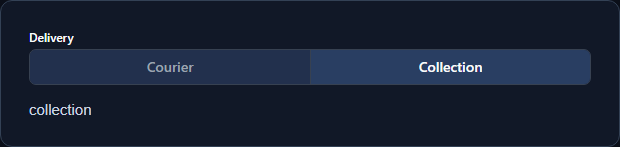
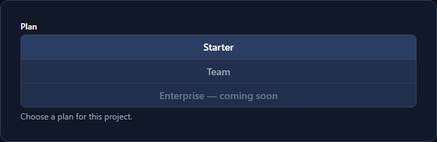
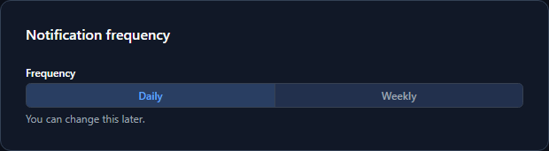

# q-radio-group

`q-radio-group` chooses one value from a short set of connected radio options.

**Component tag:** `<q-radio-group>`

**Working preview:** Run `bun start` from the repository root, open the [existing playground](http://localhost:3333), then select **Forms & inputs → Radio Group**. The examples below use this registered runtime with their own markup and data; playground presets are demonstrations, not component defaults.

**On this page**

- [Quick start](#quick-start)
- [Examples](#examples)
- [Behavior & accessibility](#behavior--accessibility)
- [Styling](#styling)
- [API reference](#api-reference)

## Quick start

1. Follow the central [installation instructions](../../README.md#1-install-library).
2. In your application entry file (for example `src/main.js`), register the elements and load the theme. This requires a bundler that resolves package imports and CSS imports.

```javascript
import "@webquark/core/dist/webquark/webquark.css";
import { defineCustomElements } from "@webquark/core/loader";

defineCustomElements();
```

3. Put the following markup in your application HTML.

```html
<q-radio-group label="Delivery" name="delivery" value="Courier"
  options='["Courier","Collection"]'></q-radio-group>
```

**Result:** A labelled pair of options with Courier selected.

### At a glance

| Capability | Options | Default |
| :--- | :--- | :--- |
| [Data](#option-data) | String or object options; JSON or JS array | [] |
| [Selection](#state-and-interaction) | One string value; disabled options/group | empty; enabled |
| [Size](#sizes) | inherit, sm, md, lg | inherit; standalone md |
| [Orientation](#orientation) | responsive, horizontal, vertical | responsive |
| [Field help](#labels-and-announcements) | label, aria-label, labelHidden, description, reserveFeedback | none; visible label |
| [Forms](#forms) | name, required, error/errorMessage, validity methods | unnamed; optional |

**With no properties:** An empty radio-group fieldset renders, without label or options. Supply options and a visible or accessible group name.

## Examples

Use the registration above first. Each HTML block belongs in the page body; its module script runs after the element is registered. CSS in a `<style>` block belongs in the page or your application stylesheet.

### Choose a delivery method

Assign structured data and read the selected value from qChange.



```html
<q-radio-group id="delivery-choice" label="Delivery" value="courier"></q-radio-group>
<output id="delivery-result">courier</output>
<script type="module">
  await customElements.whenDefined("q-radio-group");
  const delivery = document.querySelector("#delivery-choice");
  delivery.options = [
    { label: "Courier", value: "courier" },
    { label: "Collection", value: "collection" }
  ];
  delivery.addEventListener("qChange", event => {
    document.querySelector("#delivery-result").textContent = event.detail;
  });
</script>
```

Choose Collection to reach the screenshot.

### Show an unavailable choice alongside available ones

Set disabled on an individual option while keeping the group usable.



```html
<q-radio-group label="Plan" orientation="vertical" required
  description="Choose a plan for this project."
  options='[{"label":"Starter","value":"starter"},{"label":"Team","value":"team"},{"label":"Enterprise — coming soon","value":"enterprise","disabled":true}]'
  value="starter"></q-radio-group>
```

### Set the control size once for a form

Let radio options inherit compact geometry from their form.



```html
<q-form label="Notification frequency" size="sm" reserve-feedback>
  <q-radio-group label="Frequency" name="frequency" value="Daily" options='["Daily","Weekly"]'
    description="You can change this later."></q-radio-group>
</q-form>
```

## Behavior & accessibility

### State and interaction

User selection updates mutable value and emits qChange only when the enabled option differs from the current value. Application value assignments update selection/form state without emitting it. The component does not auto-select a first option. Replacing options does not clear a now-unmatched value; it simply has no enabled selection or native form contribution.

Assign a new options array when changing data. String entries are trimmed and blank strings omitted. Invalid object values are omitted; see [Option data](#option-data). Keep option values unique; duplicates cause an identity warning and ambiguous selection.

### Keyboard and focus

Native same-name radios provide Tab, Arrow-key and Space selection behavior. Disabled options are skipped. focusElement() focuses the selected enabled radio, otherwise the first enabled one; nothing is focused if all options are disabled.

### Labels and announcements

A visible label renders a legend. Without it, nonblank ariaLabel names the fieldset. labelHidden visually hides that legend without removing its name. The fieldset has role=radiogroup and true/false aria-required and aria-invalid; invalid follows truthy error/errorMessage, not every native constraint failure.

Description is replaced by active error text. The always-present feedback span uses aria-live=polite; aria-describedby connects it when a description or error exists. This DOM mechanism does not establish how a particular screen reader announces changes. reserveFeedback inherits a form's reservation when undefined; true reserves 1rem, false opts out, and longer content can grow.

### Forms

Native reset and q-form reset actions restore this field's initial value captured at first initialization. Later assignments, movement between forms and reconnecting preserve that default; reset is silent. q-form cancellation prevents restoration. Native form ownership takes precedence over a logical wrapper.

Explicit disabled state combines with disabled fieldsets and their first-legend exception without changing the public disabled property. Re-enabling restores the current controlled value and constraints. Direct property writes and public queries reconcile native state without requiring an animation frame.

q-form collects only an enabled matching option, consistent with the group selection rule. Unknown/disabled values remain public values but have no successful entry. String/null setValues writes are silent and reconcile validity. Native radio input option values are identities and are preserved by form assignment.


With name, the selected enabled option contributes its string through ElementInternals. Unmatched, disabled-option and empty selections contribute nothing. Required groups need an enabled selection. Trimmed error/errorMessage sets customError, with error taking precedence. Disabled groups are valid and excluded from native submission. Native form reset restores the first-load value. The form wrapper's explicit value collector has its own rules; see [q-form](./q-form.md#forms).

### Limitations and compatibility

There are no option slots, descriptions or arbitrary templates; icon is supported. Malformed JSON falls back to []; syntactically valid non-array JSON is not validated and can fail when array methods run. Keep options an array and values nonblank strings. No component-specific reduced-motion override exists.

## Styling

Use size and orientation; selection and validation are separate states.

### Sizes

`size="inherit"` is the declared default: it uses the nearest [q-form](./q-form.md) or [q-toolbar](./q-toolbar.md) scope, with `md` geometry when no scope exists. Explicit `sm`, `md`, or `lg` overrides that scope. Changing a scope updates inherited dimensions without changing the child's size property.

| Effective size | Minimum control height | Text / line height | Horizontal padding | Radius |
| :--- | :--- | :--- | :--- | :--- |
| `sm` | 1.75rem (28px) | 0.75 / 1rem | 0.5rem | 0.34375rem |
| `md` | 2.25rem (36px) | 0.875 / 1.25rem | 0.75rem | 0.4375rem |
| `lg` | 2.75rem (44px) | 1 / 1.5rem | 1rem | 0.53125rem |

Pixel equivalents assume a 16px root font. Heights are minimums; content and overrides can grow them. See the shared [sizing foundation](../foundation.md#choose-size-once).

The option's minimum height is the control height minus 2px inside its border; wrapped labels grow.

### Orientation

`responsive` (default) places options horizontally, stacking them at viewport widths of 680px or less. `horizontal` retains columns; `vertical` always stacks. This breakpoint follows viewport width, not container width.

### Custom styling

Use the [CSS variables](#css-variables) or [Shadow Parts](#shadow-parts) for supported customization. This matching markup and CSS can be used together:

```html
<q-radio-group class="delivery-options" label="Delivery" value="Courier"
  options='["Courier","Collection"]'></q-radio-group>
<style>
  q-radio-group.delivery-options { --q-radio-group-radius: 12px; --q-radio-group-selected-color: #38bdf8; }
</style>
```

Component radius precedes shared field radius and control radius. Option min-height and padding hooks precede shared dimensions. The inline option-count variable is recalculated from options and controls equal columns; a host value does not replace it. Field-label and feedback styles come from shared field-feedback.css.

Keep shared setup in [Theme variables](../theme_variables.md), [Theme tokens](../theme-tokens.md), and the [sizing, spacing and surface foundation](../foundation.md).

## API reference

For new code, use `error`. The deprecated aliases remain supported.

Cross-check the [generated API](../../src/components/inputs/radio-group/readme.md), [implementation](../../src/components/inputs/radio-group/radio-group.tsx), and imported public types. The entries below preserve source defaults and runtime qualifications.

### Properties

All properties are optional in the TypeScript component contract. Required content/labels and conditional constraints are explained with each workflow. Properties are alphabetical.

| Name | Default | Description |
| :--- | :--- | :--- |
| `ariaLabel` | `null` | Accessible group name only when label is absent.<br>**Type:** `string \| null`. **HTML attribute:** `aria-label`. **Required:** No. |
| `description` | `undefined` | Supporting text replaced by active error.<br>**Type:** `string`. **HTML attribute:** `description`. **Required:** No. |
| `disabled` | `false` | Disables every option and native form contribution.<br>**Type:** `boolean`. **HTML attribute:** `disabled`. **Required:** No. |
| `error` | `undefined` | Custom error text; precedes errorMessage.<br>**Type:** `string`. **HTML attribute:** `error`. **Required:** No. |
| `errorMessage` | `undefined` | Deprecated alias for `error`. Fallback custom error text.<br>**Type:** `string`. **HTML attribute:** `error-message`. **Required:** No. |
| `label` | `undefined` | Visible group legend.<br>**Type:** `string`. **HTML attribute:** `label`. **Required:** No. |
| `labelHidden` | `false` | Visually hides the legend while preserving it.<br>**Type:** `boolean`. **HTML attribute:** `label-hidden`. **Required:** No. |
| `name` | `undefined` | Native form name and inner radio-group name; omitted inner name is uniquely generated.<br>**Type:** `string`. **HTML attribute:** `name`. **Required:** No. |
| `options` | `[]` | Array or JSON string of RadioGroupOptionInput; see [Option data](#option-data).<br>**Type:** `RadioGroupOptionInput[] \| string`. **HTML attribute:** `options`. **Required:** No. |
| `orientation` | `'responsive'` | Viewport-responsive or fixed arrangement; see [Orientation](#orientation).<br>**Type:** `'horizontal' \| 'responsive' \| 'vertical'`. **HTML attribute:** `orientation`. **Required:** No. |
| `required` | `false` | Requires an enabled option whose value matches.<br>**Type:** `boolean`. **HTML attribute:** `required`. **Required:** No. |
| `reserveFeedback` | `undefined` | undefined inherits the form; true reserves 1rem, false explicitly opts out.<br>**Type:** `boolean`. **HTML attribute:** `reserve-feedback`. **Required:** No. |
| `size` | `'inherit'` | Inherited or explicit control geometry; see [Sizes](#sizes).<br>**Type:** `'inherit' \| 'sm' \| 'md' \| 'lg'`. **HTML attribute:** `size`. **Required:** No. |
| `value` | `''` | Mutable selected value; no automatic first selection.<br>**Type:** `string`. **HTML attribute:** `value`. **Required:** No. |

Boolean attributes use Stencil coercion: presence/empty string is true, the literal string `"false"` is false, and removing the attribute supplies false rather than restoring a true or undefined initializer. Prefer explicit JavaScript `true`/`false` for updates; an optional Boolean can be reset to `undefined` through its property to recover inheritance/detection. String attributes remain strings; numeric attributes are parsed as numbers, so invalid text can become `NaN`. Setting a property to `undefined` or removing a string/number attribute does not rerun its initializer. Keep values within the documented types.

#### Option data

`RadioGroupOptionInput = string | RadioGroupOption`. Strings are trimmed and become both label/value. Object fields:

| Field | Type / default | Meaning |
| :--- | :--- | :--- |
| `label` | `string`, required by the public type | Visible text; runtime missing labels fall back to value |
| `value` | `string`, required | Stable nonblank identifier; object whitespace is retained |
| `disabled` | `boolean`, omitted → false | Only exact true disables the option |
| `icon` | `QIconName` (string), optional | Optional [q-icon](./q-icon.md) identifier |

Malformed JSON yields []; non-array valid JSON is outside the supported contract. Supply unique values.

### Slots

This component exposes no public slots.

### Events

| Name | When it fires | Payload |
| :--- | :--- | :--- |
| `qBlur` | The interactive field/control loses focus. | `CustomEvent<FocusEvent>` |
| `qChange` | A user interaction updates or commits the value; see State and interaction. | `CustomEvent<string>` |
| `qFocus` | The interactive field/control receives focus. | `CustomEvent<FocusEvent>` |

All listed Stencil events bubble, cross shadow boundaries (`composed: true`), and are cancelable. The component handlers do not use the emitted event's canceled result to roll back state or automatically cancel the underlying native event. For forwarded MouseEvent details, the original event is available as `event.detail`.

### Methods

With the loader used above, first `await customElements.whenDefined("q-radio-group");` and `await element.componentOnReady();` before invoking methods. `componentOnReady()` is loader readiness, not an additional component-defined method. All listed methods return promises.

| Signature | Purpose | Returns |
| :--- | :--- | :--- |
| `checkValidity(): Promise<boolean>` | Synchronizes and checks required/custom-error constraints. | `boolean` |
| `focusElement(): Promise<void>` | Focuses selected enabled option or first enabled option. | `void` |
| `reportValidity(): Promise<boolean>` | Synchronizes constraints and reports invalidity. | `boolean` |

### Styling hooks

#### CSS variables

Defaults below show the local fallback chains; references to shared tokens depend on the active theme. Private `--_q-*` variables are implementation details and are not supported overrides. Component and functional shared hooks are listed; global palette/spacing/typography values are catalogued in [Theme tokens](../theme-tokens.md). See [Custom styling](#custom-styling) for effective precedence and exceptions.

| Name | Default | Controls |
| :--- | :--- | :--- |
| `--q-bg-field` | `var(--q-bg-surface-3, #22304d)` | --q-radio-group-bg. |
| `--q-context-control-font` | `var(--q-control-font-md, 0.875rem)` | Context control font. Inherited context; explicit component size/state may override it. |
| `--q-context-control-height` | `var(--q-control-height-md, 2.25rem)` | Context control height. Inherited context; explicit component size/state may override it. |
| `--q-context-control-icon` | `var(--q-control-icon-md, 1rem)` | Context control icon. Inherited context; explicit component size/state may override it. |
| `--q-context-control-line` | `var(--q-control-line-md, 1.25rem)` | Context control line. Inherited context; explicit component size/state may override it. |
| `--q-context-control-padding` | `var(--q-control-padding-md, 0.75rem)` | Context control padding. Inherited context; explicit component size/state may override it. |
| `--q-context-control-radius` | `var(--q-control-radius-md, 0.4375rem)` | Context control radius. Inherited context; explicit component size/state may override it. |
| `--q-context-feedback-min` | `0px` | Min-block-size, margin. Inherited context; explicit component size/state may override it. |
| `--q-control-font-lg` | `1rem` | Control font lg. Shared geometry for the named size. |
| `--q-control-font-md` | `0.875rem` | Control font md. Shared geometry for the named size. |
| `--q-control-font-sm` | `0.75rem` | Control font sm. Shared geometry for the named size. |
| `--q-control-height-lg` | `2.75rem` | Control height lg. Shared geometry for the named size. |
| `--q-control-height-md` | `2.25rem` | Control height md. Shared geometry for the named size. |
| `--q-control-height-sm` | `1.75rem` | Control height sm. Shared geometry for the named size. |
| `--q-control-icon-lg` | `1.25rem` | Control icon lg. Shared geometry for the named size. |
| `--q-control-icon-md` | `1rem` | Control icon md. Shared geometry for the named size. |
| `--q-control-icon-sm` | `0.875rem` | Control icon sm. Shared geometry for the named size. |
| `--q-control-line-lg` | `1.5rem` | Control line lg. Shared geometry for the named size. |
| `--q-control-line-md` | `1.25rem` | Control line md. Shared geometry for the named size. |
| `--q-control-line-sm` | `1rem` | Control line sm. Shared geometry for the named size. |
| `--q-control-padding-lg` | `1rem` | Control padding lg. Shared geometry for the named size. |
| `--q-control-padding-md` | `0.75rem` | Control padding md. Shared geometry for the named size. |
| `--q-control-padding-sm` | `0.5rem` | Control padding sm. Shared geometry for the named size. |
| `--q-control-radius-lg` | `0.53125rem` | Control radius lg. Shared geometry for the named size. |
| `--q-control-radius-md` | `0.4375rem` | Control radius md. Shared geometry for the named size. |
| `--q-control-radius-sm` | `0.34375rem` | Control radius sm. Shared geometry for the named size. |
| `--q-field-bg` | `var(--q-bg-field, var(--q-bg-surface-3, #22304d))` | --q-radio-group-bg. |
| `--q-field-feedback-font` | `.75rem` | Font-size. |
| `--q-field-label-font` | `.75rem` | Font-size. |
| `--q-field-radius` | `var(--_q-control-radius)` | Border-radius. |
| `--q-radio-group-bg` | `var(--q-field-bg, var(--q-bg-field, var(--q-bg-surface-3, #22304d)))` | --q-radio-group-selected-bg, background. |
| `--q-radio-group-border` | `var(--q-border, 1px solid var(--q-border-color, #4b5563))` | Border, border-inline-start, border-top. |
| `--q-radio-group-error-color` | `var(--q-color-danger, #f87171)` | Border-color, color. |
| `--q-radio-group-focus-ring` | `var(--q-focus-ring, 2px solid var(--q-color-primary, #60a5fa))` | Outline. |
| `--q-radio-group-option-count` | `max(normalized option count, 1)` | Segmented layout column count. Assigned inline on the inner options grid; setting it on the host does not replace that value. |
| `--q-radio-group-option-min-height` | `var(--_q-control-height)` | Min-height. |
| `--q-radio-group-option-padding` | `0 var(--_q-control-padding)` | Padding. |
| `--q-radio-group-radius` | `var(--q-field-radius, var(--_q-control-radius))` | Border-radius. |
| `--q-radio-group-selected-bg` | `color-mix(in srgb, var(--q-color-primary, #60a5fa) 12%, var(--q-radio-group-bg))` | Background. |
| `--q-radio-group-selected-color` | `var(--q-color-primary, #60a5fa)` | Color. |

#### Shadow Parts

| Name | Targets |
| :--- | :--- |
| `description` | Feedback when no truthy error exists, including empty content. |
| `error-msg` | Feedback alias only while error/errorMessage is truthy. |
| `feedback` | Always-present polite feedback span. |
| `group` | Native fieldset; always present. |
| `input` | Native radio per option, visually clipped but keyboard accessible. |
| `label` | Legend only when label exists; visually hidden when labelHidden. |
| `option` | One label per normalized option. |
| `option-icon` | q-icon only for an option with an icon name. |
| `option-label` | Visible text per option. |
| `options` | Segment container; always present, even empty. |
