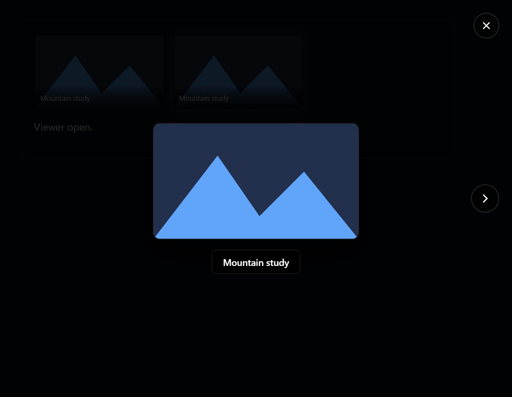
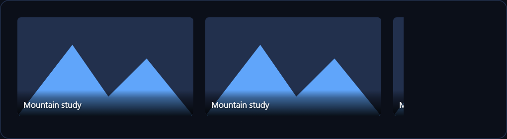

# q-reel

`q-reel` arranges thumbnail children in a grid or scrolling row and can open a built-in media viewer.

**Component tag:** `<q-reel>`

**Working preview:** Run `bun start` from the repository root, open the [existing playground](http://localhost:3333), then select **Media → Reel**. [Configure a single thumbnail](./q-thumbnail.md).

**On this page**

- [Quick start](#quick-start)
- [Examples](#examples)
- [Behavior & accessibility](#behavior--accessibility)
- [Styling](#styling)
- [API reference](#api-reference)

## Quick start

1. Follow the central [installation instructions](../../README.md#1-install-library).
2. In your application entry file, register WebQuark. This assumes a bundler that resolves package imports and CSS imports.

```javascript
import '@webquark/browser/dist/webquark/webquark.css';
import { defineCustomElements } from '@webquark/browser/loader';
defineCustomElements();
```

3. Add this markup to your application page. Any module script runs after that shared setup.

```html
<q-reel>
  <q-thumbnail src="data:image/svg+xml,%3Csvg xmlns='http://www.w3.org/2000/svg' width='320' height='180' viewBox='0 0 320 180'%3E%3Crect width='320' height='180' fill='%2322304d'/%3E%3Cpath d='M0 180L100 50L190 180M130 180L235 75L320 180' fill='%2360a5fa'/%3E%3C/svg%3E" label="Mountain study" alt="Blue geometric mountains" ></q-thumbnail>
</q-reel>
```

**Result:** a one-item gallery whose thumbnail opens the image viewer.

### At a glance

| Capability | Options | Default |
| :--- | :--- | :--- |
| [Layout](#layouts) | grid or carousel | grid |
| [Viewer](#state-and-interaction) | Built-in lightbox or application handling | Enabled |
| [Media](#slots) | q-thumbnail image/video entries | None |
| [Events](#events) | qLightboxOpen and qLightboxClose | No current-item property |

**With no properties:** An empty grid renders with no thumbnails or viewer. Supply q-thumbnail children. Playground sample photographs are demo content, not defaults.

## Examples

These examples share the [Quick start registration](#quick-start). Screenshots show the real registered component in a temporary preview fixture using the existing playground runtime. They do not imply extra permanent playground presets.

### Open a gallery image

Use thumbnail children and listen for viewer lifecycle events.



```html
<q-reel id="gallery">
  <q-thumbnail src="data:image/svg+xml,%3Csvg xmlns='http://www.w3.org/2000/svg' width='320' height='180' viewBox='0 0 320 180'%3E%3Crect width='320' height='180' fill='%2322304d'/%3E%3Cpath d='M0 180L100 50L190 180M130 180L235 75L320 180' fill='%2360a5fa'/%3E%3C/svg%3E" label="Mountain study" alt="Blue geometric mountains" ></q-thumbnail>
  <q-thumbnail src="data:image/svg+xml,%3Csvg xmlns='http://www.w3.org/2000/svg' width='320' height='180' viewBox='0 0 320 180'%3E%3Crect width='320' height='180' fill='%2322304d'/%3E%3Cpath d='M0 180L100 50L190 180M130 180L235 75L320 180' fill='%2360a5fa'/%3E%3C/svg%3E" label="Mountain study" alt="Blue geometric mountains" highlighted></q-thumbnail>
</q-reel>
<p id="viewer-status" role="status">Viewer closed.</p>
<script type="module">
const gallery = document.querySelector('#gallery');
gallery.addEventListener('qLightboxOpen', () => { document.querySelector('#viewer-status').textContent = 'Viewer open.'; });
gallery.addEventListener('qLightboxClose', () => { document.querySelector('#viewer-status').textContent = 'Viewer closed.'; });
</script>
```

The screenshot follows selecting the first thumbnail. The viewer is open; the status paragraph remains behind it.

### Use a scrolling thumbnail row

Give carousel children explicit widths and disable the built-in viewer.



```html
<q-reel class="strip" layout="carousel" lightbox="false">
  <q-thumbnail src="data:image/svg+xml,%3Csvg xmlns='http://www.w3.org/2000/svg' width='320' height='180' viewBox='0 0 320 180'%3E%3Crect width='320' height='180' fill='%2322304d'/%3E%3Cpath d='M0 180L100 50L190 180M130 180L235 75L320 180' fill='%2360a5fa'/%3E%3C/svg%3E" label="Mountain study" alt="Blue geometric mountains" ></q-thumbnail>
  <q-thumbnail src="data:image/svg+xml,%3Csvg xmlns='http://www.w3.org/2000/svg' width='320' height='180' viewBox='0 0 320 180'%3E%3Crect width='320' height='180' fill='%2322304d'/%3E%3Cpath d='M0 180L100 50L190 180M130 180L235 75L320 180' fill='%2360a5fa'/%3E%3C/svg%3E" label="Mountain study" alt="Blue geometric mountains" ></q-thumbnail>
  <q-thumbnail src="data:image/svg+xml,%3Csvg xmlns='http://www.w3.org/2000/svg' width='320' height='180' viewBox='0 0 320 180'%3E%3Crect width='320' height='180' fill='%2322304d'/%3E%3Cpath d='M0 180L100 50L190 180M130 180L235 75L320 180' fill='%2360a5fa'/%3E%3C/svg%3E" label="Mountain study" alt="Blue geometric mountains" ></q-thumbnail>
</q-reel>
<style>
  q-reel.strip { max-width: 520px; }
  q-reel.strip > q-thumbnail { width: 240px; }
</style>
```

lightbox="false" is parsed by Stencil as false. Thumbnails still emit qMaximize, allowing an application listener to handle them.

## Behavior & accessibility

### State and interaction

When lightbox=true, a child qMaximize supplies the active media and emits qLightboxOpen. Closing through Escape, backdrop, close button, or setting lightbox=false emits qLightboxClose. Navigating between items does not emit another open event. Navigation clamps at the first/last item rather than wrapping.

The application owns children. Use q-thumbnail directly; the viewer reads its src, alt, label, video and host identity. The same src is used for preview and viewer; video=true asks the viewer to create a native autoplay/loop video even though the thumbnail itself is an image. Supply an appropriate media strategy.

There is no public show/close method or current-index property. A false lightbox property disables opening but does not stop thumbnail qMaximize events.

### Keyboard and focus

| Key | Action |
| :--- | :--- |
| Enter / Space | Activate focused thumbnail. |
| ArrowLeft / ArrowRight | Previous/next viewer item within bounds. |
| Escape | Close the active viewer. |
| Tab / Shift+Tab | Trap focus within the viewer when a Tab event is handled. |

The code attempts delayed focus on the close button and restoration to the thumbnail host. Initial opening captures the button reference before the new viewer renders, and thumbnail hosts are not inherently focusable; do not rely on successful initial focus/restoration. The application may need to move focus explicitly.

### Labels and announcements

The open viewer has role="dialog", aria-modal="true", and a name from label or “Media Viewer”. Images use alt; video controls are native. Close/previous/next controls have accessible labels. The gallery itself has no list role or live region.

### Limitations and compatibility

The viewer does not inert the page or lock document scrolling. Its window-wide key listener assumes one active viewer. Smooth carousel scrolling and viewer fade-in have no reduced-motion override. Native autoplay may be restricted by the browser.

## Styling

### Layouts

| layout | Appearance |
| :--- | :--- |
| `grid` (default) | Responsive grid; shared theme defaults to one column below 768px and auto-fill 200px minimum columns above |
| `carousel` | Horizontal scrolling row with scroll snapping; give children a width |

Without the shared theme, CSS fallbacks use 140px mobile and 220px desktop minimum columns. Unknown layout values keep a base grid without the named layout rules.

### Custom styling

Scope CSS to the host or supplied content. See the exact [CSS variables](#css-variables) and [Shadow Parts](#shadow-parts).

```html
<q-reel class="gallery">
  <q-thumbnail src="data:image/svg+xml,%3Csvg xmlns='http://www.w3.org/2000/svg' width='320' height='180' viewBox='0 0 320 180'%3E%3Crect width='320' height='180' fill='%2322304d'/%3E%3Cpath d='M0 180L100 50L190 180M130 180L235 75L320 180' fill='%2360a5fa'/%3E%3C/svg%3E" label="Mountain study" alt="Blue geometric mountains" ></q-thumbnail>
</q-reel>
<style>
  q-reel.gallery { --q-reel-gap: 20px; --q-reel-columns-desktop: repeat(2, minmax(0, 1fr)); }
</style>
```

Shared geometry and theme setup are documented in [Foundation](../foundation.md) and [theme tokens](../theme-tokens.md).

## API reference

Cross-check the [generated API](../../src/browser/components/media/reel/readme.md) and [implementation](../../src/browser/components/media/reel/reel.tsx). Source nullability and actual rendering limitations are preserved below.

### Properties

All properties are optional and listed alphabetically.

| Name | Default | Description |
| :--- | :--- | :--- |
| `layout` | `'grid'` | grid or carousel; unknown values use only base grid styling.<br>**Type:** `"carousel" \| "grid"`. **HTML attribute:** `layout`. **Required:** No. |
| `lightbox` | `true` | Enable built-in viewer; setting false closes an active viewer.<br>**Type:** `boolean`. **HTML attribute:** `lightbox`. **Required:** No. |

### Slots

| Name | Description |
| :--- | :--- |
| (default) | q-thumbnail children; no fallback. Supply src and accessible text on each child. |

### Events

| Name | When it fires | Payload |
| :--- | :--- | :--- |
| `qLightboxClose` | An active viewer closes. | `CustomEvent<void>` |
| `qLightboxOpen` | An enabled viewer receives qMaximize. | `CustomEvent<void>` |

These events bubble, cross shadow boundaries (composed), and are cancelable. The implementation does not check preventDefault(); cancellation does not stop the documented state changes.

### Methods

This component exposes no public methods.

### Styling hooks

#### CSS variables

Defaults include the shared theme when set there; nested `var()` expressions show CSS fallbacks. Shared palette/typography tokens and fallback aliases are listed in the [shared variable reference](../theme_variables.md). Internal `--_q-*` variables are not public hooks.

| Name | Default | Controls |
| :--- | :--- | :--- |
| `--q-lightbox-max-size` | `90vh` | max size. |
| `--q-reel-columns-desktop` | `repeat(auto-fill, minmax(200px, 1fr))` | columns desktop. |
| `--q-reel-columns-mobile` | `1fr` | columns mobile. |
| `--q-reel-gap` | `12px` | gap. |
| `--q-reel-lightbox-btn-bg` | `rgba(0, 0, 0, 0.5)` | lightbox button background. |
| `--q-reel-lightbox-btn-border` | `1px solid rgba(255, 255, 255, 0.2)` | lightbox button border. |
| `--q-reel-lightbox-btn-color` | `#ffffff` | lightbox button color. |
| `--q-reel-lightbox-btn-hover-bg` | `rgba(255, 255, 255, 0.2)` | lightbox button hover background. |

#### Shadow Parts

This component exposes no Shadow Parts.
