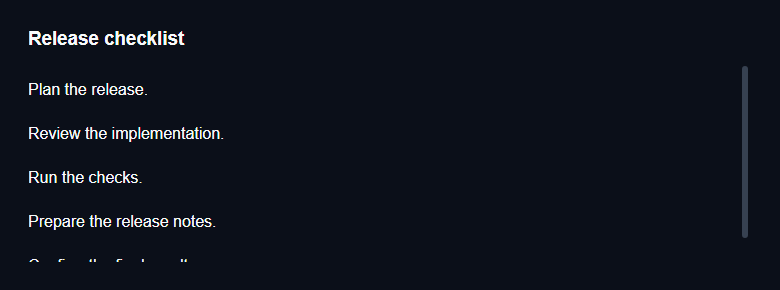

# q-scrollable

`q-scrollable` provides a bounded scroll viewport with a custom vertical thumb or styled native scrollbars.

**Component tag:** `<q-scrollable>`

**Working preview:** Run `bun start` from the repository root, open the [existing playground](http://localhost:3333), then select **Layout → Scrollable Container**. The examples below use temporary fixtures in this same registered runtime.

**On this page**

- [Quick start](#quick-start)
- [Examples](#examples)
- [Behavior & accessibility](#behavior--accessibility)
- [Styling](#styling)
- [API reference](#api-reference)

## Quick start

1. Follow the central [installation instructions](../../README.md#1-install-library).
2. Add registration to your application entry file (`main.js`). This requires a bundler that resolves package imports and CSS imports.

```javascript
import '@webquark/browser/dist/webquark/webquark.css';
import { defineCustomElements } from '@webquark/browser/loader';

defineCustomElements();
```

3. Add this markup to the application page after setup.

```html
<q-scrollable height="180px">
  <div style="min-height:300px">
    <h3>Release notes</h3>
    <p>Scroll this region to read the remaining content.</p>
  </div>
</q-scrollable>
```

**Result:** a 180px-high viewport with overflowing content; hover reveals the custom thumb.

### At a glance

| Capability | Options | Default |
| :--- | :--- | :--- |
| [Scrollbar](#variants) | custom or native | custom |
| [Dimensions](#sizes) | CSS height and maximum height | 100%; no maximum |
| [Navigation](#keyboard-and-focus) | Wheel/touch, keyboard, thumb drag, methods | At top |
| [External target](#state-and-interaction) | Native styling for another scroll element | Parent in native mode |
| [Coarse pointers](#limitations-and-compatibility) | Native scrollbar fallback | Enabled |

**With no properties:** `<q-scrollable></q-scrollable>` is an empty focusable viewport with 100% height. It needs a definite parent height or explicit height and overflowing content to scroll. The custom track is hidden when content fits.

**Playground preset:** The playground uses height 250px and long sample content; these are demonstration values.

## Examples

These examples share the registration above. Place each complete snippet in the application page; scripts use module syntax. Screenshots show the real component in the playground runtime with the shared dark theme.

### Read a bounded activity list

A custom scroll viewport contains a longer activity list.



```html
<h3>Release checklist</h3>
<q-scrollable id="activity-log" height="200px">
  <div style="line-height:2">
    <p>Plan the release.</p>
    <p>Review the implementation.</p>
    <p>Run the checks.</p>
    <p>Prepare the release notes.</p>
    <p>Confirm the final result.</p>
  </div>
</q-scrollable>
```

Hover the viewport to show its custom track, as shown.

### Jump to the latest entry

A button scrolls a native-mode viewport to its final activity entry.


```html
<q-scrollable id="activity-log" mode="native" height="180px">
  <div style="line-height:2">
    <p>Plan the release.</p>
    <p>Review the implementation.</p>
    <p>Run the checks.</p>
    <p>Prepare the release notes.</p>
    <p>Confirm the final result.</p>
  </div>
</q-scrollable>
<button id="latest-entry" type="button">Latest entry</button>
<script type="module">
  await customElements.whenDefined('q-scrollable');
  const log = document.querySelector('#activity-log');
  await log.componentOnReady();
  document.querySelector('#latest-entry').addEventListener('click', () => log.scrollToBottom());
</script>
```

Click Latest entry to reach the screenshot. Methods always scroll the component’s own viewport, including when target styles an external element.

## Behavior & accessibility

### State and interaction

The viewport uses native overflow scrolling. In custom mode, a ResizeObserver tracks viewport/content dimensions and a draggable vertical thumb maps to scrollTop. The thumb is at least 36px high. The track is hidden when there is no vertical overflow. Track clicks do not page the content.

`autoHide` controls a 1500ms scrolling-state timer, but current CSS places the scrolling class selector on a different wrapper from the class set by the component. Consequently scrolling alone does not reveal the track, and `auto-hide="false"` does not make it permanently visible. Hover or dragging reveals it. Use `::part(track) { opacity: 1; }` for a reliably persistent track.

In native mode, `target` additionally styles an external element found by a selector in the host’s document/shadow root; empty target selects the parent. It does not turn that target into a scroll container. Set overflow/dimensions on the target yourself. Invalid selectors can throw, and unmatched selectors do nothing. The component injects/removes a style element and temporary data attribute there; use one styling component per target.

### Keyboard and focus

The internal viewport is always focusable. The custom thumb is also focusable when its track is shown. On the thumb, all arrow keys move by 40px (Left/Up backward, Right/Down forward), Page Up/Down move by max(40px, viewport height − 40px), Home goes to the top, and End goes to the bottom. These moves are immediate and clamped. The thumb can remain visually transparent when reached by keyboard unless you style its track.

### Labels and announcements

The custom thumb has `role="scrollbar"`, fixed label “Scroll content”, vertical orientation, and `aria-controls` pointing to the viewport. `aria-valuemin` is 0; max/current are rounded scrollable pixels. The viewport has no built-in region role or forwarded label. Provide nearby descriptive text as needed; no live region is created.

### Limitations and compatibility

There is no horizontal custom thumb, though the viewport can overflow horizontally. At `(hover: none) and (pointer: coarse)`, `nativeOnMobile` hides the custom track and restores native scrollbars without changing mode. Browser native scrollbar appearance varies. No component-specific reduced-motion rule removes opacity/color transitions. Methods clamp finite positions; Infinity reaches the end and −Infinity reaches the start; NaN reaches the browser scrollTop setter and currently resolves to 0. Use finite numbers.

## Styling

Choose the scrollbar mode and a definite scroll height first.

### Variants

`custom` (default) uses the custom thumb; `native` uses browser scrollbar styling and optionally styles target. Unknown modes match neither supported mode’s complete behavior.

### Sizes

`height` is a CSS length (default `100%`); `max-height` is optional (default empty). They are assigned inline to the host. A percentage requires a resolved ancestor height; invalid CSS strings are left to browser CSS handling.

### Custom styling

```html
<q-scrollable class="visible-scroll" height="160px">
  <div style="min-height:320px">Content to scroll</div>
</q-scrollable>
<style>
  q-scrollable.visible-scroll { --q-scrollbar-width: 8px; --q-scrollbar-thumb-color: #60a5fa; }
  q-scrollable.visible-scroll::part(track) { opacity: 1; }
</style>
```

Set variables on an external native target itself when styling that target; values do not inherit upward from the component. See [CSS variables](#css-variables), [Shadow Parts](#shadow-parts), and [theme setup](../theme_variables.md).

## API reference

See the [Stencil-generated API](../../src/browser/components/layout/scrollable/readme.md) and [component source](../../src/browser/components/layout/scrollable/scrollable.tsx). The tables below include source-level types and effective rendering constraints.

### Properties

All properties are optional and are listed alphabetically. Boolean attributes use Stencil boolean parsing: a present empty attribute enables the property, `="false"` disables it; JavaScript properties accept `true`/`false`. Removing a boolean attribute makes it false, including properties initially declared true. For updates, set the desired JavaScript property explicitly instead of relying on attribute removal to restore initializer defaults.

| Name | Default | Description |
| :--- | :--- | :--- |
| `autoHide` | `true` | Controls the scroll-activity timer; see the current track-visibility limitation.<br>**Type:** `boolean`. **HTML attribute:** `auto-hide`. **Required:** No. |
| `height` | `'100%'` | CSS host height; inline style. Provide a constraint to make content scroll.<br>**Type:** `string`. **HTML attribute:** `height`. **Required:** No. |
| `maxHeight` | `''` | Optional CSS maximum height; empty means no inline maximum.<br>**Type:** `string`. **HTML attribute:** `max-height`. **Required:** No. |
| `mode` | `'custom'` | Custom vertical thumb or native scrollbars.<br>**Type:** `'custom' \| 'native'`. **HTML attribute:** `mode`. **Required:** No. |
| `nativeOnMobile` | `true` | Restore native bars at coarse-pointer/non-hover media query; mode remains unchanged.<br>**Type:** `boolean`. **HTML attribute:** `native-on-mobile`. **Required:** No. |
| `target` | `''` | Selector for extra native scrollbar styling; empty targets parent. Does not redirect scrolling methods/events.<br>**Type:** `string`. **HTML attribute:** `target`. **Required:** No. |


### Slots

| Name | Description |
| :--- | :--- |
| Default (unnamed) | Content inside the scroll viewport; no fallback. |

### Events

All events below are `CustomEvent`s with `bubbles: true`, `composed: true`, and `cancelable: true`. The implementation does not inspect `defaultPrevented`; canceling them does not veto component state changes.

| Name | When it fires | Payload |
| :--- | :--- | :--- |
| `qScroll` | Internal viewport scroll; external target scrolling does not emit it. | `CustomEvent<QScrollableEventDetail>`; detail `{ scrollTop: number; scrollHeight: number; clientHeight: number }`, in CSS pixels. |

### Methods

| Signature | Purpose | Returns |
| :--- | :--- | :--- |
| `scrollToBottom()` | Immediately set the internal viewport to its maximum scroll position. | `Promise<void>` |
| `scrollToPosition(top: number)` | Set internal scrollTop in pixels, clamped to the available range. | `Promise<void>` |

Wait for custom-element definition and `await element.componentOnReady()` before calling on a new lazy-loaded element. Neither method scrolls target.

### Styling hooks

Defaults below include the imported shared stylesheet; `var(...)` values follow the active theme. Component-specific hooks and the shared tokens they consume are listed. For shared setup, see [Theme variables](../theme_variables.md).

#### CSS variables

| Name | Default | Controls |
| :--- | :--- | :--- |
| `--q-border-color` | `#374151` | border color applied to `:host([mode='native']) .q-scrollable-viewport`, `:host([mode='native']) .q-scrollable-viewport::-webkit-scrollbar-thumb`, `.q-scrollbar-thumb`. |
| `--q-color-primary` | `#60a5fa` | color primary applied to `:host([mode='native']) .q-scrollable-viewport::-webkit-scrollbar-thumb:hover`, `.q-scrollbar-thumb:hover, .q-scrollbar-thumb:focus-visible`, `"]::-webkit-scrollbar-thumb:hover`. |
| `--q-scrollbar-radius` | `var(--q-radius-sm, 4px)` | Track/thumb rounding; WebKit native thumb rounding. |
| `--q-scrollbar-thumb-color` | `var(--q-border-color, #374151)` | Custom/native thumb background. |
| `--q-scrollbar-thumb-color-hover` | `var(--q-color-primary, #60a5fa)` | Thumb hover color and custom thumb focus-visible color. |
| `--q-scrollbar-track-color` | `transparent` | Custom/native track background. |
| `--q-scrollbar-width` | `6px` | Custom track width and WebKit native scrollbar dimensions. |
| `--q-scrollbar-width-thin` | `thin` | Native scrollbar-width keyword (thin by default), not a pixel width. |

#### Shadow Parts

| Name | Targets |
| :--- | :--- |
| `content` | Always-rendered content wrapper inside viewport. |
| `thumb` | Custom mode only; inline height/transform are calculated from measurements. |
| `track` | Custom mode only; hidden inline when content fits. |
| `viewport` | Always-rendered native overflow area. |
