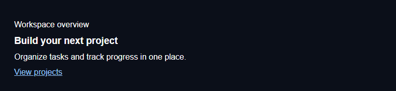

# q-section

`q-section` is a public content scaffold that currently projects consumer-owned content without its planned layout styling.

**Component tag:** `<q-section>`

**Working preview:** Run `bun start` at the repository root, open the [playground](http://localhost:3333) and select **Layout → Section**.

**On this page**

- [Quick start](#quick-start)
- [Examples](#examples)
- [Behavior & accessibility](#behavior--accessibility)
- [Styling](#styling)
- [API reference](#api-reference)

## Quick start

1. Follow the central [installation instructions](../../README.md#1-install-library).
2. Add registration to your application entry file (`main.js`). This requires a bundler that resolves package imports and CSS imports.

```javascript
import '@webquark/browser/dist/webquark/webquark.css';
import { defineCustomElements } from '@webquark/browser/loader';

defineCustomElements();
```

3. Add this markup to the application page after setup.

```html
<q-section>
  <p slot="media">Workspace overview</p>
  <h3>Build your next project</h3>
  <p>Organize tasks and track progress in one place.</p>
  <a slot="actions" href="#projects">View projects</a>
</q-section>
```

**Result:** the media slot, default content, and actions slot render in that order in normal document flow.

### At a glance

| Capability | Options | Default |
| :--- | :--- | :--- |
| [Content](#slots) | media, default, actions slots | Empty |
| [Reserved options](#state-and-interaction) | Layout, columns, reverse | Declared only; no visual effect |

**With no properties:** `<q-section></q-section>` is an empty block with `min-width: 0`; it shows no text, control, or placeholder.

## Examples

These examples share the registration above. Place each complete snippet in the application page; scripts use module syntax. Screenshots show the real component in the playground runtime with the shared dark theme.

### Project copy and actions

The scaffold projects media text, copy, and a link in source-defined slot order.



```html
<q-section>
  <p slot="media">Workspace overview</p>
  <h3>Build your next project</h3>
  <p>Organize tasks and track progress in one place.</p>
  <a slot="actions" href="#projects">View projects</a>
</q-section>
```

The component does not style the media or action elements; supply your own content and CSS.

## Behavior & accessibility

### State and interaction

This is a scaffold. All properties reflect to attributes but do not change rendering, layout, alignment, sizing, or slot order. Changing, emptying, or supplying an unrecognized property value does not activate additional behavior.

### Keyboard and focus

The host has no added tab stop or keyboard handler. Slotted links and controls retain native behavior.

### Labels and announcements

The scaffold creates no role, heading, accessible name, or live region. Supply semantic headings and labels in the content. A tag name alone does not establish a labelled landmark.

### Limitations and compatibility

The public props reserve future behavior; the current implementation is only slots and a block host. No automatic form value, events, focus management, or motion is provided.

## Styling

There are currently no implemented variants, size presets, tones, component CSS variables, or Shadow Parts. Reserved properties in [Properties](#properties) have no visual effect.

### Custom styling

Use ordinary host and light-DOM CSS for consumer presentation.

```html
<q-section class="content-shell"><p>Consumer content</p></q-section>
<style>
  q-section.content-shell { padding: 16px; border: 1px solid #64748b; }
  q-section.content-shell > p { margin: 0; }
</style>
```

See the empty [CSS-variable](#css-variables) and [Shadow-Part](#shadow-parts) inventories, and central [theme setup](../theme_variables.md).

## API reference

See the [Stencil-generated API](../../src/browser/components/layout/section/readme.md) and [component source](../../src/browser/components/layout/section/section.tsx). The tables below include source-level types and effective rendering constraints.

### Properties

All properties are optional and are listed alphabetically. Boolean attributes use Stencil boolean parsing: a present empty attribute enables the property, `="false"` disables it; JavaScript properties accept `true`/`false`. Removing a boolean attribute makes it false, including properties initially declared true. For updates, set the desired JavaScript property explicitly instead of relying on attribute removal to restore initializer defaults.

| Name | Default | Description |
| :--- | :--- | :--- |
| `columns` | `1` | Reserved column count; reflected numeric value does not affect layout, including zero, negative, and nonfinite inputs.<br>**Type:** `number`. **HTML attribute:** `columns`. **Required:** No. |
| `layout` | `'full'` | Reserved layout; full, split, sidebar, and columns currently have identical behavior.<br>**Type:** `'full' \| 'split' \| 'sidebar' \| 'columns'`. **HTML attribute:** `layout`. **Required:** No. |
| `reverse` | `false` | Reserved reversal flag; does not reorder content.<br>**Type:** `boolean`. **HTML attribute:** `reverse`. **Required:** No. |


### Slots

| Name | Description |
| :--- | :--- |
| `actions` | Optional action content, rendered last; no fallback. |
| `media` | Optional media content, rendered first; no fallback. |
| Default (unnamed) | Consumer-owned content, rendered second; no fallback. |

### Events

This component emits no public events.

### Methods

This component exposes no public methods.

### Styling hooks

Defaults below include the imported shared stylesheet; `var(...)` values follow the active theme. Component-specific hooks and the shared tokens they consume are listed. For shared setup, see [Theme variables](../theme_variables.md).

#### CSS variables

This component declares no public CSS variables.

#### Shadow Parts

This component exposes no Shadow Parts.
