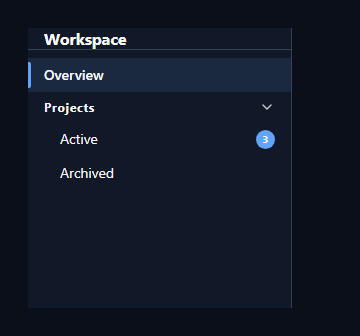
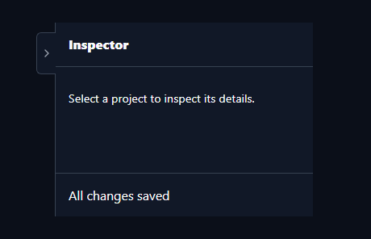
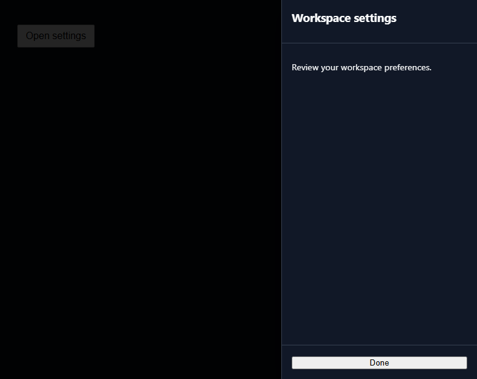

# q-sidepanel

`q-sidepanel` provides hierarchical navigation, a persistent content panel, or a dismissible drawer.

**Component tag:** `<q-sidepanel>`

**Working preview:** Run `bun start` from the repository root, open the [existing playground](http://localhost:3333), then select **Layout → Sidepanel**. The examples below use temporary fixtures in this same registered runtime.

**On this page**

- [Quick start](#quick-start)
- [Examples](#examples)
- [Behavior & accessibility](#behavior--accessibility)
- [Styling](#styling)
- [API reference](#api-reference)

## Quick start

1. Follow the central [installation instructions](../../README.md#1-install-library).
2. Add registration to your application entry file (`main.js`). This requires a bundler that resolves package imports and CSS imports.

```javascript
import '@webquark/core/dist/webquark/webquark.css';
import { defineCustomElements } from '@webquark/core/loader';

defineCustomElements();
```

3. Add this markup to the application page after setup.

```html
<div style="height:240px">
  <q-sidepanel variant="panel" aria-label="Project summary">
    <strong slot="header">Project summary</strong>
    <p>Three tasks are ready for review.</p>
  </q-sidepanel>
</div>
```

**Result:** a persistent 320px-wide labelled content panel; this example explicitly selects panel rather than the default nav variant.

### At a glance

| Capability | Options | Default |
| :--- | :--- | :--- |
| [Variant](#variants) | nav, panel, drawer | nav |
| [Navigation](#state-and-interaction) | Nested items, badges, expandable groups | Empty; groups initially expanded |
| [Collapse](#state-and-interaction) | rail or hidden; none/header/footer/edge control | Not collapsible; no control |
| [Edges and sizes](#sizes) | left, right, top, bottom; drawer CSS size | right; drawer 320px |
| [Content](#slots) | Header/footer and panel/drawer body | Empty |
| [Selection](#state-and-interaction) | Application-owned value; leaf qSelect | Empty |

**With no properties:** `<q-sidepanel></q-sidepanel>` renders an empty nav surface 264px wide and 100% high, with its header/footer hidden. It does not open a drawer or render default-slot content in nav mode. Supply items as a JavaScript array and a definite parent height.

**Playground preset:** The playground starts with a configured drawer and content; the component’s default is nav with open=false.

## Examples

These examples share the registration above. Place each complete snippet in the application page; scripts use module syntax. Screenshots show the real component in the playground runtime with the shared dark theme.

### Navigate nested project sections

A navigation sidepanel shows an expanded project group and a count badge.



```html
<div style="height:280px">
  <q-sidepanel id="workspace-nav" side="left" aria-label="Workspace navigation" value="overview">
    <strong slot="header" style="padding:16px">Workspace</strong>
  </q-sidepanel>
</div>
<script type="module">
  await customElements.whenDefined('q-sidepanel');
  const navigation = document.querySelector('#workspace-nav');
  navigation.items = [
    { label: 'Overview', value: 'overview' },
    { label: 'Projects', value: 'projects', children: [
      { label: 'Active', value: 'active', badgeCount: 3, badgeLabel: '3 active projects' },
      { label: 'Archived', value: 'archived' }
    ] }
  ];
  navigation.addEventListener('qSelect', event => { navigation.value = event.detail.value; });
</script>
```

Click a leaf to update value; click Projects to toggle its children. mode does not currently change this nested rendering.

### Collapse a persistent inspector

A persistent panel includes an edge control that can hide and reopen it.



```html
<div style="height:240px;padding-left:40px">
  <q-sidepanel variant="panel" side="right" collapsible collapse-mode="hidden"
    collapse-control="edge" collapse-control-style="edge-tab" aria-label="Inspector">
    <strong slot="header">Inspector</strong>
    <p>Select a project to inspect its details.</p>
    <span slot="footer">All changes saved</span>
  </q-sidepanel>
</div>
```

The screenshot shows the expanded panel. Activate the edge control to toggle collapsed; it stays outside hidden content. Leave room for the protruding control.

### Open a settings drawer

A settings drawer overlays the page and provides a Done action.



```html
<button id="open-settings" type="button">Open settings</button>
<q-sidepanel id="settings-drawer" variant="drawer" side="right" drawer-size="320px" aria-label="Workspace settings">
  <h3 slot="header">Workspace settings</h3>
  <p>Review your workspace preferences.</p>
  <button id="close-settings" slot="footer" type="button">Done</button>
</q-sidepanel>
<script type="module">
  await customElements.whenDefined('q-sidepanel');
  const drawer = document.querySelector('#settings-drawer');
  await drawer.componentOnReady();
  document.querySelector('#open-settings').addEventListener('click', () => { drawer.open = true; });
  document.querySelector('#close-settings').addEventListener('click', () => { drawer.open = false; });
</script>
```

Click Open settings to reach the screenshot. Done sets open=false directly; backdrop and Escape additionally emit qClose. The viewport shown is wider than 600px.

## Behavior & accessibility

### State and interaction

| Variant/state | Ownership and result |
| :--- | :--- |
| nav | Application supplies items and value. Leaf activation emits qSelect; parent activation toggles internal expanded groups. The default body slot is not rendered. |
| panel | Persistent header/body/footer. open is ignored. |
| drawer | Mutable open controls visibility. Backdrop/Escape set open=false then emit qClose. Programmatic changes emit no qClose. |
| collapsible nav/panel | Built-in control mutates collapsed then emits qCollapsedChange. External changes emit no event. collapsed has no visual effect until collapsible is true. |

Navigation accepts JavaScript arrays only. String entries are trimmed and blank entries dropped; object items require string label/value. Nested children normalize recursively. Replace the array after editing. Keep values unique at each level (and group values unique throughout the tree) for stable item identity and group state.

`defaultGroupsExpanded` seeds all groups during initialization and during items replacements before any user group toggle. Updating defaultGroupsExpanded alone does not open/close current groups. After a user toggle, replacements preserve surviving group values. `accordion` closes siblings when opening a group; it does not force only one group open on initialization. alwaysExpanded parents remain open. The declared `mode` values flat/grouped/tree are currently unused by rendering: children produce nesting in all three.

Rail collapse fades nav labels/chevrons and preserves usable icon items (text-only leaves can look blank). Always-expanded headings disappear in the rail. Panel rail only narrows/clips its content; it does not create icons. Hidden collapse slides the occupied width and fades stable content. All built-in controls sit outside the clipped, inert content and remain usable. Slotted content stays mounted, retaining inputs and scroll position; consumers must keep it mounted and separately control background activity when hidden.

The standard uses `--q-transition-normal` for occupied-size changes and content fading. Drawers retain their directional transform and backdrop while their content fades. Reduced motion settles immediately. Reversing a transition continues from the current position; drawer completion ignores child transitions and restores the original opener.

### Keyboard and focus

Nav items are role=button elements with Tab stops and Enter/Space activation; this is not a tree-widget arrow-key model. Always-expanded parent categories use heading semantics with level min(depth+2,6), are not focusable, and do not toggle.

When a persistent panel or hidden navigation sidebar closes with focus inside its content, focus moves to its built-in control before the content becomes inert. With `collapseControl="none"`, focus is released; the application should return it to its external trigger. Rail icons remain in the keyboard order.

An already-open drawer focuses its first focusable descendant after load. A later open change records prior focus and focuses the first control after its transition; close restores recorded focus. Tab/Shift+Tab wrap among focusable descendants when present. The drawer itself has tabindex=-1 as a focus fallback, but an empty drawer has no loopable descendants for the Tab trap. Closed drawer content is inert. Provide a labelled close action. Background content is not made inert and no document scroll lock is implemented. Changing variant while already open does not rerun the open watcher; choose variant before opening.

### Labels and announcements

Nav role=navigation uses trimmed aria-label or “Sidebar navigation”. A labelled persistent panel has role=region. Drawers have role=dialog and aria-modal=true but no fallback accessible name: supply aria-label. Header content is not automatically linked as the dialog name.

Leaf matches use aria-current=page. Toggleable parents expose aria-expanded. A valid badge is a positive safe integer: values above 99 show 99+, while the item’s accessible label contains the full badgeLabel (trimmed) or count; badge visuals are aria-hidden. Fractions, zero, negative, NaN, and infinities show no badge.

Collapse controls use aria-expanded, title, and a dynamic Collapse/Expand sidebar/panel label when collapseLabel is empty, whitespace, or the default “Toggle sidebar”. A custom label stays fixed. Control adornments are aria-hidden and non-interactive; include their meaning in collapseLabel if needed. No live region is created.

### Forms

The sidepanel has no form value. Built-in collapse controls use type=button; application controls retain native form behavior.

### Limitations and compatibility

Left/right drawers become bottom sheets at viewport widths ≤600px with height clamp(280px, drawerSize, 80vh); top/bottom drawers retain their edges. Unknown variants fall through to drawer rendering, while reflected host selectors may not match; use supported values. Unknown sides have no positioning rule.

## Styling

Choose the variant and collapse mode, then size the containing layout.

### Variants

| variant | Use |
| :--- | :--- |
| `nav` (default) | A persistent hierarchical navigation surface. |
| `panel` | Persistent slotted content such as an inspector. |
| `drawer` | A temporary viewport overlay with backdrop. |

Collapse requires collapsible. rail (default) retains a 65px strip; hidden defaults to 0px. Controls are none (default), header, footer, or edge. icon-button (default) works at each placement; edge-tab styling applies only at edge.

### Sizes

Nav width defaults to 264px; persistent panel width to 320px. Their height is 100% and needs a parent height. The effective `drawerSize` defaults to 320px and becomes width for left/right or height for top/bottom. It does not size persistent panels; use their CSS hooks. side defaults right. A persistent panel’s side changes borders/control placement, not its horizontal flow direction or its width-based collapse.

The edge-tab defaults to 24×52px; horizontal sides swap the dimensions. collapseControlPosition sets an inline offset variable used by panel edge controls and nav left/right edge-tabs; nav icon-button edge placement remains fixed.

### Stable content and flexible layouts

The component owns its animated width. A surrounding wrapper should follow that width (`flex: 0 0 auto`) rather than animate a competing width or flex basis. Set the expanded target through `--q-sidepanel-panel-width` (panel) or `--q-sidepanel-expanded-width` (nav). Fixed lengths and container units keep content stable through collapse. Literal percentages are resolved against the containing layout, including initially closed state and container resizing. Avoid a shrinking wrapper as the percentage sizing reference. Targets that exceed the available flex space are clipped; choose a fitting expanded target rather than relying on content reflow during collapse. Complex percentage expressions such as `calc(100% - 20px)` are not resolved; use container units such as `calc(100cqw - 20px)` or an explicit expanded length.

Borders and padding on both the host and persistent shell are included in the stable surface dimensions. These are refreshed on component updates, window resizing, and percentage-container resizing; theme changes that only alter CSS border geometry should trigger a resize/update. Header/body/footer parts and slots are preserved. `surface` exposes the inner content region without including the collapse control.

For a stacked page, keep its layout direction consistent while closing and use the height hooks below. The page still chooses vertical layout; `side="top"` or `side="bottom"` alone does not change persistent collapse to height. Example inside an inline-size query container:

```css
q-sidepanel.stacked {
  --q-sidepanel-panel-width: 100cqw;
  --q-sidepanel-hidden-width: 100cqw;
  --q-sidepanel-panel-height: min(72vh, 680px);
  --q-sidepanel-panel-content-height: min(72vh, 680px);
  --q-sidepanel-hidden-height: 0px;
}
```

### Custom styling

```html
<div style="height:240px">
  <q-sidepanel class="inspector" variant="panel" aria-label="Inspector">Project details</q-sidepanel>
</div>
<style>
  q-sidepanel.inspector { --q-sidepanel-panel-width: 360px; --q-sidepanel-panel-padding: 24px; }
</style>
```

--q-sidepanel-* hooks precede their --q-panel-* aliases where the table notes a fallback. The drawer sets --q-panel-width inline from drawerSize, so a host width variable does not override it. See [CSS variables](#css-variables), [Shadow Parts](#shadow-parts), and [theme setup](../theme_variables.md).

## API reference

For new code, use `drawerSize`, `defaultGroupsExpanded`, `collapseControlStyle`. The deprecated aliases remain supported. Canonical properties take precedence when set; otherwise the legacy property and its default apply. Set a canonical JavaScript property to `undefined` to restore the fallback.

See the [Stencil-generated API](../../src/components/layout/sidepanel/readme.md) and [component source](../../src/components/layout/sidepanel/sidepanel.tsx). The tables below include source-level types and effective rendering constraints.

### Properties

All properties are optional and are listed alphabetically. Boolean attributes use Stencil boolean parsing: a present empty attribute enables the property, `="false"` disables it; JavaScript properties accept `true`/`false`. Removing a boolean attribute makes it false, including properties initially declared true. For updates, set the desired JavaScript property explicitly instead of relying on attribute removal to restore initializer defaults.

| Name | Default | Description |
| :--- | :--- | :--- |
| `accordion` | `false` | Close sibling groups when opening another; initial expansion is unaffected.<br>**Type:** `boolean`. **HTML attribute:** `accordion`. **Required:** No. |
| `ariaLabel` | `null` | Names navigation, region, or dialog; drawer needs an explicit meaningful label.<br>**Type:** `string \| null`. **HTML attribute:** `aria-label`. **Required:** No. |
| `collapseControl` | `'none'` | Built-in collapse control placement; none delegates to application.<br>**Type:** `'none' \| 'header' \| 'footer' \| 'edge'`. **HTML attribute:** `collapse-control`. **Required:** No. |
| `collapseControlAppearance` | `'icon-button'` | Deprecated alias for `collapseControlStyle`. Control appearance; edge-tab requires edge placement for the tab shape.<br>**Type:** `'icon-button' \| 'edge-tab'`. **HTML attribute:** `collapse-control-appearance`. **Required:** No. |
| `collapseControlPosition` | `''` | CSS offset string; blank uses appearance-specific defaults. See placement limitations.<br>**Type:** `string`. **HTML attribute:** `collapse-control-position`. **Required:** No. |
| `collapseControlStyle` | `undefined` | Control appearance; edge-tab requires edge placement for the tab shape.<br>**Type:** `'icon-button' \| 'edge-tab'`. **HTML attribute:** `collapse-control-style`. **Required:** No. |
| `collapsed` | `false` | Mutable collapse state for nav/panel when collapsible.<br>**Type:** `boolean`. **HTML attribute:** `collapsed`. **Required:** No. |
| `collapseLabel` | `'Toggle sidebar'` | Accessible collapse-control name; default/blank becomes dynamic.<br>**Type:** `string`. **HTML attribute:** `collapse-label`. **Required:** No. |
| `collapseMode` | `'rail'` | rail narrows; hidden hides to configured near-zero width.<br>**Type:** `'rail' \| 'hidden'`. **HTML attribute:** `collapse-mode`. **Required:** No. |
| `collapsible` | `false` | Enable nav/panel collapse behavior.<br>**Type:** `boolean`. **HTML attribute:** `collapsible`. **Required:** No. |
| `defaultGroupsExpanded` | `undefined` | Seed nav group expansion initially; not a controlled group-state property.<br>**Type:** `boolean`. **HTML attribute:** `default-groups-expanded`. **Required:** No. |
| `drawerSize` | `undefined` | CSS drawer width/height; persistent sizes use hooks.<br>**Type:** `string`. **HTML attribute:** `drawer-size`. **Required:** No. |
| `expanded` | `true` | Deprecated alias for `defaultGroupsExpanded`. Seed nav group expansion initially; not a controlled group-state property.<br>**Type:** `boolean`. **HTML attribute:** `expanded`. **Required:** No. |
| `items` | `[]` | JavaScript array of strings or nested SidepanelItem objects; no JSON attribute parsing.<br>**Type:** `SidepanelItemInput[]`. **HTML attribute:** `none; JavaScript property only`. **Required:** No. |
| `mode` | `'flat'` | Declared flat/grouped/tree configuration; currently does not alter rendering.<br>**Type:** `'flat' \| 'grouped' \| 'tree'`. **HTML attribute:** `mode`. **Required:** No. |
| `open` | `false` | Mutable drawer visibility; ignored in other variants.<br>**Type:** `boolean`. **HTML attribute:** `open`. **Required:** No. |
| `panelSize` | `'320px'` | Deprecated alias for `drawerSize`. CSS drawer width/height; persistent sizes use hooks.<br>**Type:** `string`. **HTML attribute:** `panel-size`. **Required:** No. |
| `side` | `'right'` | Drawer edge and persistent border/control direction.<br>**Type:** `'left' \| 'right' \| 'top' \| 'bottom'`. **HTML attribute:** `side`. **Required:** No. |
| `value` | `''` | Application-owned active leaf value.<br>**Type:** `string`. **HTML attribute:** `value`. **Required:** No. |
| `variant` | `'nav'` | Choose nav, panel, or drawer.<br>**Type:** `'drawer' \| 'nav' \| 'panel'`. **HTML attribute:** `variant`. **Required:** No. |

#### SidepanelItemInput and SidepanelItem

A string becomes the same trimmed label/value. Object shape:

| Field | Type and meaning |
| :--- | :--- |
| label | Required string; visible name (object values are not trimmed). |
| value | Required string; selection and group identity. |
| icon | Optional string; lucide q-icon name. See [q-icon](./q-icon.md). |
| badgeCount | Optional number; positive safe integer only; visual cap 99+. |
| badgeLabel | Optional string; accessible full count description. |
| alwaysExpanded | Optional boolean; true makes a parent a non-collapsible heading. Ignored on leaves. |
| children | Optional SidepanelItem[]; recursive nested items. |

### Slots

| Name | Description |
| :--- | :--- |
| `collapse-control-adornment` | Built-in control visual adornment; wrapper aria-hidden, no fallback. |
| `collapse-icon` | Built-in control while expanded; default bundled side-specific icon. |
| `expand-icon` | Built-in control while collapsed; default bundled side-specific icon. |
| `footer` | All variants; hidden without content unless a nav/panel footer control requires the region. |
| `header` | All variants; hidden without content unless a nav/panel header control requires the region. |
| Default (unnamed) | Panel/drawer body only; absent in nav. No fallback. |

### Events

All three events bubble, cross shadow boundaries, and are cancelable CustomEvents. State changes happen before emission and do not inspect cancellation.

| Name | When it fires | Payload |
| :--- | :--- | :--- |
| `qClose` | Drawer backdrop/Escape closure; open is already false. | `CustomEvent<void>` |
| `qCollapsedChange` | Built-in collapse control activation. | `CustomEvent<QSidepanelCollapsedChangeDetail>`; detail `{ collapsed: boolean }`. |
| `qSelect` | Leaf activation; does not change value. | `CustomEvent<QSidepanelSelectDetail>`; detail `{ value: string; label: string; item: SidepanelItem }`. |

### Methods

This component exposes no public methods.

### Styling hooks

Defaults below include the imported shared stylesheet; `var(...)` values follow the active theme. Component-specific hooks and the shared tokens they consume are listed. For shared setup, see [Theme variables](../theme_variables.md).

#### CSS variables

| Name | Default | Controls |
| :--- | :--- | :--- |
| `--q-bg-overlay` | `rgba(0, 0, 0, 0.85)` | bg overlay applied to `.sidepanel-backdrop`. |
| `--q-bg-surface-1` | `#111827` | bg surface 1 applied to `.sidepanel-drawer`, `.nav-sidebar`, `.collapse-control--edge-tab`. |
| `--q-bg-surface-2` | `#19243b` | bg surface 2 applied to `.nav-item:hover, .nav-item:focus-visible`, `.collapse-control:hover, .collapse-control:focus-visible`, `.collapse-control--edge-tab:hover, .collapse-control--edge-tab:focus-visible`. |
| `--q-border` | `var(--q-border-width) solid var(--q-border-color)` | border applied to `.side-left .sidepanel-drawer`, `.side-right .sidepanel-drawer`, `.side-top .sidepanel-drawer`. |
| `--q-border-color` | `#374151` | border color applied to `.side-left .sidepanel-drawer`, `.side-right .sidepanel-drawer`, `.side-top .sidepanel-drawer`. |
| `--q-color-primary` | `#60a5fa` | color primary applied to `.nav-item--active`, `.nav-item--active::before`, `.nav-item--active:hover, .nav-item--active:focus-visible`. |
| `--q-fg-base` | `#f9fafb` | fg base applied to `.drawer-header`, `.drawer-body`, `.drawer-footer`. |
| `--q-fg-muted` | `#9ca3af` | fg muted applied to `.nav-item[data-depth-tone='secondary']`, `.collapse-control`. |
| `--q-focus-ring` | `2px solid var(--q-color-primary)` | focus ring applied to `.collapse-control:focus-visible`. |
| `--q-font-family` | `-apple-system, BlinkMacSystemFont, 'Segoe UI', Roboto, Helvetica, Arial, sans-serif` | font family applied to `.drawer-header`, `.drawer-body`, `.drawer-footer`. |
| `--q-font-size-base` | `0.9rem` | font size base applied to `.drawer-body`, `.panel-body`. |
| `--q-font-size-lg` | `1rem` | font size lg applied to `.drawer-header`, `.panel-header`. |
| `--q-font-weight-bold` | `600` | font weight bold applied to `.drawer-header`, `.panel-header`. |
| `--q-font-weight-normal` | `400` | font weight normal applied to `.drawer-body`, `.panel-body`. |
| `--q-padding-lg` | `var(--q-space-lg, 1rem)` | padding lg applied to `.drawer-header`, `.drawer-body`, `.drawer-footer`. |
| `--q-panel-bg` | `var(--q-bg-surface-1, #111827)` | Drawer/persistent fallback background alias; --q-sidepanel-bg takes precedence and is set by shared theme. |
| `--q-panel-border` | `var(--q-border)` | Drawer/persistent fallback border alias; --q-sidepanel-border takes precedence where used. Also directly controls drawer header and mobile top border. |
| `--q-panel-shadow` | `var(--q-shadow-high, 0 16px 32px rgba(0,0,0,0.12))` | Drawer shadow fallback; --q-sidepanel-shadow takes precedence and is set by shared theme. |
| `--q-panel-transition-duration` | `var(--q-transition-normal, 250ms ease)` | Optional drawer duration override, such as 250ms. Otherwise the complete shared normal transition is used. |
| `--q-panel-width` | `Drawer: drawerSize inline (320px); persistent fallback: 320px` | Drawer inline sizing from drawerSize overrides host inheritance. Fallback alias for persistent width when --q-sidepanel-panel-width is unset. |
| `--q-shadow-high` | `0 16px 32px rgba(0, 0, 0, 0.45)` | shadow high applied to `.sidepanel-drawer`. |
| `--q-sidepanel-bg` | `var(--q-bg-surface-1)` | All variants’ background; overrides --q-panel-bg where both appear. |
| `--q-sidepanel-border` | `var(--q-border)` | Drawer/persistent edge border; nav outer border uses --q-border-color instead. |
| `--q-sidepanel-collapse-control-adornment-left` | `0` | sidepanel collapse control adornment left applied to `.collapse-control__adornment`. |
| `--q-sidepanel-collapse-control-adornment-top` | `0` | sidepanel collapse control adornment top applied to `.collapse-control__adornment`. |
| `--q-sidepanel-collapse-control-adornment-translate-x` | `-50%` | sidepanel collapse control adornment translate x applied to `.collapse-control__adornment`. |
| `--q-sidepanel-collapse-control-adornment-translate-y` | `-50%` | sidepanel collapse control adornment translate y applied to `.collapse-control__adornment`. |
| `--q-sidepanel-collapse-control-position` | `12px` | Appearance-specific start offset, default 12px where used; nonblank collapseControlPosition sets it inline on the button. |
| `--q-sidepanel-collapse-control-size` | `32px` | sidepanel collapse control size applied to `:host([variant="nav"])`, `.collapse-control`, `.nav-sidebar.is-collapsed.collapse-mode-rail .collapse-control--edge`. |
| `--q-sidepanel-collapse-icon-size` | `20px` | Built-in icon-button icon size; edge-tab icon size overrides it. |
| `--q-sidepanel-collapsed-header-height` | `112px` | sidepanel collapsed header height applied to `.nav-sidebar.is-collapsed.collapse-mode-rail .nav-header`, `.nav-sidebar.is-collapsed.collapse-mode-rail .collapse-control--edge`. |
| `--q-sidepanel-collapsed-width` | `65px` | sidepanel collapsed width applied to `:host([variant="nav"])`, `:host([variant="nav"][collapsible][collapsed][collapse-mode="rail"])`, `:host([variant="panel"][collapsible][collapsed][collapse-mode="rail"])`. |
| `--q-sidepanel-drawer-footer-padding` | `var(--q-padding-lg, 24px)` | sidepanel drawer footer padding applied to `.drawer-footer`. |
| `--q-sidepanel-drawer-section-border` | `var(--q-panel-border, var(--q-border, 1px solid var(--q-border-color, #374151)))` | sidepanel drawer section border applied to `.drawer-footer`. |
| `--q-sidepanel-edge-tab-bg` | `var(--q-bg-surface-1, #111827)` | sidepanel edge tab bg applied to `.collapse-control--edge-tab`. |
| `--q-sidepanel-edge-tab-border` | `var(--q-border, 1px solid var(--q-border-color, #374151))` | sidepanel edge tab border applied to `.collapse-control--edge-tab`. |
| `--q-sidepanel-edge-tab-height` | `52px` | sidepanel edge tab height applied to `.collapse-control--edge-tab`, `.panel-side-top > .collapse-control--edge-tab, .panel-side-bottom > .collapse-control--edge-tab`. |
| `--q-sidepanel-edge-tab-hover-bg` | `var(--q-bg-surface-2, rgba(255, 255, 255, 0.05))` | sidepanel edge tab hover bg applied to `.collapse-control--edge-tab:hover, .collapse-control--edge-tab:focus-visible`. |
| `--q-sidepanel-edge-tab-icon-size` | `16px` | sidepanel edge tab icon size applied to `.collapse-control--edge-tab q-icon`. |
| `--q-sidepanel-edge-tab-radius` | `6px` | sidepanel edge tab radius applied to `.collapse-control--edge-tab`, `:host([side="left"]) .nav-sidebar > .collapse-control--edge-tab`, `:host([side="right"]) .nav-sidebar > .collapse-control--edge-tab`. |
| `--q-sidepanel-edge-tab-shoulder-radius` | `0px` | Optional concave shoulder radius; 0px means none. |
| `--q-sidepanel-edge-tab-width` | `24px` | sidepanel edge tab width applied to `.collapse-control--edge-tab`, `.panel-side-top > .collapse-control--edge-tab, .panel-side-bottom > .collapse-control--edge-tab`. |
| `--q-sidepanel-expanded-width` | `264px` | sidepanel expanded width applied to `:host([variant="nav"])`. |
| `--q-sidepanel-hidden-width` | `0px` | sidepanel hidden width applied to `:host([variant="nav"])`, `:host([variant="nav"][collapsible][collapsed][collapse-mode="hidden"])`, `:host([variant="panel"][collapsible][collapsed][collapse-mode="hidden"])`. |
| `--q-sidepanel-nav-border` | `var(--q-border, 1px solid var(--q-border-color, rgba(255,255,255,0.08)))` | sidepanel nav border applied to `.nav-header`, `.nav-footer`. |
| `--q-sidepanel-nav-depth-primary-color` | `var(--q-fg-base, #f9fafb)` | Leaf text and top-level parent text color. |
| `--q-sidepanel-nav-depth-secondary-color` | `var(--q-fg-muted, #9ca3af)` | Nested parent text color. |
| `--q-sidepanel-nav-icon-opacity` | `1` | sidepanel nav icon opacity applied to `.nav-item__icon`. |
| `--q-sidepanel-panel-footer-padding` | `var(--q-padding-lg)` | sidepanel panel footer padding applied to `.panel-footer`. |
| `--q-sidepanel-panel-header-padding` | `var(--q-padding-lg)` | sidepanel panel header padding applied to `.panel-header`. |
| `--q-sidepanel-panel-padding` | `var(--q-padding-lg)` | sidepanel panel padding applied to `.panel-body`. |
| `--q-sidepanel-panel-section-border` | `var(--q-border)` | sidepanel panel section border applied to `.panel-header`, `.panel-footer`. |
| `--q-sidepanel-panel-width` | `320px` | sidepanel panel width applied to `:host([variant="panel"])`. |
| `--q-sidepanel-panel-height` | `100%` | Persistent panel expanded outer height; consumer may use it for a stacked layout. |
| `--q-sidepanel-panel-content-height` | `Expanded outer height, otherwise fill` | Stable inner height target, adjusted for actual host/shell borders and padding. |
| `--q-sidepanel-hidden-height` | `Expanded outer height` | Optional closed height for hidden panel collapse; set 0px for vertical collapse. |
| `--q-sidepanel-shadow` | `var(--q-shadow-high)` | sidepanel shadow applied to `.sidepanel-drawer`. |
| `--q-transition-normal` | `250ms cubic-bezier(0.4, 0, 0.2, 1)` | transition normal applied to `.sidepanel-backdrop`, `.sidepanel-drawer`, `:host([variant="nav"])`. |
| `--q-z-index-overlay` | `1000` | z index overlay applied to `.sidepanel-wrapper`. |

#### Shadow Parts

| Name | Targets |
| :--- | :--- |
| `backdrop` | Drawer only, clickable backdrop. |
| `body` | Nav list or panel/drawer body. |
| `collapse-control` | Built-in nav/panel control only when collapsible and placement is supported/non-none. |
| `collapse-control-adornment` | Adornment wrapper inside each rendered built-in control. |
| `drawer` | Drawer dialog surface. |
| `footer` | All variants; wrapper may be hidden. |
| `header` | All variants; wrapper may be hidden. |
| `item-badge` | Each nav item with a valid positive badgeCount. |
| `panel` | Persistent panel surface only; nav has no equivalent surface part. |
| `surface` | Stable inner persistent-panel content, excluding collapse controls. |
