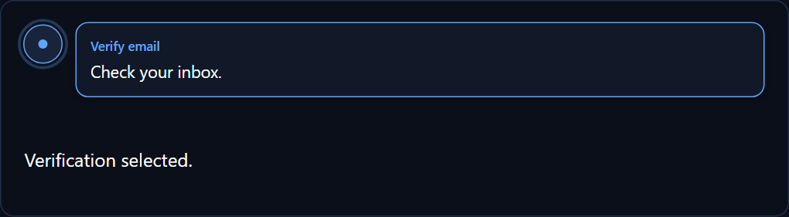
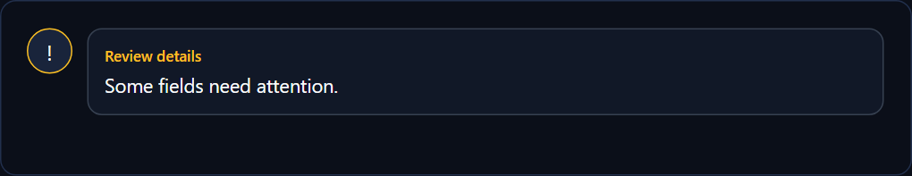

# q-step-diagram-item

`q-step-diagram-item` renders a focusable step with a decorative badge, connector, title, and body.

**Component tag:** `<q-step-diagram-item>`

**Working preview:** Run `bun start` from the repository root, open the [existing playground](http://localhost:3333), then select **Indicators → Step Diagram**.

**On this page**

- [Quick start](#quick-start)
- [Examples](#examples)
- [Behavior & accessibility](#behavior--accessibility)
- [Styling](#styling)
- [API reference](#api-reference)

## Quick start

1. Follow the central [installation instructions](../../README.md#1-install-library).
2. In your application entry file, register WebQuark. This assumes a bundler that resolves package imports and CSS imports.

```javascript
import '@webquark/core/dist/webquark/webquark.css';
import { defineCustomElements } from '@webquark/core/loader';
defineCustomElements();
```

3. Add this markup to your application page. Any module script runs after that shared setup.

```html
<q-step-diagram-item status="active" line-style="none"><span slot="title">Verify email</span>Check your inbox.</q-step-diagram-item>
```

**Result:** an active step with a title, body, and pulsing badge.

### At a glance

| Capability | Options | Default |
| :--- | :--- | :--- |
| [Status](#statuses) | pending, active, completed, success, warning, danger | completed |
| [Connector](#connectors) | solid, dashed, dotted, none | solid |
| [Layout](#layouts) | vertical or horizontal; parent can overwrite | vertical |
| [Content](#slots) | Badge, title, body | Dot badge; empty text |
| [Activation](#events) | qItemClick on click, Enter or Space | All statuses activate |

**With no properties:** An empty focusable step with a completed badge and connector renders. Supply title/body content to name the button; default status is completed, not pending.

## Examples

These examples share the [Quick start registration](#quick-start). Screenshots show the real registered component in a temporary preview fixture using the existing playground runtime. They do not imply extra permanent playground presets.

### Handle an available step

Listen for activation and decide whether the application should navigate.



```html
<q-step-diagram-item id="verify" status="active" line-style="none"><span slot="title">Verify email</span>Check your inbox.</q-step-diagram-item>
<p id="selected-step" role="status">Select Verify email.</p>
<script type="module">
const item = document.querySelector('#verify');
item.addEventListener('qItemClick', () => {
  if (item.status === 'pending') return;
  document.querySelector('#selected-step').textContent = 'Verification selected.';
});
</script>
```

The screenshot follows selecting Verify email. The still captures a running pulse; pending status does not suppress qItemClick.

### Replace a decorative badge

Supply a short badge while keeping the step name in its title.



```html
<q-step-diagram-item status="warning" line-style="none"><span slot="badge">!</span><span slot="title">Review details</span>Some fields need attention.</q-step-diagram-item>
```

The badge is hidden from assistive technology; status meaning must be available in text.

## Behavior & accessibility

### State and interaction

The application owns status changes and navigation. A q-step-diagram parent supplies its effective `orientation` after loading, on parent orientation or legacy layout changes, and on slot changes. It synchronizes both the child's `orientation` and deprecated `layout` alias. The item does not determine whether it is first/last; use line-style="none" to remove a trailing connector.

All statuses emit qItemClick, including pending. Preventing the custom event does not undo any component action, and the component never navigates on its own.

### Keyboard and focus

| Key | Action |
| :--- | :--- |
| Tab / Shift+Tab | Focus the content button; each item is a separate tab stop. |
| Enter / Space | Emit qItemClick; prevent default scrolling and stop the originating key event. |

### Labels and announcements

The content has role="button" and tabindex="0"; its name comes from title/body content. Active status sets aria-current="step"; pending sets aria-disabled="true" but remains focusable and activatable. Badge content is aria-hidden. No live region or listitem role is generated. Avoid nested interactive elements in the title/body button region.

### Limitations and compatibility

Pending is a visual/ARIA state, not enforced disablement. There is no noninteractive mode or arrow-key navigation. The active badge pulse and hover transitions continue under reduced motion; no component media-query override exists.

## Styling

### Layouts

`vertical` (default) places the badge beside the content; `horizontal` places it above. Unknown values match neither orientation rule.

### Statuses

| status | Visible effect |
| :--- | :--- |
| `completed` (default), `success` | Success badge and connector |
| `active` | Primary pulsing badge |
| `pending` | Muted outlined badge |
| `warning` | Warning accent |
| `danger` | Danger accent |

Unknown statuses retain base colors and no active/pending ARIA state.

### Connectors

`solid` (default), `dashed`, and `dotted` select line appearance; `none` removes the connector. Unknown values retain the base solid line.

### Custom styling

Scope CSS to the host or supplied content. See the exact [CSS variables](#css-variables) and [Shadow Parts](#shadow-parts).

```html
<q-step-diagram-item class="review-step" line-style="none"><span slot="title">Review</span>Confirm the details.</q-step-diagram-item>
<style>
  q-step-diagram-item.review-step { --q-step-diag-icon-size: 40px; }
  q-step-diagram-item.review-step::part(content) { border-radius: 12px; }
</style>
```

Shared geometry and theme setup are documented in [Foundation](../foundation.md) and [theme tokens](../theme-tokens.md).

## API reference

For new code, use `orientation`. The deprecated aliases remain supported. Canonical properties take precedence when set; otherwise the legacy property and its default apply. Set a canonical JavaScript property to `undefined` to restore the fallback.

Cross-check the [generated API](../../src/components/indicators/step-diagram-item/readme.md) and [implementation](../../src/components/indicators/step-diagram-item/step-diagram-item.tsx). Source nullability and actual rendering limitations are preserved below.

### Properties

All properties are optional and listed alphabetically.

| Name | Default | Description |
| :--- | :--- | :--- |
| `layout` | `'vertical'` | Deprecated alias for `orientation`. vertical or horizontal; mutable because the parent synchronizes it.<br>**Type:** `"horizontal" \| "vertical"`. **HTML attribute:** `layout`. **Required:** No. |
| `lineStyle` | `'solid'` | solid, dashed, dotted, or none. Attribute is line-style.<br>**Type:** `"dashed" \| "dotted" \| "none" \| "solid"`. **HTML attribute:** `line-style`. **Required:** No. |
| `orientation` | `undefined` | vertical or horizontal; mutable because the parent synchronizes it.<br>**Type:** `"horizontal" \| "vertical"`. **HTML attribute:** `orientation`. **Required:** No. |
| `status` | `'completed'` | pending, active, completed, success, warning, or danger; pending still emits activation.<br>**Type:** `"active" \| "completed" \| "danger" \| "pending" \| "success" \| "warning"`. **HTML attribute:** `status`. **Required:** No. |

### Slots

| Name | Description |
| :--- | :--- |
| (default) | Step body; no fallback. Contributes to the button name. |
| badge | Decorative badge content; defaults to a dot. |
| title | Step title; no fallback. Supply a meaningful label. |

### Events

| Name | When it fires | Payload |
| :--- | :--- | :--- |
| `qItemClick` | Content click, Enter, or Space in every status. | `CustomEvent<void>` |

These events bubble, cross shadow boundaries (composed), and are cancelable. The implementation does not check preventDefault(); cancellation does not stop the documented state changes.

### Methods

This component exposes no public methods.

### Styling hooks

#### CSS variables

Defaults include the shared theme when set there; nested `var()` expressions show CSS fallbacks. Shared palette/typography tokens and fallback aliases are listed in the [shared variable reference](../theme_variables.md). Internal `--_q-*` variables are not public hooks.

| Name | Default | Controls |
| :--- | :--- | :--- |
| `--q-step-diag-border` | `var(--q-border)` | border. |
| `--q-step-diag-icon-size` | `32px` | icon size. |
| `--q-step-diag-item-gap` | `24px` | item gap. |
| `--q-step-diag-line` | `2px solid var(--q-border-color)` | line. |

#### Shadow Parts

| Name | Targets |
| :--- | :--- |
| `badge` | Decorative badge node. |
| `body` | Body slot wrapper. |
| `connector` | Connector node; display:none for line-style none. |
| `content` | Focusable button surface. |
| `title` | Title slot wrapper. |
