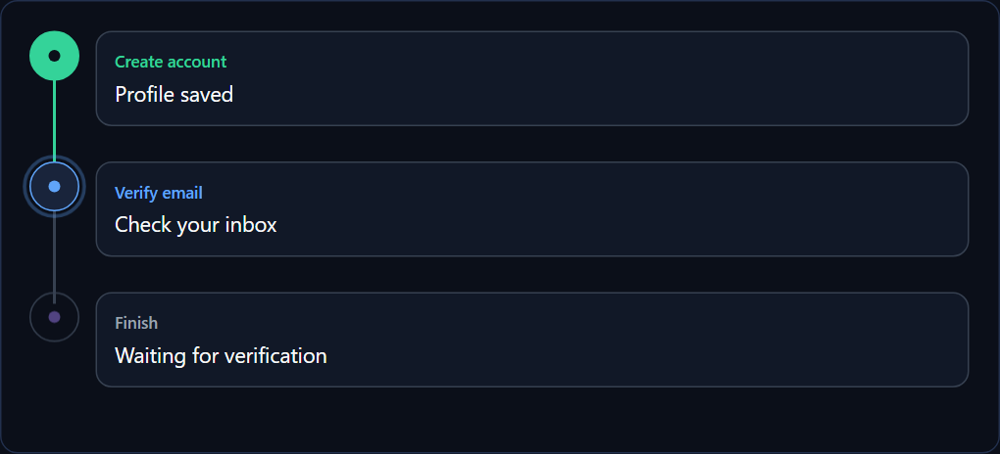
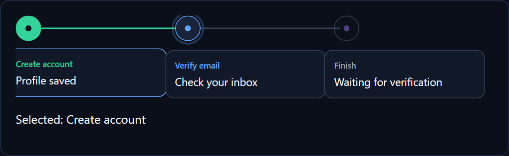

# q-step-diagram

`q-step-diagram` arranges interactive step items into a vertical or horizontal sequence.

**Component tag:** `<q-step-diagram>`

**Working preview:** Run `bun start` from the repository root, open the [existing playground](http://localhost:3333), then select **Indicators → Step Diagram**.

**On this page**

- [Quick start](#quick-start)
- [Examples](#examples)
- [Behavior & accessibility](#behavior--accessibility)
- [Styling](#styling)
- [API reference](#api-reference)

## Quick start

1. Follow the central [installation instructions](../../README.md#1-install-library).
2. In your application entry file, register WebQuark. This assumes a bundler that resolves package imports and CSS imports.

```javascript
import '@webquark/browser/dist/webquark/webquark.css';
import { defineCustomElements } from '@webquark/browser/loader';
defineCustomElements();
```

3. Add this markup to your application page. Any module script runs after that shared setup.

```html
<q-step-diagram aria-label="Account setup">
  <q-step-diagram-item status="completed"><span slot="title">Create account</span>Profile saved</q-step-diagram-item>
  <q-step-diagram-item status="active"><span slot="title">Verify email</span>Check your inbox</q-step-diagram-item>
  <q-step-diagram-item status="pending" line-style="none"><span slot="title">Finish</span>Waiting for verification</q-step-diagram-item>
</q-step-diagram>
```

**Result:** a vertical three-step account setup sequence.

### At a glance

| Capability | Options | Default |
| :--- | :--- | :--- |
| [Layout](#layouts) | vertical, horizontal | vertical |
| [Items](#slots) | q-step-diagram-item children | None |
| [Accessible name](#labels-and-announcements) | aria-label | Steps |
| [State ownership](#state-and-interaction) | Application owns statuses and activation | Child layout synchronized |

**With no properties:** An empty list named “Steps” renders with no steps. Supply q-step-diagram-item children; the parent does not create them or track completion.

## Examples

These examples share the [Quick start registration](#quick-start). Screenshots show the real registered component in a temporary preview fixture using the existing playground runtime. They do not imply extra permanent playground presets.

### Present a setup sequence

Supply explicit statuses and remove the connector after the final item.



```html
<q-step-diagram aria-label="Account setup">
  <q-step-diagram-item status="completed"><span slot="title">Create account</span>Profile saved</q-step-diagram-item>
  <q-step-diagram-item status="active"><span slot="title">Verify email</span>Check your inbox</q-step-diagram-item>
  <q-step-diagram-item status="pending" line-style="none"><span slot="title">Finish</span>Waiting for verification</q-step-diagram-item>
</q-step-diagram>
```

Active-step pulsing is captured as a still image. The parent does not advance steps or hide the last connector automatically.

### Respond to a selected step

Listen to the child event and ignore pending steps in application logic.



```html
<q-step-diagram id="setup" orientation="horizontal" aria-label="Account setup">
  <q-step-diagram-item status="completed"><span slot="title">Create account</span>Profile saved</q-step-diagram-item>
  <q-step-diagram-item status="active"><span slot="title">Verify email</span>Check your inbox</q-step-diagram-item>
  <q-step-diagram-item status="pending" line-style="none"><span slot="title">Finish</span>Waiting for verification</q-step-diagram-item>
</q-step-diagram>
<p id="step-result" role="status">Select an available step.</p>
<script type="module">
document.querySelector('#setup').addEventListener('qItemClick', (event) => {
  const item = event.target;
  if (item.status === 'pending') return;
  document.querySelector('#step-result').textContent = 'Selected: ' + item.querySelector('[slot=title]').textContent;
});
</script>
```

The screenshot follows Create account. qItemClick belongs to the child, not this parent; pending children still emit it.

## Behavior & accessibility

### State and interaction

After load, whenever orientation changes, and when the slot changes, the parent writes its orientation to matching slotted q-step-diagram-item children. Assign child statuses separately. For predictable propagation use direct children; changes inside a nested wrapper do not necessarily trigger the parent slotchange.

There is no current-step property, completion calculation, built-in navigation, or connector trimming. Set `line-style="none"` on the last child when no trailing line is wanted.

### Keyboard and focus

The parent adds no keyboard handlers. Its [step items](./q-step-diagram-item.md#keyboard-and-focus) each provide a tab stop and Enter/Space activation; there is no roving focus or arrow-key navigation.

### Labels and announcements

The internal container has `role="list"` with aria-label defaulting to “Steps”. Empty or null labels have no generated fallback. The current children expose buttons rather than listitem roles, so this is not a complete semantic list hierarchy. Status and task meaning should also appear in visible item content.

### Limitations and compatibility

This is a presentational sequence, not a router or form wizard. Horizontal layout scrolls on overflow; the component does not switch orientation responsively. Child active pulses have no built-in reduced-motion override.

## Styling

### Layouts

| orientation | Result |
| :--- | :--- |
| `vertical` (default) | Column of steps |
| `horizontal` | Row with horizontal overflow scrolling |

Use supported values: an unknown layout leaves the flex default row and is propagated unchanged to children, whose orientation rules then do not match.

### Custom styling

Scope CSS to the host or supplied content. See the exact [CSS variables](#css-variables) and [Shadow Parts](#shadow-parts).

```html
<q-step-diagram class="compact-steps" aria-label="Account setup">
  <q-step-diagram-item status="completed"><span slot="title">Create account</span>Profile saved</q-step-diagram-item>
  <q-step-diagram-item status="active"><span slot="title">Verify email</span>Check your inbox</q-step-diagram-item>
  <q-step-diagram-item status="pending" line-style="none"><span slot="title">Finish</span>Waiting for verification</q-step-diagram-item>
</q-step-diagram>
<style>
  q-step-diagram.compact-steps { --q-step-diag-item-gap: 12px; }
</style>
```

The parent declares no component-specific CSS variables or Shadow Parts. The example customizes an inherited [child spacing hook](./q-step-diagram-item.md#css-variables).

Shared geometry and theme setup are documented in [Foundation](../foundation.md) and [theme tokens](../theme-tokens.md).

## API reference

For new code, use `orientation`. The deprecated aliases remain supported. Canonical properties take precedence when set; otherwise the legacy property and its default apply. Set a canonical JavaScript property to `undefined` to restore the fallback.

Cross-check the [generated API](../../src/browser/components/indicators/step-diagram/readme.md) and [implementation](../../src/browser/components/indicators/step-diagram/step-diagram.tsx). Source nullability and actual rendering limitations are preserved below.

### Properties

All properties are optional and listed alphabetically.

| Name | Default | Description |
| :--- | :--- | :--- |
| `ariaLabel` | `'Steps'` | Accessible list name. Default Steps; empty/null values do not fall back.<br>**Type:** `string \| null`. **HTML attribute:** `aria-label`. **Required:** No. |
| `layout` | `'vertical'` | Deprecated alias for `orientation`. vertical or horizontal; synchronized into child layout properties.<br>**Type:** `"horizontal" \| "vertical"`. **HTML attribute:** `layout`. **Required:** No. |
| `orientation` | `undefined` | vertical or horizontal; synchronized into child orientation properties.<br>**Type:** `"horizontal" \| "vertical"`. **HTML attribute:** `orientation`. **Required:** No. |

### Slots

| Name | Description |
| :--- | :--- |
| (default) | q-step-diagram-item children; no fallback. Use direct children for predictable layout synchronization. |

### Events

This component emits no public events.

### Methods

This component exposes no public methods.

### Styling hooks

#### CSS variables

This component declares no component-specific CSS variables. Shared inherited values are documented in the [shared variable reference](../theme_variables.md).

#### Shadow Parts

This component exposes no Shadow Parts.
