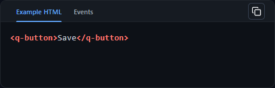
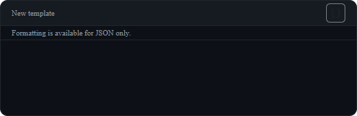
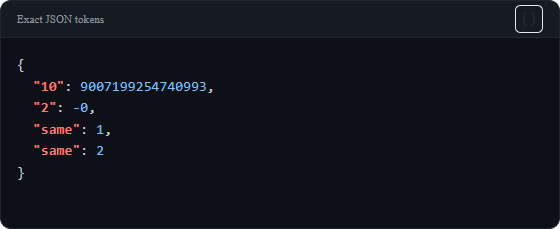
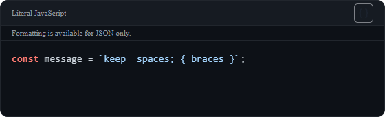
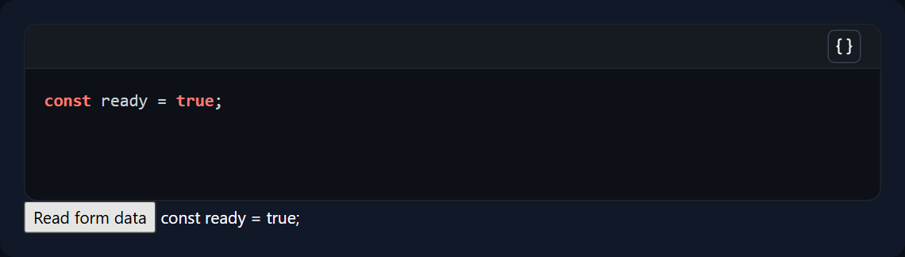
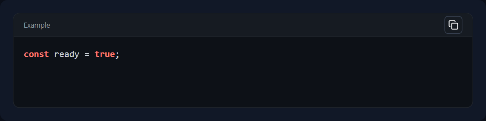

# q-syntax-box

`q-syntax-box` displays highlighted code and optionally provides an editable, form-associated code field.

**Component tag:** `<q-syntax-box>`

**Working preview:** Run `bun start` from the repository root and open the [WebQuark playground](http://localhost:3333). Select **Data display → Syntax Box**. The examples below supply their own code and handlers; playground presets are demo values.

**On this page**

- [Quick start](#quick-start)
- [Examples](#examples)
- [Behavior & accessibility](#behavior--accessibility)
- [Styling](#styling)
- [API reference](#api-reference)

## Quick start

Follow the central [installation instructions](../../README.md#1-install-library). In a bundled application that resolves package imports and CSS imports, add this to the JavaScript entry file:

```javascript
import '@webquark/browser/dist/webquark/webquark.css';
import { defineCustomElements } from '@webquark/browser/loader';
defineCustomElements();
```

Place the following markup in the application HTML. Scripts shown below are module scripts and assume the registration above.

```html
<q-syntax-box heading="Settings" language="json" code='{"enabled":true}'></q-syntax-box>
```

**Result:** a dark panel titled “Settings” with highlighted JSON in a 110 px code body.

### At a glance

| Capability | Options | Default |
| :--- | :--- | :--- |
| [Presentation](#variants) | Panel with header, or plain body | `panel` |
| [Language](#languages) | HTML, JavaScript, CSS, JSON | `html` |
| [Content](#state-and-interaction) | `code`, mirrored `value`, fallback slot | No code |
| [Editing](#keyboard-and-focus) | Read-only, editable, disabled; format/copy actions | Read-only; copy off |
| [Forms](#forms) | Named editable value, required validation, reset | No name; optional |

**Bare tag:** renders an empty panel with a 110 px body and no heading or actions. Add `code` or default-slot content. Add `editable` to render an empty editor even when neither `code` nor `value` is supplied.

## Examples

Registration from [Quick start](#quick-start) is required. Screenshots show actual registered components with the production theme.

### Display a code sample

Present read-only JSON with a title and fixed code-body height.


```html
<q-syntax-box heading="Settings" language="json" code='{"enabled":true}'></q-syntax-box>
```

The panel defaults to a 110 px code body; `height` controls the body, not the entire panel.

### Switch between views

Place a `q-syntax-view` inside the box for each piece of content. The box shows one tab per view as soon as there are at least two. A single view uses the full box without a tab bar. For a simple code sample, continue setting `code` directly on the box.



```html
<q-syntax-box heading="Example output">
  <q-syntax-view heading="Example HTML" view-key="html" code="&lt;q-button&gt;Save&lt;/q-button&gt;" copyable></q-syntax-view>

  <q-syntax-view heading="Events" view-key="events">
    <q-stack role="log" aria-label="Example events" gap="xs">
      <div>Save clicked</div>
    </q-stack>
  </q-syntax-view>
</q-syntax-box>
```

The example opens on **Example HTML** with the Copy action. Switching to **Events** displays the log. Put a custom action such as Clear in the owning view's `actions` slot. Use `heading` for the visible tab label and `name` only when submitting an editable view as a form field.

To add another view to an existing snippet, leave the original content on the parent and append one child. A heading alone names the container. A parent with its own snippet or editor supplies the first tab.

```html
<q-syntax-box heading="HTML" code="&lt;main&gt;&lt;/main&gt;" copyable>
  <q-syntax-view heading="CSS" language="css" code="main { margin: auto; }" copyable></q-syntax-view>
</q-syntax-box>
```

### Track code edits

Listen for input while the component owns its editable text.


```html
<q-syntax-box id="editor" heading="Settings" language="json" code='{"enabled":true}' editable aria-label="Settings JSON"></q-syntax-box>
<p id="edit-status" role="status">No edits yet</p>
```

```html
<script type="module">
await customElements.whenDefined('q-syntax-box');
const editor = document.querySelector('#editor');
editor.addEventListener('qInput', () => {
  document.querySelector('#edit-status').textContent = 'Unsaved changes';
});
</script>
```

Replace the editor text with `{"enabled": false}` to reach the screenshot. `qInput` fires while typing; `qChange` fires on native commit or formatting. Code is displayed literally, including raw markup and entity-looking text. Initialization and updates retain the supplied spacing.

### Start with an empty required editor

An editor needs no seed value. Required validation rejects its empty value until the user supplies text.



```html
<form>
  <q-syntax-box heading="New template" language="html" name="template" editable required aria-label="Template source"></q-syntax-box>
</form>
```

The textarea is present immediately; its initial `code` and `value` are empty strings. Native form reset returns it to that empty, invalid value.

### Format JSON while retaining exact tokens

Click the explicit Format action to lay out strict JSON without changing its token spelling or member structure.



```html
<q-syntax-box heading="Exact JSON tokens" language="json" code='{"10":9007199254740993,"2":-0,"same":1,"same":2}' editable height="190px" aria-label="Exact JSON source"></q-syntax-box>
```

Click **Format JSON** to reach the screenshot. The repeated `same` members and their order remain intact. When the editor belongs to a native form, form reset restores the exact initial unformatted source.

### Keep other languages literal

HTML, JavaScript and CSS remain editable while Format is visibly unavailable.



```html
<q-syntax-box heading="Literal JavaScript" language="javascript" code="const message = `keep  spaces; { braces }`;" editable aria-label="Literal JavaScript source"></q-syntax-box>
```

Comments, templates, attribute/text spacing and CSS string content retain their supplied text. Native editing still updates the string value; formatting adds no regex rewrites.

### Submit editable code in a form

Name an editable control to include its code in native form data.



```html
<form id="code-form">
  <q-syntax-box name="template" language="javascript" code="const ready = true;" editable required aria-label="Template code"></q-syntax-box>
  <button type="submit">Read form data</button>
  <output id="submitted-code"></output>
</form>
```

```html
<script type="module">
document.querySelector('#code-form').addEventListener('submit', event => {
  event.preventDefault();
  document.querySelector('#submitted-code').textContent = new FormData(event.currentTarget).get('template');
});
</script>
```

Click **Read form data** to reach the screenshot. Read-only mode does not contribute a form value; native reset restores the initial code.

### Copy a read-only sample

Enable the panel copy action when readers need the source text.



```html
<q-syntax-box heading="Example" language="javascript" code="const ready = true;" copyable></q-syntax-box>
```

The screenshot shows the initial action. Clicking it uses the browser Clipboard API; success/failure feedback lasts 1.5 seconds. Clipboard access depends on browser permissions and a secure context.

## Behavior & accessibility

### State and interaction

Use `code` as the primary content property; `value` is a compatibility/form alias. If only one is supplied initially, it is copied to the other. If both differ, avoid relying on reconciliation: read-only initialization retains each supplied value; rendering uses `code`.

Initialization, property updates, focus/blur and reset preserve the supplied source without automatic formatting. Editable initialization uses `code` when both aliases are supplied, then mirrors it to `value`. Subsequent writes to either alias mirror the exact supplied text to the other; missing editable content becomes an empty string. User input and the explicit Format action also update both properties.

Unedited stored values, copy and reset preserve whitespace, comments, Unicode and CRLF/CR line endings exactly. Native textarea presentation uses LF line endings; an actual textarea edit stores that LF value. Focusing or blurring without editing does not change the stored source.

| Content state | Rendered result |
| :--- | :--- |
| Read-only, `code === undefined` | Default slot |
| `code=""` | Empty code body, or empty textarea when editable |
| `editable=false` | Highlighted read-only code |
| `editable=true` | Textarea over highlighted code, initially empty when neither alias is supplied |
| `disabled=true` | Native textarea disabled and built-in copy/format actions blocked |

The Format action exists only in editable panel mode and supports strict JSON. HTML, JavaScript and CSS show a disabled Format button and a visible JSON-only message; their source remains unchanged. Copy exists only when `copyable` and panel mode are both active. The `actions` slot is also panel-only. Consumer-provided actions must implement their own disabled behavior.

### Keyboard and focus

| Key | Action |
| :--- | :--- |
| Left / Right, Home / End on a view tab | Select the previous, next, first or last view |
| Tab inside editor | Insert two spaces at the selection |
| Shift+Tab | Native backward focus navigation |
| Escape | Blur the editor |
| Other editing keys | Native textarea behavior |

The shadow root delegates focus. A hidden instruction describes Tab and Escape. There is no editor command palette or syntax completion.

### Labels and announcements

The editable textarea name uses trimmed `ariaLabel`, then trimmed `heading`, then the uppercased language plus “code editor.” Read-only output is code content, not an input.

The built-in icon buttons have accessible names for Copy and Format JSON. Copy feedback updates the originating button's name, icon and tooltip. Use the `actions` slot to add controls specific to a view.

### Forms

Native reset and q-form reset actions restore this field's initial value captured at first initialization. Later assignments, movement between forms and reconnecting preserve that default; reset is silent. q-form cancellation prevents restoration. Native form ownership takes precedence over a logical wrapper.

Explicit disabled state combines with disabled fieldsets and their first-legend exception without changing the public disabled property. Re-enabling restores the current controlled value and constraints. Direct property writes and public queries reconcile native state without requiring an animation frame. Readonly native text is distinct from disabling: it remains successful and programmatically assignable.

The q-form adapter includes only editable mode. Unnamed editable fields validate; named enabled editors collect their exact source string. Partial setValues writes are silent and keep code/value/form participation coherent. Display mode does not participate, and no consumer shadow roots are traversed.

Each editable child view is an independent field. Switching tabs preserves the field value, editor selection and form ownership. Supply `name` on each editor you want in the submitted data. A heading on the container does not create a field.

Only editable mode contributes a form value. Use `name` and `required` for native form submission and validation; unnamed fields do not produce named entries. `checkValidity()` and `reportValidity()` return promises.

Native form reset restores the initial code. Inherited disabling is mirrored into the internal textarea and guarded editor actions while preserving the public disabled property. The implementation does not expose custom validity setters or form-state restoration.

### Limitations and compatibility

Code properties are literal text. Raw tags and entity-looking strings such as `&lt;` appear as supplied; only generated highlighting spans become elements. The default read-only slot still projects consumer-owned content normally. Highlighting recognizes lightweight token patterns and does not validate a language.

Clipboard actions need a working browser Clipboard API. JSON Format changes only structural whitespace to two-space indentation and LF line endings. It retains original string escapes, numeric spelling (including large numbers and negative zero), duplicate member occurrences, member order and array order without converting tokens to JavaScript values. Highlighting remains lexical decoration, not a parser.

Only strict JSON grammar is supported; comments, trailing commas, malformed text and BOM-prefixed input remain unchanged with visible feedback. Formatting is bounded to 1,048,576 input UTF-16 units, 2,097,152 output units and 128 nested containers. Over-limit input remains exact with limit feedback. These checks run only on an explicit Format attempt and do not validate the field for form submission. No formatter dependency or asynchronous loader is required.

For nonempty JSON, an explicit Format attempt emits `qInput` then `qChange` once with the resulting source, including unchanged/error outcomes, preserving the existing action timing. Empty, disabled and unsupported-language actions emit neither event. Initialization, controlled updates, blur, native editing and reset never invoke formatting.

The code theme stays dark even in a light application theme. There is no component-specific reduced-motion override; nested controls retain their own motion behavior.

## Styling

### Variants

| Value | Effect |
| :--- | :--- |
| `panel` (default) | Header, optional actions, bordered code surface |
| `plain` | Code body for a single view, or a tab selector and the active body for multiple views |

An unrecognized variant renders the plain branch. Panel height defaults to 110 px; plain height defaults to `auto`. Explicit `height` takes precedence. An empty height disables the read-only scroll wrapper.

### Languages

| `language` | Highlighting / explicit formatting |
| :--- | :--- |
| `html` (default) | HTML markup / Format unavailable |
| `javascript` | JavaScript tokens / Format unavailable |
| `css` | CSS declarations / Format unavailable |
| `json` | JSON tokens / token-preserving JSON indentation |

Language changes select the helper used on subsequent rendering/formatting. Use the supported values.

### Custom styling

Code, editable text, and content in the default slot share the same monospace typography, line height, and large theme padding. For a list of events, use a named log region and an extra-small stack. The log uses medium padding vertically and large padding horizontally. Set `--q-syntax-padding` directly on the box to override either default.

```html
<q-syntax-box role="log" aria-label="Build events" heading="Events">
  <q-stack gap="xs">
    <div>Build started</div>
    <div>Build completed</div>
  </q-stack>
</q-syntax-box>
```

Set [CSS variables](#css-variables) on the host; there are no [Shadow Parts](#shadow-parts). The local dark-theme declarations override inherited syntax tokens, so apply component overrides directly.

```html
<q-syntax-box class="readable-code" language="javascript" code="const ready = true;"></q-syntax-box>
```

```css
q-syntax-box.readable-code {
  --q-syntax-code-font-size: 16px;
  --q-syntax-border: #526277;
}
```

The optional host class `variant-card-code` adjusts read-only code padding, border, background, and uses `--q-syntax-compact-font-size`. Shared theme setup is in [Theme variables](../theme_variables.md).

## API reference

See the [generated API](../../src/browser/components/data-display/syntax-box/readme.md) and [declared types](../../src/browser/components/data-display/syntax-box/syntax-box.types.ts).

### Properties

All properties are optional. Use JavaScript properties for structured values and callbacks; numeric HTML attributes are parsed by the component runtime. For booleans, use the bare attribute for true and remove it or assign the property `false` for false.

| Name | Default | Description |
| :--- | :--- | :--- |
| `ariaLabel` | `null` | Accessible name for the editor; falls back to `heading`, then the language.<br>**Type:** `string \| null`. **HTML attribute:** `aria-label`. **Required:** No. |
| `code` | `undefined` | Mirrored with `value`; prefer `code` for domain usage.<br>**Type:** `string`. **HTML attribute:** `code`. **Required:** No. |
| `copyable` | `false` | Shows the Copy action in panel mode only.<br>**Type:** `boolean`. **HTML attribute:** `copyable`. **Required:** No. |
| `disabled` | `false` | Disables editing and panel actions.<br>**Type:** `boolean`. **HTML attribute:** `disabled`. **Required:** No. |
| `editable` | `false` | Enables editing, including an initially empty textarea when code and value are absent.<br>**Type:** `boolean`. **HTML attribute:** `editable`. **Required:** No. |
| `heading` | `undefined` | Panel title in single-view mode. In a composed box it names the tab list or labels the view that supplies it.<br>**Type:** `string`. **HTML attribute:** `heading`. **Required:** No. |
| `height` | `undefined` | Explicit content height. Panel mode defaults to 110px; plain mode defaults to auto.<br>**Type:** `string`. **HTML attribute:** `height`. **Required:** No. |
| `language` | `'html'` | Accepted values: `html`, `javascript`, `css`, `json`.<br>**Type:** `QSyntaxBoxLanguage`. **HTML attribute:** `language`. **Required:** No. |
| `name` | `undefined` | Form field name used when the component is editable.<br>**Type:** `string`. **HTML attribute:** `name`. **Required:** No. |
| `required` | `false` | Marks the editable textarea as required for form validation.<br>**Type:** `boolean`. **HTML attribute:** `required`. **Required:** No. |
| `value` | `undefined` | Form-value alias mirrored with `code` for compatibility.<br>**Type:** `string`. **HTML attribute:** `value`. **Required:** No. |
| `variant` | `'panel'` | Accepted values: `panel` or `plain`; only panel includes header/actions.<br>**Type:** `QSyntaxBoxVariant`. **HTML attribute:** `variant`. **Required:** No. |

#### Public data types

These types describe property values and event payloads. Optional fields are marked with `?`; callbacks must be assigned in JavaScript.

**QSyntaxBoxVariant**: `'panel' | 'plain'`.

**QSyntaxBoxLanguage**: `'html' | 'javascript' | 'css' | 'json'`.

### Slots

| Name | Description |
| :--- | :--- |
| (default) | Direct `q-syntax-view` children declare views. Other content supplies the host's read-only fallback when `code` is undefined. |
| `actions` | Consumer-owned panel header controls; not rendered in plain mode |

### Events

| Name | When it fires | Payload |
| :--- | :--- | :--- |
| `qChange` | Native textarea change or a Format invocation with nonempty code (including unchanged or invalid JSON input) | `CustomEvent<string>` with current code |
| `qInput` | Typing, Tab insertion, or a Format invocation with nonempty code (including unchanged or invalid JSON input) | `CustomEvent<string>` with current code |

Both events bubble, are composed and cancelable. State is already updated; cancellation does not undo edits. Programmatic property changes do not emit these events.

### Methods

Call methods after registration and component readiness: `await customElements.whenDefined('q-syntax-box')`, then `await element.componentOnReady()` when using the lazy loader shown above.

| Signature | Purpose | Returns |
| :--- | :--- | :--- |
| `checkValidity()` | Synchronize and check editable native constraints | `Promise<boolean>` |
| `reportValidity()` | Synchronize and report native constraints | `Promise<boolean>` |
| `scrollToBottom()` | Scroll the read-only nested scroll wrapper; otherwise no-op | `Promise<void>` |

### Styling hooks

#### CSS variables

Defaults show local declarations, shared defaults where declared, or the component fallback expression. Shared tokens are defined in [Theme variables](../theme_variables.md). Set overrides directly on the host.

| Name | Default | Controls |
| :--- | :--- | :--- |
| `--q-syntax-attr` | `#79c0ff` | Attribute and applicable keyword highlight color. |
| `--q-syntax-bg` | `#0d1117` | Code panel and editor background. |
| `--q-syntax-border` | `#21262d` | Panel border color. |
| `--q-syntax-code-font-size` | `var(--q-font-size-base, 0.9rem)` | Read-only code and editor text size. |
| `--q-syntax-comment` | `#8b949e` | Comment highlight color. |
| `--q-syntax-compact-font-size` | `var(--q-font-size-sm, 0.7rem)` | Read-only text size with the variant-card-code host class. |
| `--q-syntax-font-mono` | `ui-monospace, SFMono-Regular, "SF Mono", Menlo, Consolas, "Liberation Mono", monospace` | Code and editor font family. |
| `--q-syntax-header-bg` | `#161b22` | Panel header background. |
| `--q-syntax-header-font-size` | `var(--q-font-size-sm, 0.7rem)` | Panel heading text size. |
| `--q-syntax-number` | `#f0883e` | Numeric token highlight color. |
| `--q-syntax-padding` | Large theme padding, or medium vertical and large horizontal padding for logs | Inner padding for displayed code, editable text, and slotted content. |
| `--q-syntax-tag` | `#ff7b72` | Tag and applicable keyword highlight color. |
| `--q-syntax-text` | `#c9d1d9` | Base code and editor text color. |
| `--q-syntax-value` | `#a5d6ff` | String and attribute value highlight color. |

#### Shadow Parts

This component exposes no public Shadow Parts.
