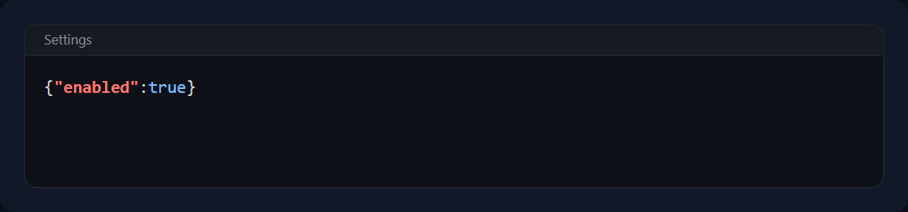
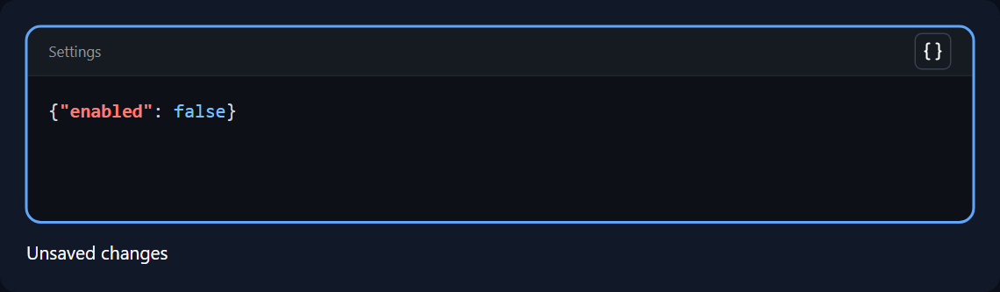

# q-syntax-box

`q-syntax-box` displays highlighted code and optionally provides an editable, form-associated code field.

**Component tag:** `<q-syntax-box>`

**Working preview:** Run `bun start` from the repository root and open the [WebQuark playground](http://localhost:3333). Select **Data display → Syntax Box**. The examples below supply their own code and handlers; playground presets are demo values.

**On this page**

- [Quick start](#quick-start)
- [Examples](#examples)
- [Behavior & accessibility](#behavior--accessibility)
- [Styling](#styling)
- [API reference](#api-reference)

## Quick start

Follow the central [installation instructions](../../README.md#1-install-library). In a bundled application that resolves package imports and CSS imports, add this to the JavaScript entry file:

```javascript
import '@webquark/core/dist/webquark/webquark.css';
import { defineCustomElements } from '@webquark/core/loader';
defineCustomElements();
```

Place the following markup in the application HTML. Scripts shown below are module scripts and assume the registration above.

```html
<q-syntax-box heading="Settings" language="json" code='{"enabled":true}'></q-syntax-box>
```

**Result:** a dark panel titled “Settings” with highlighted JSON in a 110 px code body.

### At a glance

| Capability | Options | Default |
| :--- | :--- | :--- |
| [Presentation](#variants) | Panel with header, or plain body | `panel` |
| [Language](#languages) | HTML, JavaScript, CSS, JSON | `html` |
| [Content](#state-and-interaction) | `code`, mirrored `value`, fallback slot | No code |
| [Editing](#keyboard-and-focus) | Read-only, editable, disabled; format/copy actions | Read-only; copy off |
| [Forms](#forms) | Named editable value, required validation, reset | No name; optional |

**Bare tag:** renders an empty panel with a 110 px body and no heading or actions. Add `code` or default-slot content. To render an empty editor, supply `code=""` as well as `editable`; `editable` alone still leaves the fallback slot.

## Examples

Registration from [Quick start](#quick-start) is required. Screenshots show the actual registered components in the existing playground runtime.

### Display a code sample

Present read-only JSON with a title and fixed code-body height.



```html
<q-syntax-box heading="Settings" language="json" code='{"enabled":true}'></q-syntax-box>
```

The panel defaults to a 110 px code body; `height` controls the body, not the entire panel.

### Track code edits

Listen for input while the component owns its editable text.



```html
<q-syntax-box id="editor" heading="Settings" language="json" code='{"enabled":true}' editable aria-label="Settings JSON"></q-syntax-box>
<p id="edit-status" role="status">No edits yet</p>
```

```html
<script type="module">
await customElements.whenDefined('q-syntax-box');
const editor = document.querySelector('#editor');
editor.addEventListener('qInput', () => {
  document.querySelector('#edit-status').textContent = 'Unsaved changes';
});
</script>
```

Replace the editor text with `{"enabled": false}` to reach the screenshot. `qInput` fires while typing; `qChange` fires on native commit or formatting. Supply trusted code; see the current escaping limitation.

### Submit editable code in a form

Name an editable control to include its code in native form data.


```html
<form id="code-form">
  <q-syntax-box name="template" language="javascript" code="const ready = true;" editable required aria-label="Template code"></q-syntax-box>
  <button type="submit">Read form data</button>
  <output id="submitted-code"></output>
</form>
```

```html
<script type="module">
document.querySelector('#code-form').addEventListener('submit', event => {
  event.preventDefault();
  document.querySelector('#submitted-code').textContent = new FormData(event.currentTarget).get('template');
});
</script>
```

Click **Read form data** to reach the screenshot. Read-only mode does not contribute a form value; native reset restores the initial code.

### Copy a read-only sample

Enable the panel copy action when readers need the source text.


```html
<q-syntax-box heading="Example" language="javascript" code="const ready = true;" copyable></q-syntax-box>
```

The screenshot shows the initial action. Clicking it uses the browser Clipboard API; success/failure feedback lasts 1.5 seconds. Clipboard access depends on browser permissions and a secure context.

## Behavior & accessibility

### State and interaction

Use `code` as the primary content property; `value` is a compatibility/form alias. If only one is supplied initially, it is copied to the other. If both differ, avoid relying on reconciliation: read-only initialization retains each supplied value; rendering uses `code`.

In editable mode, nonempty initial text and unfocused programmatic updates are formatted. While the textarea is focused, incoming updates preserve their supplied formatting. User input and the Format action update both properties internally.

| Content state | Rendered result |
| :--- | :--- |
| `code === undefined` | Default slot |
| `code=""` | Empty code body, or empty textarea when editable |
| `editable=false` | Highlighted read-only code |
| `editable=true` | Textarea over highlighted code |
| `disabled=true` | Native textarea disabled and built-in copy/format actions blocked |

The Format action exists only in editable panel mode; Copy exists only when `copyable` and panel mode are both active. The `actions` slot is also panel-only. Consumer-provided actions must implement their own disabled behavior.

### Keyboard and focus

| Key | Action |
| :--- | :--- |
| Tab inside editor | Insert two spaces at the selection |
| Shift+Tab | Native backward focus navigation |
| Escape | Blur the editor |
| Other editing keys | Native textarea behavior |

The shadow root delegates focus. A hidden instruction describes Tab and Escape. There is no editor command palette or syntax completion.

### Labels and announcements

The editable textarea name uses trimmed `ariaLabel`, then trimmed `heading`, then the uppercased language plus “code editor.” Read-only output is code content, not an input.

The built-in copy and format icon buttons currently lack explicit accessible names; tooltips do not reliably supply those names. For an editor with fully named actions, use `variant="plain"` and provide external, accessibly named controls with application-owned behavior. The panel `actions` slot adds controls but does not replace its built-in Format button. Copy feedback changes an icon/tooltip; no dedicated live region announces it.

### Forms

Only editable mode contributes a form value. Use `name` and `required` for native form submission and validation; unnamed fields do not produce named entries. `checkValidity()` and `reportValidity()` return promises.

Native form reset restores the initial code. The implementation does not expose custom validity setters or form-state restoration. It has no `formDisabledCallback` to mirror a disabled ancestor fieldset into the internal textarea; set the component's `disabled` property when its editor must be disabled.

### Limitations and compatibility

The highlighter inserts generated HTML and its escaping helper skips escaping when the input already contains certain HTML entities. Mixed encoded/raw markup is therefore not reliably escaped. Use trusted code; this component is not a sanitizer.

Clipboard actions need a working browser Clipboard API. Invalid JSON formatting is caught by the formatter and returns the original text. Formatting/highlighting are lightweight helpers, not language parsers or validators.

The code theme stays dark even in a light application theme. There is no component-specific reduced-motion override; nested controls retain their own motion behavior.

## Styling

### Variants

| Value | Effect |
| :--- | :--- |
| `panel` (default) | Header, optional actions, bordered code surface |
| `plain` | Code body only; heading/actions omitted |

An unrecognized variant renders the plain branch. Panel height defaults to 110 px; plain height defaults to `auto`. Explicit `height` takes precedence. An empty height disables the read-only scroll wrapper.

### Languages

| `language` | Highlighting and formatting |
| :--- | :--- |
| `html` (default) | HTML markup |
| `javascript` | JavaScript tokens |
| `css` | CSS declarations |
| `json` | JSON tokens and JSON indentation |

Language changes select the helper used on subsequent rendering/formatting. Use the supported values.

### Custom styling

Set [CSS variables](#css-variables) on the host; there are no [Shadow Parts](#shadow-parts). The local dark-theme declarations override inherited syntax tokens, so apply component overrides directly.

```html
<q-syntax-box class="readable-code" language="javascript" code="const ready = true;"></q-syntax-box>
```

```css
q-syntax-box.readable-code {
  --q-syntax-code-font-size: 16px;
  --q-syntax-border: #526277;
}
```

The optional host class `variant-card-code` adjusts read-only code padding, border, background, and uses `--q-syntax-compact-font-size`. Shared theme setup is in [Theme variables](../theme_variables.md).

## API reference

See the [generated API](../../src/components/data-display/syntax-box/readme.md) and [declared types](../../src/components/data-display/syntax-box/syntax-box.types.ts).

### Properties

All properties are optional. Use JavaScript properties for structured values and callbacks; numeric HTML attributes are parsed by the component runtime. For booleans, use the bare attribute for true and remove it or assign the property `false` for false.

| Name | Default | Description |
| :--- | :--- | :--- |
| `ariaLabel` | `null` | Accessible name for the editor; falls back to `heading`, then the language.<br>**Type:** `string \| null`. **HTML attribute:** `aria-label`. **Required:** No. |
| `code` | `undefined` | Mirrored with `value`; prefer `code` for domain usage.<br>**Type:** `string`. **HTML attribute:** `code`. **Required:** No. |
| `copyable` | `false` | Shows the Copy action in panel mode only.<br>**Type:** `boolean`. **HTML attribute:** `copyable`. **Required:** No. |
| `disabled` | `false` | Disables editing and panel actions.<br>**Type:** `boolean`. **HTML attribute:** `disabled`. **Required:** No. |
| `editable` | `false` | Enables editing when code is defined, including an empty string.<br>**Type:** `boolean`. **HTML attribute:** `editable`. **Required:** No. |
| `heading` | `undefined` | Shown only in the panel variant.<br>**Type:** `string`. **HTML attribute:** `heading`. **Required:** No. |
| `height` | `undefined` | Explicit content height. Panel mode defaults to 110px; plain mode defaults to auto.<br>**Type:** `string`. **HTML attribute:** `height`. **Required:** No. |
| `language` | `'html'` | Accepted values: `html`, `javascript`, `css`, `json`.<br>**Type:** `QSyntaxBoxLanguage`. **HTML attribute:** `language`. **Required:** No. |
| `name` | `undefined` | Form field name used when the component is editable.<br>**Type:** `string`. **HTML attribute:** `name`. **Required:** No. |
| `required` | `false` | Marks the editable textarea as required for form validation.<br>**Type:** `boolean`. **HTML attribute:** `required`. **Required:** No. |
| `value` | `undefined` | Form-value alias mirrored with `code` for compatibility.<br>**Type:** `string`. **HTML attribute:** `value`. **Required:** No. |
| `variant` | `'panel'` | Accepted values: `panel` or `plain`; only panel includes header/actions.<br>**Type:** `QSyntaxBoxVariant`. **HTML attribute:** `variant`. **Required:** No. |

#### Public data types

These types describe property values and event payloads. Optional fields are marked with `?`; callbacks must be assigned in JavaScript.

**QSyntaxBoxVariant**: `'panel' | 'plain'`.

**QSyntaxBoxLanguage**: `'html' | 'javascript' | 'css' | 'json'`.

### Slots

| Name | Description |
| :--- | :--- |
| (default) | Fallback content only while `code` is undefined; no built-in fallback text |
| `actions` | Consumer-owned panel header controls; not rendered in plain mode |

### Events

| Name | When it fires | Payload |
| :--- | :--- | :--- |
| `qChange` | Native textarea change or a Format invocation with nonempty code (including unchanged or invalid JSON input) | `CustomEvent<string>` with current code |
| `qInput` | Typing, Tab insertion, or a Format invocation with nonempty code (including unchanged or invalid JSON input) | `CustomEvent<string>` with current code |

Both events bubble, are composed and cancelable. State is already updated; cancellation does not undo edits. Programmatic property changes do not emit these events.

### Methods

Call methods after registration and component readiness: `await customElements.whenDefined('q-syntax-box')`, then `await element.componentOnReady()` when using the lazy loader shown above.

| Signature | Purpose | Returns |
| :--- | :--- | :--- |
| `checkValidity()` | Synchronize and check editable native constraints | `Promise<boolean>` |
| `reportValidity()` | Synchronize and report native constraints | `Promise<boolean>` |
| `scrollToBottom()` | Scroll the read-only nested scroll wrapper; otherwise no-op | `Promise<void>` |

### Styling hooks

#### CSS variables

Defaults show local declarations, shared defaults where declared, or the component fallback expression. Shared tokens are defined in [Theme variables](../theme_variables.md). Set overrides directly on the host.

| Name | Default | Controls |
| :--- | :--- | :--- |
| `--q-syntax-attr` | `#79c0ff` | Attribute and applicable keyword highlight color. |
| `--q-syntax-bg` | `#0d1117` | Code panel and editor background. |
| `--q-syntax-border` | `#21262d` | Panel border color. |
| `--q-syntax-code-font-size` | `var(--q-font-size-base, 0.9rem)` | Read-only code and editor text size. |
| `--q-syntax-comment` | `#8b949e` | Comment highlight color. |
| `--q-syntax-compact-font-size` | `var(--q-font-size-sm, 0.7rem)` | Read-only text size with the variant-card-code host class. |
| `--q-syntax-font-mono` | `ui-monospace, SFMono-Regular, "SF Mono", Menlo, Consolas, "Liberation Mono", monospace` | Code and editor font family. |
| `--q-syntax-header-bg` | `#161b22` | Panel header background. |
| `--q-syntax-header-font-size` | `var(--q-font-size-sm, 0.7rem)` | Panel heading text size. |
| `--q-syntax-number` | `#f0883e` | Numeric token highlight color. |
| `--q-syntax-tag` | `#ff7b72` | Tag and applicable keyword highlight color. |
| `--q-syntax-text` | `#c9d1d9` | Base code and editor text color. |
| `--q-syntax-value` | `#a5d6ff` | String and attribute value highlight color. |

#### Shadow Parts

This component exposes no public Shadow Parts.
