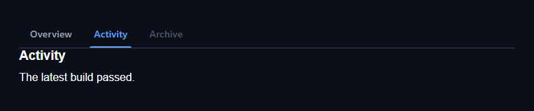
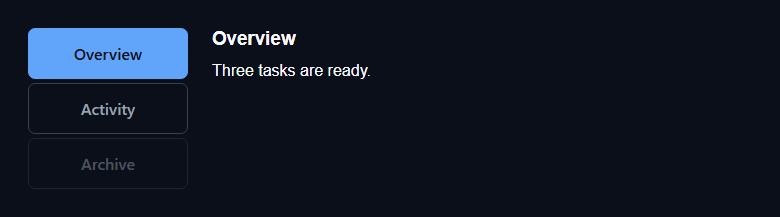

# q-tabs

`q-tabs` renders a keyboard-operable tab selector while the application owns its selected value and content panels.

**Component tag:** `<q-tabs>`

**Working preview:** There is no permanent q-tabs preset. Run `bun start`, open the [existing playground](http://localhost:3333), and use its browser console to insert the example markup into the page after registration. The examples below were executed as temporary fixtures in that runtime.

**On this page**

- [Quick start](#quick-start)
- [Examples](#examples)
- [Behavior & accessibility](#behavior--accessibility)
- [Styling](#styling)
- [API reference](#api-reference)

## Quick start

1. Follow the central [installation instructions](../../README.md#1-install-library).
2. Add registration to your application entry file (`main.js`). This requires a bundler that resolves package imports and CSS imports.

```javascript
import '@webquark/browser/dist/webquark/webquark.css';
import { defineCustomElements } from '@webquark/browser/loader';

defineCustomElements();
```

3. Add this markup to the application page after setup.

```html
<q-tabs id="project-tabs" aria-label="Project information" value="overview"></q-tabs>
<section id="overview-panel" role="tabpanel" aria-label="Overview" tabindex="0">
  <h3>Overview</h3><p>Three tasks are ready.</p>
</section>
<section id="activity-panel" role="tabpanel" aria-label="Activity" tabindex="0" hidden>
  <h3>Activity</h3><p>The latest build passed.</p>
</section>
<script type="module">
  await customElements.whenDefined('q-tabs');
  const tabs = document.querySelector('#project-tabs');
  tabs.items = [
    { label: 'Overview', value: 'overview', panelId: 'overview-panel' },
    { label: 'Activity', value: 'activity', panelId: 'activity-panel' },
    { label: 'Archive', value: 'archive', disabled: true }
  ];
  tabs.addEventListener('qChange', event => {
    tabs.value = event.detail;
    document.querySelector('#overview-panel').hidden = event.detail !== 'overview';
    document.querySelector('#activity-panel').hidden = event.detail !== 'activity';
  });
</script>
```

**Result:** Overview is selected with its panel visible; clicking Activity updates both through the application handler.

### At a glance

| Capability | Options | Default |
| :--- | :--- | :--- |
| [Appearance](#variants) | underline, enclosed, pills, button | underline |
| [Size](#sizes) | sm, md, lg | md |
| [Orientation](#state-and-interaction) | horizontal or vertical | horizontal |
| [Selection](#state-and-interaction) | Controlled value, disabled items | First enabled fallback |
| [Content](#tabiteminput-and-tabitem) | Strings or item objects; icons and panel IDs | No items |
| [Width](#sizes) | Natural or stretch, with max-width cap | 94px cap |

**With no properties:** `<q-tabs></q-tabs>` renders an empty labelled tablist with an underline border, no buttons or panel content. items is needed for useful tabs; your application supplies panels and a change handler.

## Examples

These examples share the registration above. Place each complete snippet in the application page; scripts use module syntax. Screenshots show the real component in the playground runtime with the shared dark theme.

### Switch between application panels

Tabs switch the visible project panel through an application handler.



```html
<q-tabs id="project-tabs" aria-label="Project information" value="overview"></q-tabs>
<section id="overview-panel" role="tabpanel" aria-label="Overview" tabindex="0">
  <h3>Overview</h3><p>Three tasks are ready.</p>
</section>
<section id="activity-panel" role="tabpanel" aria-label="Activity" tabindex="0" hidden>
  <h3>Activity</h3><p>The latest build passed.</p>
</section>
<script type="module">
  await customElements.whenDefined('q-tabs');
  const tabs = document.querySelector('#project-tabs');
  tabs.items = [
    { label: 'Overview', value: 'overview', panelId: 'overview-panel' },
    { label: 'Activity', value: 'activity', panelId: 'activity-panel' },
    { label: 'Archive', value: 'archive', disabled: true }
  ];
  tabs.addEventListener('qChange', event => {
    tabs.value = event.detail;
    document.querySelector('#overview-panel').hidden = event.detail !== 'overview';
    document.querySelector('#activity-panel').hidden = event.detail !== 'activity';
  });
</script>
```

Click Activity for the screenshot. Panels are outside the shadow root, so this example supplies explicit aria-label names; cross-root aria-controls string references alone are not proof of an assistive-technology relationship.

### Arrange a vertical tab selector

A vertical button-style selector sits beside the current content panel.



```html
<div style="display:grid;grid-template-columns:160px minmax(0,1fr);gap:24px">
<q-tabs orientation="vertical" variant="button" size="lg" style="--q-tabs-tab-max-width:160px" id="project-tabs" aria-label="Project information" value="overview"></q-tabs>
<div>
<section id="overview-panel" role="tabpanel" aria-label="Overview" tabindex="0">
  <h3>Overview</h3><p>Three tasks are ready.</p>
</section>
<section id="activity-panel" role="tabpanel" aria-label="Activity" tabindex="0" hidden>
  <h3>Activity</h3><p>The latest build passed.</p>
</section>
</div></div>
<script type="module">
  await customElements.whenDefined('q-tabs');
  const tabs = document.querySelector('#project-tabs');
  tabs.items = [
    { label: 'Overview', value: 'overview', panelId: 'overview-panel' },
    { label: 'Activity', value: 'activity', panelId: 'activity-panel' },
    { label: 'Archive', value: 'archive', disabled: true }
  ];
  tabs.addEventListener('qChange', event => {
    tabs.value = event.detail;
    document.querySelector('#overview-panel').hidden = event.detail !== 'overview';
    document.querySelector('#activity-panel').hidden = event.detail !== 'activity';
  });
</script>
```

This example keeps the same selection handler. Up/Down replace Left/Right for keyboard navigation.

## Behavior & accessibility

### State and interaction

Selection is controlled: clicks/keyboard emit qChange without changing value. The application must set value and show the matching panel. If value is absent, unmatched, or disabled, the first enabled tab is displayed as selected without rewriting value or emitting an initialization event. If every item is disabled or items is empty, none is selected. Activating an item already equal to value emits nothing.

String items become trimmed label/value pairs. Object label/value must be nonblank strings and are trimmed into new records. Invalid records are dropped. Malformed JSON logs and gives no items; valid JSON of a non-array shape is unsupported and can throw. Replace arrays after changes. Use stable unique tabId or value identities to preserve buttons and generated IDs across reorder; duplicates warn and get fallback identities.

### Keyboard and focus

The selected enabled tab is the single tab stop. Left/Right (horizontal) or Up/Down (vertical) move focus, wrap, skip disabled tabs, and request selection. Home/End move to first/last enabled tab. Enter/Space use native button activation. Focus movement does not wait for the application to update value.

### Labels and announcements

The tablist name is trimmed aria-label or “Sections”; orientation is exposed. Each button has role=tab, aria-selected, a title from its label, and optional aria-controls from panelId. Icon-only tabs get aria-label=label and a decorative icon. No tab panels or live regions are rendered. Explicit tabId sets an ID inside the shadow root; external panels need their own accessible labels because ID relationships across shadow boundaries cannot be assumed to work. DOM/ARIA checks do not establish screen-reader support.

### Forms

Tab buttons use type=button. This is not a form value control.

### Limitations and compatibility

Unknown size/variant values match no corresponding preset styling. Unknown orientation values make the keyboard handler use vertical keys but do not match the vertical CSS selector; use supported values. The horizontal list scrolls with its scrollbar hidden. No explicit scroll-into-view is performed during arrow navigation.

Tabs add no CSS transitions or animations and have no component-specific reduced-motion override.

## Styling

Select variant, size, orientation, and optional stretching.

### Variants

| variant | Visible effect |
| :--- | :--- |
| `underline` (default) | Selected line attached to the list edge. |
| `enclosed` | Outlined tabs connected visually to the panel edge. |
| `pills` | Separate fully rounded items. |
| `button` | Separate standard-radius buttons. |

### Sizes

| size | Minimum height | Padding |
| :--- | :--- | :--- |
| `sm` | 34px | 6px 10px |
| `md` (default) | 42px | 9px 16px |
| `lg` | 50px | 14px 18px |

Text defaults use theme small/base/large fonts. Buttons are capped at 94px and truncate long labels. Stretch distributes remaining space but does not remove that cap. Icon-only widths follow the size’s height unless overridden and do not stretch. Vertical tabs also retain the max-width cap.

### Custom styling

```html
<q-tabs class="wide-tabs" items='["Project overview","Release activity"]' variant="pills"></q-tabs>
<style>
  q-tabs.wide-tabs { --q-tabs-tab-max-width: 180px; --q-tabs-pills-radius: 12px; }
</style>
```

Per-size height/padding/font hooks precede their general fallback aliases. See [CSS variables](#css-variables), [Shadow Parts](#shadow-parts), and [theme setup](../theme_variables.md).

## API reference

See the [Stencil-generated API](../../src/browser/components/layout/tabs/readme.md) and [component source](../../src/browser/components/layout/tabs/tabs.tsx). The tables below include source-level types and effective rendering constraints.

### Properties

All properties are optional and are listed alphabetically. Boolean attributes use Stencil boolean parsing: a present empty attribute enables the property, `="false"` disables it; JavaScript properties accept `true`/`false`. Removing a boolean attribute makes it false, including properties initially declared true. For updates, set the desired JavaScript property explicitly instead of relying on attribute removal to restore initializer defaults.

| Name | Default | Description |
| :--- | :--- | :--- |
| `ariaLabel` | `'Sections'` | Tablist name; blank/null resolves to Sections.<br>**Type:** `string \| null`. **HTML attribute:** `aria-label`. **Required:** No. |
| `items` | `[]` | Array or JSON-array string; supplies tab records.<br>**Type:** `TabItemInput[] \| string`. **HTML attribute:** `items`. **Required:** No. |
| `orientation` | `'horizontal'` | Horizontal or vertical layout and matching arrow-key behavior.<br>**Type:** `'horizontal' \| 'vertical'`. **HTML attribute:** `orientation`. **Required:** No. |
| `size` | `'md'` | Tab dimensions/font preset, independent of control-size inheritance.<br>**Type:** `'sm' \| 'md' \| 'lg'`. **HTML attribute:** `size`. **Required:** No. |
| `stretch` | `false` | Allow non-icon-only tabs to grow, subject to max-width.<br>**Type:** `boolean`. **HTML attribute:** `stretch`. **Required:** No. |
| `value` | `''` | Application-owned selected value; unmatched uses first enabled visually without mutation.<br>**Type:** `string`. **HTML attribute:** `value`. **Required:** No. |
| `variant` | `'underline'` | Visual tab style.<br>**Type:** `'underline' \| 'enclosed' \| 'pills' \| 'button'`. **HTML attribute:** `variant`. **Required:** No. |

#### TabItemInput and TabItem

Strings use the same trimmed text for label and value. Objects support:

| Field | Type and meaning |
| :--- | :--- |
| label | Required nonblank string; visible label, title, and icon-only name. |
| value | Required nonblank string; emitted selection and default identity. |
| icon | Optional string; lucide q-icon name. See [q-icon](./q-icon.md) for icon loading. |
| iconOnly | Optional boolean; hides text only when icon exists. |
| disabled | Optional boolean; removes activation and keyboard targeting. |
| tabId | Optional string; trimmed explicit shadow button ID and preferred identity. |
| panelId | Optional string; copied to aria-controls; does not create, hide, or name any panel. |

### Slots

This component exposes no public slots.

### Events

Events are `CustomEvent`s with `bubbles: true`, `composed: true`, and `cancelable: true`. The component does not check cancellation; preventDefault on the custom event does not veto its behavior.

| Name | When it fires | Payload |
| :--- | :--- | :--- |
| `qChange` | Enabled item activation when its value differs from the supplied value. | `CustomEvent<string>`; normalized selected value. |

### Methods

This component exposes no public methods.

### Styling hooks

Component hooks below show their CSS fallback expressions. Shared-token defaults come from the active theme; see the [generated theme-token reference](../theme-tokens.md) for palette and typography values. More specific component hooks take precedence over those shared fallbacks. For setup, see [Theme variables](../theme_variables.md).

#### CSS variables

| Name | Default | Controls |
| :--- | :--- | :--- |
| `--q-bg-base` | Active theme; see [theme tokens](../theme-tokens.md) | Fallback selected text/icon color for pills and button variants. |
| `--q-bg-surface-1` | Active theme; see [theme tokens](../theme-tokens.md) | Fallback selected background for enclosed tabs, including the edge that visually joins the panel. |
| `--q-bg-surface-2` | Active theme; see [theme tokens](../theme-tokens.md) | Fallback hover background for enclosed, pills, and button variants. |
| `--q-border-color` | Active theme; see [theme tokens](../theme-tokens.md) | Fallback color for the list edge and tab borders, unless a more specific hook is set. |
| `--q-color-primary` | Active theme; see [theme tokens](../theme-tokens.md) | Fallback accent for selected text, the underline indicator, selected borders, and pills/button selected backgrounds. |
| `--q-fg-base` | Active theme; see [theme tokens](../theme-tokens.md) | Fallback text/icon color when an enabled, unselected tab is hovered. |
| `--q-fg-muted` | Active theme; see [theme tokens](../theme-tokens.md) | Fallback text/icon color for unselected tabs. |
| `--q-focus-ring` | Active theme; see [theme tokens](../theme-tokens.md) | Outline around a keyboard-focused tab; drawn 3px inside its border. |
| `--q-font-family` | Active theme; see [theme tokens](../theme-tokens.md) | Font family inherited by all tab labels. |
| `--q-font-size-base` | Active theme; see [theme tokens](../theme-tokens.md) | Fallback medium-tab text size when tab-specific font-size hooks are unset. |
| `--q-font-size-lg` | Active theme; see [theme tokens](../theme-tokens.md) | Fallback large-tab text size when tab-specific font-size hooks are unset. |
| `--q-font-size-sm` | Active theme; see [theme tokens](../theme-tokens.md) | Fallback small-tab text size when tab-specific font-size hooks are unset. |
| `--q-font-weight-bold` | Active theme; see [theme tokens](../theme-tokens.md) | Fallback label weight when `--q-tabs-font-weight` is unset. |
| `--q-radius-md` | Active theme; see [theme tokens](../theme-tokens.md) | Fallback corners for underline, enclosed, and button variants; variant-specific radius hooks take precedence. |
| `--q-tabs-active-fg` | `var(--q-color-primary, #60a5fa)` | Selected text/icon color for underline and enclosed variants; also colors the selected underline indicator. |
| `--q-tabs-border` | `1px solid var(--q-border-color, #374151)` | Bottom list border for horizontal underline/enclosed tabs, or right list border for vertical tabs. |
| `--q-tabs-button-active-bg` | `var(--q-color-primary, #60a5fa)` | Background of the selected button-style tab. |
| `--q-tabs-button-active-border` | `var(--q-color-primary, #60a5fa)` | Border color of the selected button-style tab. |
| `--q-tabs-button-active-fg` | `var(--q-bg-base, #111827)` | Text/icon color of the selected button-style tab. |
| `--q-tabs-button-bg` | `transparent` | Background of unselected button-style tabs before hover. |
| `--q-tabs-button-border` | `1px solid var(--q-border-color, #374151)` | Base button-style tab border width, style, and color; hover/selection replace its color. |
| `--q-tabs-button-gap` | `4px` | Spacing between button-style tabs; horizontal or vertical according to orientation. |
| `--q-tabs-button-hover-bg` | `var(--q-bg-surface-2, #374151)` | Background of an enabled, unselected button-style tab on hover. |
| `--q-tabs-button-hover-border` | `var(--q-color-primary, #60a5fa)` | Border color of an enabled, unselected button-style tab on hover. |
| `--q-tabs-button-radius` | `var(--q-radius-md, 7px)` | Corner radius of each button-style tab. |
| `--q-tabs-enclosed-active-bg` | `var(--q-bg-surface-1, #1f2937)` | Selected enclosed-tab background and the border edge joining the panel: bottom when horizontal, right when vertical. |
| `--q-tabs-enclosed-active-border` | `var(--q-color-primary, #60a5fa)` | Selected enclosed-tab border color, except the edge joining the panel, which uses the selected background. |
| `--q-tabs-enclosed-hover-bg` | `var(--q-bg-surface-2, #374151)` | Background of an enabled, unselected enclosed tab on hover. |
| `--q-tabs-enclosed-hover-border` | `var(--q-border-color, #374151)` | Border color of an enabled, unselected enclosed tab on hover. |
| `--q-tabs-enclosed-radius` | `var(--q-radius-md, 7px) var(--q-radius-md, 7px) 0 0` | Corners of horizontal enclosed tabs; vertical tabs use `--q-tabs-enclosed-radius-vertical` instead. |
| `--q-tabs-enclosed-radius-vertical` | `var(--q-radius-md, 7px) 0 0 var(--q-radius-md, 7px)` | Corners of vertical enclosed tabs, rounded on the side away from the panel by default. |
| `--q-tabs-enclosed-tab-border` | `1px solid transparent` | Base enclosed-tab border width, style, and color; hover/selection replace its color. |
| `--q-tabs-fg` | `var(--q-fg-muted, #9ca3af)` | Base text/icon color for unselected tabs; hover and selection apply their own colors. |
| `--q-tabs-font-size` | `sm: var(--q-font-size-sm, 0.7rem); md: var(--q-font-size-base, 0.9rem) (default); lg: var(--q-font-size-lg, 1rem)` | Fallback font size only when matching per-size font-size hook is unset. |
| `--q-tabs-font-size-lg` | `var(--q-tabs-font-size, var(--q-font-size-lg, 1rem))` | Text size for large tabs; takes precedence over `--q-tabs-font-size`. |
| `--q-tabs-font-size-md` | `var(--q-tabs-font-size, var(--q-font-size-base, 0.9rem))` | Text size for medium tabs; takes precedence over `--q-tabs-font-size`. |
| `--q-tabs-font-size-sm` | `var(--q-tabs-font-size, var(--q-font-size-sm, 0.7rem))` | Text size for small tabs; takes precedence over `--q-tabs-font-size`. |
| `--q-tabs-font-weight` | `var(--q-font-weight-bold, 600)` | Label weight for every tab, including selected tabs. |
| `--q-tabs-height` | `sm: 34px; md: 42px (default); lg: 50px` | Fallback minimum height only when the matching per-size height hook is unset. |
| `--q-tabs-height-lg` | `var(--q-tabs-height, 50px)` | Minimum height for large tabs; also the fallback width of large icon-only tabs. |
| `--q-tabs-height-md` | `var(--q-tabs-height, 42px)` | Minimum height for medium tabs; also the fallback width of medium icon-only tabs. |
| `--q-tabs-height-sm` | `var(--q-tabs-height, 34px)` | Minimum height for small tabs; also the fallback width of small icon-only tabs. |
| `--q-tabs-hover-bg` | `color-mix(in srgb, currentColor 6%, transparent)` | Background of an enabled, unselected underline tab on hover; other variants use their own hover-background hooks. |
| `--q-tabs-hover-fg` | `var(--q-fg-base, #f9fafb)` | Text/icon color of any enabled, unselected tab on hover. |
| `--q-tabs-icon-gap` | `6px` | Spacing between a tab icon and its label. |
| `--q-tabs-icon-only-width-lg` | `var(--q-tabs-height-lg, var(--q-tabs-height, 50px))` | Width of large icon-only tabs; independent of stretching and the text-tab maximum width. |
| `--q-tabs-icon-only-width-md` | `var(--q-tabs-height-md, var(--q-tabs-height, 42px))` | Width of medium icon-only tabs; independent of stretching and the text-tab maximum width. |
| `--q-tabs-icon-only-width-sm` | `var(--q-tabs-height-sm, var(--q-tabs-height, 34px))` | Width of small icon-only tabs; independent of stretching and the text-tab maximum width. |
| `--q-tabs-padding` | `sm: 6px 10px; md: 9px 16px (default); lg: 14px 18px` | Fallback padding only when matching per-size padding hook is unset. |
| `--q-tabs-padding-lg` | `var(--q-tabs-padding, 14px 18px)` | Inner padding for large tabs; icon-only tabs always remove horizontal padding. |
| `--q-tabs-padding-md` | `var(--q-tabs-padding, 9px 16px)` | Inner padding for medium tabs; icon-only tabs always remove horizontal padding. |
| `--q-tabs-padding-sm` | `var(--q-tabs-padding, 6px 10px)` | Inner padding for small tabs; icon-only tabs always remove horizontal padding. |
| `--q-tabs-pills-active-bg` | `var(--q-color-primary, #60a5fa)` | Background of the selected pill tab. |
| `--q-tabs-pills-active-border` | `var(--q-color-primary, #60a5fa)` | Border color of the selected pill tab. |
| `--q-tabs-pills-active-fg` | `var(--q-bg-base, #111827)` | Text/icon color of the selected pill tab. |
| `--q-tabs-pills-border` | `1px solid var(--q-border-color, #374151)` | Base pill tab border width, style, and color; hover/selection replace its color. |
| `--q-tabs-pills-gap` | `4px` | Spacing between pill tabs; horizontal or vertical according to orientation. |
| `--q-tabs-pills-hover-bg` | `var(--q-bg-surface-2, #374151)` | Background of an enabled, unselected pill tab on hover. |
| `--q-tabs-pills-hover-border` | `var(--q-color-primary, #60a5fa)` | Border color of an enabled, unselected pill tab on hover. |
| `--q-tabs-pills-radius` | `999px` | Corner radius of each pill tab. |
| `--q-tabs-tab-max-width` | `94px` | Maximum width for text tabs in all orientations; also limits stretch. Icon-only tabs use max-width:none. |
| `--q-tabs-underline-radius` | `var(--q-radius-md, 7px) var(--q-radius-md, 7px) 0 0` | Tab corners in the underline variant; does not change the selected indicator’s rounded ends. |

#### Shadow Parts

| Name | Targets |
| :--- | :--- |
| `selected-tab` | The selected enabled button only; absent for empty/all-disabled items. |
| `tab` | Every item button, including disabled items. |
| `tablist` | Always-rendered scrolling tablist. |
