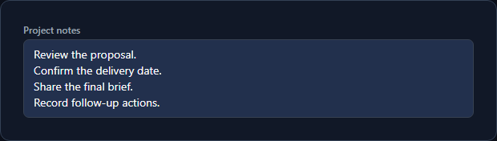
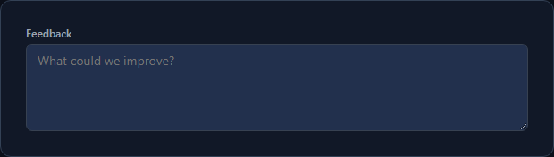
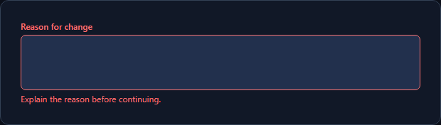

# q-textarea

`q-textarea` collects multiline text with automatic growth, optional manual resizing, and form validation.

**Component tag:** `<q-textarea>`

**Working preview:** Run `bun start` from the repository root, open the [existing playground](http://localhost:3333), then select **Forms & inputs → Textarea**. The examples below use this registered runtime with their own markup and data; playground presets are demonstrations, not component defaults.

**On this page**

- [Quick start](#quick-start)
- [Examples](#examples)
- [Behavior & accessibility](#behavior--accessibility)
- [Styling](#styling)
- [API reference](#api-reference)

## Quick start

1. Follow the central [installation instructions](../../README.md#1-install-library).
2. In your application entry file (for example `src/main.js`), register the elements and load the theme. This requires a bundler that resolves package imports and CSS imports.

```javascript
import "@webquark/core/dist/webquark/webquark.css";
import { defineCustomElements } from "@webquark/core/loader";

defineCustomElements();
```

3. Put the following markup in your application HTML.

```html
<q-textarea label="Project notes" name="notes"></q-textarea>
```

**Result:** A labelled three-row multiline field that grows with its content.

### At a glance

| Capability | Options | Default |
| :--- | :--- | :--- |
| [Resizing](#resizing) | auto, manual, fixed; autoGrow compatibility switch | auto; autoGrow true |
| [Size](#sizes) | inherit, sm, md, lg; rows; CSS width/height | inherit; 3 rows |
| [Text](#state-and-interaction) | value and placeholder | empty strings |
| [Validation](#forms) | required, disabled, error/errorMessage | optional; enabled |
| [Accessible name](#labels-and-announcements) | label, aria-label, placeholder fallback | none |
| [Field help](#labels-and-announcements) | description, labelHidden, reserveFeedback | no description; visible label; inherit reservation |

**With no properties:** An empty three-row textarea renders with auto growth enabled, but no name or label. Add a label and a submission name.

## Examples

Use the registration above first. Each HTML block belongs in the page body; its module script runs after the element is registered. CSS in a `<style>` block belongs in the page or your application stylesheet.

### Grow notes as someone types

Keep auto growth enabled for longer descriptions.



```html
<q-textarea id="growing-notes" label="Project notes" rows="2"></q-textarea>
<script type="module">
  await customElements.whenDefined("q-textarea");
  document.querySelector("#growing-notes").value =
    "Review the proposal.\nConfirm the delivery date.\nShare the final brief.\nRecord follow-up actions.";
</script>
```

The assigned value causes the same height recalculation used for input updates.

### Let people resize a longer response

Use manual mode when the person should choose the field's visible height.



```html
<q-textarea label="Feedback" resize-mode="manual" rows="4" placeholder="What could we improve?"></q-textarea>
```

### Reserve space for a validated response

Combine fixed resizing with an application-provided validation message.



```html
<q-textarea label="Reason for change" name="reason" required resize-mode="fixed" rows="3"
  error="Explain the reason before continuing."></q-textarea>
```

## Behavior & accessibility

### State and interaction

Typing updates mutable `value` and emits `qInput`; native change commits emit `qChange`. Application assignments update native text/form value and schedule height measurement, without emitting those custom events. Use the `value` property/attribute for initial text; unslotted child text is not consumed.

In auto mode, growth measures scrollHeight plus borders. `autoGrow=false` changes auto mode to fixed. Manual/fixed modes skip measurement and do not clear an inline height previously set by auto mode. `rows`, explicit size, resize mode and autoGrow updates schedule a measurement. ResizeObserver also tracks width and inherited text geometry; only auto mode recalculates height.

### Keyboard and focus

The native textarea supplies multiline editing, Enter for new lines, and normal Tab focus. `focusElement()` focuses it. Resizing by a pointer is available only in manual mode.

### Labels and announcements

The visible label is linked to the native textarea. Nonblank `aria-label` takes precedence; without label, the placeholder is a fallback accessible name. Prefer a persistent visible label. Nonempty error/errorMessage sets aria-invalid and connects the error text with aria-describedby.

`labelHidden` visually hides the supplied label while retaining it for accessibility. `description` supplies supporting text; active error text replaces it. The feedback span is always present with `aria-live="polite"`, and aria-describedby references it when description or error is truthy. That is the DOM announcement mechanism; a still image does not verify a screen reader's delivery.

Omitted `reserveFeedback` inherits the enclosing form's setting, falling back to collapsed empty feedback. `true` reserves 1rem; explicit `false` opts out. Longer feedback grows normally.

### Forms

Native reset and q-form reset actions restore this field's initial value captured at first initialization. Later assignments, movement between forms and reconnecting preserve that default; reset is silent. q-form cancellation prevents restoration. Native form ownership takes precedence over a logical wrapper.

Explicit disabled state combines with disabled fieldsets and their first-legend exception without changing the public disabled property. Re-enabling restores the current controlled value and constraints. Direct property writes and public queries reconcile native state without requiring an animation frame. Readonly native text is distinct from disabling: it remains successful and programmatically assignable.

Its q-form adapter validates unnamed fields and collects named successful values. Partial setValues writes are silent and immediately synchronize the textarea value; repeated scalar names use positional arrays. Reset uses its field-owned default and inherited disabling reaches the internal textarea.


The named string value participates through ElementInternals. Reset restores the first-load value. `required` and native validity are synchronized, and trimmed nonblank error/errorMessage supplies customError; error takes precedence. Disabled fields are exempt from validation/native submission. Empty error strings do not activate error styling; whitespace can activate styling without creating a customError.

### Limitations and compatibility

Use positive integer rows; the component passes values to the native textarea without sanitizing invalid or nonfinite counts. Auto height is based on actual layout, so call `adjustHeight()` after revealing a previously hidden field or changing layout. The method performs a measurement synchronously inside its asynchronous API; it does not wait for unrelated future layout changes. No component-specific reduced-motion override exists.

## Styling

Use resizeMode and rows first. Width defaults to 100%; CSS variables provide surface customization.

### Sizes

`size="inherit"` is the declared default: it uses the nearest [q-form](./q-form.md) or [q-toolbar](./q-toolbar.md) scope, with `md` geometry when no scope exists. Explicit `sm`, `md`, or `lg` overrides that scope. Changing a scope updates inherited dimensions without changing the child's size property.

| Effective size | Minimum control height | Text / line height | Horizontal padding | Radius |
| :--- | :--- | :--- | :--- | :--- |
| `sm` | 1.75rem (28px) | 0.75 / 1rem | 0.5rem | 0.34375rem |
| `md` | 2.25rem (36px) | 0.875 / 1.25rem | 0.75rem | 0.4375rem |
| `lg` | 2.75rem (44px) | 1 / 1.5rem | 1rem | 0.53125rem |

Pixel equivalents assume a 16px root font. Heights are minimums; content and overrides can grow them. See the shared [sizing foundation](../foundation.md#choose-size-once).

Textarea retains `rows` (default 3); height follows line metrics and content. Vertical padding defaults to `--q-space-sm` (0.5rem).

### Resizing

| resizeMode | Result |
| :--- | :--- |
| `auto` (default) | Measures text content when autoGrow is true |
| `manual` | Native vertical resize handle; no automatic measurements |
| `fixed` | No resize handle or automatic measurements |

With `resizeMode="auto" auto-grow="false"`, effective mode is fixed. Unknown modes skip measurement and do not enable the manual handle. Switching out of auto retains its last inline height.

### Custom styling

Use the [CSS variables](#css-variables) or [Shadow Parts](#shadow-parts) for supported customization. This matching markup and CSS can be used together:

```html
<q-textarea class="notes-field" label="Notes" resize-mode="fixed" rows="4"></q-textarea>
<style>
  q-textarea.notes-field { --q-input-radius: 12px; --q-input-padding: 14px 18px; }
</style>
```

Textarea uses `--q-input-*` surface hooks. Padding resolves `--q-input-padding` → `--q-field-padding` → shared spacing and control padding. Radius follows effective control size, not row count. Auto mode writes height inline; fixed/manual modes retain their current height. Use the textarea part for deliberate fixed styling.

Keep shared setup in [Theme variables](../theme_variables.md), [Theme tokens](../theme-tokens.md), and the [sizing, spacing and surface foundation](../foundation.md).

## API reference

For new code, use `error`. The deprecated aliases remain supported.

Cross-check the [generated API](../../src/components/inputs/textarea/readme.md), [implementation](../../src/components/inputs/textarea/textarea.tsx), and imported public types. The entries below preserve source defaults and runtime qualifications.

### Properties

All properties are optional in the TypeScript component contract. Required content/labels and conditional constraints are explained with each workflow. Properties are alphabetical.

| Name | Default | Description |
| :--- | :--- | :--- |
| `ariaLabel` | `null` | Accessible name for the native textarea when a visible label is not used.<br>**Type:** `string \| null`. **HTML attribute:** `aria-label`. **Required:** No. |
| `autoGrow` | `true` | Grows with content when `resizeMode` is `auto`.<br>**Type:** `boolean`. **HTML attribute:** `auto-grow`. **Required:** No. |
| `description` | `undefined` | Supporting text; replaced by active error feedback.<br>**Type:** `string`. **HTML attribute:** `description`. **Required:** No. |
| `disabled` | `false` | Prevents normal interaction.<br>**Type:** `boolean`. **HTML attribute:** `disabled`. **Required:** No. |
| `error` | `undefined` | Custom error text; takes precedence over errorMessage.<br>**Type:** `string`. **HTML attribute:** `error`. **Required:** No. |
| `errorMessage` | `undefined` | Deprecated alias for `error`. Fallback custom error text.<br>**Type:** `string`. **HTML attribute:** `error-message`. **Required:** No. |
| `label` | `undefined` | Visible field label.<br>**Type:** `string`. **HTML attribute:** `label`. **Required:** No. |
| `labelHidden` | `false` | Visually hides the supplied label without removing its accessible text.<br>**Type:** `boolean`. **HTML attribute:** `label-hidden`. **Required:** No. |
| `name` | `undefined` | Name used for form submission.<br>**Type:** `string`. **HTML attribute:** `name`. **Required:** No. |
| `placeholder` | `""` | Empty-state hint and accessible-name fallback only when no label/ariaLabel is supplied.<br>**Type:** `string`. **HTML attribute:** `placeholder`. **Required:** No. |
| `required` | `false` | Native required constraint; visible error text remains application-owned.<br>**Type:** `boolean`. **HTML attribute:** `required`. **Required:** No. |
| `reserveFeedback` | `undefined` | undefined inherits the form's reservation (otherwise 0px); true reserves 1rem; false explicitly collapses empty feedback.<br>**Type:** `boolean`. **HTML attribute:** `reserve-feedback`. **Required:** No. |
| `resizeMode` | `'auto'` | Resize behavior: auto grows to content, manual allows vertical drag, fixed locks the height.<br>**Type:** `'auto' \| 'manual' \| 'fixed'`. **HTML attribute:** `resize-mode`. **Required:** No. |
| `rows` | `3` | Native row count; use a positive integer. Auto-grow may exceed it.<br>**Type:** `number`. **HTML attribute:** `rows`. **Required:** No. |
| `size` | `'inherit'` | Supported visual size; see Sizes.<br>**Type:** `'inherit' \| 'sm' \| 'md' \| 'lg'`. **HTML attribute:** `size`. **Required:** No. |
| `value` | `""` | Mutable text string; application updates synchronize the field but emit no custom value event.<br>**Type:** `string`. **HTML attribute:** `value`. **Required:** No. |

Boolean attributes use Stencil coercion: presence/empty string is true, the literal string `"false"` is false, and removing the attribute supplies false rather than restoring a true or undefined initializer. Prefer explicit JavaScript `true`/`false` for updates; an optional Boolean can be reset to `undefined` through its property to recover inheritance/detection. String attributes remain strings; numeric attributes are parsed as numbers, so invalid text can become `NaN`. Setting a property to `undefined` or removing a string/number attribute does not rerun its initializer. Keep values within the documented types.

### Slots

This component exposes no public slots.

### Events

| Name | When it fires | Payload |
| :--- | :--- | :--- |
| `qBlur` | The interactive field/control loses focus. | `CustomEvent<FocusEvent>` |
| `qChange` | A user interaction updates or commits the value; see State and interaction. | `CustomEvent<string>` |
| `qClick` | Activation of the enabled interactive control; detail is the original MouseEvent. | `CustomEvent<MouseEvent>` |
| `qFocus` | The interactive field/control receives focus. | `CustomEvent<FocusEvent>` |
| `qInput` | User input updates the value. | `CustomEvent<string>` |

All listed Stencil events bubble, cross shadow boundaries (`composed: true`), and are cancelable. The component handlers do not use the emitted event's canceled result to roll back state or automatically cancel the underlying native event. For forwarded MouseEvent details, the original event is available as `event.detail`.

### Methods

With the loader used above, first `await customElements.whenDefined("q-textarea");` and `await element.componentOnReady();` before invoking methods. `componentOnReady()` is loader readiness, not an additional component-defined method. All listed methods return promises.

| Signature | Purpose | Returns |
| :--- | :--- | :--- |
| `adjustHeight(): Promise<void>` | Measures height only in effective auto mode; use after revealing the field or changing layout. | `void` |
| `checkValidity(): Promise<boolean>` | Synchronizes native/custom constraints and checks validity. | `boolean` |
| `focusElement(): Promise<void>` | Focuses the mounted textarea. | `void` |
| `reportValidity(): Promise<boolean>` | Synchronizes constraints and reports an invalid value. | `boolean` |

### Styling hooks

#### CSS variables

Defaults below show the local fallback chains; references to shared tokens depend on the active theme. Private `--_q-*` variables are implementation details and are not supported overrides. Component and functional shared hooks are listed; global palette/spacing/typography values are catalogued in [Theme tokens](../theme-tokens.md). See [Custom styling](#custom-styling) for effective precedence and exceptions.

| Name | Default | Controls |
| :--- | :--- | :--- |
| `--q-bg-field` | `var(--q-bg-surface-3, #22304d)` | Background. |
| `--q-context-control-font` | `var(--q-control-font-md, 0.875rem)` | Context control font. Inherited context; explicit component size/state may override it. |
| `--q-context-control-height` | `var(--q-control-height-md, 2.25rem)` | Context control height. Inherited context; explicit component size/state may override it. |
| `--q-context-control-icon` | `var(--q-control-icon-md, 1rem)` | Context control icon. Inherited context; explicit component size/state may override it. |
| `--q-context-control-line` | `var(--q-control-line-md, 1.25rem)` | Context control line. Inherited context; explicit component size/state may override it. |
| `--q-context-control-padding` | `var(--q-control-padding-md, 0.75rem)` | Context control padding. Inherited context; explicit component size/state may override it. |
| `--q-context-control-radius` | `var(--q-control-radius-md, 0.4375rem)` | Context control radius. Inherited context; explicit component size/state may override it. |
| `--q-context-feedback-min` | `0px` | Min-block-size, margin. Inherited context; explicit component size/state may override it. |
| `--q-control-font-lg` | `1rem` | Control font lg. Shared geometry for the named size. |
| `--q-control-font-md` | `0.875rem` | Control font md. Shared geometry for the named size. |
| `--q-control-font-sm` | `0.75rem` | Control font sm. Shared geometry for the named size. |
| `--q-control-height-lg` | `2.75rem` | Control height lg. Shared geometry for the named size. |
| `--q-control-height-md` | `2.25rem` | Control height md. Shared geometry for the named size. |
| `--q-control-height-sm` | `1.75rem` | Control height sm. Shared geometry for the named size. |
| `--q-control-icon-lg` | `1.25rem` | Control icon lg. Shared geometry for the named size. |
| `--q-control-icon-md` | `1rem` | Control icon md. Shared geometry for the named size. |
| `--q-control-icon-sm` | `0.875rem` | Control icon sm. Shared geometry for the named size. |
| `--q-control-line-lg` | `1.5rem` | Control line lg. Shared geometry for the named size. |
| `--q-control-line-md` | `1.25rem` | Control line md. Shared geometry for the named size. |
| `--q-control-line-sm` | `1rem` | Control line sm. Shared geometry for the named size. |
| `--q-control-padding-lg` | `1rem` | Control padding lg. Shared geometry for the named size. |
| `--q-control-padding-md` | `0.75rem` | Control padding md. Shared geometry for the named size. |
| `--q-control-padding-sm` | `0.5rem` | Control padding sm. Shared geometry for the named size. |
| `--q-control-radius-lg` | `0.53125rem` | Control radius lg. Shared geometry for the named size. |
| `--q-control-radius-md` | `0.4375rem` | Control radius md. Shared geometry for the named size. |
| `--q-control-radius-sm` | `0.34375rem` | Control radius sm. Shared geometry for the named size. |
| `--q-field-bg` | `var(--q-bg-field, var(--q-bg-surface-3, #22304d))` | Background. |
| `--q-field-border` | `var(--q-border)` | Fallback for --q-input-border. |
| `--q-field-feedback-font` | `.75rem` | Font-size. |
| `--q-field-label-font` | `.75rem` | Font-size. |
| `--q-field-padding` | `var(--q-space-sm, .5rem) var(--_q-control-padding)` | Padding. |
| `--q-field-radius` | `var(--_q-control-radius)` | Border-radius. |
| `--q-input-bg` | `var(--q-field-bg, var(--q-bg-field, var(--q-bg-surface-3, #22304d)))` | Background. |
| `--q-input-border` | `var(--q-field-border)` | Border. |
| `--q-input-padding` | `var(--q-field-padding, var(--q-space-sm, .5rem) var(--_q-control-padding))` | Padding. |
| `--q-input-radius` | `var(--q-field-radius, var(--_q-control-radius))` | Border-radius. |

#### Shadow Parts

| Name | Targets |
| :--- | :--- |
| `description` | Feedback span whenever there is no truthy error, including empty feedback. |
| `error-msg` | Additional name on feedback only while error/errorMessage is truthy. |
| `feedback` | Always-present polite live feedback span; shows error, otherwise description. |
| `label` | Visible label when label is truthy. |
| `textarea` | Native textarea; always present. |
