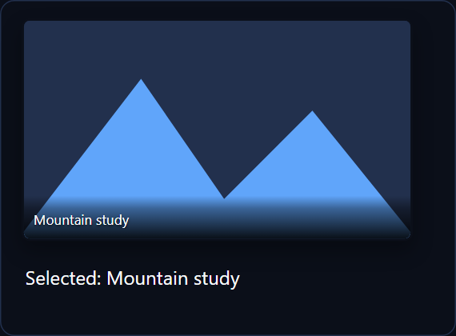
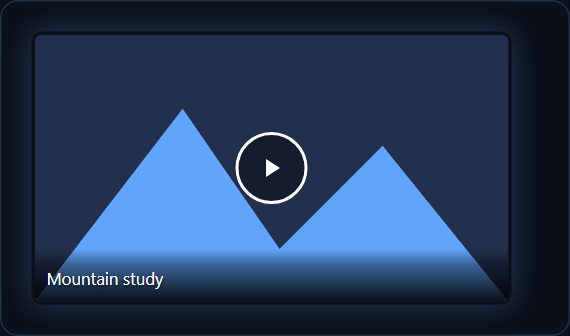

# q-thumbnail

`q-thumbnail` shows an interactive image preview that requests maximization through an event.

**Component tag:** `<q-thumbnail>`

**Working preview:** Run `bun start` at the repository root, open the [playground](http://localhost:3333) and select **Media → Thumbnail**. [Try thumbnails in the reel lightbox](./q-reel.md).

**On this page**

- [Quick start](#quick-start)
- [Examples](#examples)
- [Behavior & accessibility](#behavior--accessibility)
- [Styling](#styling)
- [API reference](#api-reference)

## Quick start

1. Follow the central [installation instructions](../../README.md#1-install-library).
2. In your application entry file, register WebQuark. This assumes a bundler that resolves package imports and CSS imports.

```javascript
import '@webquark/browser/dist/webquark/webquark.css';
import { defineCustomElements } from '@webquark/browser/loader';
defineCustomElements();
```

3. Add this markup to your application page. Any module script runs after that shared setup.

```html
<q-thumbnail src="data:image/svg+xml,%3Csvg xmlns='http://www.w3.org/2000/svg' width='320' height='180' viewBox='0 0 320 180'%3E%3Crect width='320' height='180' fill='%2322304d'/%3E%3Cpath d='M0 180L100 50L190 180M130 180L235 75L320 180' fill='%2360a5fa'/%3E%3C/svg%3E" label="Mountain study" alt="Blue geometric mountains" ></q-thumbnail>
```

**Result:** a labeled image preview with a keyboard-focusable button surface.

### At a glance

| Capability | Options | Default |
| :--- | :--- | :--- |
| [Media](#state-and-interaction) | Image preview; optional decorative video marker | Empty source; image |
| [Appearance](#states) | highlighted selection frame | Off |
| [Content](#slots) | Caption, alternate text, overlay slot | Empty |
| [Activation](#events) | Click, Enter, Space emit qMaximize | Application or q-reel handles it |

**With no properties:** A focusable media frame with an empty image source renders and is named “Media item”. Supply src plus meaningful alt/label; no viewer is built in.

## Examples

These examples share the [Quick start registration](#quick-start). Screenshots show the real registered component in a temporary preview fixture using the existing playground runtime.

### Handle a media selection

Read qMaximize to connect a thumbnail to application behavior.



```html
<q-thumbnail src="data:image/svg+xml,%3Csvg xmlns='http://www.w3.org/2000/svg' width='320' height='180' viewBox='0 0 320 180'%3E%3Crect width='320' height='180' fill='%2322304d'/%3E%3Cpath d='M0 180L100 50L190 180M130 180L235 75L320 180' fill='%2360a5fa'/%3E%3C/svg%3E" label="Mountain study" alt="Blue geometric mountains" id="preview"></q-thumbnail>
<p id="selection" role="status">Select the preview.</p>
<script type="module">
document.querySelector('#preview').addEventListener('qMaximize', (event) => {
  document.querySelector('#selection').textContent = 'Selected: ' + event.detail.label;
});
</script>
```

The screenshot follows selecting the thumbnail. The event requests a viewer; it does not open one by itself.

### Mark a highlighted video preview

Add a decorative play marker and highlight glow to an image poster.



```html
<q-thumbnail src="data:image/svg+xml,%3Csvg xmlns='http://www.w3.org/2000/svg' width='320' height='180' viewBox='0 0 320 180'%3E%3Crect width='320' height='180' fill='%2322304d'/%3E%3Cpath d='M0 180L100 50L190 180M130 180L235 75L320 180' fill='%2360a5fa'/%3E%3C/svg%3E" label="Mountain study" alt="Blue geometric mountains" video highlighted></q-thumbnail>
```

This example is a poster only. video still renders an img; q-reel interprets the same src as a video URL when opening a viewer. Do not use this SVG poster as a playable video source.

## Behavior & accessibility

### State and interaction

The component always renders an `img` with `loading="lazy"`; it has no loading state or error fallback. `video` adds a decorative play marker but does not load a video. `highlighted` changes the frame, not selection state or event handling. With the shared theme, the inherited --q-thumb-border shorthand keeps its root transparent border color even in highlighted/hover/focus states; the glow still changes. Set --q-thumb-border on the host to customize the full border.

Clicking the wrapper, or Enter/Space on it, stops the originating event from propagating and emits `qMaximize`. No disabled state exists. Set boolean properties to false or remove their attributes to turn them off. The application owns the viewer, or use [q-reel](./q-reel.md).

### Keyboard and focus

| Key | Action |
| :--- | :--- |
| Tab / Shift+Tab | Focus the internal button surface. |
| Enter / Space | Emit qMaximize; Space scrolling is prevented. |

### Labels and announcements

The internal wrapper has `role="button"` and `tabindex="0"`. Its name is label, otherwise alt, otherwise “Media item”; values are not trimmed. `alt` also goes on the image. The play indicator is decorative. Provide meaningful names and avoid putting interactive controls in the overlay slot, which sits inside the button surface.

### Limitations and compatibility

There is no public viewer method, native video playback, image-error event, or reduced-motion override. Hover/focus transforms and transitions remain active under reduced motion. A source suitable for an image poster may not be suitable for q-reel video playback.

## Styling

### States

| Control | Effect |
| :--- | :--- |
| `highlighted` | Highlight glow and requested primary border; default false |
| `video` | Centered play marker; default false |

The media frame defaults to 16:9 and the image is cropped with object-fit: cover. Set host width using ordinary CSS.

### Custom styling

Scope CSS to the host or supplied content. See the exact [CSS variables](#css-variables) and [Shadow Parts](#shadow-parts).

```html
<q-thumbnail src="data:image/svg+xml,%3Csvg xmlns='http://www.w3.org/2000/svg' width='320' height='180' viewBox='0 0 320 180'%3E%3Crect width='320' height='180' fill='%2322304d'/%3E%3Cpath d='M0 180L100 50L190 180M130 180L235 75L320 180' fill='%2360a5fa'/%3E%3C/svg%3E" label="Mountain study" alt="Blue geometric mountains" class="square-preview"></q-thumbnail>
<style>
  q-thumbnail.square-preview { width: 240px; --q-thumb-aspect-ratio: 1; --q-thumb-radius: 12px; }
</style>
```

The shared stylesheet assigns --q-thumb-hover-transform from --q-hover-transform (translateY(-4px) scale(1.02)). Override --q-thumb-hover-transform directly on the thumbnail for a local change; --q-hover-transform is the shared alias. --q-thumb-glow similarly uses shared --q-glow-interactive. See the shared variable reference for palette, motion, and geometry tokens.

Shared geometry and theme setup are documented in [Foundation](../foundation.md) and [theme tokens](../theme-tokens.md).

## API reference

Cross-check the [generated API](../../src/browser/components/media/thumbnail/readme.md) and [implementation](../../src/browser/components/media/thumbnail/thumbnail.tsx). Source nullability and actual rendering limitations are preserved below.

### Properties

All properties are optional and listed alphabetically.

| Name | Default | Description |
| :--- | :--- | :--- |
| `alt` | `''` | Native image alternate text and accessible button-name fallback.<br>**Type:** `string`. **HTML attribute:** `alt`. **Required:** No. |
| `highlighted` | `false` | Requests primary border and glow; the shared root border shorthand masks the border color. Does not manage selection.<br>**Type:** `boolean`. **HTML attribute:** `highlighted`. **Required:** No. |
| `label` | `undefined` | Visible caption and preferred accessible button name; falsy values omit caption.<br>**Type:** `string`. **HTML attribute:** `label`. **Required:** No. |
| `src` | `''` | Image URL. Also included unchanged in qMaximize detail.<br>**Type:** `string`. **HTML attribute:** `src`. **Required:** No. |
| `video` | `false` | Shows a decorative play marker; qMaximize includes video: true.<br>**Type:** `boolean`. **HTML attribute:** `video`. **Required:** No. |

### Slots

| Name | Description |
| :--- | :--- |
| (default) | Custom overlay content, no fallback. Keep it noninteractive and position it explicitly if needed. |

### Events

| Name | When it fires | Payload |
| :--- | :--- | :--- |
| `qMaximize` | Wrapper click or Enter/Space activation. | `CustomEvent<QThumbnailMaximizeDetail>` |

These events bubble, cross shadow boundaries (composed), and are cancelable. The implementation does not check preventDefault(); cancellation does not stop the documented state changes.

#### QThumbnailMaximizeDetail

| Field | Type / value |
| :--- | :--- |
| `src` | string; current src |
| `label` | string or undefined; current label |
| `video` | boolean; current video flag |
| `alt` | string; current alternate text |
| `triggerEl` | HTMLElement; the q-thumbnail host for the original trigger |

### Methods

This component exposes no public methods.

### Styling hooks

#### CSS variables

Defaults include the shared theme when set there; nested `var()` expressions show CSS fallbacks. Shared palette/typography tokens and fallback aliases are listed in the [shared variable reference](../theme_variables.md). Internal `--_q-*` variables are not public hooks.

| Name | Default | Controls |
| :--- | :--- | :--- |
| `--q-thumb-aspect-ratio` | `16 / 9` | aspect ratio. |
| `--q-thumb-border` | `2px solid var(--q-thumb-border-color)` | Full border shorthand; inherited global token can resolve against root border color before local hover/highlight changes. Override on the component to control the frame. |
| `--q-thumb-border-color` | `transparent` | Normal border color; hover/focus/highlight assign primary color on the wrapper, overriding inherited values. |
| `--q-thumb-glow` | `var(--q-glow-interactive)` | glow. |
| `--q-thumb-hover-transform` | `var(--q-hover-transform)` | hover transform. |
| `--q-thumb-overlay-bg` | `rgba(0, 0, 0, 0.4)` | overlay background. |
| `--q-thumb-radius` | `var(--q-radius-md)` | radius. |

#### Shadow Parts

This component exposes no Shadow Parts.
