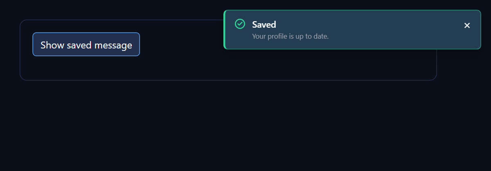
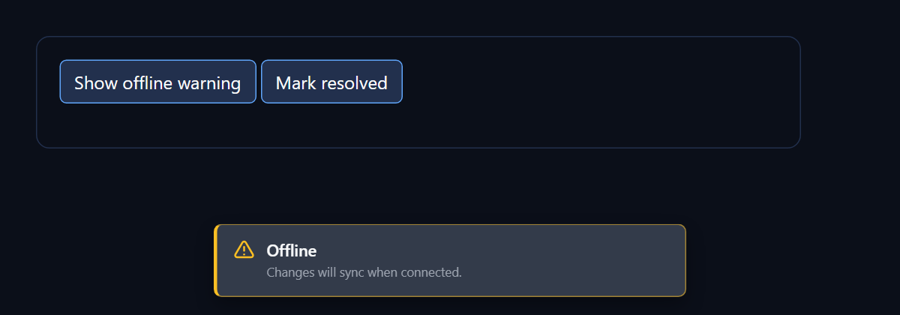

# q-toast

`q-toast` hosts application notifications with queued display, timed dismissal, and a shared polite live region.

**Component tag:** `<q-toast>`

**Working preview:** Run `bun start` from the repository root, open the [existing playground](http://localhost:3333), then select **Communication → Toast**.

**On this page**

- [Quick start](#quick-start)
- [Examples](#examples)
- [Behavior & accessibility](#behavior--accessibility)
- [Styling](#styling)
- [API reference](#api-reference)

## Quick start

1. Follow the central [installation instructions](../../README.md#1-install-library).
2. In your application entry file, register WebQuark. This assumes a bundler that resolves package imports and CSS imports.

```javascript
import '@webquark/browser/dist/webquark/webquark.css';
import { defineCustomElements } from '@webquark/browser/loader';
defineCustomElements();
```

3. Add this markup to your application page. Any module script runs after that shared setup.

```html
<q-toast id="notifications"></q-toast>
<button id="notify" type="button">Show notification</button>
<script type="module">
await customElements.whenDefined('q-toast');
const host = document.querySelector('#notifications');
document.querySelector('#notify').addEventListener('click', () => host.success('Saved', 'Your profile is up to date.'));
</script>
```

**Result:** a Show notification button; selecting it displays a success toast for five seconds.

### At a glance

| Capability | Options | Default |
| :--- | :--- | :--- |
| [Feedback](#variants) | info, success, warning, danger; error alias | No initial toast |
| [Position](#positions) | Six viewport positions | top-end |
| [Capacity](#state-and-interaction) | Visible stack and pending queue | 3 visible |
| [Lifetime](#state-and-interaction) | Timed, persistent, pause on hover/focus | 5s info/success; 8s warning; persistent danger |
| [API](#methods) | Component methods or exported toast controller | Client-only |

**With no properties:** One empty global host renders with an empty notification region and live region, but no visible toast. Calling a toast method creates content. Connect exactly one host.

## Examples

These examples share the [Quick start registration](#quick-start). Screenshots show the real registered component in a temporary preview fixture using the existing playground runtime. They do not imply extra permanent playground presets.

### Report a successful action

Show a notification after an application action finishes.



```html
<q-toast id="feedback"></q-toast>
<button id="show-success" type="button">Show saved message</button>
<script type="module">
await customElements.whenDefined('q-toast');
const host = document.querySelector('#feedback');
document.querySelector('#show-success').addEventListener('click', () => host.success('Saved', 'Your profile is up to date.'));
</script>
```

The screenshot follows Show saved message. It captures a visible toast, not its live-region announcement.

### Dismiss a persistent notification by ID

Keep a warning visible until the application explicitly resolves it.



```html
<q-toast id="persistent-feedback" position="bottom-center"></q-toast>
<button id="show-warning" type="button">Show offline warning</button>
<button id="resolve-warning" type="button">Mark resolved</button>
<script type="module">
await customElements.whenDefined('q-toast');
const host = document.querySelector('#persistent-feedback');
let notificationId;
document.querySelector('#show-warning').addEventListener('click', async () => {
  notificationId = await host.warning('Offline', 'Changes will sync when connected.', { duration: 0, dismissible: false });
});
document.querySelector('#resolve-warning').addEventListener('click', async () => {
  if (notificationId) await host.dismiss(notificationId);
});
</script>
```

The screenshot follows Show offline warning. Mark resolved removes it; duration:0 disables the timer and dismissible:false hides its close button.

## Behavior & accessibility

### State and interaction

Only one connected host receives controller requests. Additional hosts log an error and stay inactive; they are not automatically promoted when the active host disconnects. Component methods delegate to the shared controller.

maxVisible defaults to 3. Finite values truncate to an integer and clamp to at least 1; nonfinite values normalize to 3 without rewriting the property. Raising capacity promotes queued entries; lowering it does not evict already-visible entries. The pending queue allows 50 entries, and pre-host controller buffering separately allows 50; exceeding either throws RangeError.

Timers start when an item becomes visible. Hover, focus inside the toast, and a hidden document pause the remaining duration; all pause reasons must clear before it resumes. Dismissal animates removal before promoting queued items; reduced motion removes animation and schedules immediate microtask removal. Disconnect discards this host’s active/pending items and timers.

### Keyboard and focus

| Key | Action |
| :--- | :--- |
| Tab / Shift+Tab | Reach visible dismiss buttons in normal page order; no focus is stolen. |
| Enter / Space | Activate a focused dismiss button. |
| Escape | No built-in global dismissal. |

### Labels and announcements

Visible entries are q-alert elements with announcements disabled. One shared role="status", aria-live="polite", aria-atomic="true" region announces title and optional description for promoted items. The visible stack is a region named “Notifications”. No assertive channel or automatic focus movement is provided. A still screenshot cannot verify screen-reader output.

### Limitations and compatibility

Controller calls require document and throw outside a client runtime. Empty/whitespace titles throw TypeError. Duration must be finite and nonnegative or RangeError is thrown; zero means persistent. Descriptions are trimmed, and empty descriptions become undefined. Dismissing one toast does not cancel an already-queued announcement; clear() clears the announcement queue.

## Styling

### Variants

| Method / variant | Appearance and default lifetime |
| :--- | :--- |
| `info()` | Primary; 5000ms |
| `success()` | Success; 5000ms |
| `warning()` | Warning; 8000ms |
| `danger()` / `error()` | Danger; persistent (0ms) |

Variant is selected by the method, not a q-toast property.

### Positions

`top-start`, `top-center`, `top-end` (default), `bottom-start`, `bottom-center`, `bottom-end` place the stack at the corresponding viewport edge. Start/end follow writing direction. Unsupported values have no complete placement rule.

Width defaults to min(420px, viewport minus 32px); at 480px and below it becomes viewport minus 16px and the inset becomes 8px.

### Custom styling

Scope CSS to the host or supplied content. See the exact [CSS variables](#css-variables) and [Shadow Parts](#shadow-parts).

```html
<q-toast class="app-notifications"></q-toast>
<style>
  q-toast.app-notifications { --q-toast-width: 360px; --q-toast-gap: 12px; }
</style>
```

Shared geometry and theme setup are documented in [Foundation](../foundation.md) and [theme tokens](../theme-tokens.md).

## API reference

Cross-check the [generated API](../../src/browser/components/communication/toast/readme.md) and [implementation](../../src/browser/components/communication/toast/toast.tsx). Source nullability and actual rendering limitations are preserved below.

### Properties

All properties are optional and listed alphabetically.

| Name | Default | Description |
| :--- | :--- | :--- |
| `maxVisible` | `3` | Visible capacity; finite values truncate/clamp to at least 1, nonfinite values use 3. Lowering does not evict visible entries.<br>**Type:** `number`. **HTML attribute:** `max-visible`. **Required:** No. |
| `position` | `'top-end'` | top-start, top-center, top-end, bottom-start, bottom-center, bottom-end.<br>**Type:** `"bottom-center" \| "bottom-end" \| "bottom-start" \| "top-center" \| "top-end" \| "top-start"`. **HTML attribute:** `position`. **Required:** No. |

### Slots

This component exposes no public slots.

### Events

This component emits no public events.

### Methods

Wait for `customElements.whenDefined('q-toast')` before calling element methods.

| Signature | Purpose | Returns |
| :--- | :--- | :--- |
| `clear(): Promise<number>` | Begin removal of visible and pending notifications; clear announcements. | `Count excluding already-exiting entries` |
| `danger(title, description?, options?): Promise<QToastId>` | Create persistent danger feedback by default. | `Unique string ID` |
| `dismiss(id: QToastId): Promise<boolean>` | Dismiss a visible/pending item; already-exiting visible entries still return true. | `Whether the ID was found` |
| `error(title, description?, options?): Promise<QToastId>` | Alias for danger. | `Unique string ID` |
| `info(title, description?, options?): Promise<QToastId>` | Create info feedback, default 5000ms. | `Unique string ID` |
| `success(title, description?, options?): Promise<QToastId>` | Create success feedback, default 5000ms. | `Unique string ID` |
| `warning(title, description?, options?): Promise<QToastId>` | Create warning feedback, default 8000ms. | `Unique string ID` |

#### Arguments and options

`title: string` is required and trimmed; `description?: string` is trimmed. `options?: QToastOptions` contains `duration?: number` (finite milliseconds ≥0; omitted uses the variant default) and `dismissible?: boolean` (default true). `QToastId` is a string. Method promises resolve to the stated result, not after timeout/removal.

#### Exported controller

Import `toast` from `@webquark/browser` in a bundler application entry/module. It has the same seven methods and arguments, but returns IDs/booleans/counts synchronously rather than promises. Calls before a host connects are buffered.

```javascript
import { toast } from '@webquark/browser';
const id = toast.info('Saved', 'Your draft is available.', { duration: 0 });
toast.dismiss(id);
```

### Styling hooks

#### CSS variables

Defaults include the shared theme when set there; nested `var()` expressions show CSS fallbacks. Shared palette/typography tokens and fallback aliases are listed in the [shared variable reference](../theme_variables.md). Internal `--_q-*` variables are not public hooks.

| Name | Default | Controls |
| :--- | :--- | :--- |
| `--q-toast-gap` | `10px` | Vertical spacing between visible notifications. |
| `--q-toast-icon-size` | `20px` | Width and height of each notification's status icon. |
| `--q-toast-inset` | `16px` | Distance from the selected top/bottom viewport edge and, for start/end positions, the corresponding inline edge. A host rule sets 8px at viewport widths ≤480px. |
| `--q-toast-max-visible` | `Set by component` | Written inline on the stack from normalized maxVisible; CSS does not consume it, so overriding it does not change capacity. |
| `--q-toast-shadow` | `var(--q-shadow-medium)` | Box shadow around each notification's alert surface. |
| `--q-toast-width` | `420px` | Stack width, capped at viewport width minus 32px. At viewport widths ≤480px, the stack uses viewport width minus 16px and ignores this hook. |

#### Shadow Parts

| Name | Targets |
| :--- | :--- |
| `announcement` | Shared visually hidden polite live region. |
| `item` | Each visible/exiting notification wrapper; absent when empty. |
| `stack` | Visible notification stack and named region. |
