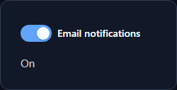
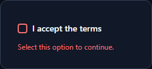

# q-toggle

`q-toggle` switches a Boolean preference using switch or checkbox presentation.

**Component tag:** `<q-toggle>`

**Working preview:** Run `bun start` from the repository root, open the [existing playground](http://localhost:3333), then select **Forms & inputs → Toggle**. The examples below use this registered runtime with their own markup and data; playground presets are demonstrations, not component defaults.

**On this page**

- [Quick start](#quick-start)
- [Examples](#examples)
- [Behavior & accessibility](#behavior--accessibility)
- [Styling](#styling)
- [API reference](#api-reference)

## Quick start

1. Follow the central [installation instructions](../../README.md#1-install-library).
2. In your application entry file (for example `src/main.js`), register the elements and load the theme. This requires a bundler that resolves package imports and CSS imports.

```javascript
import "@webquark/core/dist/webquark/webquark.css";
import { defineCustomElements } from "@webquark/core/loader";

defineCustomElements();
```

3. Put the following markup in your application HTML.

```html
<q-toggle label="Email notifications"></q-toggle>
```

**Result:** An unchecked medium switch labelled “Email notifications”.

### At a glance

| Capability | Options | Default |
| :--- | :--- | :--- |
| [Presentation](#variants) | switch or checkbox | switch |
| [Size](#sizes) | inherit, sm, md, lg | inherit; effective md without scope |
| [State](#state-and-interaction) | checked, disabled, toggle() | unchecked; enabled |
| [Labels and icons](#slots) | label/default slot; checkbox icon slots | empty label; built-in checked icon |
| [Validation and forms](#forms) | name, required, error | unnamed; optional |
| [Field help](#labels-and-announcements) | description, labelHidden, reserveFeedback | no description; visible label; inherit reservation |

**With no properties:** An unchecked inherit-sized (standalone md) switch renders without an accessible name. Supply label or default-slot text.

## Examples

Use the registration above first. Each HTML block belongs in the page body; its module script runs after the element is registered. CSS in a `<style>` block belongs in the page or your application stylesheet.

### Reflect a notification preference

Read qChange to keep application text in sync with a switch.



```html
<q-toggle id="email-toggle" label="Email notifications"></q-toggle>
<output id="email-state">Off</output>
<script type="module">
  await customElements.whenDefined("q-toggle");
  document.querySelector("#email-toggle").addEventListener("qChange", event => {
    document.querySelector("#email-state").textContent = event.detail ? "On" : "Off";
  });
</script>
```

Activate the switch once to reach the shown state.

### Require an explicit checkbox choice

Use checkbox type and required for an opt-in control.



```html
<q-toggle type="checkbox" name="terms" label="I accept the terms" required
  error="Select this option to continue."></q-toggle>
```

Required controls validity; the error property supplies the displayed message. Clear that message when the application accepts the choice.

## Behavior & accessibility

### State and interaction

Pointer activation or Space/Enter emits `qClick` before toggling mutable `checked`, followed by `qChange` with the new Boolean. `toggle()` changes checked and emits qChange only. Disabled controls ignore these interactions and toggle(). Application assignment to checked updates form value and validity without either event. Canceling qClick does not stop the subsequent toggle.

### Keyboard and focus

The inner wrapper is a single tab stop with switch/checkbox role. Space and Enter toggle it; disabled changes tabindex to -1. There is no public focusElement method. Checkbox icon slots are content inside the control; keep them decorative.

### Labels and announcements

Label text comes from the default slot, falling back to `label`. It names the role-bearing wrapper. `aria-checked`, `aria-disabled`, `aria-required`, and `aria-invalid` are always true/false strings; the last follows truthy error text. Error text is linked through aria-describedby only when shown. There is no ariaLabel property.

`labelHidden` visually hides the supplied label while retaining it for accessibility. `description` supplies supporting text; active error text replaces it. The feedback span is always present with `aria-live="polite"`, and aria-describedby references it when description or error is truthy. That is the DOM announcement mechanism; a still image does not verify a screen reader's delivery.

Omitted `reserveFeedback` inherits the enclosing form's setting, falling back to collapsed empty feedback. `true` reserves 1rem; explicit `false` opts out. Longer feedback grows normally.

### Forms

With name, checked contributes the string `true` to native FormData and unchecked contributes no entry. Reset restores checked captured on first load. Required unchecked controls fail with valueMissing; disabled controls are valid. `error` changes visual/ARIA messaging but does not create customError validity. [q-form](./q-form.md) represents a named toggle as a Boolean in its values object, including false.

### Limitations and compatibility

There is no indeterminate/mixed state. Unknown type values render a checkbox structure but lack the supported checkbox CSS class; use switch/checkbox. Switch transitions and the 200ms checkmark animation have no component reduced-motion override.

## Styling

Select type and size before applying color hooks or parts.

### Variants

`type="switch"` (default) shows a sliding thumb and role=switch. `type="checkbox"` shows a check box and role=checkbox. It is a type property, not variant.

### Sizes

`size="inherit"` is the declared default: it uses the nearest [q-form](./q-form.md) or [q-toolbar](./q-toolbar.md) scope, with `md` geometry when no scope exists. Explicit `sm`, `md`, or `lg` overrides that scope. Changing a scope updates inherited dimensions without changing the child's size property.

| Effective size | Minimum control height | Text / line height | Horizontal padding | Radius |
| :--- | :--- | :--- | :--- | :--- |
| `sm` | 1.75rem (28px) | 0.75 / 1rem | 0.5rem | 0.34375rem |
| `md` | 2.25rem (36px) | 0.875 / 1.25rem | 0.75rem | 0.4375rem |
| `lg` | 2.75rem (44px) | 1 / 1.5rem | 1rem | 0.53125rem |

Pixel equivalents assume a 16px root font. Heights are minimums; content and overrides can grow them. See the shared [sizing foundation](../foundation.md#choose-size-once).

The interaction row follows these minimums. Default switch width/height are 2.75 × / 1.5 × the icon metric (14/16/20px); thumb is 1.125 × icon size. Checkbox size equals the icon metric. Public dimension overrides take precedence.

### Custom styling

Use the [CSS variables](#css-variables) or [Shadow Parts](#shadow-parts) for supported customization. This matching markup and CSS can be used together:

```html
<q-toggle class="notification-toggle" label="Email notifications" checked></q-toggle>
<style>
  q-toggle.notification-toggle { --q-toggle-bg-on: #0e7490; --q-toggle-thumb-color: white; }
</style>
```

Switch dimensions resolve explicit `--q-toggle-switch-width/height` and `--q-toggle-thumb-size`, then legacy `--q-toggle-width/height/size`, then shared icon-based geometry. Checkbox size resolves `--q-toggle-checkbox-size` → `--q-toggle-box-size` → control icon size. Keep the track wide enough for its thumb and 6px travel margins.

Keep shared setup in [Theme variables](../theme_variables.md), [Theme tokens](../theme-tokens.md), and the [sizing, spacing and surface foundation](../foundation.md).

## API reference

Cross-check the [generated API](../../src/components/inputs/toggle/readme.md), [implementation](../../src/components/inputs/toggle/toggle.tsx), and imported public types. The entries below preserve source defaults and runtime qualifications.

### Properties

All properties are optional in the TypeScript component contract. Required content/labels and conditional constraints are explained with each workflow. Properties are alphabetical.

| Name | Default | Description |
| :--- | :--- | :--- |
| `checked` | `false` | Mutable Boolean state; application assignment emits no qChange.<br>**Type:** `boolean`. **HTML attribute:** `checked`. **Required:** No. |
| `description` | `undefined` | Supporting text; replaced by active error feedback.<br>**Type:** `string`. **HTML attribute:** `description`. **Required:** No. |
| `disabled` | `false` | Blocks pointer/keyboard/toggle() and removes the tab stop.<br>**Type:** `boolean`. **HTML attribute:** `disabled`. **Required:** No. |
| `error` | `undefined` | Visible/ARIA error text only; does not set custom validity.<br>**Type:** `string`. **HTML attribute:** `error`. **Required:** No. |
| `label` | `undefined` | Fallback visible label when the default slot is empty.<br>**Type:** `string`. **HTML attribute:** `label`. **Required:** No. |
| `labelHidden` | `false` | Visually hides the supplied label without removing its accessible text.<br>**Type:** `boolean`. **HTML attribute:** `label-hidden`. **Required:** No. |
| `name` | `undefined` | Native form field name.<br>**Type:** `string`. **HTML attribute:** `name`. **Required:** No. |
| `required` | `false` | Unchecked fails valueMissing; error text is separate.<br>**Type:** `boolean`. **HTML attribute:** `required`. **Required:** No. |
| `reserveFeedback` | `undefined` | undefined inherits the form's reservation (otherwise 0px); true reserves 1rem; false explicitly collapses empty feedback.<br>**Type:** `boolean`. **HTML attribute:** `reserve-feedback`. **Required:** No. |
| `size` | `'inherit'` | Finite visual size; see [Sizes](#sizes).<br>**Type:** `'inherit' \| 'sm' \| 'md' \| 'lg'`. **HTML attribute:** `size`. **Required:** No. |
| `type` | `'switch'` | Switch or checkbox semantics and visuals; see [Variants](#variants).<br>**Type:** `'switch' \| 'checkbox'`. **HTML attribute:** `type`. **Required:** No. |

Boolean attributes use Stencil coercion: presence/empty string is true, the literal string `"false"` is false, and removing the attribute supplies false rather than restoring a true or undefined initializer. Prefer explicit JavaScript `true`/`false` for updates; an optional Boolean can be reset to `undefined` through its property to recover inheritance/detection. String attributes remain strings; numeric attributes are parsed as numbers, so invalid text can become `NaN`. Setting a property to `undefined` or removing a string/number attribute does not rerun its initializer. Keep values within the documented types.

### Slots

| Name | Description |
| :--- | :--- |
| `default` | Visible label; falls back to label. Must name the control. |
| `checked-icon` | Checkbox-only icon, displayed when checked; falls back to a decorative SVG checkmark. |
| `unchecked-icon` | Checkbox-only icon, displayed when unchecked; no fallback. |

### Events

| Name | When it fires | Payload |
| :--- | :--- | :--- |
| `qBlur` | The interactive field/control loses focus. | `CustomEvent<FocusEvent>` |
| `qChange` | A user interaction updates or commits the value; see State and interaction. | `CustomEvent<boolean>` |
| `qClick` | Activation of the enabled interactive control; detail is the original MouseEvent. | `CustomEvent<MouseEvent>` |
| `qFocus` | The interactive field/control receives focus. | `CustomEvent<FocusEvent>` |

All listed Stencil events bubble, cross shadow boundaries (`composed: true`), and are cancelable. The component handlers do not use the emitted event's canceled result to roll back state or automatically cancel the underlying native event. For forwarded MouseEvent details, the original event is available as `event.detail`.

### Methods

With the loader used above, first `await customElements.whenDefined("q-toggle");` and `await element.componentOnReady();` before invoking methods. `componentOnReady()` is loader readiness, not an additional component-defined method. All listed methods return promises.

| Signature | Purpose | Returns |
| :--- | :--- | :--- |
| `checkValidity(): Promise<boolean>` | Checks the required constraint after synchronizing validity. | `boolean` |
| `reportValidity(): Promise<boolean>` | Reports a required violation and returns validity. | `boolean` |
| `toggle(): Promise<void>` | Toggles checked and emits qChange unless disabled; does not emit qClick. | `void` |

### Styling hooks

#### CSS variables

Defaults below show the local fallback chains; references to shared tokens depend on the active theme. Private `--_q-*` variables are implementation details and are not supported overrides. Component and functional shared hooks are listed; global palette/spacing/typography values are catalogued in [Theme tokens](../theme-tokens.md). See [Custom styling](#custom-styling) for effective precedence and exceptions.

| Name | Default | Controls |
| :--- | :--- | :--- |
| `--q-context-control-font` | `var(--q-control-font-md, 0.875rem)` | Context control font. Inherited context; explicit component size/state may override it. |
| `--q-context-control-height` | `var(--q-control-height-md, 2.25rem)` | Context control height. Inherited context; explicit component size/state may override it. |
| `--q-context-control-icon` | `var(--q-control-icon-md, 1rem)` | Context control icon. Inherited context; explicit component size/state may override it. |
| `--q-context-control-line` | `var(--q-control-line-md, 1.25rem)` | Context control line. Inherited context; explicit component size/state may override it. |
| `--q-context-control-padding` | `var(--q-control-padding-md, 0.75rem)` | Context control padding. Inherited context; explicit component size/state may override it. |
| `--q-context-control-radius` | `var(--q-control-radius-md, 0.4375rem)` | Context control radius. Inherited context; explicit component size/state may override it. |
| `--q-context-feedback-min` | `0px` | Min-block-size, margin. Inherited context; explicit component size/state may override it. |
| `--q-control-font-lg` | `1rem` | Control font lg. Shared geometry for the named size. |
| `--q-control-font-md` | `0.875rem` | Control font md. Shared geometry for the named size. |
| `--q-control-font-sm` | `0.75rem` | Control font sm. Shared geometry for the named size. |
| `--q-control-height-lg` | `2.75rem` | Control height lg. Shared geometry for the named size. |
| `--q-control-height-md` | `2.25rem` | Control height md. Shared geometry for the named size. |
| `--q-control-height-sm` | `1.75rem` | Control height sm. Shared geometry for the named size. |
| `--q-control-icon-lg` | `1.25rem` | Control icon lg. Shared geometry for the named size. |
| `--q-control-icon-md` | `1rem` | Control icon md. Shared geometry for the named size. |
| `--q-control-icon-sm` | `0.875rem` | Control icon sm. Shared geometry for the named size. |
| `--q-control-line-lg` | `1.5rem` | Control line lg. Shared geometry for the named size. |
| `--q-control-line-md` | `1.25rem` | Control line md. Shared geometry for the named size. |
| `--q-control-line-sm` | `1rem` | Control line sm. Shared geometry for the named size. |
| `--q-control-padding-lg` | `1rem` | Control padding lg. Shared geometry for the named size. |
| `--q-control-padding-md` | `0.75rem` | Control padding md. Shared geometry for the named size. |
| `--q-control-padding-sm` | `0.5rem` | Control padding sm. Shared geometry for the named size. |
| `--q-control-radius-lg` | `0.53125rem` | Control radius lg. Shared geometry for the named size. |
| `--q-control-radius-md` | `0.4375rem` | Control radius md. Shared geometry for the named size. |
| `--q-control-radius-sm` | `0.34375rem` | Control radius sm. Shared geometry for the named size. |
| `--q-field-feedback-font` | `.75rem` | Font-size. |
| `--q-field-label-font` | `.75rem` | Font-size. |
| `--q-toggle-bg-off` | `var(--q-bg-surface-2, #374151)` | Background-color. |
| `--q-toggle-bg-on` | `var(--q-color-primary, #60a5fa)` | Background-color. |
| `--q-toggle-border-color` | `var(--q-border-color, #4b5563)` | Border. |
| `--q-toggle-border-color-on` | `var(--q-color-primary, #60a5fa)` | Border-color. |
| `--q-toggle-box-size` | `var(--_q-control-icon)` | Width, height. |
| `--q-toggle-checkbox-size` | `var(--q-toggle-box-size, var(--_q-control-icon))` | Width, height. |
| `--q-toggle-error-color` | `var(--q-color-danger, #f87171)` | Border-color, background-color, color. |
| `--q-toggle-focus-ring` | `var(--q-focus-ring, 2px solid var(--q-color-primary, #60a5fa))` | Outline. |
| `--q-toggle-height` | `calc(var(--_q-control-icon) * 1.5)` | Toggle height. |
| `--q-toggle-size` | `calc(var(--_q-control-icon) * 1.125)` | Toggle size. |
| `--q-toggle-switch-height` | `var(--q-toggle-height, calc(var(--_q-control-icon) * 1.5))` | Height. |
| `--q-toggle-switch-width` | `var(--q-toggle-width, calc(var(--_q-control-icon) * 2.75))` | Width, transform. |
| `--q-toggle-thumb-color` | `var(--q-fg-base, #f9fafb)` | Background-color, color, stroke. |
| `--q-toggle-thumb-size` | `var(--q-toggle-size, calc(var(--_q-control-icon) * 1.125))` | Width, height, transform. |
| `--q-toggle-width` | `calc(var(--_q-control-icon) * 2.75)` | Toggle width. |

#### Shadow Parts

| Name | Targets |
| :--- | :--- |
| `box` | Checkbox box; only for checkbox/non-switch rendering. |
| `control` | Visual control wrapper; always present, not the focusable role-bearing wrapper. |
| `description` | Feedback span whenever there is no truthy error, including empty feedback. |
| `error-msg` | Additional name on feedback only while error/errorMessage is truthy. |
| `feedback` | Always-present polite live feedback span; shows error, otherwise description. |
| `icon-checked` | Checkbox checked-icon wrapper; exists in checkbox mode, hidden while unchecked. |
| `icon-unchecked` | Checkbox unchecked-icon wrapper; exists in checkbox mode, hidden while checked. |
| `label` | Label wrapper; present but hidden without label/default content. |
| `thumb` | Switch thumb; switch mode only. |
| `track` | Switch track; switch mode only. |
