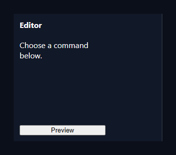

# q-toolbar

`q-toolbar` arranges consumer-owned controls and content along a horizontal or vertical edge.

**Component tag:** `<q-toolbar>`

**Working preview:** Run `bun start` from the repository root, open the [existing playground](http://localhost:3333), then select **Layout → Toolbar**. The examples below use temporary fixtures in this same registered runtime.

**On this page**

- [Quick start](#quick-start)
- [Examples](#examples)
- [Behavior & accessibility](#behavior--accessibility)
- [Styling](#styling)
- [API reference](#api-reference)

## Quick start

1. Follow the central [installation instructions](../../README.md#1-install-library).
2. Add registration to your application entry file (`main.js`). This requires a bundler that resolves package imports and CSS imports.

```javascript
import '@webquark/browser/dist/webquark/webquark.css';
import { defineCustomElements } from '@webquark/browser/loader';

defineCustomElements();
```

3. Add this markup to the application page after setup.

```html
<q-toolbar aria-label="Project actions" bordered>
  <strong>Workspace</strong>
  <button slot="end" type="button">Save draft</button>
</q-toolbar>
```

**Result:** a horizontal content group with a bottom border and an end-aligned button.

### At a glance

| Capability | Options | Default |
| :--- | :--- | :--- |
| [Edges](#edges) | top, right, bottom, left | top |
| [Size](#sizes) | Regular or compact | Regular |
| [Surface](#variants) | Opaque or transparent; optional border | Opaque, no border |
| [Position](#state-and-interaction) | Normal flow or sticky | Normal flow |
| [Content](#slots) | start, default, end | Empty |
| [Control size](#sizes) | inherit, sm, md, lg | inherit (md without ancestor) |
| [Spacing and wrapping](#sizes) | Eight gap tokens; horizontal wrap toggle | sm (8px), wrap true |

**With no properties:** `<q-toolbar></q-toolbar>` renders an empty horizontal surface with 8px vertical and 16px horizontal padding. Its minimum height is 0px, so content determines its height. It has no label, group role, border, or controls.

**Playground preset:** The playground inserts controls, title content, and a label.

## Examples

These examples share the registration above. Place each complete snippet in the application page; scripts use module syntax. Screenshots show the real component in the playground runtime with the shared dark theme.

### Arrange page actions

A toolbar groups a back link, title, and save control.


```html
<q-toolbar aria-label="Workspace actions" bordered>
  <a slot="start" href="#projects">Back to projects</a>
  <strong>Workspace</strong>
  <button slot="end" type="button">Save draft</button>
</q-toolbar>
```

The application supplies button handlers; the toolbar only arranges content.

### Create a vertical command area

A compact left toolbar places content between its start and end regions.



```html
<div style="height:260px">
  <q-toolbar edge="left" compact bordered aria-label="Editor commands">
    <strong slot="start">Editor</strong>
    <p>Choose a command below.</p>
    <button slot="end" type="button">Preview</button>
  </q-toolbar>
</div>
```

### Size inherited controls once

A toolbar applies one shared control size to its actions.


```html
<q-toolbar size="sm" gap="md" compact aria-label="Draft actions">
  <strong>Draft</strong>
  <q-inline slot="end" gap="sm">
    <q-button type="button" variant="ghost">Cancel</q-button>
    <q-button type="button">Save draft</q-button>
  </q-inline>
</q-toolbar>
```

The buttons keep their default inherit size and receive the toolbar’s sm metrics. The inline wrapper does not interrupt CSS inheritance.

## Behavior & accessibility

### State and interaction

`edge` determines orientation and inward-facing border. `sticky` sets sticky positioning at the selected edge; it does not move the bar into a fixed viewport overlay. Container dimensions and overflow determine whether sticky positioning can engage. All controls and their state belong to the application.

### Keyboard and focus

Slotted controls retain their native Tab order and key behavior. The component implements no roving focus or arrow-key control.

### Labels and announcements

A truthy `aria-label` gives the container `role="group"`. Without one, no role is supplied. Whitespace labels are not trimmed. The container does not use `role="toolbar"` and adds no live region.

### Forms

The toolbar has no form value; native controls placed inside it keep their normal behavior. Use `type="button"` for controls that should not submit a form.

### Limitations and compatibility

Unknown or empty `edge` values match no orientation, border-edge, sticky, or safe-area selector. Use the supported finite values. The component adds no animation.

## Styling

Start with edge, compact sizing, transparent background, and optional border.

### Variants

`transparent` removes the background; default is opaque. `bordered` adds the inward-facing border; default is false.

### Sizes

Horizontal bars grow with their content, with a 0px default minimum height. Normal padding is 8px vertical/16px horizontal, compact padding 4px/12px (plus safe-area insets). On left/right edges, the inner content row is 240px wide, or 200px compact, and needs a definite parent height. The outer host and surface still stretch to the parent width; set the host width explicitly when a narrow vertical bar is required.

`size` publishes inherited control metrics: sm gives 28px minimum control height, md 36px, lg 44px at a 16px root. The default inherit uses an ancestor scope or md. Explicit descendant sizes override the scope. `compact` affects toolbar chrome independently.

`gap` defaults to sm; `wrap` defaults true on horizontal toolbars. Gap tokens are:

| Value | Default spacing |
| :--- | :--- |
| `none` | 0 (0px at a 16px root) |
| `xs` | 0.25rem (4px at a 16px root) |
| `sm` | 0.5rem (8px at a 16px root) |
| `md` | 0.75rem (12px at a 16px root) |
| `lg` | 1rem (16px at a 16px root) |
| `xl` | 1.5rem (24px at a 16px root) |
| `2xl` | 2rem (32px at a 16px root) |
| `3xl` | 3rem (48px at a 16px root) |

See [Foundation](../foundation.md) for the full shared geometry.

### Edges

`top` (default) and `bottom` arrange slots horizontally; `left` and `right` arrange them vertically. Border and sticky offset face the corresponding edge. Safe-area insets are included in default edge padding.

### Custom styling

```html
<q-toolbar class="command-bar" aria-label="Commands">Commands</q-toolbar>
<style>
  q-toolbar.command-bar { --q-toolbar-height: 72px; --q-toolbar-gap: 24px; }
</style>
```

Explicit padding hooks override the computed safe-area edge padding. See [CSS variables](#css-variables), [Shadow Parts](#shadow-parts), and [theme setup](../theme_variables.md).

## API reference

See the [Stencil-generated API](../../src/browser/components/layout/toolbar/readme.md) and [component source](../../src/browser/components/layout/toolbar/toolbar.tsx). The tables below include source-level types and effective rendering constraints.

### Properties

All properties are optional and are listed alphabetically. Boolean attributes use Stencil boolean parsing: a present empty attribute enables the property, `="false"` disables it; JavaScript properties accept `true`/`false`. Removing a boolean attribute makes it false, including properties initially declared true. For updates, set the desired JavaScript property explicitly instead of relying on attribute removal to restore initializer defaults.

| Name | Default | Description |
| :--- | :--- | :--- |
| `ariaLabel` | `null` | Accessible label; creates a group role when truthy.<br>**Type:** `string \| null`. **HTML attribute:** `aria-label`. **Required:** No. |
| `bordered` | `false` | Add the inward-facing border.<br>**Type:** `boolean`. **HTML attribute:** `bordered`. **Required:** No. |
| `compact` | `false` | Use compact dimensions and padding.<br>**Type:** `boolean`. **HTML attribute:** `compact`. **Required:** No. |
| `edge` | `'top'` | Select orientation, safe-area padding, border, and sticky edge.<br>**Type:** `'top' \| 'right' \| 'bottom' \| 'left'`. **HTML attribute:** `edge`. **Required:** No. |
| `gap` | `'sm'` | Spacing token for regions and start/end control gaps.<br>**Type:** `'none' \| 'xs' \| 'sm' \| 'md' \| 'lg' \| 'xl' \| '2xl' \| '3xl'`. **HTML attribute:** `gap`. **Required:** No. |
| `size` | `'inherit'` | Inherited control size scope: inherit, sm, md, lg. Changes descendant controls that inherit size; does not set toolbar chrome height.<br>**Type:** `'inherit' \| 'sm' \| 'md' \| 'lg'`. **HTML attribute:** `size`. **Required:** No. |
| `sticky` | `false` | Use CSS sticky positioning at edge.<br>**Type:** `boolean`. **HTML attribute:** `sticky`. **Required:** No. |
| `transparent` | `false` | Use a transparent background.<br>**Type:** `boolean`. **HTML attribute:** `transparent`. **Required:** No. |
| `wrap` | `true` | Allow horizontal regions and start/end controls to wrap; vertical toolbars retain their grid.<br>**Type:** `boolean`. **HTML attribute:** `wrap`. **Required:** No. |


### Slots

| Name | Description |
| :--- | :--- |
| `end` | Ending controls/content; no fallback. |
| `start` | Starting controls/content; no fallback. |
| Default (unnamed) | Primary content; no fallback. |

### Events

This component emits no public events.

### Methods

This component exposes no public methods.

### Styling hooks

Defaults below include the imported shared stylesheet; `var(...)` values follow the active theme. Component-specific hooks and the shared tokens they consume are listed. For shared setup, see [Theme variables](../theme_variables.md).

#### CSS variables

| Name | Default | Controls |
| :--- | :--- | :--- |
| `--q-bg-surface-1` | `#111827` | bg surface 1 applied to `.toolbar`. |
| `--q-border-color` | `#374151` | border color applied to `:host([edge='top']) .toolbar.is-bordered`, `:host([edge='right']) .toolbar.is-bordered`, `:host([edge='bottom']) .toolbar.is-bordered`. |
| `--q-context-control-font` | `Inherited context; md fallback in leaf controls` | Published inline for explicit size; inherited with size=inherit. Descendant controls read this context metric. |
| `--q-context-control-height` | `Inherited context; md fallback in leaf controls` | Published inline for explicit size; inherited with size=inherit. Descendant controls read this context metric. |
| `--q-context-control-icon` | `Inherited context; md fallback in leaf controls` | Published inline for explicit size; inherited with size=inherit. Descendant controls read this context metric. |
| `--q-context-control-line` | `Inherited context; md fallback in leaf controls` | Published inline for explicit size; inherited with size=inherit. Descendant controls read this context metric. |
| `--q-context-control-padding` | `Inherited context; md fallback in leaf controls` | Published inline for explicit size; inherited with size=inherit. Descendant controls read this context metric. |
| `--q-context-control-radius` | `Inherited context; md fallback in leaf controls` | Published inline for explicit size; inherited with size=inherit. Descendant controls read this context metric. |
| `--q-control-font-lg` | `1rem` | Shared font-lg control metric published to inheriting descendants when toolbar size selects that suffix. It does not set toolbar chrome dimensions. |
| `--q-control-font-md` | `0.875rem` | Shared font-md control metric published to inheriting descendants when toolbar size selects that suffix. It does not set toolbar chrome dimensions. |
| `--q-control-font-sm` | `0.75rem` | Shared font-sm control metric published to inheriting descendants when toolbar size selects that suffix. It does not set toolbar chrome dimensions. |
| `--q-control-height-lg` | `2.75rem` | Shared height-lg control metric published to inheriting descendants when toolbar size selects that suffix. It does not set toolbar chrome dimensions. |
| `--q-control-height-md` | `2.25rem` | Shared height-md control metric published to inheriting descendants when toolbar size selects that suffix. It does not set toolbar chrome dimensions. |
| `--q-control-height-sm` | `1.75rem` | Shared height-sm control metric published to inheriting descendants when toolbar size selects that suffix. It does not set toolbar chrome dimensions. |
| `--q-control-icon-lg` | `1.25rem` | Shared icon-lg control metric published to inheriting descendants when toolbar size selects that suffix. It does not set toolbar chrome dimensions. |
| `--q-control-icon-md` | `1rem` | Shared icon-md control metric published to inheriting descendants when toolbar size selects that suffix. It does not set toolbar chrome dimensions. |
| `--q-control-icon-sm` | `0.875rem` | Shared icon-sm control metric published to inheriting descendants when toolbar size selects that suffix. It does not set toolbar chrome dimensions. |
| `--q-control-line-lg` | `1.5rem` | Shared line-lg control metric published to inheriting descendants when toolbar size selects that suffix. It does not set toolbar chrome dimensions. |
| `--q-control-line-md` | `1.25rem` | Shared line-md control metric published to inheriting descendants when toolbar size selects that suffix. It does not set toolbar chrome dimensions. |
| `--q-control-line-sm` | `1rem` | Shared line-sm control metric published to inheriting descendants when toolbar size selects that suffix. It does not set toolbar chrome dimensions. |
| `--q-control-padding-lg` | `1rem` | Shared padding-lg control metric published to inheriting descendants when toolbar size selects that suffix. It does not set toolbar chrome dimensions. |
| `--q-control-padding-md` | `0.75rem` | Shared padding-md control metric published to inheriting descendants when toolbar size selects that suffix. It does not set toolbar chrome dimensions. |
| `--q-control-padding-sm` | `0.5rem` | Shared padding-sm control metric published to inheriting descendants when toolbar size selects that suffix. It does not set toolbar chrome dimensions. |
| `--q-control-radius-lg` | `0.53125rem` | Shared radius-lg control metric published to inheriting descendants when toolbar size selects that suffix. It does not set toolbar chrome dimensions. |
| `--q-control-radius-md` | `0.4375rem` | Shared radius-md control metric published to inheriting descendants when toolbar size selects that suffix. It does not set toolbar chrome dimensions. |
| `--q-control-radius-sm` | `0.34375rem` | Shared radius-sm control metric published to inheriting descendants when toolbar size selects that suffix. It does not set toolbar chrome dimensions. |
| `--q-fg-base` | `#f9fafb` | fg base applied to `.toolbar`. |
| `--q-font-family` | `-apple-system, BlinkMacSystemFont, 'Segoe UI', Roboto, Helvetica, Arial, sans-serif` | font family applied to `.toolbar`. |
| `--q-space-2xl` | `2rem` | Shared spacing token selected by the corresponding padding/gap property; inherits to descendants. |
| `--q-space-3xl` | `3rem` | Shared spacing token selected by the corresponding padding/gap property; inherits to descendants. |
| `--q-space-lg` | `1rem` | Shared spacing token selected by the corresponding padding/gap property; inherits to descendants. |
| `--q-space-md` | `0.75rem` | Shared spacing token selected by the corresponding padding/gap property; inherits to descendants. |
| `--q-space-none` | `0rem` | Shared spacing token selected by the corresponding padding/gap property; inherits to descendants. |
| `--q-space-sm` | `0.5rem` | Shared spacing token selected by the corresponding padding/gap property; inherits to descendants. |
| `--q-space-xl` | `1.5rem` | Shared spacing token selected by the corresponding padding/gap property; inherits to descendants. |
| `--q-space-xs` | `0.25rem` | Shared spacing token selected by the corresponding padding/gap property; inherits to descendants. |
| `--q-toolbar-bg` | `var(--q-bg-surface-1, #1f2937)` | toolbar bg applied to `.toolbar`. |
| `--q-toolbar-border` | `1px solid var(--q-border-color, #374151)` | toolbar border applied to `:host([edge='top']) .toolbar.is-bordered`, `:host([edge='right']) .toolbar.is-bordered`, `:host([edge='bottom']) .toolbar.is-bordered`. |
| `--q-toolbar-compact-height` | `0px horizontal; ignored vertically` | Compact horizontal minimum height; vertical mode sets min-height: 0. |
| `--q-toolbar-compact-padding` | `var(--q-toolbar-edge-compact-padding, 0 16px)` | toolbar compact padding applied to `.toolbar.is-compact .toolbar-row`, `:host([edge='top']) .toolbar.is-compact .toolbar-row, :host([edge='bottom']) .toolbar.is-compact .toolbar-row`. |
| `--q-toolbar-compact-width` | `200px` | toolbar compact width applied to `:host([edge='left']) .toolbar.is-compact .toolbar-row, :host([edge='right']) .toolbar.is-compact .toolbar-row`. |
| `--q-toolbar-edge-compact-padding` | `Depends on edge and safe-area insets; see Edges/Sizes` | Edge-dependent compact safe-area padding. Prefer --q-toolbar-compact-padding. |
| `--q-toolbar-edge-padding` | `Depends on edge and safe-area insets; see Edges/Sizes` | Edge-dependent safe-area padding assigned on the host. Prefer --q-toolbar-padding to override it. |
| `--q-toolbar-fg` | `var(--q-fg-base, #f9fafb)` | toolbar fg applied to `.toolbar`. |
| `--q-toolbar-gap` | `Resolved gap (sm = 0.5rem by default)` | toolbar gap applied to `.toolbar-row`, `:host([edge='top']) .toolbar-row, :host([edge='bottom']) .toolbar-row`, `.toolbar-start, .toolbar-end`. |
| `--q-toolbar-height` | `0px horizontal; ignored vertically` | Horizontal minimum height; vertical mode sets min-height: 0. |
| `--q-toolbar-padding` | `var(--q-toolbar-edge-padding, 0 24px)` | toolbar padding applied to `.toolbar-row`, `:host([edge='top']) .toolbar-row, :host([edge='bottom']) .toolbar-row`, `:host([edge='top']) .toolbar.is-compact .toolbar-row, :host([edge='bottom']) .toolbar.is-compact .toolbar-row`. |
| `--q-toolbar-width` | `240px` | toolbar width applied to `:host([edge='left']) .toolbar-row, :host([edge='right']) .toolbar-row`. |
| `--q-toolbar-z-index` | `100` | toolbar z index applied to `:host`. |

#### Shadow Parts

| Name | Targets |
| :--- | :--- |
| `content` | Default slot wrapper. |
| `end` | Ending slot wrapper. |
| `row` | Grid layout wrapper. |
| `start` | Starting slot wrapper. |
| `toolbar` | Surface container; role group only when labelled. |
