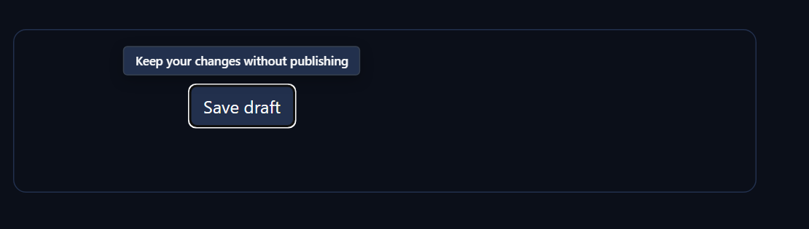
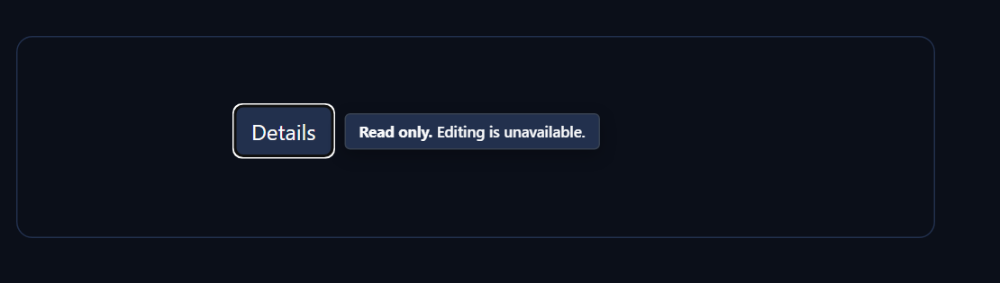

# q-tooltip

`q-tooltip` adds a noninteractive description to its immediate parent on hover or focus.

**Component tag:** `<q-tooltip>`

**Working preview:** Run `bun start` from the repository root, open the [existing playground](http://localhost:3333), then select **Overlays → Tooltip**.

**On this page**

- [Quick start](#quick-start)
- [Examples](#examples)
- [Behavior & accessibility](#behavior--accessibility)
- [Styling](#styling)
- [API reference](#api-reference)

## Quick start

1. Follow the central [installation instructions](../../README.md#1-install-library).
2. In your application entry file, register WebQuark. This assumes a bundler that resolves package imports and CSS imports.

```javascript
import '@webquark/core/dist/webquark/webquark.css';
import { defineCustomElements } from '@webquark/core/loader';
defineCustomElements();
```

3. Add this markup to your application page. Any module script runs after that shared setup.

```html
<button type="button">Save draft<q-tooltip content="Keep your changes without publishing"></q-tooltip></button>
```

**Result:** a Save draft button whose tooltip appears after 200 ms of hover or focus.

### At a glance

| Capability | Options | Default |
| :--- | :--- | :--- |
| [Trigger](#state-and-interaction) | Immediate parent hover/focus | Hidden |
| [Placement](#positions) | top, bottom, left, right | top |
| [Delay](#properties) | Milliseconds before display | 200 |
| [Content](#slots) | content text or default slot | Empty |

**With no properties:** An empty hidden tooltip connects to its immediate parent and adds an aria-describedby reference. Supply content or a default slot and a meaningful focusable parent.

## Examples

These examples share the [Quick start registration](#quick-start). Screenshots show the real registered component in a temporary preview fixture using the existing playground runtime. They do not imply extra permanent playground presets.

### Describe a button

Place the tooltip inside the focusable element it describes.



```html
<button id="save-draft" type="button">Save draft<q-tooltip content="Keep your changes without publishing"></q-tooltip></button>
```

The screenshot follows keyboard focus on Save draft and the 200 ms delay.

### Place a description beside its trigger

Use a supported position and slot for simple formatted text.



```html
<button id="details" type="button">Details<q-tooltip position="right" delay="0"><strong>Read only.</strong> Editing is unavailable.</q-tooltip></button>
```

The screenshot follows focus on Details. Keep slot content noninteractive; the tooltip has pointer-events:none.

## Behavior & accessibility

### State and interaction

On connection, the tooltip attaches mouseenter/mouseleave and focusin/focusout listeners to its immediate parent. Hover or focus schedules visibility after delay; leaving or focusout cancels the timer and hides it. Scroll or resize hides a visible tooltip. Disconnect removes listeners and its added description ID.

Changing content updates text. Placement coordinates update when showing, not continuously when props or layout change. The component does not clamp delay; pass a finite nonnegative millisecond number rather than relying on browser timer coercion.

### Keyboard and focus

| Key | Action |
| :--- | :--- |
| Tab / Shift+Tab | Focus/leave the parent; tooltip shows/hides. |
| Escape | No built-in dismissal handler. |

### Labels and announcements

The host has role="tooltip" and aria-hidden=true while hidden, false while visible. A generated or existing host id is appended to the parent aria-describedby without removing existing IDs; disconnect removes only an ID the component added. The tooltip is a description, not a substitute for the trigger’s accessible name. No live region is created.

### Limitations and compatibility

No Escape dismissal, viewport collision avoidance, wrapping, or touch interaction is implemented. Long text stays on one line and can overflow. Positioning accounts for some transformed containing blocks but does not establish platform compatibility. Opacity/transform transitions continue under reduced motion.

## Styling

### Positions

| position | Placement |
| :--- | :--- |
| `top` (default) | Above the parent |
| `bottom` | Below the parent |
| `left` | Left of the parent |
| `right` | Right of the parent |

Visible offsets are 8 px from the trigger. Unknown positions use top coordinates but do not match the top transform selector; use supported values.

### Custom styling

Scope CSS to the host or supplied content. See the exact [CSS variables](#css-variables) and [Shadow Parts](#shadow-parts).

```html
<button type="button">Save<q-tooltip class="save-help" content="Save your draft"></q-tooltip></button>
<style>
  q-tooltip.save-help { --q-bg-surface-3: #22304d; --q-fg-base: #ffffff; }
</style>
```

There are no tooltip-specific custom properties or Shadow Parts. The example scopes shared palette tokens to this tooltip.

Shared geometry and theme setup are documented in [Foundation](../foundation.md) and [theme tokens](../theme-tokens.md).

## API reference

Cross-check the [generated API](../../src/components/overlays/tooltip/readme.md) and [implementation](../../src/components/overlays/tooltip/tooltip.tsx). Source nullability and actual rendering limitations are preserved below.

### Properties

All properties are optional and listed alphabetically.

| Name | Default | Description |
| :--- | :--- | :--- |
| `content` | `undefined` | Truthy text replaces the default slot; an empty string uses slotted content.<br>**Type:** `string`. **HTML attribute:** `content`. **Required:** No. |
| `delay` | `200` | Show delay in milliseconds; no component-level normalization.<br>**Type:** `number`. **HTML attribute:** `delay`. **Required:** No. |
| `position` | `'top'` | top, bottom, left, or right. Reflected for placement CSS.<br>**Type:** `"bottom" \| "left" \| "right" \| "top"`. **HTML attribute:** `position`. **Required:** No. |

### Slots

| Name | Description |
| :--- | :--- |
| (default) | Description content when content is absent or empty; no fallback. Keep it noninteractive. |

### Events

This component emits no public events.

### Methods

This component exposes no public methods.

### Styling hooks

#### CSS variables

Defaults include the shared theme when set there; nested `var()` expressions show CSS fallbacks. Shared palette/typography tokens and fallback aliases are listed in the [shared variable reference](../theme_variables.md). Internal `--_q-*` variables are not public hooks.

| Name | Default | Controls |
| :--- | :--- | :--- |
| `--q-bg-surface-3` | `#22304d dark; #c7d1e6 light; CSS fallback #1e293b` | Bubble background. |
| `--q-border-color` | `#374151 dark; #e5e7eb light; CSS fallback rgba(255,255,255,0.08)` | One-pixel bubble border color. |
| `--q-fg-base` | `#f9fafb dark; #1f2937 light` | Bubble text color; no local fallback. |
| `--q-font-family` | `-apple-system, BlinkMacSystemFont, 'Segoe UI', Roboto, Helvetica, Arial, sans-serif` | Bubble font family. |
| `--q-font-size-sm` | `0.7rem` | Bubble text size; no local fallback. |
| `--q-radius-sm` | `4px` | Bubble corner radius. |

#### Shadow Parts

This component exposes no Shadow Parts.
