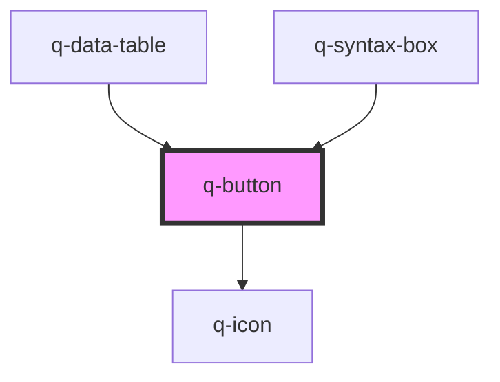

# q-button

<!-- Auto Generated Below -->

## Overview

Action button that renders a native button or anchor according to `href`.

## Properties

| Property         | Attribute        | Description                                                                      | Type                                                                           | Default     |
| ---------------- | ---------------- | -------------------------------------------------------------------------------- | ------------------------------------------------------------------------------ | ----------- |
| `ariaLabel`      | `aria-label`     | Required when an icon-only button has no accessible text.                        | `string`                                                                       | `null`      |
| `disabled`       | `disabled`       | Prevents activation, navigation, and secondary actions such as removal.          | `boolean`                                                                      | `false`     |
| `download`       | `download`       | Enables native download behavior when the component operates as a link.          | `string`                                                                       | `undefined` |
| `expand`         | `expand`         |                                                                                  | `boolean`                                                                      | `false`     |
| `form`           | `form`           | Explicit native form ID in this tree; unresolved IDs do not fall back.           | `string`                                                                       | `undefined` |
| `formAction`     | `formaction`     | Overrides the owning form's action for this submission.                          | `string`                                                                       | `undefined` |
| `formEnctype`    | `formenctype`    | Overrides the owning form's encoding for this submission.                        | `"application/x-www-form-urlencoded" \| "multipart/form-data" \| "text/plain"` | `undefined` |
| `formMethod`     | `formmethod`     | Overrides the owning form's method for this submission.                          | `"dialog" \| "get" \| "post"`                                                  | `undefined` |
| `formNoValidate` | `formnovalidate` | Skips validation for this submitter while retaining cancellation and collection. | `boolean`                                                                      | `false`     |
| `formTarget`     | `formtarget`     | Overrides the owning form's browsing context for this submission.                | `string`                                                                       | `undefined` |
| `href`           | `href`           | Destination used when the component operates as a link.                          | `string`                                                                       | `undefined` |
| `icon`           | `icon`           | Lucide icon rendered before the label. Use icon slots for custom content.        | `string`                                                                       | `undefined` |
| `iconOnly`       | `icon-only`      | Auto-detected from slotted icon content when omitted.                            | `boolean`                                                                      | `undefined` |
| `layout`         | `layout`         |                                                                                  | `"inline" \| "stacked"`                                                        | `'inline'`  |
| `loading`        | `loading`        | Shows a spinner and prevents interaction while loading.                          | `boolean`                                                                      | `false`     |
| `name`           | `name`           | Successful submission name when this button is the submitter.                    | `string`                                                                       | `undefined` |
| `rel`            | `rel`            | Defaults to `noopener noreferrer` when `target="_blank"`.                        | `string`                                                                       | `undefined` |
| `shape`          | `shape`          | The `circle` shape uses a fixed-size circular presentation.                      | `"circle" \| "default" \| "pill"`                                              | `'default'` |
| `size`           | `size`           |                                                                                  | `"inherit" \| "lg" \| "md" \| "sm"`                                            | `'inherit'` |
| `target`         | `target`         |                                                                                  | `string`                                                                       | `undefined` |
| `type`           | `type`           | Applied to the native `<button>` when `href` is unset.                           | `"button" \| "reset" \| "submit"`                                              | `'button'`  |
| `value`          | `value`          | Successful submission value when this button is the submitter.                   | `string`                                                                       | `''`        |
| `variant`        | `variant`        |                                                                                  | `"danger" \| "ghost" \| "primary" \| "secondary" \| "success" \| "text"`       | `'primary'` |

## Events

| Event    | Description                                       | Type                      |
| -------- | ------------------------------------------------- | ------------------------- |
| `qBlur`  |                                                   | `CustomEvent<FocusEvent>` |
| `qClick` | Emitted on activation unless disabled or loading. | `CustomEvent<MouseEvent>` |
| `qFocus` |                                                   | `CustomEvent<FocusEvent>` |

## Slots

| Slot           | Description                      |
| -------------- | -------------------------------- |
|                | Button label content.            |
| `"icon-left"`  | Content placed before the label. |
| `"icon-right"` | Content placed after the label.  |

## Shadow Parts

| Part        | Description                                      |
| ----------- | ------------------------------------------------ |
| `"button"`  | Native button or anchor element.                 |
| `"icon"`    | Leading q-icon rendered by the `icon` shorthand. |
| `"spinner"` | Loading spinner shown while `loading` is true.   |

## Dependencies

### Used by

 - [q-data-table](../../data-display/data-table)
 - [q-syntax-box](../../data-display/syntax-box)

### Depends on

- [q-icon](../../media/icon)

### Graph

----------------------------------------------

*Built with [StencilJS](https://stenciljs.com/)*
