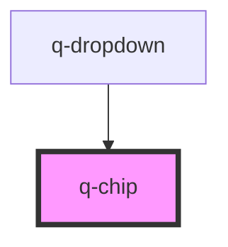

# q-chip

<!-- Auto Generated Below -->

## Overview

Compact label, link, filter, or removable token.

## Properties

| Property    | Attribute   | Description                                                                    | Type                                                                       | Default     |
| ----------- | ----------- | ------------------------------------------------------------------------------ | -------------------------------------------------------------------------- | ----------- |
| `clickable` | `clickable` | Renders a native button when `href` is empty and `removable` is false.         | `boolean`                                                                  | `false`     |
| `disabled`  | `disabled`  | Prevents activation, navigation, and secondary actions such as removal.        | `boolean`                                                                  | `false`     |
| `download`  | `download`  | Enables native download behavior when the component operates as a link.        | `string`                                                                   | `undefined` |
| `href`      | `href`      | Destination used when the component operates as a link.                        | `string`                                                                   | `undefined` |
| `label`     | `label`     | Text used when slotted content cannot supply the component's required label.   | `string`                                                                   | `undefined` |
| `rel`       | `rel`       | Defaults to `noopener noreferrer` when `target="_blank"`.                      | `string`                                                                   | `undefined` |
| `removable` | `removable` | Adds a remove button and prevents the rest of the chip from being interactive. | `boolean`                                                                  | `false`     |
| `selected`  | `selected`  | Maps to `aria-current="page"` for links and `aria-pressed` for buttons.        | `boolean`                                                                  | `false`     |
| `size`      | `size`      |                                                                                | `"lg" \| "md" \| "sm"`                                                     | `'md'`      |
| `target`    | `target`    |                                                                                | `"_blank" \| "_parent" \| "_self" \| "_top"`                               | `undefined` |
| `value`     | `value`     | Included in `qRemove` detail.                                                  | `string`                                                                   | `undefined` |
| `variant`   | `variant`   |                                                                                | `"danger" \| "filter" \| "neutral" \| "primary" \| "success" \| "warning"` | `'neutral'` |

## Events

| Event     | Description                                                   | Type                             |
| --------- | ------------------------------------------------------------- | -------------------------------- |
| `qBlur`   | Emitted when the chip action or remove button loses focus.    | `CustomEvent<FocusEvent>`        |
| `qClick`  |                                                               | `CustomEvent<MouseEvent>`        |
| `qFocus`  | Emitted when the chip action or remove button receives focus. | `CustomEvent<FocusEvent>`        |
| `qRemove` |                                                               | `CustomEvent<QChipRemoveDetail>` |

## Slots

| Slot           | Description                                                                                                                  |
| -------------- | ---------------------------------------------------------------------------------------------------------------------------- |
|                | Chip label text. If using this for visible text on a removable chip, also set `label` for the remove button accessible name. |
| `"icon-left"`  | Content placed before the label.                                                                                             |
| `"icon-right"` | Content placed after the label.                                                                                              |

## Shadow Parts

| Part              | Description           |
| ----------------- | --------------------- |
| `"chip"`          | Root chip element.    |
| `"label"`         | Chip label wrapper.   |
| `"remove-button"` | Remove action button. |
| `"remove-icon"`   | Remove action icon.   |

## Dependencies

### Used by

 - [q-dropdown](../../inputs/dropdown)

### Graph

----------------------------------------------

*Built with [StencilJS](https://stenciljs.com/)*
