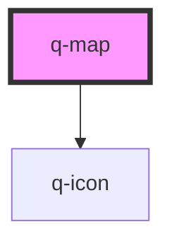

# q-map

`q-map` keeps the original dot/avatar marker API unchanged and adds optional rich presentation:

- `kind`: `dot`, `avatar`, `icon`, or `image`
- `size`: `small`, `medium`, or `large`; each semantic size has an overridable CSS diameter token
- `ring` and `pulse`: independent status emphasis
- `badge`: compact icon/text status with a required accessible label
- `callout`: plain-text, non-interactive context with an optional status pill and structured stats
- `clusterMarkers`: deterministic, keyboard-accessible clustering
- `clusterGroup`: clusters nearby markers only when their normalized group matches; markers from different source layers may share a group

```ts
map.markers = [{
  id: 'location-1',
  latitude: -26.1459,
  longitude: 28.0416,
  label: 'Rosebank location, live',
  clusterGroup: 'field-activity',
  kind: 'avatar',
  size: 'medium',
  fallbackText: 'RL',
  variant: 'success',
  ring: 'solid',
  pulse: true,
  badge: {
    icon: 'clock-3',
    variant: 'warning',
    ariaLabel: 'Location updated eight minutes ago',
  },
  callout: {
    title: 'Rosebank location',
    subtitle: 'CUST-001 | Rosebank',
    status: {
      label: 'In Progress',
      variant: 'success',
    },
    meta: 'Updated eight minutes ago',
    stats: [
      { label: 'Visits', value: '2 of 4' },
      { label: 'Last update', value: '8m' },
      {
        label: 'Current activity',
        value: 'Shelf audit at Rosebank',
        layout: 'wide',
      },
    ],
    placement: 'right',
  },
}];
```

Image markers display the complete image with transparent surroundings, without avatar clipping or chrome. Supply `imageSize: [width, height]` in pixels and optional `imageAnchor: [x, y]` measured from the top-left. The anchor defaults to bottom-center. Without a size, natural image dimensions fit within 48 × 48 pixels without upscaling. Missing or failed images render the ordinary dot at the coordinate; existing avatar images retain their circular crop.

```ts
map.markers = [{
  id: 'head-office',
  latitude: -33.5,
  longitude: 18.5,
  label: 'Head office',
  kind: 'image',
  imageUrl: '/assets/location-pin.png',
  imageSize: [25, 41],
  imageAnchor: [12.5, 41],
}];
map.scrollWheelZoom = false;

// Call after qReady, or after updating markers or the container dimensions.
await map.fitMarkers({ padding: 48, maxZoom: 13 });
```

`fitMarkers()` fits the latest valid marker coordinates, handles a single location or coincident locations at the maximum fitted zoom, and returns `false` before initialization or when no valid markers exist. It does not overwrite the configured center/zoom properties or continually reset a user's view. Wheel zoom defaults to enabled; disabling it preserves touch, keyboard, and zoom-button controls.

Markers without a `clusterGroup` use the `default` group. Layer membership does not limit clustering: any visible markers supplied to the same `q-map` may cluster when their normalized group matches. Every visible marker and cluster uses a collision footprint equal to 75% of its rendered diameter, so overlapping items push apart regardless of type or group. Each cluster exposes a normalized `cluster-group-<group>` CSS part, so consumers can style groups independently. Cancel `qClusterSelect` to replace the default centre-and-zoom behaviour; its detail includes the activated `clusterGroup`. Callout, status, badge, and stat strings are inserted as text, never interpreted as HTML. A callout status is rendered as a pill beside the title, while the optional subtitle remains on its own line. Callout stats render in two compact columns; a stat with `layout: 'wide'` spans both columns.

```css
q-map::part(cluster-group-field-activity) {
  background: var(--field-activity-cluster-background);
}

q-map {
  --q-map-marker-size-small: 36px;
  --q-map-marker-size-medium: 44px;
  --q-map-marker-size-large: 52px;
}
```


<!-- Auto Generated Below -->


## Overview

Framework-neutral interactive map powered by Leaflet.

## Properties

| Property                  | Attribute                    | Description                                                                    | Type                                                | Default             |
| ------------------------- | ---------------------------- | ------------------------------------------------------------------------------ | --------------------------------------------------- | ------------------- |
| `ariaLabel`               | `aria-label`                 | Accessible name for the interactive map region.                                | `string`                                            | `'Interactive map'` |
| `attribution`             | `attribution`                | Rendered for raster tiles and styled vectors.                                  | `string`                                            | `''`                |
| `attributionUrl`          | `attribution-url`            | Links attribution only for HTTP(S) URLs.                                       | `string`                                            | `''`                |
| `centerLatitude`          | `center-latitude`            | Finite values are clamped to the geographic range.                             | `number`                                            | `0`                 |
| `centerLongitude`         | `center-longitude`           | Finite values are clamped to the geographic range.                             | `number`                                            | `0`                 |
| `clusterMarkers`          | `cluster-markers`            | Preserves stable source IDs while grouping nearby markers.                     | `boolean`                                           | `false`             |
| `clusterMaxZoom`          | `cluster-max-zoom`           | Defaults to one below `maxZoom`.                                               | `number`                                            | `undefined`         |
| `clusterMinPoints`        | `cluster-min-points`         |                                                                                | `number`                                            | `2`                 |
| `clusterRadius`           | `cluster-radius`             | Screen-pixel radius clamped from 1 to 200.                                     | `number`                                            | `48`                |
| `googleApiKey`            | `google-api-key`             | Browser-restricted key used only when WebQuark loads Google Maps.              | `string`                                            | `''`                |
| `googleMapType`           | `google-map-type`            | Unsupported values normalize to `roadmap`.                                     | `"hybrid" \| "roadmap" \| "satellite" \| "terrain"` | `'roadmap'`         |
| `markers`                 | `markers`                    | Accepts an array or JSON and reconciles markers using type-stable IDs.         | `QMapMarker[] \| string`                            | `[]`                |
| `maxBounds`               | `max-bounds`                 | Accepts an object or JSON; malformed updates preserve the last valid bounds.   | `QMapBounds \| string`                              | `undefined`         |
| `maxBoundsViscosity`      | `max-bounds-viscosity`       | Clamped from zero to one.                                                      | `number`                                            | `1`                 |
| `maxZoom`                 | `max-zoom`                   | Never resolves below `minZoom`.                                                | `number`                                            | `19`                |
| `minZoom`                 | `min-zoom`                   | Non-finite values normalize to zero.                                           | `number`                                            | `0`                 |
| `provider`                | `provider`                   | Non-tile provider failures may fall back to `tileUrl`.                         | `"google" \| "tiles" \| "vector"`                   | `'tiles'`           |
| `rasterTileLoadingPolicy` | `raster-tile-loading-policy` | Selects full-batch or progressive raster replacement and zoom loading.         | `"full-batch" \| "progressive"`                     | `'full-batch'`      |
| `scrollWheelZoom`         | `scroll-wheel-zoom`          | Enables mouse-wheel zoom without changing touch, keyboard, or button controls. | `boolean`                                           | `true`              |
| `selectedMarkerId`        | `selected-marker-id`         | Controls the selected visual and `aria-pressed` state.                         | `number \| string`                                  | `undefined`         |
| `tilePreloadBuffer`       | `tile-preload-buffer`        | Preloads zero to four raster-tile rows and columns beyond the viewport.        | `number`                                            | `0`                 |
| `tileUrl`                 | `tile-url`                   | Tile template used by the tiles provider and optional provider fallback.       | `string`                                            | `''`                |
| `vectorPadding`           | `vector-padding`             | Extends rendering beyond the viewport; clamped from zero to one-half.          | `number`                                            | `0.2`               |
| `vectorStyleUrl`          | `vector-style-url`           | MapLibre Style Specification URL for the vector provider.                      | `string`                                            | `''`                |
| `zoom`                    | `zoom`                       | Clamped between the normalized zoom limits.                                    | `number`                                            | `2`                 |
| `zoomControls`            | `zoom-controls`              |                                                                                | `boolean`                                           | `true`              |


## Events

| Event            | Description                                                              | Type                                   |
| ---------------- | ------------------------------------------------------------------------ | -------------------------------------- |
| `qClusterSelect` | Emitted before the default center-and-zoom action; cancel to prevent it. | `CustomEvent<QMapClusterSelectDetail>` |
| `qError`         | Reports serializable configuration and initialization failures.          | `CustomEvent<QMapErrorDetail>`         |
| `qMapClick`      | Excludes drags and interactive-layer clicks.                             | `CustomEvent<QMapClickDetail>`         |
| `qMarkerSelect`  | Does not mutate `selectedMarkerId`.                                      | `CustomEvent<QMapMarkerSelectDetail>`  |
| `qReady`         | Emitted after Leaflet setup and the initial provider attempt complete.   | `CustomEvent<void>`                    |
| `qStatusChange`  | Includes the active fallback provider.                                   | `CustomEvent<QMapStatusChangeDetail>`  |


## Methods

### `ensureMarkerVisible(markerId: QMapMarkerId, occlusions: readonly QMapViewportRect[]) => Promise<QMapMarkerVisibilityResult>`

Minimally pans to fully expose a marker or its current cluster without changing zoom.

#### Parameters

| Name         | Type                          | Description |
| ------------ | ----------------------------- | ----------- |
| `markerId`   | `string \| number`            |             |
| `occlusions` | `readonly QMapViewportRect[]` |             |

#### Returns

Type: `Promise<QMapMarkerVisibilityResult>`


### `fitMarkers(options?: QMapFitMarkersOptions) => Promise<boolean>`

Fits the latest valid marker coordinates without changing the configured center or zoom props.

#### Parameters

| Name      | Type                    | Description |
| --------- | ----------------------- | ----------- |
| `options` | `QMapFitMarkersOptions` |             |

#### Returns

Type: `Promise<boolean>`


## Slots

| Slot      | Description                                                                  |
| --------- | ---------------------------------------------------------------------------- |
| `"empty"` | Content shown when the requested provider is missing required configuration. |
| `"error"` | Content shown after provider initialization fails without a usable fallback. |


## Shadow Parts

| Part               | Description                                  |
| ------------------ | -------------------------------------------- |
| `"attribution"`    | Provider attribution text or link.           |
| `"canvas"`         | Leaflet map canvas.                          |
| `"cluster"`        | Each interactive marker cluster.             |
| `"empty"`          | Missing-configuration overlay.               |
| `"error"`          | Provider-error overlay.                      |
| `"marker"`         | Each interactive map marker.                 |
| `"marker-badge"`   | A marker's optional status badge.            |
| `"marker-callout"` | A marker's optional non-interactive callout. |
| `"surface"`        | Outer clipped map surface.                   |


## Dependencies

### Depends on

- [q-icon](../../media/icon)

### Graph


----------------------------------------------

*Built with [StencilJS](https://stenciljs.com/)*
