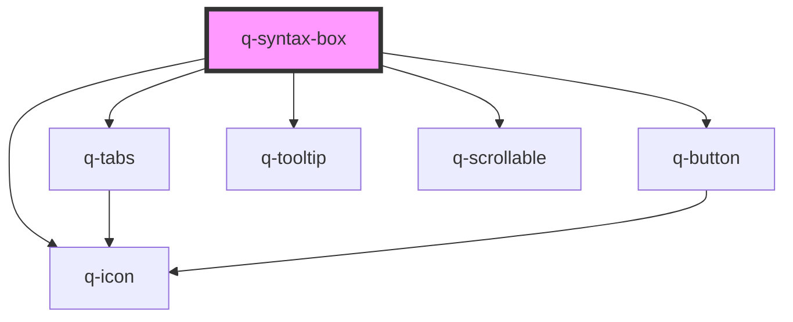

# q-syntax-box

Code and value are literal source. Click Format to load the selected language's bundled formatter. Strict JSON uses a synchronous token-preserving formatter with two-space indentation. Initialization, controlled updates and form resets preserve the supplied text. A pending formatter discards its result if the editor receives a newer value.

Editable mode creates an empty textarea when both aliases are absent. Required empty editors are invalid; read-only missing code retains the default slot.

```html
<q-syntax-box heading="New template" editable required name="template" aria-label="Template source"></q-syntax-box>
```

See the [authored guide](../../../../../docs/components/q-syntax-box.md) for literal-source, editing, form and compatibility examples.

<!-- Auto Generated Below -->


## Overview

Displays syntax-highlighted content and automatically adds tabs for multiple views.

## Properties

| Property    | Attribute    | Description                                                                              | Type                                                                                                                                                                                                                                                                      | Default     |
| ----------- | ------------ | ---------------------------------------------------------------------------------------- | ------------------------------------------------------------------------------------------------------------------------------------------------------------------------------------------------------------------------------------------------------------------------- | ----------- |
| `ariaLabel` | `aria-label` | Accessible name for the editor; falls back to `heading`, then the language.              | `string`                                                                                                                                                                                                                                                                  | `null`      |
| `code`      | `code`       | Mirrored with `value`; prefer `code` for domain usage.                                   | `string`                                                                                                                                                                                                                                                                  | `undefined` |
| `copyable`  | `copyable`   |                                                                                          | `boolean`                                                                                                                                                                                                                                                                 | `false`     |
| `disabled`  | `disabled`   | Disables editing and panel actions.                                                      | `boolean`                                                                                                                                                                                                                                                                 | `false`     |
| `editable`  | `editable`   |                                                                                          | `boolean`                                                                                                                                                                                                                                                                 | `false`     |
| `heading`   | `heading`    | Title in panel mode and tab label for a composed view.                                   | `string`                                                                                                                                                                                                                                                                  | `undefined` |
| `height`    | `height`     | Explicit content height. Panel mode defaults to 110px; plain mode defaults to auto.      | `string`                                                                                                                                                                                                                                                                  | `undefined` |
| `language`  | `language`   | Selects the formatter. HTML, JavaScript, CSS, and JSON also receive syntax highlighting. | `"angular" \| "css" \| "flow" \| "graphql" \| "handlebars" \| "html" \| "javascript" \| "json" \| "json-stringify" \| "json5" \| "jsonc" \| "jsx" \| "less" \| "lwc" \| "markdown" \| "mdx" \| "mjml" \| "postcss" \| "scss" \| "tsx" \| "typescript" \| "vue" \| "yaml"` | `'html'`    |
| `name`      | `name`       | Form field name used when the component is editable.                                     | `string`                                                                                                                                                                                                                                                                  | `undefined` |
| `required`  | `required`   | Marks the editable textarea as required for form validation.                             | `boolean`                                                                                                                                                                                                                                                                 | `false`     |
| `value`     | `value`      | Form-value alias mirrored with `code` for compatibility.                                 | `string`                                                                                                                                                                                                                                                                  | `undefined` |
| `variant`   | `variant`    |                                                                                          | `"panel" \| "plain"`                                                                                                                                                                                                                                                      | `'panel'`   |


## Events

| Event     | Description                                                                             | Type                  |
| --------- | --------------------------------------------------------------------------------------- | --------------------- |
| `qChange` | Emitted when editable content is committed by the native change event or by formatting. | `CustomEvent<string>` |
| `qInput`  | Emitted on each editable content input and after formatting.                            | `CustomEvent<string>` |


## Methods

### `checkValidity() => Promise<boolean>`

Returns whether editable content satisfies native constraints.

#### Returns

Type: `Promise<boolean>`


### `reportValidity() => Promise<boolean>`

Reports editable constraint violations and reveals the editor in its owning box.

#### Returns

Type: `Promise<boolean>`


### `scrollToBottom() => Promise<void>`

Programmatically scrolls the read-only code body to the bottom when it is wrapped by q-scrollable.

#### Returns

Type: `Promise<void>`


## Slots

| Slot        | Description                                                  |
| ----------- | ------------------------------------------------------------ |
|             | Read-only fallback content or direct q-syntax-view children. |
| `"actions"` | Additional actions for the box's own view.                   |


## Dependencies

### Depends on

- [q-tabs](../../layout/tabs)
- [q-button](../../actions/button)
- [q-icon](../../media/icon)
- [q-tooltip](../../overlays/tooltip)
- [q-scrollable](../../layout/scrollable)

### Graph


----------------------------------------------

*Built with [StencilJS](https://stenciljs.com/)*
