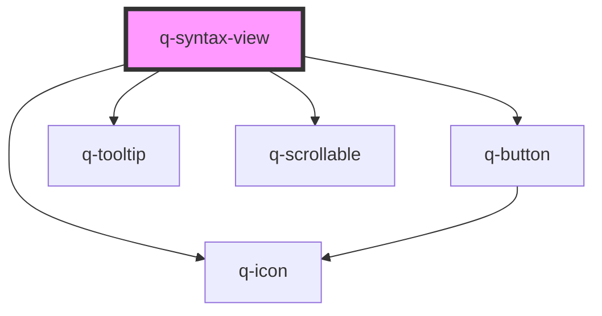

# q-syntax-view

Use a Syntax View on its own for one snippet, editor, or log. Place views directly inside a Syntax Box to group them. The box displays tabs when it contains two or more views. Each editable view uses its own [formatting language](../../../../../docs/components/q-syntax-box.md#languages). See the [working examples](../../../../../docs/components/q-syntax-box.md#switch-between-views).

<!-- Auto Generated Below -->

## Overview

Displays one editable or read-only view, on its own or as a child of a Syntax Box.

## Properties

| Property    | Attribute    | Description                                                                              | Type                                                                                                                                                                                                                                                                      | Default     |
| ----------- | ------------ | ---------------------------------------------------------------------------------------- | ------------------------------------------------------------------------------------------------------------------------------------------------------------------------------------------------------------------------------------------------------------------------- | ----------- |
| `ariaLabel` | `aria-label` | Accessible name for the editor; falls back to `heading`, then the language.              | `string`                                                                                                                                                                                                                                                                  | `null`      |
| `code`      | `code`       | Mirrored with `value`; prefer `code` for domain usage.                                   | `string`                                                                                                                                                                                                                                                                  | `undefined` |
| `copyable`  | `copyable`   |                                                                                          | `boolean`                                                                                                                                                                                                                                                                 | `false`     |
| `disabled`  | `disabled`   | Disables editing and panel actions.                                                      | `boolean`                                                                                                                                                                                                                                                                 | `false`     |
| `editable`  | `editable`   |                                                                                          | `boolean`                                                                                                                                                                                                                                                                 | `false`     |
| `heading`   | `heading`    | Title in panel mode and tab label for a composed view.                                   | `string`                                                                                                                                                                                                                                                                  | `undefined` |
| `height`    | `height`     | Explicit content height. Panel mode defaults to 110px; plain mode defaults to auto.      | `string`                                                                                                                                                                                                                                                                  | `undefined` |
| `language`  | `language`   | Selects the formatter. HTML, JavaScript, CSS, and JSON also receive syntax highlighting. | `"angular" \| "css" \| "flow" \| "graphql" \| "handlebars" \| "html" \| "javascript" \| "json" \| "json-stringify" \| "json5" \| "jsonc" \| "jsx" \| "less" \| "lwc" \| "markdown" \| "mdx" \| "mjml" \| "postcss" \| "scss" \| "tsx" \| "typescript" \| "vue" \| "yaml"` | `'html'`    |
| `name`      | `name`       | Form field name used when the component is editable.                                     | `string`                                                                                                                                                                                                                                                                  | `undefined` |
| `required`  | `required`   | Marks the editable textarea as required for form validation.                             | `boolean`                                                                                                                                                                                                                                                                 | `false`     |
| `value`     | `value`      | Form-value alias mirrored with `code` for compatibility.                                 | `string`                                                                                                                                                                                                                                                                  | `undefined` |
| `variant`   | `variant`    |                                                                                          | `"panel" \| "plain"`                                                                                                                                                                                                                                                      | `'panel'`   |
| `viewKey`   | `view-key`   | Optional identity for preserving selection when replacing a view element.                | `string`                                                                                                                                                                                                                                                                  | `undefined` |

## Events

| Event     | Description                                                                             | Type                  |
| --------- | --------------------------------------------------------------------------------------- | --------------------- |
| `qChange` | Emitted when editable content is committed by the native change event or by formatting. | `CustomEvent<string>` |
| `qInput`  | Emitted on each editable content input and after formatting.                            | `CustomEvent<string>` |

## Methods

### `checkValidity() => Promise<boolean>`

Returns whether editable content satisfies native constraints.

#### Returns

Type: `Promise<boolean>`

### `reportValidity() => Promise<boolean>`

Reports editable constraint violations and reveals the editor in its owning box.

#### Returns

Type: `Promise<boolean>`

### `scrollToBottom() => Promise<void>`

Programmatically scrolls the read-only code body to the bottom when it is wrapped by q-scrollable.

#### Returns

Type: `Promise<void>`

## Slots

| Slot        | Description                             |
| ----------- | --------------------------------------- |
|             | Read-only content when code is omitted. |
| `"actions"` | Actions for this view.                  |

## Dependencies

### Depends on

- [q-button](../../actions/button)
- [q-icon](../../media/icon)
- [q-tooltip](../../overlays/tooltip)
- [q-scrollable](../../layout/scrollable)

### Graph

----------------------------------------------

*Built with [StencilJS](https://stenciljs.com/)*
