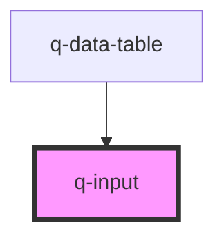

# q-input

## Horizontal width

See the [shared width guide](../../../../../docs/input-widths.md) for a copyable project override block.

Use `width="xs|sm|md|lg|xl|xxl|full"` to opt into a shared field width. The six widths default to 5rem, 7.5rem, 11.25rem, 15rem, 18.125rem and 22.5rem. `full` fills the available width. Omitted, empty or unsupported values preserve the existing 100% layout. `size` still controls height and internal density independently.

Override `--q-input-width-xs` through `--q-input-width-xxl` at the document or a local container. Widths are identical in compact/comfortable presets and light/dark themes, and rem values follow the root font size. Valid widths are capped to their containing block; flex/grid parents still control available space. Long content may wrap or truncate within that space rather than expanding the field.

Normal consumer CSS on the host (for example `q-input { width: 18rem; }`) takes precedence over these shadow styles; removing that rule restores the attribute-selected width. No inline style or JavaScript sizing is applied by the width API.

<!-- Auto Generated Below -->

## Overview

Form-associated input field with optional prefix/suffix slots, clear button, password visibility toggle, and numeric spinner controls.

## Properties

| Property          | Attribute          | Description                                                                                             | Type                                                                                                                                       | Default     |
| ----------------- | ------------------ | ------------------------------------------------------------------------------------------------------- | ------------------------------------------------------------------------------------------------------------------------------------------ | ----------- |
| `ariaLabel`       | `aria-label`       | Accessible name for the native input when a visible label is not used.                                  | `string`                                                                                                                                   | `null`      |
| `clearable`       | `clearable`        | Shows a clear button when the field has a value.                                                        | `boolean`                                                                                                                                  | `false`     |
| `description`     | `description`      | Supporting text, replaced by an active error.                                                           | `string`                                                                                                                                   | `undefined` |
| `disabled`        | `disabled`         |                                                                                                         | `boolean`                                                                                                                                  | `false`     |
| `error`           | `error`            | Validation error text or error-state flag.                                                              | `string`                                                                                                                                   | `undefined` |
| `errorMessage`    | `error-message`    | **[DEPRECATED]** Use error. Used when error is empty or unset.   | `string`                                                                                                                                   | `undefined` |
| `label`           | `label`            |                                                                                                         | `string`                                                                                                                                   | `undefined` |
| `labelHidden`     | `label-hidden`     | Keep the label accessible without displaying it.                                                        | `boolean`                                                                                                                                  | `false`     |
| `max`             | `max`              |                                                                                                         | `number`                                                                                                                                   | `undefined` |
| `min`             | `min`              |                                                                                                         | `number`                                                                                                                                   | `undefined` |
| `name`            | `name`             |                                                                                                         | `string`                                                                                                                                   | `undefined` |
| `placeholder`     | `placeholder`      |                                                                                                         | `string`                                                                                                                                   | `""`        |
| `required`        | `required`         |                                                                                                         | `boolean`                                                                                                                                  | `false`     |
| `reserveFeedback` | `reserve-feedback` | Omitted inherits the enclosing form; false cancels reservation.                                         | `boolean`                                                                                                                                  | `undefined` |
| `size`            | `size`             |                                                                                                         | `"inherit" \| "lg" \| "md" \| "sm"`                                                                                                        | `'inherit'` |
| `step`            | `step`             |                                                                                                         | `number`                                                                                                                                   | `1`         |
| `type`            | `type`             | `password` adds a visibility toggle; `number` adds spinner controls.                                    | `"color" \| "date" \| "datetime-local" \| "email" \| "month" \| "number" \| "password" \| "search" \| "text" \| "time" \| "url" \| "week"` | `'text'`    |
| `value`           | `value`            |                                                                                                         | `string`                                                                                                                                   | `""`        |
| `width`           | `width`            | Opt-in horizontal width; independent of size. Omitted uses the existing full-width layout.              | `"full" \| "lg" \| "md" \| "sm" \| "xl" \| "xs" \| "xxl"`                                                                                  | `undefined` |

## Events

| Event     | Description                                                     | Type                      |
| --------- | --------------------------------------------------------------- | ------------------------- |
| `qBlur`   |                                                                 | `CustomEvent<FocusEvent>` |
| `qChange` | Emitted when the committed value changes.                       | `CustomEvent<string>`     |
| `qClick`  |                                                                 | `CustomEvent<MouseEvent>` |
| `qFocus`  |                                                                 | `CustomEvent<FocusEvent>` |
| `qInput`  | Emitted as the user types or spinner controls update the value. | `CustomEvent<string>`     |

## Methods

### `checkValidity() => Promise<boolean>`

Returns whether the control satisfies native and custom constraints.

#### Returns

Type: `Promise<boolean>`

### `clearValue() => Promise<void>`

Clears the current value and focuses the native input.

#### Returns

Type: `Promise<void>`

### `focusElement() => Promise<void>`

Moves focus to the native input.

#### Returns

Type: `Promise<void>`

### `reportValidity() => Promise<boolean>`

Reports native or custom constraint violations and returns whether the control is valid.

#### Returns

Type: `Promise<boolean>`

## Slots

| Slot       | Description                                                                                  |
| ---------- | -------------------------------------------------------------------------------------------- |
| `"prefix"` | Content displayed before the native input.                                                   |
| `"suffix"` | Content displayed after the native input when no clear or password toggle button is visible. |

## Shadow Parts

| Part          | Description                                          |
| ------------- | ---------------------------------------------------- |
| `"control"`   | Wrapper around the native input and inline controls. |
| `"error-msg"` | Validation helper text.                              |
| `"label"`     | Optional field label.                                |
| `"prefix"`    | Prefix slot container.                               |
| `"spinners"`  | Numeric spinner button container.                    |
| `"suffix"`    | Suffix slot container.                               |

## Dependencies

### Used by

 - [q-data-table](../../data-display/data-table)

### Graph

----------------------------------------------

*Built with [StencilJS](https://stenciljs.com/)*
