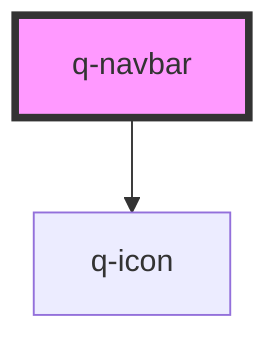

# q-navbar

## Navigation alignment

The default `navAlign="start"` preserves existing layouts. Use `end` to place
desktop navigation beside the actions, or `center` to centre the navigation group.
These options apply to horizontal navbars above the existing 720px viewport breakpoint.

| `navCenterWithin` | Centre reference |
| --- | --- |
| `available` (default) | Space between brand and actions. |
| `container` | Navbar's padded content box, with equal side regions reserved for the wider brand/action group. |

```html
<!-- Compare these with a long brand and a short action. -->
<q-navbar brand="My long product name" nav-align="center" nav-center-within="available"
  items='["Home","Products","About"]'>
  <button slot="actions">Sign in</button>
</q-navbar>
<q-navbar brand="My long product name" nav-align="center" nav-center-within="container"
  items='["Home","Products","About"]'>
  <button slot="actions">Sign in</button>
</q-navbar>

<!-- Optical adjustment: positive moves toward inline-end (left in RTL). -->
<q-navbar dir="rtl" nav-align="center" nav-center-within="container"
  style="--q-navbar-nav-offset-inline: 8px" items='["Home","Products","About"]'>
</q-navbar>

<!-- A narrow parent can trigger a menu even on a large desktop viewport. -->
<div style="width: 320px">
  <q-navbar brand="Product" nav-align="center" items='["Home","Products","About"]'>
    <button slot="nav">Help</button>
    <button slot="actions">Sign in</button>
  </q-navbar>
</div>
```

Centred layouts collapse before brand, navigation (including item add-ons), and
actions overlap. Desktop layout returns with at least 8px spare room to prevent
flickering near the boundary. Container size, changing content, images, and fonts
are remeasured. With `mobileMode="inline"`, navigation instead gets its own wrapping row.

For a content-triggered menu above 720px, `mobile-nav` replaces custom `nav`
content and `mobile-actions` replaces `actions`. Without those mobile slots, the
desktop content remains available in the expanded menu. Generated items and their
add-ons retain their original nodes. At or below 720px, existing mobile-slot
behaviour is unchanged: provide mobile slots for custom content.

Optical displacement applies only to centred desktop navigation; it is removed
in the collapsed/wrapping layout. Vertical navbars keep their existing layout.
CSS parts remain advanced styling hooks. Custom layout overrides (including
forced widths or positioning inside slots) may bypass collision handling.

Angular consumers can use `navAlign="center" navCenterWithin="container"` and
`[sticky]="true"`. React consumers use the same camelCase property names.

## Item add-ons

Set `addonSlot` on a navigation item, then assign any custom element to that named slot. Use `addonPlacement` to position it at `top-start`, `top-center`, `top-end`, `bottom-start`, `bottom-center`, or `bottom-end`.

```html
<q-navbar id="app-navigation">
  <span slot="messages-addon">3</span>
</q-navbar>

<script>
  document.querySelector('#app-navigation').items = [
    {
      label: 'Messages',
      value: 'messages',
      addonSlot: 'messages-addon',
      addonPlacement: 'top-end'
    }
  ];
</script>
```

## CSS Custom Properties

| Name                    | Description                                                        |
| ----------------------- | ------------------------------------------------------------------ |
| `--q-navbar-item-width` | Width of each navigation item wrapper and interactive item. |
| `--q-navbar-nav-offset-inline` | Signed CSS length; optical displacement for centred horizontal desktop navigation. Default `0px`. |


<!-- Auto Generated Below -->


## Overview

Edge-aware site navigation with optional brand content, actions, and mobile menu.

## Properties

| Property          | Attribute           | Description                                                                                                    | Type                                     | Default       |
| ----------------- | ------------------- | -------------------------------------------------------------------------------------------------------------- | ---------------------------------------- | ------------- |
| `activeValue`     | `active-value`      | <span style="color:red">**[DEPRECATED]**</span> Use value. Used only when value is unset.<br/><br/>            | `string`                                 | `''`          |
| `ariaLabel`       | `aria-label`        | Accessible name for the desktop and mobile navigation regions.                                                 | `string`                                 | `null`        |
| `bordered`        | `bordered`          |                                                                                                                | `boolean`                                | `true`        |
| `brand`           | `brand`             |                                                                                                                | `string`                                 | `undefined`   |
| `brandHref`       | `brand-href`        |                                                                                                                | `string`                                 | `'/'`         |
| `compact`         | `compact`           |                                                                                                                | `boolean`                                | `false`       |
| `edge`            | `edge`              |                                                                                                                | `"bottom" \| "left" \| "right" \| "top"` | `'top'`       |
| `items`           | `items`             | Navigation items; strings use the same text for label and value, while objects enable links, icons, and state. | `NavbarItemInput[] \| string`            | `[]`          |
| `logoAlt`         | `logo-alt`          | Accessible text for a logo-only brand image.                                                                   | `string`                                 | `''`          |
| `logoSrc`         | `logo-src`          |                                                                                                                | `string`                                 | `undefined`   |
| `mobileLabel`     | `mobile-label`      | Accessible label for the mobile menu toggle button.                                                            | `string`                                 | `'Menu'`      |
| `mobileMode`      | `mobile-mode`       | Controls whether mobile widths collapse items into a menu or keep them inline.                                 | `"inline" \| "menu"`                     | `'menu'`      |
| `navAlign`        | `nav-align`         | Horizontal desktop navigation alignment.                                                                       | `"center" \| "end" \| "start"`           | `'start'`     |
| `navCenterWithin` | `nav-center-within` | Reference box for centred horizontal desktop navigation.                                                       | `"available" \| "container"`             | `'available'` |
| `sticky`          | `sticky`            |                                                                                                                | `boolean`                                | `false`       |
| `transparent`     | `transparent`       |                                                                                                                | `boolean`                                | `false`       |
| `value`           | `value`             | Matches either an item's value or `href`.                                                                      | `string`                                 | `undefined`   |


## Events

| Event         | Description | Type                              |
| ------------- | ----------- | --------------------------------- |
| `qMenuToggle` |             | `CustomEvent<boolean>`            |
| `qSelect`     |             | `CustomEvent<NavbarSelectDetail>` |


## Slots

| Slot               | Description                        |
| ------------------ | ---------------------------------- |
| `"actions"`        | Desktop action controls.           |
| `"brand"`          | Custom brand link content.         |
| `"mobile-actions"` | Mobile action controls.            |
| `"mobile-nav"`     | Custom mobile navigation content.  |
| `"nav"`            | Custom desktop navigation content. |


## Shadow Parts

| Part             | Description                        |
| ---------------- | ---------------------------------- |
| `"actions"`      | Desktop action container.          |
| `"brand"`        | Brand link.                        |
| `"item-addon"`   | Per-item slotted add-on container. |
| `"menu-button"`  | Mobile menu toggle button.         |
| `"mobile-panel"` | Mobile menu panel.                 |
| `"nav"`          | Desktop navigation container.      |
| `"navbar"`       | Navbar container.                  |


## Dependencies

### Depends on

- [q-icon](../../media/icon)

### Graph


----------------------------------------------

*Built with [StencilJS](https://stenciljs.com/)*
