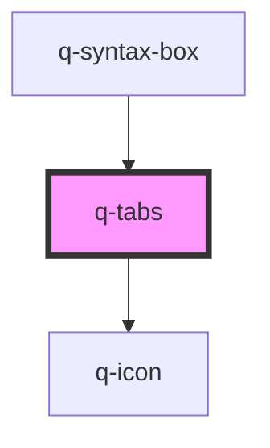

# q-tabs

## Variants

Use `underline` for the default active indicator, `enclosed` for tabs connected
to panel content, `pills` for fully rounded choices, or `button` for separate
standard-radius buttons.

Tab buttons are capped at `94px` and truncate longer labels. Consumers can
override the cap with `--q-tabs-tab-max-width` when required.

```html
<q-tabs variant="underline"></q-tabs>
<q-tabs variant="enclosed"></q-tabs>
<q-tabs variant="pills"></q-tabs>
<q-tabs variant="button"></q-tabs>
```

## Item Identity

Each tab uses its trimmed `tabId` as its identity when provided; otherwise it
uses its trimmed `value`. Keep that identity stable and unique.

Stable identities preserve tab buttons and generated DOM IDs when `items` is
replaced or reordered. Duplicate identities warn and use a safe fallback, but
cannot guarantee preservation.

<!-- Auto Generated Below -->


## Overview

Accessible tab selector for switching between consumer-owned tab panels.

## Properties

| Property      | Attribute     | Description                                                           | Type                                               | Default        |
| ------------- | ------------- | --------------------------------------------------------------------- | -------------------------------------------------- | -------------- |
| `ariaLabel`   | `aria-label`  | Accessible name for the tab list.                                     | `string`                                           | `'Sections'`   |
| `items`       | `items`       | Tab records; strings use the same text for label and value.           | `TabItemInput[] \| string`                         | `[]`           |
| `orientation` | `orientation` | Direction of the tab list and its corresponding arrow-key navigation. | `"horizontal" \| "vertical"`                       | `'horizontal'` |
| `size`        | `size`        |                                                                       | `"lg" \| "md" \| "sm"`                             | `'md'`         |
| `stretch`     | `stretch`     |                                                                       | `boolean`                                          | `false`        |
| `value`       | `value`       | Falls back to the first enabled tab when unmatched.                   | `string`                                           | `''`           |
| `variant`     | `variant`     |                                                                       | `"button" \| "enclosed" \| "pills" \| "underline"` | `'underline'`  |


## Events

| Event     | Description | Type                  |
| --------- | ----------- | --------------------- |
| `qChange` |             | `CustomEvent<string>` |


## Shadow Parts

| Part             | Description                    |
| ---------------- | ------------------------------ |
| `"selected-tab"` | Currently selected tab button. |
| `"tab"`          | Individual tab button.         |
| `"tablist"`      | Scrollable tab-list container. |


## Dependencies

### Used by

 - [q-syntax-box](../../data-display/syntax-box)

### Depends on

- [q-icon](../../media/icon)

### Graph


----------------------------------------------

*Built with [StencilJS](https://stenciljs.com/)*
