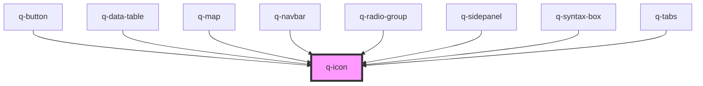

# q-icon

`q-icon` resolves trusted compile-time definitions before any URL-based source.
Applications can register exactly the icons they use and turn off every network
fallback before WebQuark components are defined:

```ts
import { Bell, CircleAlert } from '@lucide/icons';
import { configureQIcons, registerQIcons } from '@webquark/browser';
import { defineCustomElements } from '@webquark/browser/loader';

registerQIcons({
  bell: Bell,
  'circle-alert': CircleAlert,
});
configureQIcons({ strict: true });
defineCustomElements();
```

`registerQIcons()` validates the complete map and atomically replaces the
previous registry. Use one app-owned manifest per application. Registered icons
and the `definition` property render synchronously as SVG nodes. They never use
`fetch()`, `innerHTML`, DOM parsing, or sanitization.

With `strict: true`, an unknown name renders the built-in fallback and cannot
resolve a Lucide CDN, Font Awesome CDN, local path, or custom URL. Configure
strict mode before defining or bootstrapping components. The default remains
`strict: false` for backwards compatibility with existing consumers.


## Supported SVG and asset URLs

Fetched XML and registered data share a strict element/attribute/resource allowlist.
Paths, groups, masks, clip paths, gradients and local symbol references are supported;
references must resolve within the icon. Malformed XML, namespaces outside SVG/xlink,
active content, inline styles, external resources, cycles and exceeded budgets are
rejected through the existing fallback. There is no regex recovery. Without native
browser XML parsing, fetched inline SVG fails closed; registered data still renders.

Registered child-node attributes may include the own enumerable string `key` metadata supplied by `@lucide/icons`. It is discarded before SVG validation/rendering and still counts against attribute and UTF-8 byte budgets. Function/accessor metadata is rejected. This exception does not apply to root SVG attributes or fetched XML: `key` remains unsupported there, and all emitted SVG attributes use the strict allowlist.

All IDs, including a root SVG ID, must be nonempty, valid and unique. Root IDs are
retained; local references may target supported child elements, never the SVG root.

Limits: 512 child elements, depth 16, 64 attributes per element, 64 KiB per attribute,
128 KiB accumulated attribute values/fetched UTF-8 response bytes, and 4096 expanded
reference nodes at depth 32. Streaming SVG responses are required to enforce the cap.

Image classification uses the pathname and preserves query/fragment: for example,
`library="local" name="check-preview.png?v=2#preview"`. Extensionless local names
infer .svg before the suffix. HTTP(S), file/blob assets, relative paths and SVG image
data URLs follow browser loading permissions; other schemes are rejected.

<!-- Auto Generated Below -->


## Overview

Synchronous registered icon renderer with optional backwards-compatible URL loading.

## Properties

| Property         | Attribute         | Description                                                                                                           | Type                                                                    | Default            |
| ---------------- | ----------------- | --------------------------------------------------------------------------------------------------------------------- | ----------------------------------------------------------------------- | ------------------ |
| `color`          | `color`           |                                                                                                                       | `"currentColor" \| string & {}`                                         | `'currentColor'`   |
| `definition`     | --                | Trusted compile-time icon data. Takes precedence over `name` and never performs I/O.                                  | `QIconDefinition`                                                       | `undefined`        |
| `fetchTimeout`   | `fetch-timeout`   | SVG fetch timeout in milliseconds.                                                                                    | `number`                                                                | `8000`             |
| `label`          | `label`           | Meaningful icons require a label; unlabeled icons are hidden from assistive technology.                               | `string`                                                                | `undefined`        |
| `lib`            | `lib`             | <span style="color:red">**[DEPRECATED]**</span> Use library. Used only when library is unset.<br/><br/>               | `"font-awesome" \| "fontawesome" \| "local" \| "lucide" \| string & {}` | `'lucide'`         |
| `libVersion`     | `lib-version`     | <span style="color:red">**[DEPRECATED]**</span> Use libraryVersion. Used only when libraryVersion is unset.<br/><br/> | `string`                                                                | `undefined`        |
| `library`        | `library`         | Supports built-in libraries, local assets, and custom URL templates.                                                  | `"font-awesome" \| "fontawesome" \| "local" \| "lucide" \| string & {}` | `undefined`        |
| `libraryVersion` | `library-version` | Overrides the version of built-in remote libraries.                                                                   | `string`                                                                | `undefined`        |
| `localPath`      | `local-path`      | Base path used when `library="local"`.                                                                                | `string`                                                                | `'/assets/icons/'` |
| `name`           | `name`            | Icon name or local asset filename.                                                                                    | `string`                                                                | `undefined`        |
| `size`           | `size`            | Accepts a preset, pixel number, or CSS size.                                                                          | `"lg" \| "md" \| "sm" \| number \| string & {}`                         | `'md'`             |


## Shadow Parts

| Part         | Description                                               |
| ------------ | --------------------------------------------------------- |
| `"fallback"` | Error fallback shown when an icon cannot load.            |
| `"image"`    | Native image used for binary icon assets.                 |
| `"svg"`      | Container for registered or sanitized inline SVG content. |


## Dependencies

### Used by

 - [q-button](../../actions/button)
 - [q-data-table](../../data-display/data-table)
 - [q-map](../../data-display/map)
 - [q-navbar](../../layout/navbar)
 - [q-radio-group](../../inputs/radio-group)
 - [q-sidepanel](../../layout/sidepanel)
 - [q-syntax-box](../../data-display/syntax-box)
 - [q-tabs](../../layout/tabs)

### Graph


----------------------------------------------

*Built with [StencilJS](https://stenciljs.com/)*
