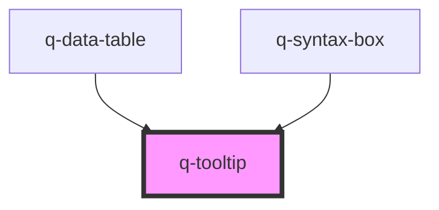

# q-tooltip

<!-- Auto Generated Below -->

## Overview

Non-interactive tooltip attached to its immediate parent element.

## Properties

| Property   | Attribute  | Description                           | Type                                     | Default     |
| ---------- | ---------- | ------------------------------------- | ---------------------------------------- | ----------- |
| `content`  | `content`  |                                       | `string`                                 | `undefined` |
| `delay`    | `delay`    | Delay in milliseconds before showing. | `number`                                 | `200`       |
| `position` | `position` |                                       | `"bottom" \| "left" \| "right" \| "top"` | `'top'`     |

## Slots

| Slot | Description                                          |
| ---- | ---------------------------------------------------- |
|      | Tooltip content used when `content` is not supplied. |

## Dependencies

### Used by

 - [q-data-table](../../data-display/data-table)
 - [q-syntax-box](../../data-display/syntax-box)

### Graph

----------------------------------------------

*Built with [StencilJS](https://stenciljs.com/)*
